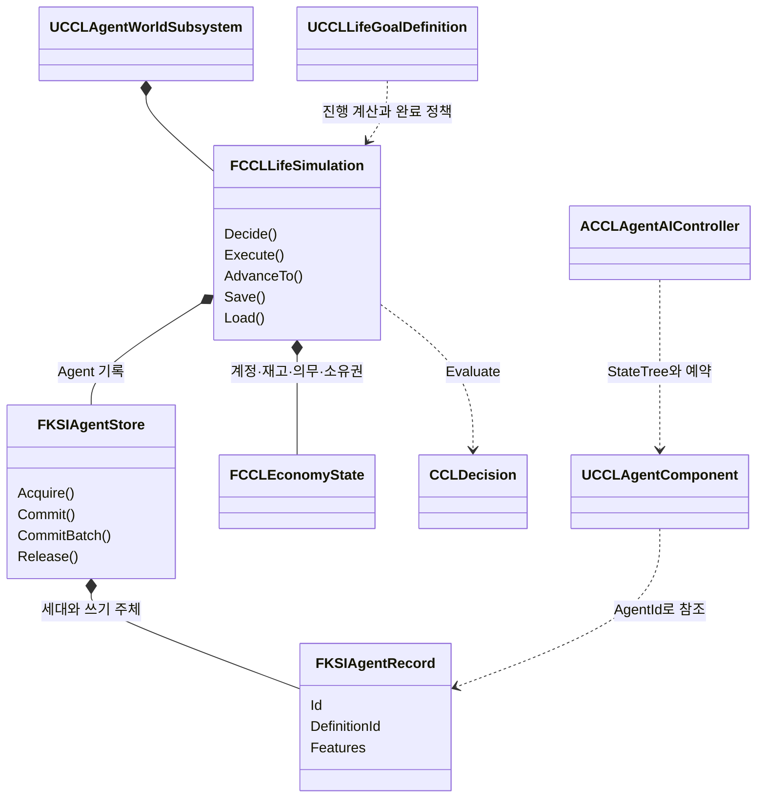

# 개인의 삶이 누적되는 Agent

같은 직업의 Agent도 다른 목표·생활 기반·경험·관계를 가지고 시작하고, 실행 결과가 실제 자원과 세계를 바꿔 다음 선택의 원인이 된다. 상인 8명의 30일 시험과 실제 마을 실행으로 이 계약을 검증했다. 이 문서는 [결정 18](decisions/0018-agent-lives-from-resources.md)의 구현 계약, 구현 경계, 검증 기록, 현재 제한을 소유한다.

공통 세계 시간, 생물 개체군과 노화·성장으로 확장하는 계획은 [EnvironmentPlan](EnvironmentPlan.md)이 소유한다. 선택 생애 Feature의 나이·수명·자연 노화 보호와 검증 결과는 [생태계·생애 구현](EnvironmentEcology/AgentLife.md#agent-생애-연결과-실행-근거)이 소유한다. 이 문서의 초기 구현 범위와 확장 계획의 완료 상태는 구분한다.

## 데이터와 소유권

개인 특성, 개인의 삶, 경험과 관계, 현재 상태는 선택 가능한 Feature다. Definition은 불변 설정, Record는 지속 상태, Processor는 실행을 소유한다. Feature Registry는 태그·구조체 타입·버전·의존성·Migration을 검증한다. 잘못된 타입이나 미래 버전은 조용히 기본값으로 바꾸지 않는다.

기본 성격은 위험 감수·공격성·호기심·사회성·자기 통제·공감성의 6개, 가치관은 물질적 이익·의무·타인 복지의 3개다. 내부 범위는 0-1, 표시 범위는 0-100이다. 성격은 초기 버전에서 고정한다. 공감은 타인의 고통에 대한 반응이고 타인 복지는 도움의 결과에 부여하는 가치다. 새로운 축에는 기존 축으로 재현할 수 없는 행동 차이 시험이 필요하다.

생활 상태는 직업·역할·거주지·일터·사회 연결·숙련·장기 목표를 포함한다. 가족·동료 같은 연결 종류와 신뢰·호감·원한 같은 평가는 서로 독립적이다. 출산·혼인·노화는 이 계약의 초기 구현 범위에 포함하지 않는다.

계정만 돈을, 인벤토리만 물품을 소유한다. Agent는 그 식별자를 참조한다. 부채 잔액은 채무자·채권자가 공유하는 단일 의무 레코드에 둔다. 공간의 소유권과 사용 권한은 구분한다. 플레이어도 동일한 자원 계약을 사용하며 기존 저장 금화는 계정으로 변환한다.

| 계층 | 실제 데이터 | 확인 위치 |
|---|---|---|
| 개인 특성 | 위험 감수·공격성·호기심·사회성·자기 통제·공감성, 물질적 이익·의무·타인 복지 | `FCCLAgentTraits::Axes` |
| 개인의 삶 | 직업·역할·집·일터·사회 연결·숙련·장기 목표 | `FCCLLifeState` |
| 실제 자원 | 계정·인벤토리·소유권·의무 ID, 정수 잔액과 부채 | `FCCLAgentResourceLinks`, `FCCLEconomyState` |
| 경험과 관계 | 관측한 사건·상대, 기억·믿음·증거, 신뢰·호감·원한 | `FCCLAgentExperience` |
| 현재 상태 | 욕구 긴급도·감정 강도와 감쇠, 부상, 단기 의도 | `FCCLAgentNeeds`, `FKSIPersistentIntent` |
| 결과 설명 | 요청 ID·기회·실행 시각·성공 여부·실패 이유·선택 점수 기여 | `FCCLLifeExecutionReceipt` |

## 판단과 실행

판단 커널은 UObject·Actor·Mass에 의존하지 않는 입력 스냅샷을 읽는다. 알고 있는 기회와 실제 능력으로 후보를 만들고 성향·욕구·관계·목표의 점수 기여를 기록한다. StateTree는 선택된 의도를 수행하고 실패를 복구한다. 별도의 인생 목표를 선택하지 않는다.

장기 목표의 진행은 잔액·실제 상환·공급·숙련·시설 상태에서 계산한다. 행동 선택만으로 진행하지 않는다. 급한 욕구는 단기 의도를 바꿀 수 있지만 장기 목표를 삭제하지 않는다. 실패한 실행은 이익·욕구 충족·성공 경험을 적용하지 않는다.

WorldEvent의 실제 신원과 Agent가 지각한 Observation은 구분한다. 관측이 기억과 믿음을 갱신하며 같은 증거의 재전달을 독립적인 증거로 세지 않는다. 관측하지 못한 상대의 신원이나 비공개 기회를 판단에 전달하지 않는다.

서버는 거래 직전에 잔액·재고·공간·권한·만료·제안 조건을 재검사한다. 요청 식별자로 재실행을 막고 돈과 물품을 원자적으로 이전한다. 생산·소비·이전·손실은 원장에 기록한다. 시설 개선은 작성된 단계와 비용만 사용한다.

## 수명과 저장

안정적인 ID로 Agent·계정·인벤토리·목표·사건을 참조한다. Record 핸들은 세대를 포함하고 교체 시 이전 핸들을 무효화한다. 채널마다 쓰기 주체는 하나다. Actor가 사라져도 지속 상태와 시간은 남는다. 이동 경로·Ability·예약은 복원 시 다시 계산한다.

저장과 Actor/Mass 이전은 진행 중인 실행을 정지하고 미반영 결과를 수집한 뒤 동일 시점의 스냅샷을 검증한다. 복원 검증 실패 시 기존 상태를 유지한다. 간략 실행기가 없는 행동을 자동 성공 처리하지 않는다. 게임을 종료한 동안의 현실 시간은 자동으로 진행하지 않는다.

## 기존 기능과 통합

무기는 ItemDefinition·Fragment·개별 상태·행동 집합을 공유하고 근접·투사체 실행기를 연결한다. 플레이어·NPC·적은 공통 Action/GAS 경로를 사용한다. 자원·방어·피해 정책은 공통 실행과 분리한다.

지도는 지역·표식 데이터를 공유하되 관찰자별 공개 정책을 적용한다. 생활 상태 전체를 클라이언트에 복제하지 않는다. 연출은 카메라·UI·음향·VFX의 소유 핸들을 관리하고 중단 시 복구한다.

실제 마을은 Actor 8명으로 구성한다. Mass는 별도의 작은 시험에서 같은 입력의 판단 결과와 상태 이전을 검증한다. Mass의 이동·전투·GAS·저장 호환을 자동으로 가정하지 않는다.

## 검증 계약

동일 상인 Definition을 사용하는 8명의 작성된 초기 조건과 Seed로 30일 시험을 수행한다. 공급 부족·도움 요청·거래 실패를 정해진 시점에 발생시킨다. 매일 자산·재고·부채·목표·관계·사건과 판단 점수 기여를 기록한다. 무작위 보너스나 손실로 개체 차이를 만들지 않는다.

성격만, 경험·관계만, 자원만 바꾸는 대조 시험으로 선택 차이의 원인을 검증한다. 실행 실패·재접촉·중간 저장 재개·Actor 비활성화를 검사한다. 같은 입력과 Seed의 커널·간략 실행은 재현되어야 한다. Actor 물리·이동은 비트 단위 일치 대신 자원 일관성과 실행 계약을 검증한다.

구현 순서는 기반·저장, 공통 행동·전투, 단일 Agent 순환, 생활·거래·목표, 경험 반영, 마을·지도·연출, 장기·Mass·네트워크 검증이다. 각 작업 묶음의 최종 변경 상태에서 생성 BAT, Editor 빌드, 실행 검사와 코드 검토를 수행한다.

## 구현과 확장 경계

아래는 주요 클래스의 책임 관계다. 이름은 현재 코드 기준이다.

Agent Record는 Actor를 참조하지 않는다. `UCCLAgentComponent`는 지속 기록의 Actor 표현이며 `AgentId`만 가진다. 생활·사회 기능이 필요 없는 적은 성격·욕구·경험만 조합할 수 있다. Mass 실험은 같은 판단 함수를 호출하고 의도·실행권만 Fragment로 옮기며, 인벤토리·생활 기록을 Mass Fragment에 복제하지 않는다.

`Source/CCL/Agents/`의 `KSIAgentTypes`는 선택적 Feature, 타입·버전·의존성·Migration과 ID·세대·실행권을 구현한다. `CCLAgentFeatures`는 성격·생활·욕구·기억을, `CCLAgentSnapshot`은 실행권 수집 이후 저장을 담당한다. 구조체 인스턴스는 `FInstancedStruct`다. `CCLAgentTraitsCustomization`은 기본 성격과 가치관을 0-100으로 편집하고 내부에는 0-1을 쓴다. 에디터 Details의 수동 조작은 미확인이다.

`FCCLLifeSimulation`이 기회 조회·판단 입력 생성·결과 확정·시간·목표 평가를 묶는다. 독립 `CCLDecision::Evaluate`는 값 입력만 읽는다. `ACCLAgentAIController`의 StateTree는 선택, 이동, 예약, 수행과 실패 복구를 실행한다. `UCCLLifeGoalDefinition`은 진행 계산기와 완료 정책을 교체한다. 새 활동은 `RegisterActivity`에 Build·Apply 처리기를 등록하며, 간략 실행 지원 여부를 별도로 선언한다. 미지원 간략 실행은 실패한다.

`DA_MerchantLifeScenario`의 동일 상인 Definition을 사용하는 8명이 실제 마을에서 생활한다. 기존 퀘스트 담당자도 생활 의도를 수행한다. 공급처 발견, 작업, 판매·구매, 식사·휴식, 도움, 부채 상환과 정의된 시설 개선을 연결했다. 보관 시설은 개선 수준에 따라 용량과 큐브 외형이 바뀐다. Actor가 언로드되면 기록을 유지하고 지원된 간략 실행으로 전환한다.

`CCLEconomy`의 계정·재고·의무·소유권·영수증이 자원의 원본이다. 실행은 거래와 관련 Agent 상태를 검증한 뒤 함께 게시한다. 실패는 성공 보상과 욕구 충족을 적용하지 않는다. 거래·도움의 상대도 경험을 받으며, 같은 시간 구간의 후속 갱신이 그 경험을 덮어쓰지 않는다. 재고·능력·권한을 확인하고, 판매자의 비공개 재고는 실행 시 재검사한다.

플레이어 금화는 `UCCLAccountComponent`가 공통 계정으로 연결한다. 보상은 유한한 금고에서 이전하고, 포션 구매는 실제 상점 재고와 기존 아이템 인벤토리를 잇는 거래 어댑터다. 영수증에는 외부 아이템의 목적지와 정의가 남는다. 계정의 초기 배분은 `OpeningBalance`로 추적한다. 체크포인트 범위와 기존 금화 변환은 [SessionFoundation](SessionFoundation.md#이번-저장-정책)을 따른다.

`UKSIActionComponent`는 소스 ID별 GAS 행동을 등록·해제하고 기존 근접 입력도 같은 진입점으로 전달한다. 무기 Fragment의 ActionSet과 손별 태그가 실행을 선택한다. `ACCLProjectile`은 서버에서 이동·충돌하며 발사 당시 피해·효과·팀을 보존한다. 발사자 Actor가 제거되어도 적중을 처리한다. `KSIHit::Apply`는 근접과 투사체의 정책·효과 적용을 공유한다. 장전은 완료 시 탄약을 옮기며 아이템 GUID별 탄창을 저장한다. 공용 전투·행동과 CCL 정책의 모듈 경계는 [Framework 단계 3](FrameworkPlan.md#단계-3-구현과-검증)을 따른다.

전투 적은 생활·계정 Feature 없이 성격·욕구·기억을 사용하고, 공통 판단 커널로 공격 지속과 후퇴를 평가한다. 생활 NPC의 실제 피격도 부상·공포·기억으로 이어진다. 인지하지 못한 공격자의 ID는 기억에 넣지 않는다. 저장한 부상은 Actor 체력으로 복원한다. 구체적인 동물 행동과 NPC의 무기 전술은 등록할 콘텐츠다.

`UKSIMapSubsystem`과 `UKSIMapMarkerComponent`는 미니맵·전체맵에 지역과 관찰자별 표식을 공급한다. 기본 지형은 레벨의 충돌 StaticMesh 경계 투영이며, `SetRegion`으로 작성한 지역 정의를 쓸 수 있다. 표식 공개는 거리·시야를 확인한다. `UCCLCinematicSubsystem`은 마을 진입·승리의 카메라 이동, UI 숨김, 제목·레터박스, 음향과 광원 연출을 소유 핸들로 정리한다. 취소·완료·소유 Pawn 교체 시 복구한다.

`CCLMassAgentBridge`는 실제 `FMassEntityManager`의 Entity를 만든다. Fragment에는 의도와 실행권만 두고 동적 Feature는 공통 Store가 유지한다. 이동 전에는 미반영 의도를 Commit하고 실행권을 반환한다. 실패하면 Entity를 남겨 복구할 수 있다. UE 5.9 소스의 `<Engine>/Source/Runtime/MassEntity/Public/MassEntityManager.h`에 있는 Fragment의 복사 가능 타입 검사에 맞춘 구성이다. Mass 이동·전투·GAS 자동 호환은 제공하지 않는다.

## 직접 확인

생활 시뮬레이션, 총기 투사체, 미니맵·전체맵, 마을 진입·승리 연출을 같은 Campaign에서 확인한다. 아래 조작은 2026-10-08 통합 당시 기준이다.

1. `CCL.uproject`의 `/Game/Maps/Campaign`을 실행한다. 마을 진입 연출이 끝나면 카메라와 HUD가 돌아온다. `Esc`로 연출을 건너뛸 수 있다.
2. 주민 가까이에서 `T`로 대화한다. 생활 NPC는 현재 활동·목표·진행과 자신의 잔액을 대사로 알린다. 퀘스트 담당자는 기존 퀘스트·상점 기능을 유지하며 생활 행동도 수행한다.
3. 오른쪽 위 미니맵을 확인하고 `M`으로 전체맵을 연다. 파란색은 나, 노란색은 NPC, 빨간색은 보이는 적이다. `Esc`로 닫는다.
4. 마을 시작 지점 주변의 Pistol·Rifle·탄약을 `E`로 수집한다. `I`에서 무기를 장착한다.
5. `R`로 장전한다. Rifle은 왼쪽 클릭으로 발사하고 오른쪽 클릭을 유지하면 조준한다. 한손 장비는 장착한 손의 입력을 사용한다. 탄환은 서버에서 이동·충돌한다.
6. 살아 있고 행동 중이 아닐 때 `Esc` 메뉴에서 저장한다. 재개 후 주민의 목표·재산·부채·기억·관계와 탄창 상태를 확인한다. 호스트 개인 체크포인트 정책은 [SessionFoundation](SessionFoundation.md#이번-저장-정책)을 따른다.

주민의 작업은 이동 후 일정 시간 수행하므로 시작 직후에는 실행 중인 모습이 먼저 보인다. 보관 시설의 개선은 실제 비용을 지불할 수 있고 개선 행동을 선택했을 때만 일어난다. 30일 시험은 별도의 간략 실행 검증이며 실제 마을을 즉시 30일 돌리는 단축키는 없다. 30일 결과 파일은 날짜별 자원과 관계를 기록하고, `execution=` 줄의 점수 기여를 보면 선택과 결과를 이어서 확인할 수 있다.

같은 상인 Definition을 사용하는 초기 조건은 `/Game/Progression/DA_MerchantLifeScenario`에 있다. 최종 마을 아트, 총기 애니메이션·총성, 동물별 행동, 탐험 안개와 손님의 개인 저장은 이 확인 범위에 없다. 세부 제한은 [현재 제한](#현재-제한)을 따른다.

## 검증

아래는 2026-10-08 기록이다. 검증 설치본은 UE 5.9.0 소스 엔진이었다. 실행 순서와 증거 기록은 `ccl8-verify` 스킬을 따른다. 아래 경로는 저장소 기준이며 로그·캡처는 Git에 넣지 않는다.

| 검사 | 확인한 계약 | 로컬 근거 |
|---|---|---|
| 전체 자동화 | 12개 통과: Feature 수명·Migration, 관측, 거래 원자성·중복 요청, 원인별 선택 차이, 실행 실패, 선택적 기능, 예약, 실제 Mass 이전과 기존 UI·장비 검사 | |
| 30일 상인 시험 | 자원 보존·계정별 원장 대사, 같은 입력·Seed의 새 실행 재현, 15일 저장 후 30일 결과 재현 | 위 자동화의 `CCL.Agent.ThirtyDays` |
| 투사체 | 발사자 제거 후 적중, 단일 적중·제거, 탄약·저장 | |
| 실제 마을 | 이동·실행·피격 기억·부상 복원, 적 기록과 주민 생성의 분리, 언로드 후 시간 진행 | |
| 전투 네트워크 | Dedicated 지연·손실 환경에서 공통 Action 입력, 공격·가드·패링·회피·개별 재스폰 | |
| NPC 거래·보상 | Listen 지연·손실 환경에서 포션 재고·잔액·가방 한계, 퀘스트·중복 보상 거부·개별 재스폰 | |
| 체크포인트 | 별도 프로세스 저장·재개, 장비·금화·퀘스트·처치 상태 | |
| 세션 네트워크 | 공개 주민 복제·서버 전용 생활 상태, 계정 소유자 전용 복제, 손님의 호스트 저장 거부 | |
| 지도·연출 | 실제 1280×720·1920×1080, 지형·표식·좌표, 완료·취소·오래된 핸들의 복구 | |

30일 보고서는 매일 계정·재고·부채·목표·관계와 사건을 기록한다. 각 실행 영수증은 선택 당시 점수 기여도와 실행 결과를 연결한다. 성향 차이에 임의의 자산 보너스를 주지 않고 실제 생산·소비·이전으로 잔액과 물량을 설명한다. 이 시험의 실행 시간은 자동화 보고서에 기록되며 대규모 군중 성능 보장은 아니다.

## 현재 제한

마을·시설·탄환·연출은 작동 확인용 표현이다. 총구 소켓에 맞춘 발사 애니메이션·총성·궤적 효과와 최종 아트는 별도 콘텐츠 작업이다. 지도에는 탐험 안개 저장이나 지형 텍스처 베이크가 없다. 기억·믿음에는 크기 제한이 있고, 장기 운영용 사건 압축·원장 보관 정책은 확정하지 않았다.

플레이어와 NPC는 거래 계약을 공유하지만 아이템 인벤토리의 표현은 각각 어댑터와 자원 재고다. 모든 종류의 NPC 장비·아이템 거래 UI가 있는 것은 아니다. 2026-10-08 검사의 로컬 체크포인트는 호스트 개인 상태만 복원했고 손님의 재접속 신원·개인 인벤토리 영속성은 없었다. 원격 플레이어의 서버 발급 신원과 세계 저장의 플레이어 프로필은 2026-10-11에 추가됐고 [SessionFoundation](SessionFoundation.md)이 소유한다([결정 21](decisions/0021-server-issued-player-identity.md)). 새 Windows 배포 패키지는 2026-10-08 검사에 포함하지 않았다.
