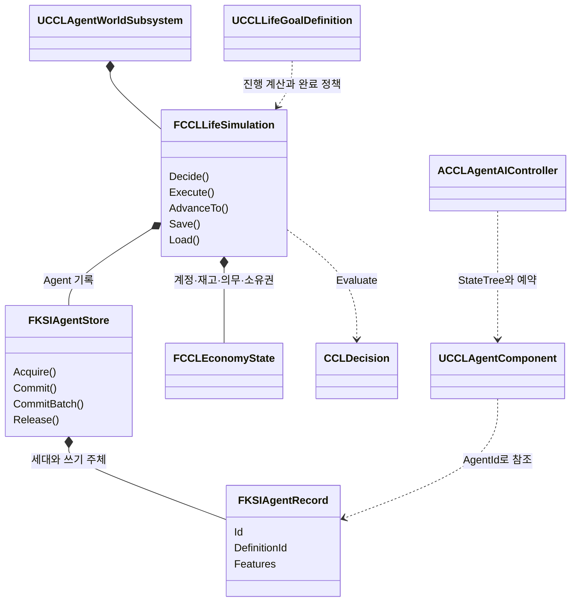

# Agent 구현 경계

Agent 코드를 고치거나 새 활동, 무기, 지도, 연출을 연결할 때 읽는다. 이름은 현재 코드 기준이다.

## 구조

Agent Record는 Actor를 참조하지 않는다. `UCCLAgentComponent`는 지속 기록의 Actor 표현이며 `AgentId`만 가진다. 생활·사회 기능이 필요 없는 적은 성격·욕구·경험만 조합할 수 있다. Mass 실험은 같은 판단 함수를 호출하고 의도·실행권만 Fragment로 옮기며, 인벤토리·생활 기록을 Mass Fragment에 복제하지 않는다.

`Source/CCL/Agents/`의 `KSIAgentTypes`는 선택적 Feature, 타입·버전·의존성·Migration과 ID·세대·실행권을 구현한다. `CCLAgentFeatures`는 성격·생활·욕구·기억을, `CCLAgentSnapshot`은 실행권 수집 이후 저장을 담당한다. 구조체 인스턴스는 `FInstancedStruct`다. `CCLAgentTraitsCustomization`은 기본 성격과 가치관을 0-100으로 편집하고 내부에는 0-1을 쓴다. 에디터 Details의 수동 조작은 미확인이다.

## 판단과 경제

`FCCLLifeSimulation`이 기회 조회·판단 입력 생성·결과 확정·시간·목표 평가를 묶는다. 독립 `CCLDecision::Evaluate`는 값 입력만 읽는다. `ACCLAgentAIController`의 StateTree는 선택, 이동, 예약, 수행과 실패 복구를 실행한다. `UCCLLifeGoalDefinition`은 진행 계산기와 완료 정책을 교체한다. 새 활동은 `RegisterActivity`에 Build·Apply 처리기를 등록하며, 간략 실행 지원 여부를 별도로 선언한다. 미지원 간략 실행은 실패한다.

`DA_MerchantLifeScenario`의 동일 상인 Definition을 사용하는 8명이 실제 마을에서 생활한다. 기존 퀘스트 담당자도 생활 의도를 수행한다. 공급처 발견, 작업, 판매·구매, 식사·휴식, 도움, 부채 상환과 정의된 시설 개선을 연결했다. 보관 시설은 개선 수준에 따라 용량과 큐브 외형이 바뀐다. Actor가 언로드되면 기록을 유지하고 지원된 간략 실행으로 전환한다.

`CCLEconomy`의 계정·재고·의무·소유권·영수증이 자원의 원본이다. 실행은 거래와 관련 Agent 상태를 검증한 뒤 함께 게시한다. 실패는 성공 보상과 욕구 충족을 적용하지 않는다. 거래·도움의 상대도 경험을 받으며, 같은 시간 구간의 후속 갱신이 그 경험을 덮어쓰지 않는다. 재고·능력·권한을 확인하고, 판매자의 비공개 재고는 실행 시 재검사한다.

플레이어 금화는 `UCCLAccountComponent`가 공통 계정으로 연결한다. 보상은 유한한 금고에서 이전하고, 포션 구매는 실제 상점 재고와 기존 아이템 인벤토리를 잇는 거래 어댑터다. 영수증에는 외부 아이템의 목적지와 정의가 남는다. 계정의 초기 배분은 `OpeningBalance`로 추적한다. 체크포인트 범위와 기존 금화 변환은 [SessionFoundation](../SessionFoundation/Checkpoint.md#저장-범위)을 따른다.

## 행동, 전투, 표현

`UKSIActionComponent`는 소스 ID별 GAS 행동을 등록·해제하고 기존 근접 입력도 같은 진입점으로 전달한다. 무기 Fragment의 ActionSet과 손별 태그가 실행을 선택한다. `ACCLProjectile`은 서버에서 이동·충돌하며 발사 당시 피해·효과·팀을 보존한다. 발사자 Actor가 제거되어도 적중을 처리한다. `KSIHit::Apply`는 근접과 투사체의 정책·효과 적용을 공유한다. 장전은 완료 시 탄약을 옮기며 아이템 GUID별 탄창을 저장한다. 공용 전투·행동과 CCL 정책의 모듈 경계는 [Framework 단계 3](../FrameworkPlan/Stage3.md#단계-3-구현과-검증)을 따른다.

전투 적은 생활·계정 Feature 없이 성격·욕구·기억을 사용하고, 공통 판단 커널로 공격 지속과 후퇴를 평가한다. 생활 NPC의 실제 피격도 부상·공포·기억으로 이어진다. 인지하지 못한 공격자의 ID는 기억에 넣지 않는다. 저장한 부상은 Actor 체력으로 복원한다. 구체적인 동물 행동과 NPC의 무기 전술은 등록할 콘텐츠다.

`UKSIMapSubsystem`과 `UKSIMapMarkerComponent`는 미니맵·전체맵에 지역과 관찰자별 표식을 공급한다. 기본 지형은 레벨의 충돌 StaticMesh 경계 투영이며, `SetRegion`으로 작성한 지역 정의를 쓸 수 있다. 표식 공개는 거리·시야를 확인한다. `UCCLCinematicSubsystem`은 마을 진입·승리의 카메라 이동, UI 숨김, 제목·레터박스, 음향과 광원 연출을 소유 핸들로 정리한다. 취소·완료·소유 Pawn 교체 시 복구한다.

`CCLMassAgentBridge`는 실제 `FMassEntityManager`의 Entity를 만든다. Fragment에는 의도와 실행권만 두고 동적 Feature는 공통 Store가 유지한다. 이동 전에는 미반영 의도를 Commit하고 실행권을 반환한다. 실패하면 Entity를 남겨 복구할 수 있다. UE 5.9 소스의 `<Engine>/Source/Runtime/MassEntity/Public/MassEntityManager.h`에 있는 Fragment의 복사 가능 타입 검사에 맞춘 구성이다. Mass 이동·전투·GAS 자동 호환은 제공하지 않는다.
