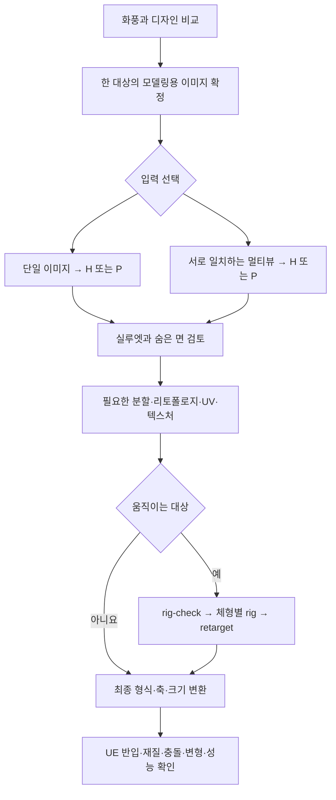

# Tripo 개발자 문서 전체 분석

Tripo는 콘셉트 이미지에서 3D 메시를 만들고, 텍스처·면 수·UV를 조정한 뒤 리깅과 프리셋 애니메이션까지 연결할 수 있다. Codex 플러그인으로 이 과정을 지시할 수 있지만, 생성된 파일의 UE 반입 품질은 별도 검증이 필요하다. ccl8에서는 **콘셉트 확정 → 모델링용 이미지 → 3D 초안 → 형상 검토 → 필요한 후처리 → UE 검증** 순서를 제안한다. [이미지 생성 입력](https://developers.tripo3d.ai/ko/docs/generation-image-to-model/standard), [Codex 플러그인](https://developers.tripo3d.ai/ko/docs/codex-plugin)

2026-11-18에 [한국어 개발자 문서](https://developers.tripo3d.ai/ko/docs)의 목차 44개 항목을 모두 읽었다. H/P 시리즈 하위 페이지, 펼친 애니메이션 목록, 빠른 시작의 시나리오 6개와 기능별 예제 8개를 포함한다. 추가로 공식 가격 페이지의 H·P·스플랫 탭을 대조했다. 원문별 확인 상태와 분석 위치는 [전체 출처 목록](Tripo-2026-11-18/Sources.md)에 있다.

이 문서는 외부 도구 조사다. API 호출 성공, 비용 청구, 모델 품질, UE 5.8.3 호환성을 시험한 결과는 아니다. 문서에 적힌 기능과 조사자의 적용 제안을 구분하며, 서로 충돌하는 설명은 [불일치 목록](Tripo-2026-11-18/Sources.md#문서-불일치와-대응)에 남긴다.

## 분야별 문서

| 문서 | 다루는 범위 | 읽는 때 |
|---|---|---|
| [설치·SDK·CLI·플러그인](Tripo-2026-11-18/Tools.md) | 시작 안내, SDK 5종, 편집기 플러그인, ComfyUI, CLI, Codex | 실행 수단과 버전을 선택할 때 |
| [이미지·3D 생성](Tripo-2026-11-18/Generation.md) | H/P, 단일 이미지, 멀티뷰, 이미지 편집, splat | 콘셉트를 모델 입력으로 만들 때 |
| [메시·텍스처·파일 변환](Tripo-2026-11-18/Processing.md) | 가져오기, 텍스처, 분할, 보완, 리토폴로지, UV, 변환 | 생성 모델을 다듬고 내보낼 때 |
| [리깅·애니메이션](Tripo-2026-11-18/Animation.md) | 리그 검사, 버전·체형, 프리셋 전체 분류 | 주인공·NPC·동물 보스를 움직일 때 |
| [운영·요금·오류·마이그레이션](Tripo-2026-11-18/Operations.md) | 인증, 작업, 업로드, 정산, 제한, Webhook, v3 전환 | 자동화와 비용 회수를 설계할 때 |
| [ccl8 제작 적용안](Tripo-2026-11-18/ProductionWorkflow.md) | 입력 이미지 기준, 후보 비교, UE 검증, 비용 예시 | 실제 첫 시험의 범위를 정할 때 |
| [전체 출처와 불일치](Tripo-2026-11-18/Sources.md) | 44개 읽기 목록, 숨은 탭, 상충 설명, 미확인 | 조사 누락과 근거를 확인할 때 |
| [조회 근거 JSON](Tripo-2026-11-18/coverage.json) | URL, HTTP 상태, 원문 길이, 수집 식별자 | 이후 문서 조사 범위를 비교할 때 |

## 선택에 영향을 주는 결과

| 항목 | 확인한 문서 내용 | 적용 판단 |
|---|---|---|
| H와 P | H3.1은 고밀도 형상, P2는 면 수 제어와 쿼드 생성에 초점 | 화풍은 입력 이미지에서 비교한다. 시리즈 선택을 화풍 선택으로 취급하지 않는다 |
| 필수 모델 버전 | 세 가지 3D 생성 API는 `model` 필수 | 지오메트리·텍스처·리그·리토폴로지 버전을 각각 기록한다 |
| 기본값 차이 | REST 생성은 PBR 기본 true, CLI 0.9는 요청하지 않으면 PBR 미생성 | Codex 요청에 PBR 요구를 적고 실행 계획을 확인한다 |
| 텍스처 기본값 변화 | 2026-11부터 대부분의 생성은 텍스처 v3.5로 처리. 명시 여부에 따라 `delight` 기본값도 다름 | 조명 제거 여부까지 명시한다 |
| 리깅 | API 기본은 v1.0. 휴머노이드는 v3.0, 비휴머노이드는 v2.5 안내 | 동물 보스에 휴머노이드 기본 예제를 그대로 적용하지 않는다 |
| 비용 | P2 기본 형상 100크레딧. H 이미지 형상은 20크레딧 | 저폴리라는 이유로 더 저렴하다고 가정하지 않는다 |
| 비동기 실패 | 대기 시간 초과 후에도 서버 작업은 계속될 수 있음 | 재생성 전에 기존 작업을 조회한다 |
| 출력 방향 | 생성 중 방향 변경은 후처리 오작동을 일으켜도 성공으로 보고될 수 있음 | 최종 변환에서 방향을 맞춘다 |

근거: [모델](https://developers.tripo3d.ai/ko/docs/models-and-versions), [CLI](https://developers.tripo3d.ai/ko/docs/cli), [현재 변경 공지](https://developers.tripo3d.ai/ko/docs/changelog), [리깅](https://developers.tripo3d.ai/ko/docs/animations-rig), [가격](https://developers.tripo3d.ai/ko/pricing), [생성 제약](https://developers.tripo3d.ai/ko/docs/generation-image-to-model/standard).

## 제작 흐름과 검토 지점

앞부분의 디자인 선택과 마지막 UE 검증은 ccl8 적용 제안이다. 중간의 API 연결 가능성은 각 기능 문서에 근거한다. 생성 품질을 확인한 뒤 후처리를 진행하면, 버릴 형상에 텍스처와 리깅 비용을 연속으로 쓰는 일을 줄일 수 있다.

## 현재 환경의 확인 범위

2026-11-18 로컬 확인에서 Tripo 플러그인 매니페스트 버전은 `0.2.7`이고, 두 스킬을 제공한다. Node는 `v24.21.0`이다. 현재 PowerShell의 `Get-Command tripo`는 명령을 찾지 못했다. 따라서 **플러그인 파일 존재는 확인했지만 CLI 실행·로그인·잔액·생성 준비 완료는 확인하지 않았다.**

벨레스 Fab 건축 후보 중 K01과 K02의 UE 패키지는 이 PC에 있다. 둘 다 Epic VaultCache와 별도 UE 프로젝트의 Content에서 확인했다. ccl8에서 같은 패키지 폴더를 확인한 후보는 K07이다. [Fab 로컬 확인](Tripo-2026-11-18/ProductionWorkflow.md#fab-건축-후보의-로컬-파일)

아트 방향은 [ArtDirection](../ArtDirection.md), 외부 이미지 도구 비교는 [ConceptImageToolTest](../ConceptImageToolTest.md), 설치 설정은 [AgentContextTools](../AgentContextTools.md)를 참고한다.
