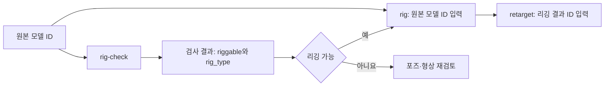

# Tripo 리깅·애니메이션 분석

주인공과 비휴머노이드 보스는 리깅 경로를 나눠야 한다. API의 리깅 기본 모델은 구형 v1.0이며, 최신 기능을 사용하려면 버전을 명시한다. 사전 검사 성공은 자동 리깅 가능 판정이고, 실제 움직임의 품질 판정은 따로 필요하다. [리깅 API](https://developers.tripo3d.ai/ko/docs/animations-rig), [조사 지도](../Tripo-2026-11-18.md)

## 검사와 작업 ID 연결

`POST /v3/animations/rig-check`는 모델 작업 ID, file_token 또는 공개 URL을 받는다. 파일은 GLB/FBX/OBJ/STL, 최대 150 MB다. 성공 작업의 output.riggable과 output.rig_type을 확인한다. 검사 자체는 무료로 안내된다. [리그 검사](https://developers.tripo3d.ai/ko/docs/animations-rig-check), [가격](https://developers.tripo3d.ai/ko/pricing)

검사 결과의 작업 ID를 rig의 모델 input으로 넣지 않는다. 검사는 모델을 리깅하지 않는다. 원본 모델 ID로 rig를 만들고, rig가 성공한 뒤 그 결과 ID를 retarget에 전달한다. [빠른 시작](https://developers.tripo3d.ai/ko/docs/quick-start)

## 체형과 리그 버전

| 리그 모델 | 문서상 범위 | 권장 적용 |
|---|---|---|
| v1.0-20240301, API 기본 | 이족 전용, preset:biped 계열 | 레거시 프리셋이 반드시 필요할 때 별도 비교 |
| v2.5-20260210 | 비휴머노이드 중심, 이족도 표에 기재 | quadruped 등 동물·다족 후보 |
| v3.0-20260909 | 휴머노이드 권장, others 추가 | 주인공·NPC의 첫 시험 |
| v2.0-20250506 | ComfyUI는 v2.5로 실행된다고 안내 | 새 요청에서는 현행 버전 직접 선택 |

rig_type은 biped/quadruped/hexapod/octopod/avian/serpentine/aquatic/others다. rig-check의 반환 목록은 others를 명시하지 않으므로 검사 결과에 항상 모든 체형이 나온다고 가정하지 않는다. 기본 rig_type은 biped다.

rig의 spec은 biped에만 적용하며 tripo/mixamo/actorcore/unity/unreal/vrm, 기본 tripo다. out_format은 glb/fbx, 기본 glb다. 파일 입력을 사용하는 자동 리깅은 변경 공지에서 GLB/FBX/OBJ/STL로 안내한다. 개별 rig의 input 표는 URL을 생략했으므로 REST 직접 호출에서는 token 또는 task_id를 우선 사용한다. [자동 리깅](https://developers.tripo3d.ai/ko/docs/animations-rig), [변경 공지](https://developers.tripo3d.ai/ko/docs/changelog)

v3가 동물 리깅도 최신 품질로 바꾸는 것은 아니다. 공지는 비휴머노이드의 품질·속도가 v2.5와 같다고 설명한다. 빠른 시작 기능 탭은 biped/others에 v3, 그 밖의 체형에 v2.5를 선택한다.

## 리타겟 요청

`POST /v3/animations/retarget`의 input은 스켈레톤이 있는 작업 ID다. 리깅 작업에 이어 실행한 텍스처·UV·분할 결과도 사용할 수 있지만, 실행 시 스켈레톤이 남았는지 판정한다. [리타겟](https://developers.tripo3d.ai/ko/docs/animations-retarget)

| 필드 | 규칙 |
|---|---|
| animation | 프리셋 하나 |
| animations | 최대 5개. animation과 동시에 사용 불가 |
| out_format | glb 또는 fbx, 기본 glb |
| export_with_geometry | REST 기본 true. ComfyUI 노드 기본 false와 다름 |
| animate_in_place | 기본 false. 이동 없는 출력이 필요하면 명시 |
| bake_animation | v3에서 무시되는 호환 필드. 새 요청에서는 생략 |

프리셋 호환성은 공식 문서끼리 일치하지 않는다. retarget 페이지는 v2/v2.5/v3를 하나의 표로 묶지만, ComfyUI 2.0은 v2.5의 접두사 없는 휴머노이드 프리셋과 v3의 quadruped/hexapod/octopod 걷기를 제출 전에 거부한다. 따라서 v3+biped+기본 인간 동작, v2.5+해당 동물 걷기부터 시험하는 방안을 제안한다. [ComfyUI 버전 검사](https://developers.tripo3d.ai/ko/docs/comfyui-nodes)

## 프리셋 목록

현행 계열의 16개 식별자는 아래와 같다. 목록 존재만으로 모든 rig_type에서 모든 프리셋이 작동한다고 해석하지 않는다.

| 대상 | 식별자 |
|---|---|
| 기본·이동 | preset:idle, preset:walk, preset:run, preset:dive, preset:climb, preset:jump, preset:turn |
| 전투·반응 | preset:slash, preset:shoot, preset:hurt, preset:fall |
| 비휴머노이드 | preset:quadruped:walk, preset:hexapod:walk, preset:octopod:walk, preset:serpentine:march, preset:aquatic:march |

v1 이족 전용 목록은 모든 값 앞에 `preset:biped:`가 붙는다. 펼쳐진 원문 표의 식별자를 분류하면 다음과 같다. 범위 표기는 원문에 실제 존재하는 연속 번호만 압축했다.

| 분류 | 접두사 뒤 식별자 |
|---|---|
| 기본 | idle, walk, run, run_upstairs, turn, jump, jump_down, jump_rope_01/02, fall, climb, dive, swim, surf, flip, sit, standing_relax, look_around, wait, swagger |
| 춤·공연 | dance_01/02/03/04/05/06, freaky, sing_01/02/03/04, cheer |
| 감정·인사 | clap, bow, greet_01/02/03/04, wave_goodbye_01/02, agree, heart_pose, hug, fold_arms, laugh_01/02, cry, sob |
| 공포·분노·좌절 | afraid, frightened, scared_01/02, angry_01/02/03, depressed, frustrated_01/02, complain_01/02, victory_celebration, defeat_02/03 |
| 일상·작업 | scratch, make_a_call_01/02, play_mobile_game, play_video_game, dig, chop, shovel, lift_heavy |
| 운동 | warm_up, press-up, cross_body_crunch, basketball_shot, crossover_dribble, dribble, pitch_baseball, golf, volleyball, football_catch, football_save, football_pass |
| 전투 | box_01/02/03, front_kick_01/02, slash, shoot, fire, cast_a_spell, hurt, hit_to_body_01/02, hit_to_head, hit_to_side, hit_to_stomach, flee_01/02 |

출처: [리타겟의 전체 프리셋 표](https://developers.tripo3d.ai/ko/docs/animations-retarget). 예를 들어 `press-up`에는 하이픈이 있고 `defeat_01`은 이 목록에 없으므로 이름을 규칙만 보고 만들어서는 안 된다.

## ccl8 캐릭터와 보스의 검증 제안

| 대상 | 먼저 시험할 연결 | 채택 전에 볼 것 |
|---|---|---|
| 주인공·인간 NPC | rig-check → v3 biped → walk | 어깨·팔꿈치·손목·무릎 변형, 발 접지, 얼굴·장비 보존 |
| 사족 동물 | rig-check → v2.5 quadruped → quadruped:walk | 앞뒤 다리 관절, 척추·목·꼬리, 몸통 관통 |
| 다족·뱀·수생 | 검사 체형과 해당 프리셋 | 다리 개수·몸통 분절과 애니메이션 대응 |
| 혼합 체형 보스 | 검사 후 others 가능성 검토 | 뿔·날개·입·추가 팔의 독립 제어 가능성 |

자동 리깅과 프리셋은 움직임을 확인하는 출발점으로 사용한다. 게임 전용 공격 타이밍, 루트 모션, 소켓, 피격 판정, 얼굴 리그, 털·천 시뮬레이션은 이 문서들에서 완성 결과를 보장하지 않는다. spec=unreal이 ccl8의 기존 Skeleton·애니메이션과 즉시 호환된다는 근거도 아직 없다.
