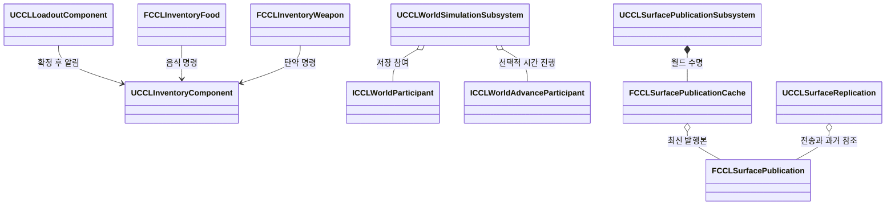

# 코드 설계 검토 후속 수정

> 아래는 2026-10-11 구현 당시의 기록이다. 후속 공용 타입·확장 상태 변경과 코드 제출 범위는 [FrameworkPlan](FrameworkPlan.md#패키지-검증과-제출-범위), 2026-10-12 패키지 검증은 [Packaging](Packaging.md#framework-분리-후-gameserver-패키지)을 따른다.

장비 변경의 알림 순서와 재진입을 보호하고, 저장 카탈로그의 이름 충돌을 거절하도록 수정했다. 음식·무기 명령과 세계 시간 진행 인터페이스를 분리했으며 표면 전송 데이터는 월드에서 공유한다. 2026-10-11 전체 코드 검토의 후속 구현이며, 실제 검증 범위는 아래 결과 표를 따른다. 구현과 실행 결과는 로컬 작업 트리 기준이며, 코드·도구 변경은 아직 제출하지 않았다.

## 변경 범위와 계약

| 대상 | 책임과 수명 | 변경 |
|---|---|---|
| Loadout | 서버 PlayerState의 장착·훈련 상태 | 명령 재진입 거절, 효과와 슬롯 확정 후 인벤토리 알림 |
| ItemCatalog | 콘텐츠 에셋의 저장 이름 해석 | 중복 이름과 빈 항목 검증, 모호한 해석 거절 |
| Inventory 기능 | 인벤토리가 소유하는 개별 상태의 실행 | 무기·음식 실행을 기능 서비스로 분리, 저장·복제 필드 유지 |
| WorldParticipant | 월드 서브시스템의 저장 참여자 | 환경 시간 진행을 선택 인터페이스로 분리 |
| Surface publication | 서버 월드의 불변 전송 데이터 | 연결 간 발행본 공유, 연결별 확인·전송 위치·과거 참조 유지 |

KSI 모듈 분리, 타입 전면 개명, 저장 형식 마이그레이션은 포함하지 않는다. Framework 관련 기존 작업은 보존한다.



## 인터페이스와 확정 순서

`Equip`, `Unequip`, `Use`, `Learn`은 변경 중 재진입을 거절한다. 장비 배치를 미리 검증한 다음 `BeginTransaction`으로 알림을 묶고 인벤토리 쓰기를 잠근다. 슬롯과 효과 핸들을 확정하고 GAS 속성 배치를 끝낸 뒤 외형을 동기화한다. 마지막으로 `Inventory.OnChanged`를 한 번 보낸다. 이 알림이 끝날 때까지 잠금을 유지한다. 저장 복원도 같은 쓰기 보호를 적용한다.

GAS의 효과 추가 콜백 자체를 숨기지는 않는다. 해당 콜백에서 들어온 Loadout 명령과 인벤토리의 공개 변경 API를 거절한다. 콜백이 ASC를 직접 변경하거나 Actor를 파괴하는 임의 동작까지 되돌리는 범용 트랜잭션은 아니다.

현재 엔진 근거는 UE 5.8.3의 `<Engine>/Plugins/Runtime/GameplayAbilities/Source/GameplayAbilities/Private/AbilitySystemComponent.cpp:1037`의 동기 적용 질의와 `GameplayEffect.cpp:4740`의 효과 추가 알림이다. `FScopedAggregatorOnDirtyBatch`는 속성 계산 알림의 배치이며 모든 GAS 콜백을 지연하는 도구가 아니다.

음식 명령은 `FCCLInventoryFood`, 탄약 명령은 `FCCLInventoryWeapon`으로 옮겼다. 호출자는 인벤토리를 명시적으로 전달한다. `UCCLInventoryComponent`의 저장 항목과 검증은 기존 `Food`, `LoadedAmmo` 필드를 유지한다. 기본 추가·소비의 음식 처리와 기능 상태 검증 연결도 남아 있으므로 완전한 장르 독립 상태 스키마로 분리한 것은 아니다.

```cpp
class FCCLInventoryWeapon
{
public:
    static bool Reload(UCCLInventoryComponent& Inventory, FGuid Id);
};

class FCCLInventoryFood
{
public:
    static bool TransferFood(UCCLInventoryComponent& Inventory,
        FGuid SourceId, int32 Count, UCCLInventoryComponent* Destination);
};
```

위 선언은 각 기능 헤더의 발췌다. `UCCLInventoryComponent::CanMutate`는 소유자의 권위와 Loadout 쓰기 잠금을 검사한다.

```cpp
bool UCCLInventoryComponent::CanMutate() const
{
    return GetOwner() && GetOwner()->HasAuthority() && !bMutationLocked;
}
```

`ICCLWorldParticipant`는 저장의 Capture/Prepare/Commit/Publish/Cancel 계약을 유지한다. 환경 시간이 필요한 구현만 `ICCLWorldAdvanceParticipant`를 함께 구현하고 별도로 등록한다. 두 기존 저장 서브시스템은 두 인터페이스를 모두 구현한다. 각 목록은 같은 기존 우선순위로 정렬하며 모든 Commit 뒤에 Publish한다. 저장 구간 검증 문맥에 있는 Surface·Life 참조는 그대로 유지한다.

카탈로그는 같은 종류의 항목 안에서 이름을 유일하게 요구한다. 같은 객체의 중복 등록과 빈 참조도 검증 오류다. 아이템과 스킬은 별도 이름 영역을 유지한다. 에디터 Data Validation과 런타임 `Get`에서 전체 카탈로그를 검증하며, 직접 `FindItem`·`FindSkill`을 호출해도 중복 이름을 첫 항목으로 해석하지 않는다. 기존 이름 기반 저장 형식은 바꾸지 않는다.

## 표면 발행본의 수명과 비용

`UCCLSurfacePublicationSubsystem::Acquire`의 첫 요청은 그 서버 프레임의 표면 바이트와 지형 완료 번호를 고정한다. 같은 프레임의 다음 요청은 그 객체를 재사용한다. 동일 프레임에서 뒤늦게 바뀐 월드 상태는 다음 프레임의 발행 후보에 반영한다. 복원 Epoch가 달라지면 같은 프레임에도 새 후보를 만든다.

캐시는 이전 발행본과 정확한 바이트·Epoch·지형 완료 번호를 비교한다. 모두 같으면 기존 객체를 유지하고, 달라지면 새 불변 객체에 표면 모델과 바이트를 저장한다. 연결은 전송 중 객체와 최근 4개 전송의 참조를 소유한다. 전송 번호, 확인 위치, 전송 시각과 15초 이력 제한은 연결별로 유지한다. 마지막 참조가 사라지면 과거 객체도 해제된다.

같은 발행본을 사용하는 연결 수만큼 표면 모델과 원본 전송 바이트를 복사하던 비용을 줄였다. 청크 RPC의 바이트 복사와 연결별 네트워크 송신량은 남는다. 같은 프레임에서 직렬화는 한 번이며, 다음 프레임의 요청에서는 변경 여부 확인을 위한 직렬화가 다시 필요하다. CPU 시간과 최대 메모리 사용량은 이번에 측정하지 않았다.

## 검증 기준

- 장착·해제 알림에서 슬롯·소지품·속성이 최종 상태이며 재진입 명령은 실패해야 한다.
- 효과 적용 거절 시 이전 장착과 인벤토리를 유지해야 한다.
- 이름이 같은 두 에셋을 넣으면 조회와 검증이 실패하며 정상 카탈로그는 유지해야 한다.
- 저장 전용 참여자는 환경 진행 함수를 구현하지 않아도 컴파일할 수 있어야 한다. 등록은 기존 저장 참여 API를 사용한다.
- 같은 발행본의 여러 소비자는 동일 객체를 참조하고, 이전 발행본은 참조가 있는 동안 유지돼야 한다.
- 프로젝트 파일 생성, CCLEditor Development 빌드, CCL 자동화 전체와 장비·음식·월드·눈 네트워크 실행 검사를 수행한다.

수정 전 UE 5.8.3에서 CCL 자동화 158개가 성공했다. 새 회귀 검사 3개를 추가했다. 저장 전용 참여자의 환경 메서드 생략은 구체 클래스의 컴파일 단언으로 검증한다.

## 트레이드오프

알림 지연과 명령 가드는 동기 콜백의 중간 상태 접근을 제한한다. 저장 이름 유일성 검사는 현재 형식을 유지하지만 이름 변경까지 해결하지 않는다. 기능 서비스는 실행 의존을 줄이지만 음식·탄약 필드는 호환성 때문에 남는다. 불변 공유본은 복사를 줄이는 대신 느린 연결이 이전 발행본의 수명을 연장한다.

GAS는 UE4에도 존재하던 시스템이다. 이번 수정은 현재 설치된 UE 5.8.3의 동기 효과 콜백과 속성 배치 동작에 맞춘다. Build.cs 의존은 늘리지 않는다.

## 검증 결과

| 검사 | 결과 | 로컬 근거 |
|---|---|---|
| 프로젝트 파일 생성 | 성공 | `Saved/Tests/DesignFixes-20261011/GenerateProjectFiles.log` |
| CCLEditor Win64 Development 전체 링크 | 성공 | `Saved/Tests/DesignFixes-20261011/EditorBuild.log` |
| CCL 자동화 전체 | 161개 성공, 실패·경고·미실행 0개 | `Saved/Tests/Automation/20261011-194350-765/report/index.json` |
| 장비 복원·새 프로세스 플레이어 복원 | 성공 | `Saved/Tests/LoadoutRestore/20261011-192650-634/result.json` |
| 발사·탄약·재장전 | 성공 | `Saved/Tests/Projectile/20261011-192743/editor.log` |
| 음식 환경·오프라인 보관·새 프로세스 재개 | 성공 | `Saved/Tests/FoodEnvironment/Standalone-20261011-193251-165/result.json` |
| 세계 시간·저장·복원 | 성공 | `Saved/Tests/WorldSmoke/Standalone-20261011-193952-054/result.json` |
| 캠페인 장비·훈련·전투·재스폰 | 성공 | `Saved/Tests/CampaignSmoke/Standalone-20261011-194008/driver.log` |
| 눈 Listen·첫 접속·지연 접속 | 성공 | `Saved/Tests/Snow/Listen-20261011-193254-227/result.json` |
| 눈 Dedicated·첫 접속·지연 접속 | 성공 | `Saved/Tests/Snow/Dedicated-20261011-193938-237/result.json` |
| 눈 Dedicated 지연 50ms·손실 2%·보정 | 성공 | `Saved/Tests/Snow/Dedicated-20261011-194350-463/result.json` |

새 자동화는 `CCL.Items.Loadout.AtomicPublication`, `CCL.Items.Catalog.UniqueSaveNames`, `CCL.Environment.Surface.SharedPublication`이다. 장비 알림에서 최종 슬롯·속성과 직접 인벤토리 쓰기 거절을 확인했고, GAS 적용 질의의 재진입·적용 거절·훈련 포인트 단일 차감도 확인했다. 공유 발행본은 8개 소비자의 동일 객체 참조, Epoch·지형 완료 번호 변경, 실패 후보와 이전 객체 수명을 검사한다.

음식 환경 실행 검사는 순간 실내 온도를 유지 중인 음식 온도 샘플과 직접 비교하던 조건을 보완했다. 성공한 세계 진행마다 정수 세계 시각의 실내 온도를 독립적으로 기록하고 그 값·시각과 보관 상태를 비교한다. 이 검사는 생산 코드의 1초 샘플 주기를 바꾸지 않는다. 초기 실패 로그는 `Saved/Tests/FoodEnvironment/Standalone-20261011-192744-762/server.log`, 계측한 재실행은 `Standalone-20261011-193016-999/server.log`에 남았다.

세계 실행 검사는 기존 호출당 0.25게임초 한도를 무시하고 2초 입력을 한 번에 처리했다고 가정했다. 제한된 반복으로 대기 입력을 모두 처리한 뒤 완료 시각과 저장을 확인하도록 고쳤다. 캠페인 성장 검사는 비장비 중 첫 보급품을 회복품으로 골라 탄약을 수집하던 조건을 고쳤다. 원래 수치 기대값에 맞는 장갑과 회복품의 정의 이름을 명시한다.

눈 검사 도구의 `TimeoutSeconds`를 실행 프로세스에도 전달하도록 연결했다. 기존 C++ 검사는 이 옵션과 무관하게 200초에 종료했다. 지연 50ms·손실 2%의 초기 실행은 `Saved/Tests/Snow/Dedicated-20261011-193353-252`에서 서버 6단계 제한 시간을 넘겼다. 해당 실패를 정상 통과로 집계하지 않는다. 제한 시간을 420초로 일치시킨 재검사에서 서버·첫 클라이언트·지연 접속 클라이언트가 모두 통과했다. 서버는 6,189회의 이동 보정을 기록했고, 첫 클라이언트는 자신의 시작 후 186.388초에 복원 발행본을 확인했다. 이 결과는 제한된 시간 안의 기능 검증이며 전송 지연의 성능 목표를 충족했다는 판정은 아니다.

검증 로그의 기기별 절대 경로는 이 문서에서 저장소 상대 경로 또는 `<Engine>`으로 표기했다. 에디터 기반 실행 검사이며 새 패키지 생성과 렌더링 화면 검사는 포함하지 않는다. 저장 필드를 유지하므로 에셋 변환은 수행하지 않았다.
