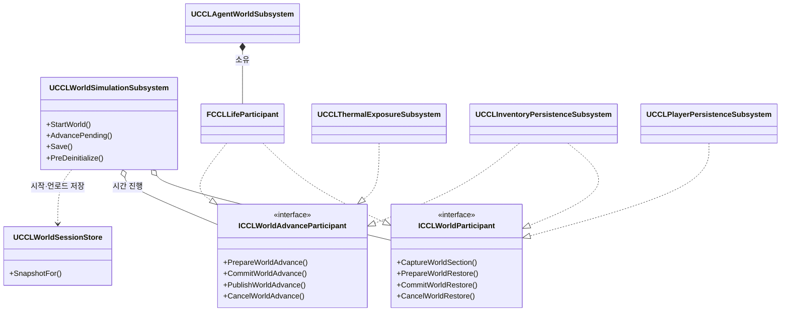

# R1 설계 초안

세계 소유권 구조 위험 R1의 설계 초안을 소유한다. 상위 문서는 [코드 구조 개선 계획](../CodeStructurePlan.md)이다.

## R1 설계 초안

### 목표와 제약

세계 시계와 저장은 Agent 없이 시작해야 한다. Life는 인벤토리처럼 이름 있는 구간과 진행 단계를 가진 참여자가 되고, 열 노출은 진행 단계만 가진 참여자가 되어야 한다. 기존 트랜잭션 성질은 유지한다. 모든 참여자의 준비가 성공해야 코어 상태와 참여자 상태를 확정하고, 하나라도 실패하면 확정된 시각과 상태를 바꾸지 않는다.

확정된 제약은 다음과 같다. 서버만 세계를 진행하고 저장한다. 참여자는 오름차순으로 실행한다 (`CCLWorldParticipant.h`의 `ICCLWorldParticipant` 설명). 열 노출은 단계 시작 시점의 표면 상태로 피해를 계산한다 (`CCLThermalExposure.cpp:145-160`). 세부 형식 버전과 이전 저장의 변환 정책은 미정이다.

### 책임과 수명

| 대상 | 책임 | 소유자와 수명 | 권위 |
|---|---|---|---|
| `UCCLWorldSimulationSubsystem` | 시계·표면·생태·천체 코어 상태, 세계 시작, 참여자 진행·저장 조율, 언로드 저장 | World. `OnWorldBeginPlay`에 시작하고 `PreDeinitialize`에 저장 | 서버 |
| `UCCLWorldSessionStore` (신규) | 도메인별 세계 바이트, 맵 이동 묶음, 실험 초기 스냅샷. 현재 `UCCLAgentSessionStore`의 역할을 옮긴다 | GameInstance | 서버 |
| `FCCLLifeParticipant` (신규) | Life 구간의 캡처·복원, 진행 후보 계산과 확정 | `UCCLAgentWorldSubsystem`이 소유하고 등록 | 서버 |
| `UCCLAgentWorldSubsystem` | `FCCLLifeSimulation` 소유, 인구 준비·퇴장 이벤트, 외부 사망 요청 | World | 서버 |
| `UCCLThermalExposureSubsystem` | 진행 참여자로서 피해 후보 계산과 확정 | World | 서버 |
| `UCCLInventoryPersistenceSubsystem`, `UCCLPlayerPersistenceSubsystem` | 기존 구간 참여 유지. 아이템 소유 확인은 공통 `FCCLWorldClaims`로 옮긴다 | World | 서버 |

### 클래스 다이어그램

저장 참여와 시간 진행은 두 인터페이스로 나눈다. [코드 설계 후속 수정](../ProgressionFoundation/Verification.md#2026-10-11-설계-후속-수정)이 진행 함수를 `ICCLWorldAdvanceParticipant`로 분리하는 중이므로 이 초안도 그 분리를 전제로 한다. 2026-10-11 작업 트리의 진행 중 선언(`Source/CCL/Environment/CCLWorldAdvanceParticipant.h`)과 비교하면, 이 초안은 `PrepareWorldAdvance`의 표면 인자만 `FCCLWorldAdvanceView`로 바꾼다. 그 수정이 끝나면 실제 선언에 다시 맞춘다.



`o--`는 등록 관계, `*--`는 소유, `..>`는 사용, `..|>`는 구현이다. Life는 저장과 진행을 모두 구현한다. 열 노출은 저장할 상태가 없으므로 진행만 구현한다. 인벤토리는 보관된 음식의 시간 변화 때문에 진행도 구현한다. Environment는 Agents를 include하지 않고, Agents가 Environment의 계약을 구현한다.

### 인터페이스 초안

```cpp
// Ownership claims shared by participants during one capture, restore or advance.
// Replaces ClaimedItems, KeptItems and ClaimedContainers with named spaces.
struct CCL_API FCCLWorldClaims
{
	bool Claim(FName Space, FGuid Id);
	bool IsClaimed(FName Space, FGuid Id) const;

	TMap<FName, TSet<FGuid>> Claimed;
};

// Read-only facts every advancing participant sees for one step.
struct CCL_API FCCLWorldAdvanceView
{
	// Committed state at the start of the step.
	const FCCLSurfaceSimulation* Previous = nullptr;

	// Candidate state at the end of the step.
	const FCCLSurfaceSimulation* Candidate = nullptr;

	FCCLWorldClaims* Claims = nullptr;
};

// Time advance contract split from ICCLWorldParticipant by the in-progress design fixes.
// This draft only replaces the surface argument with FCCLWorldAdvanceView.
class CCL_API ICCLWorldAdvanceParticipant
{
public:
	// GetWorldAdvanceOrder and NeedsWorldAdvance stay as declared by the design fixes.

	// A failed prepare leaves no staged state. Every successful prepare is followed by Commit or Cancel.
	virtual bool PrepareWorldAdvance(const FCCLWorldStep& Step, const FCCLWorldAdvanceView& View, FString& Error) = 0;
	virtual void CommitWorldAdvance() = 0;
	virtual void PublishWorldAdvance() = 0;
	virtual void CancelWorldAdvance() = 0;
};

UCLASS()
class CCL_API UCCLWorldSimulationSubsystem : public UTickableWorldSubsystem
{
	GENERATED_BODY()

	// 부모 인터페이스 함수
public:
	virtual void OnWorldBeginPlay(UWorld& InWorld) override;

	// Saves the unload checkpoint while every participant is still registered.
	virtual void PreDeinitialize() override;

	// 내 클래스 함수
public:
	bool StartWorld(ECCLWorldDomain Domain, const TArray<uint8>& Saved, FString& Error);
	bool AdvancePending(double MaxGameSeconds, double MaxWorldSeconds, FString& Error);
	bool Save(TArray<uint8>& Bytes, FString& Error);
	bool Restore(const TArray<uint8>& Bytes, FString& Error);
};
```

`FCCLLifeSimulation`은 지금 `TryAdvanceTo` 안에서 후보 계산과 교체를 함께 한다. 참여자로 옮기려면 후보 계산(현재 비공개 `AdvanceCandidate`)과 교체를 공개 단계로 나눠야 한다.

### 핵심 경로 예시

진행 한 단계의 확정 순서다. 시각 경계 제한, CSV 측정과 오류 보고의 세부는 생략했다.

```cpp
bool UCCLWorldSimulationSubsystem::AdvancePending(double MaxGameSeconds, double MaxWorldSeconds, FString& Error)
{
	if (!CheckAuthority(Error))
	{
		return false;
	}

	// Registered advance participants are sorted by GetWorldAdvanceOrder.
	TArray<ICCLWorldAdvanceParticipant*> Advancing;
	for (auto* Participant : AdvanceParticipants)
	{
		if (Participant->NeedsWorldAdvance())
		{
			Advancing.Add(Participant);
		}
	}

	FCCLWorldClock CandidateClock = Clock;
	FCCLWorldStep Step;
	if (!CandidateClock.Prepare(FMath::Min(MaxGameSeconds, .25), MaxWorldSeconds, Step, Error) ||
		!CandidateClock.Commit(Step.Ticket, Error))
	{
		return false;
	}

	// Ecology claims its individuals so the Life participant can reject an Agent with the same id.
	FCCLWorldClaims Claims;
	FCCLSurfaceSimulation CandidateSurface = SurfaceSimulation;
	FCCLEcologySimulation CandidateEcology = EcologySimulation;
	if (!AdvanceCore(Step, CandidateSurface, CandidateEcology, Claims, Error))
	{
		return false;
	}

	const FCCLWorldAdvanceView View{&SurfaceSimulation, &CandidateSurface, &Claims};
	int32 Prepared = 0;
	for (; Prepared < Advancing.Num(); ++Prepared)
	{
		if (!Advancing[Prepared]->PrepareWorldAdvance(Step, View, Error))
		{
			break;
		}
	}

	if (Prepared < Advancing.Num())
	{
		for (int32 Index = 0; Index < Prepared; ++Index)
		{
			Advancing[Index]->CancelWorldAdvance();
		}

		ReportFailure(Error);
		return false;
	}

	Clock = MoveTemp(CandidateClock);
	SurfaceSimulation = MoveTemp(CandidateSurface);
	EcologySimulation = MoveTemp(CandidateEcology);
	for (auto* Participant : Advancing)
	{
		Participant->CommitWorldAdvance();
	}

	// Every participant commits before any of them notifies listeners.
	for (auto* Participant : Advancing)
	{
		Participant->PublishWorldAdvance();
	}

	Publish();
	return true;
}
```

`AdvanceCore`는 현재 `CCLWorldAdvance::Advance`에서 Life를 뺀 표면·생태 계산을 맡는 비공개 함수다. 새 모듈 의존은 없다.

### 트레이드오프와 대안

이 구조에서는 계층이 FrameworkPlan과 일치하고, Agent 호스트가 없는 게임에서도 시계가 돈다. 코어 함수의 시그니처는 새 참여자가 생겨도 바뀌지 않는다. 언로드 저장이 `PreDeinitialize`로 옮겨 D1의 원인도 함께 사라진다.

비용은 다음과 같다.

- Life가 코어에서 구간으로 옮겨 세계 스냅샷 형식 버전이 올라간다. 이전 저장을 읽으려면 변환 경로가 필요하다.
- 생태와 Agent 생물학의 개체 중복 검사 (`CCLWorldAdvance.cpp:26-37`)를 `FCCLWorldClaims`로 옮겨야 하고, 참여자 순서가 이 검사의 전제가 된다.
- 열 노출은 피해 후보를 만들 때 Agent의 생존과 실행권을 확인한다 (`CCLThermalExposure.cpp:188-204`). 참여자로 옮겨도 이 Agent 의존은 남으므로, 열 노출을 환경과 Agent를 잇는 조합 계층에 둘지는 착수 때 정한다.
- 보관함 소유 확인은 지금 `UObject*` 기준이다. `FGuid` 기준으로 바꾸려면 모든 보관함에 고정 ID가 있어야 하며, 이 조건은 미확인이다.
- `CCLWorldAdvance`·`CCLWorldSnapshot` 계열 자동 검사를 다시 써야 한다.

대안은 시작·저장·이동의 소유만 세계 시뮬레이션으로 옮기고 Life는 코어에 두는 절반 수정이다. 비용은 작고 D1도 해결되지만, `KSIWorldTime`은 계속 Agent에 의존한다.

### 검증 방법

실행 전 예상 결과는 기존 자동 검사가 동작 변경 없이 통과하는 것이다. 구현을 맡은 AI는 다음을 추가로 확인한다.

1. `CCL.Environment.*`, `CCL.Agents.*` 자동 검사와 패키지 smoke 검사(`-CCLWorldSmoke` 등)를 다시 실행한다.
2. Agent 호스트가 없는 맵에서 세계 시계가 진행되는지 확인한다.
3. 참여자 생성 순서를 바꿔도 언로드 저장의 구간 목록이 같은지 확인한다.
4. 변경 전 형식의 저장이 변환되어 같은 상태로 복원되는지 확인한다.
5. 진행 중 한 참여자의 준비를 실패시켜 시계·표면·Life가 모두 이전 상태로 남는지 확인한다.
