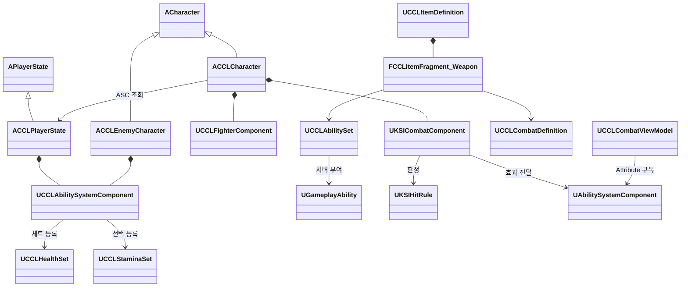

# 최소 전투 설계와 구현

마네킹의 맨손 공격 하나와 일반 몹 한 종류로 공격, 회피, 가드, 패링, 사망, 개별 재스폰을 연결했고 Standalone, Dedicated, Listen에서 서버 판정을 검증했다. 이 문서는 전투의 책임 배치, ASC 수명, 행동과 프로토타입 수치, 판정 계약, 검증 기록을 소유한다. 범위와 초기 수치의 근거는 [결정 8](decisions/0008-dodge-guard-parry.md)과 [결정 11](decisions/0011-minimal-combat-and-asc-lifetime.md)이다. 장르에 독립적인 기반과 UE5 현행 시스템 우선 원칙은 [Coding](Coding.md)이 소유한다.

공용 판정·입력·능력 부여·행동 수명은 `Source/KSICombat/`에 있다. `Source/CCL/AbilitySystem`은 게임 ASC·AbilitySet 파생형과 AttributeSet·효과를, `Combat`은 능력·판정 정책·적·투사체를 소유한다. 게임별 무기·아이템·UI 연결도 CCL에 남긴다. 모듈 경계와 UE 5.8.3 검증은 [Framework 단계 3](FrameworkPlan/Stage3.md#단계-3-구현과-검증)이 소유한다.

## 목표와 경계

서버가 행동 허용, 적중, 방어 결과, 능력치, 사망을 확정한다. Standalone, Dedicated Server, Listen Server에서 같은 규칙을 쓴다. 로컬 입력은 GAS의 예측 실행을 쓰고 상대 피해는 서버 결과를 따른다. 과거 시점으로 되돌리는 적중 판정은 넣지 않았다.

피해 대상은 플레이어와 적 사이로 제한한다. 스태미나 없는 파괴 가능한 표적도 같은 적중 경로로 처리한다. 최종 협동·대전·아군 피해와 저장 규칙은 [GameDesign](GameDesign.md)의 미정 상태를 따른다. 인벤토리와 성장은 [ProgressionFoundation](ProgressionFoundation.md), 저장은 [SessionFoundation](SessionFoundation.md)이 소유한다. 락온과 입력 버퍼는 없다.

이동 검증용 `MultiplayerPlayground`와 별도로 `CombatPlayground`를 둔다. 이 맵은 World Partition을 쓰고 스트리밍은 끈다. 전투장 환경용 StaticMesh에는 Nanite를 적용한다([결정 10](decisions/0010-prefer-current-ue5-systems.md)).

## 공통 기반과 콘텐츠

공통 ASC·AbilitySet은 입력 Tag 연결·효과 적용·능력 부여를 제공한다. CCL 파생형은 사망 입력 차단과 게임 Magnitude 태그를 공급한다. 체력과 스태미나 AttributeSet은 분리한다. 공통 적중 컴포넌트는 서버가 만든 공격 식별자, 대상·거리·차폐·중복 적중, 현재 Avatar를 검증하고, 구체적인 플레이어, HUD, 스태미나를 요구하지 않는다.

판정 정책은 결과 GameplayTag와 적용할 GameplayEffect·Magnitude를 반환한다. 공통 결과에 방어 행동 enum을 고정하지 않는다. 회피 무적, 정면 가드, 패링, 자원 소모는 `UCCLDuelHitRule`, 콘텐츠 Ability, `UCCLFighterComponent`가 연결한다. 효과의 지속시간과 제거는 GAS가 관리한다.

무기의 전투 데이터는 아이템 정의에 붙는다. `UCCLItemDefinition`은 `UKSIItemDefinition`의 파생형이고 기능을 `FInstancedStruct` Fragment로 조합한다([결정 15](decisions/0015-struct-fragments-and-two-handed-gear.md)). 무기 Fragment `FCCLItemFragment_Weapon`의 `Combat`이 공격 정의를, `Abilities`가 AbilitySet을 참조한다. 이전 형식의 `UCCLItemFragment_Combat` UObject는 옛 에셋을 읽기 위한 호환 경로로만 남아 있다. 공유 정의에는 현재 체력, 개별 아이템 상태, 실행 중 핸들을 저장하지 않는다.

| 구성 | 책임 | 소유와 수명 |
|---|---|---|
| `UCCLAbilitySystemComponent` | 입력 Tag로 능력 실행·해제, 효과 적용 | 플레이어는 PlayerState, 적은 적 Actor |
| `UCCLHealthSet`, `UCCLStaminaSet` | 현재·최대 자원과 값 범위, 복제 | ASC의 대상별 세트, 스태미나는 선택 구성 |
| `UCCLAbilitySet` | 능력·세트·초기 효과 부여 정의 | 공유 DataAsset, 서버가 부여 |
| `UCCLCombatDefinition` | 공격 구간·거리·정책·효과·Montage 정의 | 공유 DataAsset |
| `UKSICombatComponent` | 공격 식별·적중 검증·정책 호출·효과 전달 | 공격 Actor, 공격 종료 때 기록 정리 |
| `UKSIHitRule` | 적중 정책의 결과 계약 | 상태 없는 정책 클래스 기본 객체 |
| `UCCLFighterComponent` | ccl8 자원 초기화·전투 행동·방향·표현 연결 | 현재 생명의 Pawn |
| `UCCLCombatAbility` 파생 타입 | 공격·회피·가드·패링과 Task 수명 | ASC의 InstancedPerActor 능력 |
| `ACCLEnemyAIController` | StateTree의 탐색·접근·공격·복귀 요청 | 서버의 적 Controller |
| `UCCLCombatViewModel` | Attribute 통지를 표시 값으로 변환 | 로컬 HUD, ASC 변경 때 구독 교체 |

### ASC 초기화와 재스폰

플레이어의 OwnerActor는 PlayerState, AvatarActor는 현재 Character다. 서버 `PossessedBy`와 클라이언트 `OnRep_PlayerState`에서 ActorInfo를 연결한다. 적은 OwnerActor와 AvatarActor가 같다. 플레이어 ASC는 Mixed, 적은 Minimal 효과 복제를 쓴다. 체력은 관찰자에게, 플레이어 스태미나는 소유자에게 복제한다.

서버가 능력과 필요한 세트를 부여하며 같은 클래스의 능력을 중복 부여하지 않는다. 현재 생명의 자원은 초기화 효과로 설정한다. 자원 회복은 주기 효과, 회복 지연과 방어·경직 조건은 효과의 Tag 요구조건으로 처리한다.

사망 시 능력·유지 입력·예약 적중·생명 효과를 정리한다. 플레이어는 죽은 Pawn을 유지하다 R 재도전으로 교체한다. PlayerState의 ASC와 능력 부여는 유지하고 새 Pawn에 ActorInfo와 자원을 초기화한다. 이전 Pawn의 종료 콜백은 ASC의 Avatar가 여전히 자신일 때만 ActorInfo를 정리한다.

PlayerState 소유는 재스폰 후 능력을 유지하기 쉽지만 생명 단위 효과를 구분하고 제거해야 한다. Pawn 소유는 정리가 단순하지만 재스폰 때 능력을 다시 구성해야 한다. 이 구현은 전자를 따른다.

## 행동과 초기 수치

아래는 결정 11에서 승인한 프로토타입 값이다. 최종 밸런스가 아니며 공격 정의와 Fighter 설정에서 바꿀 수 있다. 적 유형별 체력·이동·패턴은 아래 "구조 계약"의 적 정의가 소유한다.

| 항목 | 초기값 |
|---|---|
| 체력 | 플레이어 100, 적 80 |
| 스태미나 | 최대 100, 마지막 소모 후 1초부터 초당 20 회복. 가드·경직·사망 중 회복 중지 |
| 플레이어 공격 | 피해 20, 비용 15, 준비·유효·회복 0.35·0.15·0.4초 |
| 적 공격 | 피해 20, 비용 없음, 준비·유효·회복 0.7·0.15·0.9초 |
| 근접 판정 | 전방 150cm, 검사 반경 35cm |
| 회피 | 비용 25, 이동 400cm·0.3초, 시작 후 0.05-0.25초 무적, 총 행동 0.55초 |
| 가드 | 정면 120도, 적중당 비용 30, 잔량이 비용 이하이면 붕괴·1초 경직 |
| 패링 | 비용 15, 정면 120도, 시작 후 0.08-0.28초 성공 구간, 총 행동 0.65초, 성공 시 적 1.2초 경직 |
| 적 재생성 | 사망 5초 후 원위치, 스폰이 막히면 0.5초 뒤 재시도 |

적은 원위치에서 1400cm 안의 살아 있는 플레이어 중 가장 가까운 대상을 고른다. 대상이 사망·연결 해제되거나 원위치에서 1800cm를 벗어나면 다시 탐색한다. 대상이 없으면 원위치로 돌아간다. 탐색·추적 거리는 초기 구현값이며 전투 데이터를 조정할 때 함께 검토한다.

### 입력과 방향

| 입력 | 행동 |
|---|---|
| WASD, 마우스, Space | 이동, 시점, 점프 |
| 좌클릭 | 기본 공격 |
| 우클릭 유지 | 오른손 방패 장착 시 가드, 빈손이면 공격 |
| Q | 패링 |
| Shift | 회피 |
| R | 사망 후 개별 재도전 |
| K | 개발 빌드의 사망 검사 |

CombatPlayground에서 방패 픽업에 접근해 E로 획득한다. I로 인벤토리를 열고 방패를 오른손에 장착한 뒤 우클릭을 유지하면 가드를 시험할 수 있다. 방패 해제 후 우클릭은 빈손 공격으로 돌아간다.

평소에는 이동 방향을 바라본다. 공격·가드·패링 중에는 카메라의 수평 방향을 바라보며 공격 방향은 유효 구간 시작에 고정한다. 회피는 현재 이동 가속도 방향, 이동 입력이 없으면 뒤쪽이다. 이동은 CharacterMovement와 Root Motion AbilityTask가 처리한다.

Busy Tag로 전투 행동의 동시 실행을 제한한다. 일반 행동끼리의 입력 취소는 없다. 피격·패링·가드 붕괴·사망은 진행 중인 행동을 중단시킨다. 가드는 GAS 입력 해제 이벤트를 기다리며 포커스를 잃으면 눌린 입력을 해제한다.

서버 판정 순서는 무효·사망·중복 제외, 회피 무적, 정면 패링, 정면 가드, 일반 피해다. 공격 한 번은 대상별로 한 번만 처리한다. 패링에 성공하면 공격을 취소하고 남은 적중도 중단한다. 가드가 붕괴하는 공격은 막지만 경직 중 후속 공격은 체력 피해를 준다.

## 클래스와 호출 계약



입력은 `AbilityInputTagPressed`와 `AbilityInputTagReleased`를 거쳐 AbilitySpec을 실행한다. 판정 값을 보내는 입력별 RPC는 없다. 자동 검증 전용 RPC는 검증 명령행 옵션으로 생성되는 서브시스템에만 연결한다.

`BeginAttack`은 서버 공격 ID를 발급하고 `ResolveHit`은 현재 공격과 Avatar를 확인한다. 적중 정책은 판단과 부작용을 두 단계로 나눈다. `UKSIHitRule::Resolve`는 상태를 바꾸지 않고 `FKSIHitResolution`을 반환하고, `UKSIHitRule::Commit`은 피해 효과가 실제로 적용된 뒤에만 능력 취소·경직·피격 알림 같은 부작용을 확정한다. 이 분리는 판단 중에 부작용을 실행해 피해 효과가 거부돼도 취소와 피격 표시가 남던 결함을 2026-10-11 검토에서 고친 것이다. 공통 적용 경로 `KSIHit::Apply`의 핵심은 다음과 같다.

```cpp
const auto Resolution = Rule->Resolve(Context);
if (Resolution.Effect)
{
    // Build the spec, set the SetByCaller magnitude and apply it.
    if (!Applied.WasSuccessfullyApplied())
    {
        return {};
    }
}

Rule->Commit(Context, Resolution);
TInlineComponentArray<UActorComponent*> Receivers(Context.Target);
for (UActorComponent* Component : Receivers)
{
    if (auto* Receiver = IsValid(Component) ? Cast<IKSIHitReceiver>(Component) : nullptr)
    {
        Receiver->ReceiveHit(Context, Resolution.Outcome);
    }
}
```

전투는 Agent 기억이나 퀘스트를 직접 호출하지 않는다. 확정된 결과는 대상 Actor의 컴포넌트 중 `IKSIHitReceiver`를 구현한 것에 전달된다. `UCCLAgentComponent`가 이 계약으로 피격 기억을 기록한다.

Instant 효과는 지속 중인 핸들이 없을 수 있으므로 적용 성공은 `WasSuccessfullyApplied()`로 확인한다. 체력 변경 통지가 사망을 연결하고 AttributeSet은 구체적인 캐릭터를 참조하지 않는다. 월드 위험의 `TakeDamage`는 GAS 체력 효과를 한 번 적용하고 관찰한 체력 감소량을 반환한다.

## 구조 계약

2026-10-11 전체 소스 검토의 지적으로 전투 기반과 콘텐츠의 경계를 다시 나눴다. 원칙은 [결정 9](decisions/0009-genre-independent-base-systems.md)의 공통 계약·콘텐츠 분리다.

| 변경 | 이전 문제 | 현재 계약 |
|---|---|---|
| 적 정의 | 적 종류를 Archetype 번호 0·1·2로 코드에서 분기했다 | `UCCLEnemyDefinition` DataAsset이 이름·체력·이동 속도·탐지·추적 반경과 공격 패턴을 소유한다. 현재 콘텐츠는 `/Game/Progression`의 `DA_GateGuard`, `DA_RoadRaider`, `DA_GateWarden`이다 |
| 공격 패턴 | 보스 패턴을 코드가 체력 구간으로 골랐다 | 각 패턴의 `MaxHealthFraction` 이하 체력에서 선택 가능하며, 가능한 패턴을 목록 순서로 돌아가며 쓴다 |
| 적 재스폰 | 클래스 기본값으로 생성해 배치에서 바꾼 값·구독자·Agent ID를 잃었다 | `CopyConfigurationTo`가 정의, 인스턴스 값, `OnDefeated` 구독자, Agent ID와 특성을 교체 Actor에 복사한다 |
| 기본 장비 경로 | 공통 `UCCLFighterComponent`가 `DA_Unarmed`·`ABP_Combat` 경로를 가졌다 | Fighter는 `DefaultItem`, `CombatAnimClass`와 몽타주를 소프트 참조 속성으로 받는다. 플레이어 콘텐츠인 `ACCLCharacter`가 값을 지정한다 |
| 장비 표현 | Items의 Loadout이 Combat의 Fighter를 직접 호출했다 | Loadout은 `ICCLEquipmentPresenter`를 찾아 호출하고 Fighter가 구현한다 |
| 테스트 RPC | 실제 PlayerController에 테스트 RPC 6개와 Tests 헤더 include가 있었다 | 스모크 서브시스템이 명령줄 옵션이 있을 때만 서버 PlayerController에 `UCCLTestBridgeComponent`를 붙인다 |

## 검증 방법

`Tools/Validation/run_combat_smoke.ps1`은 Standalone, Dedicated, Listen과 호스트 조작을 고르고 `-Impaired`로 지연·손실을 설정한다. 서버 판정과 실제 클라이언트 Ability 입력을 연결해 다음을 검사한다. 실행 순서와 증거 기록은 `ccl8-verify` 스킬의 전투 기능 파일을 따른다.

- 기본 공격 적중과 비용의 단일 차감, 정면 가드와 입력 해제.
- 가드 붕괴 시 해당 공격 차단, 후속 피해, 후방 가드 실패.
- 패링 성공 구간과 공격자 경직, 회피 무적, 비용 부족 거부.
- 스태미나 없는 표적, 중복·종료된 공격 거부, 자원 상한.
- 재스폰 후 ASC 유지와 Avatar 교체, 자원 초기화, 능력 중복과 이전 생명 효과 제거.

에디터 자동 검사 `Source/CCL/Tests/CCLGameplayRuleTests.cpp`는 멀티프로세스 스모크로만 확인하던 규칙 8개를 맡는다. 전투 판정 결과, 피해 효과 거부 시 부작용 없음, 적 패턴 순환, 인벤토리 추가·이동·제거, 장착과 사용, 저장 기록 거부 경로, 재접속 신원 키, 세계 저장 구간 규칙이다. 테스트 월드는 `CreateWorld` 뒤 `InitializeActorsForPlay`, `BeginPlay`, `WorldSettings->NotifyBeginPlay`를 호출해야 Actor의 `BeginPlay`가 실행된다. GameMode가 없는 월드에서 마지막 호출을 빠뜨리면 Fighter의 공격 정의가 비어 있다.

화면 검사는 개발 구성의 선택적 `-CCLVisualSmoke` 실행으로 한다. 월드 서브시스템이 Standalone에서 적 AI를 멈추고 기본 자세, 공격, 가드, 패링, 회피, 사망 화면을 `Saved/Tests/VisualSmoke/`에 저장한다. 표현을 비교하기 위한 고정 장면이며 AI 추적과 네트워크 검사를 대신하지 않는다. Shipping·Test 구성에서는 서브시스템을 생성하지 않는다.

에셋 생성 도구는 `Tools/Validation/create_combat_playground.py`와 `UCCLCombatAssetLibrary`다. 프로젝트 전용 공격·회피 시퀀스, AnimBP, Montage, AbilitySet, 아이템, StateTree, 맵을 만든다. 원본 시퀀스는 두고 복제한 시퀀스의 루트 이동을 잠가 AbilityTask 이동과 겹치지 않게 한다. 가드·패링 자세와 색상 표시는 임시 표현이다.

## 검증 상태

UE 5.8.3의 전투 Standalone·Dedicated, 자동 검사 154개와 기존 기능 회귀 결과는 [2026-10-11 재검증 기록](QA/FullReviewReverification-2026-10-11.md)이 소유한다. 아래는 그 이전의 시점 기록이다.

### 2026-10-07 UE 5.9 실행 호환성 검사

노트북에서 전투 에셋 생성과 아래 실행 검증을 마쳤다. 당시 엔진은 `Engine/Build/Build.version` 기준 UE 5.9.0이었다. 이 환경에서 생성한 바이너리 에셋을 UE 5.8.1에서 여는 것은 검증하지 않았다.

Standalone과 네트워크 실행에서 서버의 전투 검사는 통과했지만, 클라이언트의 GameplayEffect 제거 호출에서 권한 경고가 났다. `<GAS>/Private/AbilitySystemComponent.cpp:1275`는 권한 없는 `RemoveActiveGameplayEffect`를 거부한다. 수정 범위는 `UCCLCombatAbility`의 Busy·방어 구간 효과 제거다. 서버가 제거를 확정하고 클라이언트의 예측 효과는 GAS의 예측 키 정리와 서버 복제를 따른다. 엔진의 예측 제거 제한을 완화하는 콘솔 변수는 쓰지 않는다.

수정 후 프로젝트 생성·빌드와 Standalone, Dedicated, Listen 원격·호스트, 지연·손실 전투 검사 5개 구성이 통과했다. 해당 실행 로그에서 권한 없는 효과 제거 경고와 전투 실패 표식은 0건이었다. 에디터 초기 로딩에 대비한 테스트의 기본 시작 대기는 600초이며 `-StartupTimeoutSeconds`로 바꾼다. 전투 시나리오의 내부 중단 제한은 유지한다.

| 검증 항목 | 결과 |
|---|---|
| 프로젝트 파일 생성·전체 타깃 빌드 | 최종 `GenerateProjectFiles.bat`과 `CCLEditor Win64 Development` 통과 |
| 비대화형 에디터 클래스 로드 | GAS·DataRegistry·StateTree·CCL 로드와 에셋 저장 후 정상 종료 |
| 생성 Python·검증 PowerShell 구문 | 통과 |
| 전투 에셋·World Partition·Nanite 맵 생성 | 저장 결과 검사 포함 재생성, 종료 코드 0과 `CCL_COMBAT_ASSETS PASS` 확인 |
| Standalone·Dedicated·Listen 전투 | Standalone, Dedicated, Listen 원격·호스트 통과 |
| 새 코드의 기존 이동 회귀 검사 | Standalone, Dedicated, Listen 원격·호스트 4개 구성 통과 |
| 100ms 왕복 지연·2% 손실 | Dedicated 전투 통과 |
| 화면이 있는 애니메이션·방향·예고 가독성 | 기본 자세·공격·가드·패링·회피·사망 6개 캡처 확인. 최종 조작감·예고 가독성은 추가 검토 필요 |

경로는 저장소 기준이다. 화면에서 공격 후 체력 감소, 방어 자세, 회피 이동, 사망 안내를 확인했다. 기존 `run_network_smoke.ps1`의 네 실행 구성도 다시 통과했다.

UE 5.9의 EditorToolset·ToolsetRegistry Python 초기화 오류와 HLOD 편집기 클래스 경고는 게임 실행 로그에 남았다. 전투 판정·종료 성공과 이 플러그인 초기화 메시지는 구분하며, 실행 검사 전체의 로그에 오류가 없었다는 뜻은 아니다.

### 2026-10-06 엔진 모듈 목록 갱신과 효과 생성자 수정

사용자 승인으로 UBT의 `WriteMetadata` 두 작업을 실행했다. 실제 내용이 바뀐 엔진 파일은 DataRegistry, GameplayAbilities, GameplayStateTree의 `.modules` 세 개이며 엔진 재컴파일은 없었다. 세 플러그인과 CCL의 BuildId가 실행 엔진과 일치한다.

`CCLEffects.cpp`의 생성자는 `CreateDefaultSubobject`로 GameplayEffectComponent를 만들고 `GEComponents`에 등록한다. 생성자에서 `FindOrAddComponent`가 이름 없는 `NewObject`를 호출해 생긴 초기화 오류를 고친 것이다. 수정 후 프로젝트 파일 생성, 전체 빌드, 클래스 로드 성공 표식 `CCL_MANIFEST_LOAD_PASS`를 확인했다. 클래스 로드 검사는 전투·화면 검증을 대신하지 않는다.

### 2026-10-07 내비게이션 후속 수정

단계 3의 실제 AI 접근 검사에서 전투 맵과 진행 맵의 내비게이션 볼륨 브러시가 비어 있던 결함을 찾았다. 엔진의 볼륨 생성 경로를 쓰도록 고치고 두 맵을 복구했다. 원인과 근거는 [CampaignFoundation](CampaignFoundation.md)의 내비게이션 수정 기록이 소유한다. 복구 후 기존 전투의 Standalone·Dedicated 검사도 통과했다. 단계 2의 고정 위치 판정 통과와 실제 AI 접근 확인은 구분한다.

### 미검증

정확한 방어 구간 경계, 불가 공격, 동시 피격, 서버 예측 거절, 벽 충돌, 재접속·늦은 관전자, 최종 표현 품질은 추가 실행 검증이 필요하다. 자동 시나리오만으로 통과했다고 판단하지 않는다. 임시 마네킹과 색상 표시는 최종 아트가 아니다.

## 엔진 소스 근거

GAS는 UE5에서 처음 도입된 기능이 아니다. 이 구현은 UE 5.8의 Attribute 복제·예측과 GameplayEffect Component 구성을 쓴다. 자체 능력·효과 스케줄러를 줄일 수 있지만 ActorInfo 재연결, 생명 효과 정리, 예측 보정을 검증해야 한다.

2026-10-06 집의 `<Engine>/Build/Build.version`에서 UE 5.8.1, Changelist 0을 확인했다. Graft 조회를 출발점으로 아래 실제 설치 소스를 확인했다. `<GAS>`는 `<Engine>/Plugins/Runtime/GameplayAbilities/Source/GameplayAbilities`다. 엔진 API 확인과 프로젝트의 빌드·실행 검증은 구분한다.

| 근거 | 확인 내용 |
|---|---|
| `<GAS>/Private/AbilitySystemComponent_Abilities.cpp:161` | InitAbilityActorInfo의 OwnerActor·AvatarActor 설정 |
| `<GAS>/Private/AbilitySystemComponent_Abilities.cpp:1604` | TryActivateAbility 실행 경로 |
| `<GAS>/Private/AbilitySystemComponent_Abilities.cpp:2846` | 로컬 입력 해제를 Ability와 복제 이벤트에 전달 |
| `<GAS>/Private/Abilities/Tasks/AbilityTask_WaitInputRelease.cpp:16` | 예측 클라이언트의 입력 해제를 서버 이벤트로 전달 |
| `<GAS>/Private/Abilities/GameplayAbility.cpp:592` | CommitAbility가 CommitCheck 이후 비용·쿨다운 적용 경로 실행 |
| `<GAS>/Private/AbilitySystemComponent.cpp:525`, `:975` | 효과 Spec 생성과 대상 ASC 적용 |
| `<GAS>/Public/GameplayEffect.h:1117` | GameplayTag로 SetByCaller magnitude 설정 |
| `<GAS>/Public/ActiveGameplayEffectHandle.h:39` | Instant 효과의 IsValid와 WasSuccessfullyApplied 의미 구분 |
| `<GAS>/Public/AttributeSet.h:206`, `:220`, `:402` | 효과 실행 후처리·값 변경 전처리·Attribute RepNotify |
| `<GAS>/Public/AbilitySystemComponent.h:539` | Attribute 값 변경 델리게이트 조회 |
| `<GAS>/Private/GameplayEffect.cpp:5195`, `:5226` | Mixed·Minimal의 활성 효과 복제 범위와 소유 연결 검사 |
| `<GAS>/Public/Abilities/GameplayAbilityTypes.h:46`, `:65` | InstancedPerActor 권장과 LocalPredicted 선언 |
| `<GAS>/Public/Abilities/Tasks/AbilityTask_ApplyRootMotionConstantForce.h:33` | Root Motion 기반 이동 Task 진입점 |
