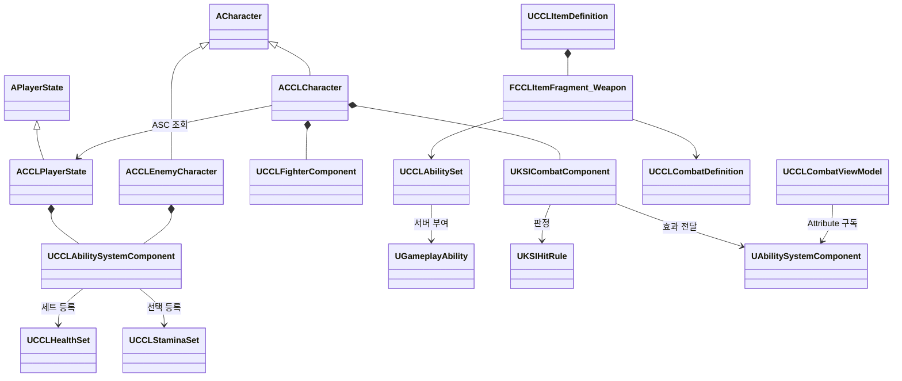

# 전투 구조와 호출 계약

책임 배치, ASC 수명, 적중 판정 계약, 콘텐츠 경계를 바꿀 때 읽는다.

## 공통 기반과 콘텐츠

공통 ASC·AbilitySet은 입력 Tag 연결·효과 적용·능력 부여를 제공한다. CCL 파생형은 사망 입력 차단과 게임 Magnitude 태그를 공급한다. 체력과 스태미나 AttributeSet은 분리한다. 공통 적중 컴포넌트는 서버가 만든 공격 식별자, 대상·거리·차폐·중복 적중, 현재 Avatar를 검증하고, 구체적인 플레이어, HUD, 스태미나를 요구하지 않는다.

판정 정책은 결과 GameplayTag와 적용할 GameplayEffect·Magnitude를 반환한다. 공통 결과에 방어 행동 enum을 고정하지 않는다. 회피 무적, 정면 가드, 패링, 자원 소모는 `UCCLDuelHitRule`, 콘텐츠 Ability, `UCCLFighterComponent`가 연결한다. 효과의 지속시간과 제거는 GAS가 관리한다.

무기의 전투 데이터는 아이템 정의에 붙는다. `UCCLItemDefinition`은 `UKSIItemDefinition`의 파생형이고 기능을 `FInstancedStruct` Fragment로 조합한다([결정 15](../decisions/0015-struct-fragments-and-two-handed-gear.md)). 무기 Fragment `FCCLItemFragment_Weapon`의 `Combat`이 공격 정의를, `Abilities`가 AbilitySet을 참조한다. 이전 형식의 `UCCLItemFragment_Combat` UObject는 옛 에셋을 읽기 위한 호환 경로로만 남아 있다. 공유 정의에는 현재 체력, 개별 아이템 상태, 실행 중 핸들을 저장하지 않는다.

| 구성 | 책임 | 소유와 수명 |
|---|---|---|
| `UCCLAbilitySystemComponent` | 입력 Tag로 능력 실행·해제, 효과 적용 | 플레이어는 PlayerState, 적은 적 Actor |
| `UCCLHealthSet`, `UCCLStaminaSet` | 현재·최대 자원과 값 범위, 복제 | ASC의 대상별 세트, 스태미나는 선택 구성 |
| `UCCLAbilitySet` | 능력·세트·초기 효과 부여 정의 | 공유 DataAsset, 서버가 부여 |
| `UCCLCombatDefinition` | 공격 구간·거리·정책·효과·Montage 정의 | 공유 DataAsset |
| `UKSICombatComponent` | 공격 식별·적중 검증·정책 호출·효과 전달 | 공격 Actor, 공격 종료 때 기록 정리 |
| `UKSIHitRule` | 적중 정책의 결과 계약 | 상태 없는 정책 클래스 기본 객체 |
| `UCCLFighterComponent` | ccl8 자원 초기화·전투 행동·방향·표현 연결 | 현재 생명의 Pawn |
| `UCCLCombatAbility` 파생 타입 | 공격·회피·가드·패링과 Task 수명 | ASC의 InstancedPerActor 능력 |
| `ACCLEnemyAIController` | StateTree의 탐색·접근·공격·복귀 요청 | 서버의 적 Controller |
| `UCCLCombatViewModel` | Attribute 통지를 표시 값으로 변환 | 로컬 HUD, ASC 변경 때 구독 교체 |

### ASC 초기화와 재스폰

플레이어의 OwnerActor는 PlayerState, AvatarActor는 현재 Character다. 서버 `PossessedBy`와 클라이언트 `OnRep_PlayerState`에서 ActorInfo를 연결한다. 적은 OwnerActor와 AvatarActor가 같다. 플레이어 ASC는 Mixed, 적은 Minimal 효과 복제를 쓴다. 체력은 관찰자에게, 플레이어 스태미나는 소유자에게 복제한다.

서버가 능력과 필요한 세트를 부여하며 같은 클래스의 능력을 중복 부여하지 않는다. 현재 생명의 자원은 초기화 효과로 설정한다. 자원 회복은 주기 효과, 회복 지연과 방어·경직 조건은 효과의 Tag 요구조건으로 처리한다.

사망 시 능력·유지 입력·예약 적중·생명 효과를 정리한다. 플레이어는 죽은 Pawn을 유지하다 R 재도전으로 교체한다. PlayerState의 ASC와 능력 부여는 유지하고 새 Pawn에 ActorInfo와 자원을 초기화한다. 이전 Pawn의 종료 콜백은 ASC의 Avatar가 여전히 자신일 때만 ActorInfo를 정리한다.

PlayerState 소유는 재스폰 후 능력을 유지하기 쉽지만 생명 단위 효과를 구분하고 제거해야 한다. Pawn 소유는 정리가 단순하지만 재스폰 때 능력을 다시 구성해야 한다. 이 구현은 전자를 따른다.

## 클래스와 호출 계약

입력은 `AbilityInputTagPressed`와 `AbilityInputTagReleased`를 거쳐 AbilitySpec을 실행한다. 판정 값을 보내는 입력별 RPC는 없다. 자동 검증 전용 RPC는 검증 명령행 옵션으로 생성되는 서브시스템에만 연결한다.

`BeginAttack`은 서버 공격 ID를 발급하고 `ResolveHit`은 현재 공격과 Avatar를 확인한다. 적중 정책은 판단과 부작용을 두 단계로 나눈다. `UKSIHitRule::Resolve`는 상태를 바꾸지 않고 `FKSIHitResolution`을 반환하고, `UKSIHitRule::Commit`은 피해 효과가 실제로 적용된 뒤에만 능력 취소·경직·피격 알림 같은 부작용을 확정한다. 이 분리는 판단 중에 부작용을 실행해 피해 효과가 거부돼도 취소와 피격 표시가 남던 결함을 2026-10-11 검토에서 고친 것이다.

공통 적용 경로 `KSIHit::Apply`는 `Resolve`, 효과 적용, 적용 실패 시 중단, `Commit`, 대상 컴포넌트의 `IKSIHitReceiver` 통지 순서다.

전투는 Agent 기억이나 퀘스트를 직접 호출하지 않는다. 확정된 결과는 대상 Actor의 컴포넌트 중 `IKSIHitReceiver`를 구현한 것에 전달된다. `UCCLAgentComponent`가 이 계약으로 피격 기억을 기록한다.

Instant 효과는 지속 중인 핸들이 없을 수 있으므로 적용 성공은 `WasSuccessfullyApplied()`로 확인한다. 체력 변경 통지가 사망을 연결하고 AttributeSet은 구체적인 캐릭터를 참조하지 않는다. 월드 위험의 `TakeDamage`는 GAS 체력 효과를 한 번 적용하고 관찰한 체력 감소량을 반환한다.

## 구조 계약

2026-10-11 전체 소스 검토의 지적으로 전투 기반과 콘텐츠의 경계를 다시 나눴다. 원칙은 [결정 9](../decisions/0009-genre-independent-base-systems.md)의 공통 계약·콘텐츠 분리다.

| 변경 | 이전 문제 | 현재 계약 |
|---|---|---|
| 적 정의 | 적 종류를 Archetype 번호 0·1·2로 코드에서 분기했다 | `UCCLEnemyDefinition` DataAsset이 이름·체력·이동 속도·탐지·추적 반경과 공격 패턴을 소유한다. 현재 콘텐츠는 `/Game/Progression`의 `DA_GateGuard`, `DA_RoadRaider`, `DA_GateWarden`이다 |
| 공격 패턴 | 보스 패턴을 코드가 체력 구간으로 골랐다 | 각 패턴의 `MaxHealthFraction` 이하 체력에서 선택 가능하며, 가능한 패턴을 목록 순서로 돌아가며 쓴다 |
| 적 재스폰 | 클래스 기본값으로 생성해 배치에서 바꾼 값·구독자·Agent ID를 잃었다 | `CopyConfigurationTo`가 정의, 인스턴스 값, `OnDefeated` 구독자, Agent ID와 특성을 교체 Actor에 복사한다 |
| 기본 장비 경로 | 공통 `UCCLFighterComponent`가 `DA_Unarmed`·`ABP_Combat` 경로를 가졌다 | Fighter는 `DefaultItem`, `CombatAnimClass`와 몽타주를 소프트 참조 속성으로 받는다. 플레이어 콘텐츠인 `ACCLCharacter`가 값을 지정한다 |
| 장비 표현 | Items의 Loadout이 Combat의 Fighter를 직접 호출했다 | Loadout은 `ICCLEquipmentPresenter`를 찾아 호출하고 Fighter가 구현한다 |
| 테스트 RPC | 실제 PlayerController에 테스트 RPC 6개와 Tests 헤더 include가 있었다 | 스모크 서브시스템이 명령줄 옵션이 있을 때만 서버 PlayerController에 `UCCLTestBridgeComponent`를 붙인다 |
