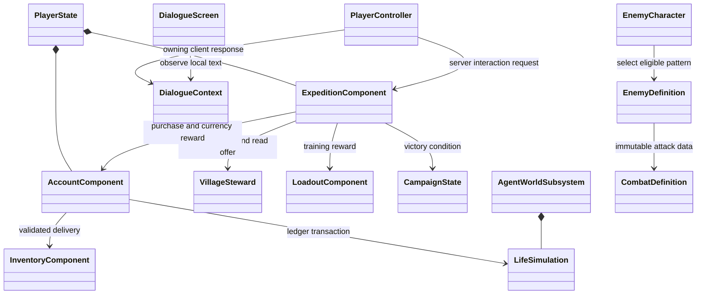

# 마을 서비스와 전투 콘텐츠

같은 원정 안에 일반 적 두 유형, 보스의 체력별 패턴, 마을 안내인, 상점, 퀘스트, 튜토리얼을 연결했고 UE 5.8.3에서 Standalone, Dedicated, Listen, 지연·손실 구성을 검증했다. 이 문서는 마을 서비스와 전투 콘텐츠의 책임 배치를 소유하고 하위 문서로 안내한다. [StudyRoadmap](StudyRoadmap.md)의 단계 5 사양이다. 이름, 수치, 대사는 기능 검증용 초안이며 정본 서사와 최종 밸런스가 아니다.

## 하위 문서

| 문서 | 읽는 때 |
|---|---|
| [콘텐츠 규칙과 데이터](ContentFoundation/Rules.md) | 대화, 상점, 퀘스트, 적, 보스의 규칙과 데이터 위치를 바꿀 때 |
| [콘텐츠 검증](ContentFoundation/Verification.md) | 검사 방법, 실행 결과, 미검증 범위를 볼 때 |

## 책임과 수명

| 구성 | 책임 | 소유자와 수명 |
|---|---|---|
| EnemyCharacter·EnemyDefinition | 서버가 적 정의의 체력 조건에서 공격 패턴 선택 | 적 Actor와 공유 정의 에셋 |
| CombatDefinition | 공격 시간·범위·피해·방어 가능 여부 | 공유 에셋 |
| VillageSteward | NPC 표현, 상품 정의 제공, 상호작용 거리·시야 확인 | 월드 Actor |
| PlayerController | 상호작용 입력과 서버 RPC, 요청한 플레이어에게 대화 결과 전달 | 플레이어 접속 |
| ExpeditionComponent | 상호작용 가능 여부, 개인 퀘스트 수락·수령 상태와 보상 조건 판단 | PlayerState |
| AccountComponent | 계정 연결, 구매·금화 보상의 거래 실행, 소유자 전용 잔액 표시 값 복제 | PlayerState |
| LifeSimulation의 Economy | 계정 잔액·상점 재고·거래 원장 보관 | AgentWorldSubsystem이 소유하는 월드 상태 |
| DialogueContext·DialogueScreen | 서버가 보낸 NPC 이름·본문을 로컬 대화 화면에 표시 | 로컬 UI 문맥과 화면 |
| HUD 화면 | 퀘스트·튜토리얼·현재 공격 패턴 안내 | 로컬 플레이어 |

콘텐츠 규칙은 `UCCLExpeditionComponent`가 판단하고, 금화·구매 실행은 `UCCLAccountComponent`에 맡긴다. `Talk`는 원정 승리와 수령 상태를 확인한 뒤 계정에 금화 보상을 요청하고, 성공하면 수령 상태와 훈련 포인트를 갱신한다. `Buy`는 상호작용과 상품을 확인한 뒤 계정의 `Purchase`를 호출한다. 서버의 잔액 원본은 `FCCLLifeSimulation::Economy`에 있고, AccountComponent의 `BalanceView`는 소유자에게 복제하는 표시 값이다. 근거는 `Source/CCL/Campaign/CCLExpeditionComponent.cpp`의 `Talk`·`Buy`·`GetCoins`, `Source/CCL/Agents/CCLAccountComponent.cpp`의 `Purchase`·`Resolve`·`GetBalance`다.

계정의 구매 경로는 인벤토리 알림을 묶고 물건을 추가한 뒤 경제 거래를 실행한다. 거래가 실패하면 추가 전 인벤토리를 복원하고 성공 알림을 내보내지 않는다. 금화·재고·거래 원장의 검증과 확정은 경제 실행이 맡는다. 그래서 인벤토리는 마을의 가격이나 퀘스트 조건을 모른 채 물건을 보관한다.

보관·성장 공통 컴포넌트에는 상점·퀘스트 조건을 넣지 않는다([결정 9](decisions/0009-genre-independent-base-systems.md)). 범용 퀘스트 그래프 대신 단일 원정 상태를 쓰면 구현·저장 검증 범위가 줄어든다. 퀘스트를 여럿 만들 때 정의 에셋과 개별 상태로 나눈다.
