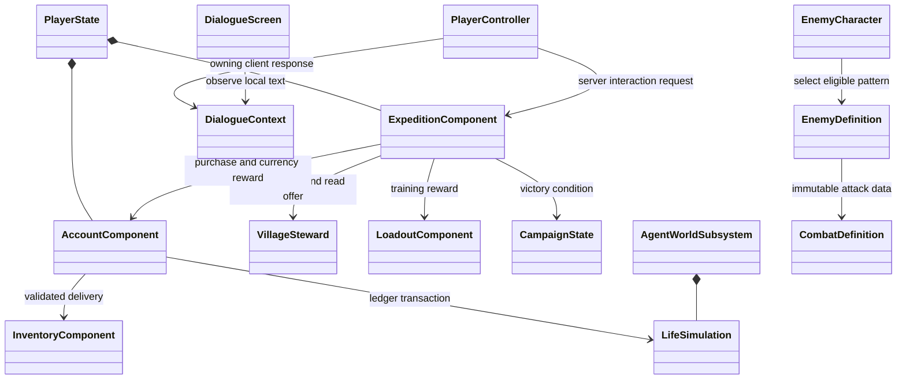

# 마을 서비스와 전투 콘텐츠

같은 원정 안에 일반 적 두 유형, 보스의 체력별 패턴, 마을 안내인·상점·퀘스트·튜토리얼을 연결했고 UE 5.8.3에서 Standalone, Dedicated, Listen, 지연·손실 구성을 검증했다. 이 문서는 마을 서비스와 전투 콘텐츠의 책임 배치, 플레이 규칙, 콘텐츠 데이터의 위치, 검증 기록을 소유한다. [StudyRoadmap](StudyRoadmap.md)의 단계 5 사양이다. 아래 이름·수치·대사는 기능 검증용 초안이며 정본 서사와 최종 밸런스가 아니다.

## 책임과 수명

| 구성 | 책임 | 소유자와 수명 |
|---|---|---|
| EnemyCharacter·EnemyDefinition | 서버가 적 정의의 체력 조건에서 공격 패턴 선택 | 적 Actor와 공유 정의 에셋 |
| CombatDefinition | 공격 시간·범위·피해·방어 가능 여부 | 공유 에셋 |
| VillageSteward | NPC 표현, 상품 정의 제공, 상호작용 거리·시야 확인 | 월드 Actor |
| PlayerController | 상호작용 입력과 서버 RPC, 요청한 플레이어에게 대화 결과 전달 | 플레이어 접속 |
| ExpeditionComponent | 상호작용 가능 여부, 개인 퀘스트 수락·수령 상태와 보상 조건 판단 | PlayerState |
| AccountComponent | 계정 연결, 구매·금화 보상의 거래 실행, 소유자 전용 잔액 표시 값 복제 | PlayerState |
| LifeSimulation의 Economy | 계정 잔액·상점 재고·거래 원장 보관 | AgentWorldSubsystem이 소유하는 월드 상태 |
| DialogueContext·DialogueScreen | 서버가 보낸 NPC 이름·본문을 로컬 대화 화면에 표시 | 로컬 UI 문맥과 화면 |
| HUD 화면 | 퀘스트·튜토리얼·현재 공격 패턴 안내 | 로컬 플레이어 |

콘텐츠 규칙은 `UCCLExpeditionComponent`가 판단하고, 금화·구매 실행은 `UCCLAccountComponent`에 맡긴다. `Talk`는 원정 승리와 수령 상태를 확인한 뒤 계정에 금화 보상을 요청하고, 성공하면 수령 상태와 훈련 포인트를 갱신한다. `Buy`는 상호작용과 상품을 확인한 뒤 계정의 `Purchase`를 호출한다. 서버의 잔액 원본은 `FCCLLifeSimulation::Economy`에 있고, AccountComponent의 `BalanceView`는 소유자에게 복제하는 표시 값이다. 근거는 `Source/CCL/Campaign/CCLExpeditionComponent.cpp`의 `Talk`·`Buy`·`GetCoins`, `Source/CCL/Agents/CCLAccountComponent.cpp`의 `Purchase`·`Resolve`·`GetBalance`다.

계정의 구매 경로는 인벤토리 알림을 묶고 물건을 추가한 뒤 경제 거래를 실행한다. 거래가 실패하면 추가 전 인벤토리를 복원하고 성공 알림을 내보내지 않는다. 금화·재고·거래 원장의 검증과 확정은 경제 실행이 맡는다. 그래서 인벤토리는 마을의 가격이나 퀘스트 조건을 모른 채 물건을 보관한다.

보관·성장 공통 컴포넌트에는 상점·퀘스트 조건을 넣지 않는다([결정 9](decisions/0009-genre-independent-base-systems.md)). 범용 퀘스트 그래프 대신 단일 원정 상태를 쓰면 구현·저장 검증 범위가 줄어든다. 퀘스트를 여럿 만들 때 정의 에셋과 개별 상태로 나눈다.

## 기능 계약

### 대화

NPC 표시는 공용 UI에 등록한 `UCCLDialogueScreen`이 맡는다. 컨트롤러가 서버 응답을 `UCCLDialogueContext`에 전달하고 변경 알림으로 이름·본문을 갱신한다. 일반 안내와 능력치도 별도 화면이다. 구현·입력·재스폰 검증은 [UIFoundation](UIFoundation.md)이 소유한다.

NPC 대사는 화면 하단 중앙의 사각형 상자에 표시한다(2026-10-07 사용자 요청). 왼쪽 위에 NPC 이름을 두고 다음 줄부터 대화 내용을 줄바꿈한다. 상호작용 결과는 서버가 해당 플레이어에게만 전달한다. Esc·인벤토리 열기·거리 이탈·사망으로 상자를 닫는다. 일반 퀘스트 안내와 NPC 대사는 별도 영역이다.

T 대화와 B 구매는 거리·시야 조건을 만족하는 NPC 중 가장 가까운 대상을 고른다. HUD와 서버 RPC는 같은 선택 함수를 쓰며, 서버는 요청 처리 시점의 위치로 다시 검사한다. NPC가 교차하면 대상이 바뀔 수 있다. 관련 검증은 [종합 QA 수정과 검증](QA/GameplayQAFixes-2026-10-12.md)에 있다.

### 상점과 퀘스트

마을 안내인 가까이에서 T를 눌러 원정을 수락한다. B는 금화 10으로 회복약 한 개를 산다. 시작 금화는 30이다. 서버가 NPC 거리·시야·생존 상태와 실제 잔액·보관 공간을 확인하고, 아이템 추가에 성공했을 때만 차감한다. 원정 승리 후 돌아와 T를 누르면 금화 60과 훈련 포인트 1을 한 번 받는다.

수락과 수령은 개인 상태이고 월드 승리 조건은 공유한다. 늦은 참가자도 수락 후 현재 승리 조건으로 수령할 수 있다. 이것은 임시 협동 규칙이며 최종 보상 소유권 규칙은 정하지 않았다.

### 적과 보스

일반 적은 경비병과 빠른 공격의 척후병으로 나눈다. 보스는 예고가 긴 강공격을 쓰고 체력이 절반 이하이면 넓은 휩쓸기와 강공격을 번갈아 쓴다. 공유 정의는 런타임에 수정하지 않는다. 공격 전에 선택을 확정하고 실행 중인 공격은 바꾸지 않는다. 휩쓸기는 방어 불가·패링 불가로 표시해 회피를 안내한다. HUD는 준비·원정·귀환 순서의 튜토리얼과 현재 패턴을 표시한다.

몽타주 재생은 GAS AbilityTask를 쓰고 공격 정의의 총 시간에 맞춰 재생 속도를 조정한다. 각 정의의 방어·패링 가능 여부는 공통 전투 정책이 판정한다.

## 2026-10-11 콘텐츠 데이터 분리

2026-10-11에 적 유형과 상점 상품을 코드에서 데이터로 옮겼다. 원칙은 [결정 9](decisions/0009-genre-independent-base-systems.md)의 공통 계약·콘텐츠 분리다. 위의 플레이 규칙과 수치는 바뀌지 않았다.

| 콘텐츠 | 현재 위치 | 이전 위치 |
|---|---|---|
| 경비병·척후병·보스 | `UCCLEnemyDefinition` 에셋 `DA_GateGuard`, `DA_RoadRaider`, `DA_GateWarden` | `ACCLEnemyCharacter`의 Archetype 0·1·2 분기 |
| 보스의 체력별 패턴 | 정의의 `Patterns` 목록과 패턴별 `MaxHealthFraction` | 적 클래스의 체력 절반 분기 |
| 원정 적 배치 | `ACCLCampaignDirector`의 `Guards`·`Boss`(`FCCLEncounterSpawn`: 위치와 정의) | 위치 배열과 고정 유형 |
| 마을 보급품 | Director의 `Supplies`(`FCCLSupplySpawn`: 위치·아이템·수량) | Director 코드의 정의 이름 3개와 수량 분기 |
| 상점 상품 | `ACCLVillageSteward::Offer`(`FCCLShopOffer`: 아이템·가격·재고 자원 태그·초기 재고) | `UCCLAccountComponent`의 `DA_RecoveryPotion`·가격 10 고정 검사 |
| 마을 Actor 생성 | `UCCLVillagePopulationSubsystem`이 Agent 인구 변경 알림을 받아 작업장·안내인·주민 Actor를 만든다 | Agent 세계 서브시스템이 Campaign Actor를 직접 생성 |

공통 계정 코드는 상품의 가격·재고 범위와 보관 공간만 검사하고 특정 아이템 이름은 검사하지 않는다. 재고 자원은 처음 구매 요청이 올 때 `InitialStock`으로 한 번 채운다. 경비병 처치 기록은 비트 마스크이므로 `Guards`는 최대 8명이다.

에셋은 `Tools/Validation/create_content_definitions.py`로 만들고 저장 결과를 검사한다. 2026-10-11 실행은 `PASS`였다. 캠페인 스모크는 약탈자를 Archetype 번호가 아닌 정의 이름으로 찾는다.

## 상품 복제와 거부 조건 보완

서버에서 바꾼 상품의 아이템·가격·초기 재고 설정은 `ACCLVillageSteward::Offer`를 통해 클라이언트에 복제된다. Actor 관련성 범위의 기존 접속자와 늦은 참가자가 현재 상품을 받는다. 이전에는 `Offer`가 `EditAnywhere`에만 노출돼 런타임의 서버 설정이 원격 플레이어의 안내에 반영되지 않았다. 근거는 `Source/CCL/Campaign/CCLVillageSteward.h`의 `Offer`와 같은 이름의 CPP에 있는 `GetLifetimeReplicatedProps`다.

거래 권위와 계정·재고 원본은 서버 경로에 있다. 복제되는 `InitialStock`은 초기 설정이며 실제 남은 재고가 아니다. 재고를 소진한 뒤 이 값을 바꿔도 해당 자원을 다시 채우지 않는다. 상품 정의를 Actor에서 복제하면 공통 에셋만 참조하는 방식보다 변경 데이터 전송이 늘지만, 소규모 NPC의 단일 상품을 별도 UI 요청 없이 전달할 수 있다.

## 검증 방법

프로젝트 파일 생성·빌드·에셋 생성 뒤 실제 클라이언트 요청으로 수락·구매·귀환 보상을 검사한다. 원거리 요청, 잔액 부족, 중복 보상, 보관 공간 부족을 거부하는지 본다. 원정의 AI·전투·재스폰·늦은 접속 검사와 함께 Standalone·Dedicated·Listen과 지연 구성을 실행한다. 보스 패턴 정의와 체력 전환, 재스폰 후 개인 상태, 렌더링 화면을 확인한다.

실행 도구는 `Tools/Validation/run_campaign_smoke.ps1`에 `-Content`를 붙인다. Listen 호스트 조작은 `-DriverIsHost`, 지연·손실은 `-Impaired`, 렌더링은 `-Rendered`를 더한다. 자동 검사는 `Tools/Validation/run_automation.ps1 -Filter 'CCL.' -TimeoutSeconds 600`이다. 실행 순서와 증거 기록은 `ccl8-verify` 스킬을 따른다.

- `UCCLCampaignSmokeSubsystem::TickContent`는 전투 행동 중이거나 경직된 플레이어의 요청을 거부하고 개인 상태를 유지하는지 본다. 재고를 소진한 뒤 잔액이 충분해도 구매가 실패하는지, 초기 재고 설정을 바꿔도 금화·아이템이 그대로인지 확인한다. 원거리·보관 공간 부족·잔액 부족·중복 보상 거부와 보스 체력별 공격 검사도 포함한다.
- 클라이언트 검사 `CheckContentReplication`은 기본값과 다른 상품 아이템·가격·초기 재고 설정이 도착하고, 조작자·관찰자·늦은 참가자 각각의 퀘스트·잔액·훈련 포인트·인벤토리가 기대 상태가 된 뒤 완료를 기록한다. 월드 승리 수신만으로 개인 콘텐츠 검사를 끝내지 않는다. 검사용 상품·재고 값은 스모크 프로세스 안에서만 바꾸고 콘텐츠 에셋을 저장하지 않는다.

## 검증 상태

현재 설치본은 UE 5.8.3이다. 전체 검토 직후의 재검증은 [DeliveryPlan](DeliveryPlan.md#2026-10-11-전체-검토-수정과-ue-583-재검증)이 소유하고, 상품 복제 보완의 검증은 아래 표다.

### 2026-10-11 UE 5.8.3

검증 대상은 설계 수정과 [상품 복제 보완](#상품-복제와-거부-조건-보완)을 포함한 당시 로컬 작업 트리다. 아래 기록은 소스 변경의 커밋·원격 반영 여부와 별개인 실행 근거다.

| 검사 | 결과 | 로컬 근거 |
|---|---|---|
| 프로젝트 파일 생성 | 성공 | `Saved/Tests/ContentFoundation-20261011/GenerateProjectFiles.log` |
| `CCLEditor Win64 Development` | 성공 | 같은 폴더의 `EditorBuild.log` |
| CCL 자동 검사 | 161개 성공, 경고·실패·미실행·진행 중 0 | `Saved/Tests/Automation/20261011-211541-112/report/index.json` |
| 콘텐츠 Standalone | 통과 | `Saved/Tests/CampaignSmoke/Standalone-20261011-211506` |
| 콘텐츠 Dedicated | 조작자·관찰자·늦은 참가자 통과 | `Saved/Tests/CampaignSmoke/Dedicated-20261011-211615` |
| 콘텐츠 Listen 원격 조작 | 호스트 관찰자·원격 조작자·늦은 참가자 통과 | `Saved/Tests/CampaignSmoke/Listen-20261011-211754` |
| 콘텐츠 Listen 호스트 조작 | 호스트 조작자·원격 관찰자·늦은 참가자 통과 | `Saved/Tests/CampaignSmoke/Listen-20261011-211927` |
| 콘텐츠 Dedicated 지연·손실 | `PktLag 50`, `PktLoss 2` 적용과 모든 역할 통과 | `Saved/Tests/CampaignSmoke/Dedicated-20261011-212058` |
| 콘텐츠 렌더링 실행 | Standalone 전체 흐름 통과, 1280×720 NPC 이름·대사·잔액 부족 안내와 조작 안내 확인 | `Saved/Tests/CampaignSmoke/Standalone-20261011-212233`, `Saved/Tests/ContentFoundation-20261011/Visual/steward.png` |

역할별 확인 결과는 `Saved/Tests/ContentFoundation-20261011/verified-results.json`에 묶었다. 렌더링 캡처는 기본 회복약의 대화 화면이며, 변경 상품의 수신은 각 클라이언트의 데이터 검사로 확인했다. Windows 패키지는 다시 만들지 않았다.

### 2026-10-07 UE 5.9.0

아래 결과와 `Saved/StageValidation/` 경로는 노트북에서 확인한 과거 기록이다. 원본 로그가 현재 작업 공간에 없으므로 다시 확인한 결과로 취급하지 않는다.

생성 BAT·CCLEditor 빌드·공격 정의 3개와 NPC 저장을 통과했다. Standalone·Dedicated·Listen 원격·호스트·왕복 지연 100ms와 손실 2% 구성에서 실제 클라이언트 요청으로 수락·구매·귀환 보상을 검사했고, 각 네트워크 구성에서 늦은 접속도 통과했다. 원거리 거래, 잔액 부족, 보관 공간 부족, 중복 보상을 거부했고 재스폰 후 개인 상태를 유지했다. 보스는 절반 체력에서 휩쓸기와 강공격을 교대했으며, 정면 방어 중인 대상에게 휩쓸기 피해 24가 적용됐다. 성장·전투 회귀도 통과했다. NPC 렌더링 화면에서 안내인·이름·구매 가격·거부 결과·다음 행동을 확인했다.

| 검사 | 로컬 근거 |
|---|---|
| 생성 BAT·빌드·에셋 | `Saved/StageValidation/Stage5-Generate.log`, `Stage5-Build.log`, `Stage5-Assets.log` |
| 기능·멀티플레이 | 같은 폴더의 `Stage5-Standalone.log`, `Stage5-Dedicated.log`, `Stage5-Listen.log`, `Stage5-Host.log`, `Stage5-Impaired.log` |
| 기존 기능 회귀 | `Stage5-Progression.log`, `Stage5-Combat.log` |
| NPC 화면 | `Saved/Tests/CampaignVisual/steward.png` |

같은 날 별도 패키지의 1280×720·1920×1080 캡처에서 대화 상자의 이름·대사·조작 안내를 확인했고 인벤토리 전환과 거리 이탈로 닫히는 검사도 통과했다. 근거는 `Saved/StageValidation/Equipment-Packaged-UI-1280.log`, `Equipment-Packaged-UI-1920.log`와 `Saved/Tests/UIVisual/`의 해당 실행 캡처다.

같은 날 옮겨 온 커서 4개, 레벨 프로토타입 29개, 무기 27개, 애니메이션 관련 2개를 저장 없이 불러왔다. 62개 모두 객체 로드에는 성공했지만 `BP_WobbleTarget`은 `/Game/DemoTemplate/_Core/MI_Intro_Colorway`가 없고, `ABP_FP_Copy`와 `CtrlRig_FPWarp`에는 `/Game/FirstPerson/Anims/` 참조가 남아 있다. `ABP_FP_Copy`는 유효한 Control Rig 클래스가 없어 Blueprint 컴파일 오류도 난다. 원본 에셋은 바꾸지 않았고 대화 UI는 이 리소스에 의존하지 않는다. 결과는 로컬 `Saved/StageValidation/ImportedResources-Report.json`과 `ImportedResources.log`에 있다.

### 미검증

- 전용 캐릭터 아트, 보스 휩쓸기 모션, 대사, 효과음의 최종 제작과 사용자 조작감 검토. NPC와 적은 기존 마네킹, 전투는 기존 공격 애니메이션을 재사용한다.
- 자동 검사는 기능 연결과 일관성을 확인하며 콘텐츠 분량과 최종 완성도를 보증하지 않는다.
