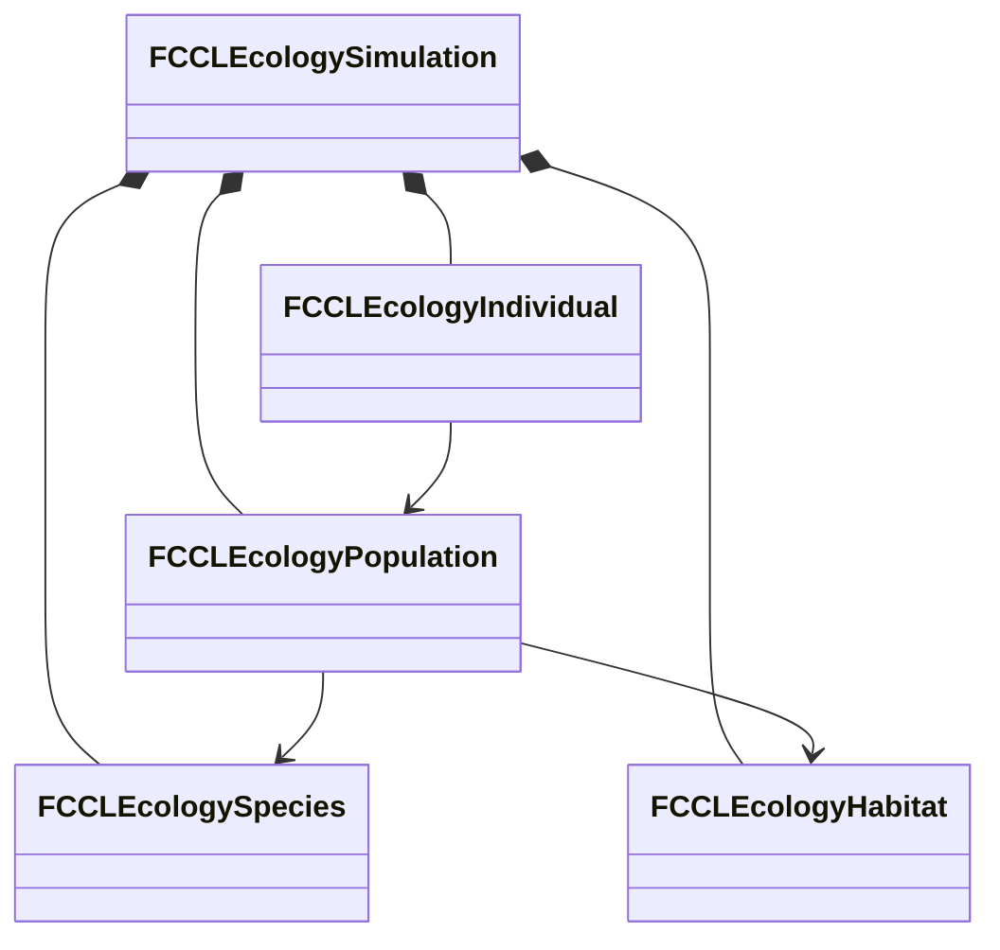

# 생태계·생애 구현과 검증

단계 8의 범위는 [환경 계획](EnvironmentPlan.md#생태계와-생애-주기)을 따른다. 현재 작업은 개체군·식생·부패·Agent 나이를 공통 세계 시간과 저장에 연결하는 것이다. 개체군 값 모델과 시간순 생애 계산을 구현했다. 월드 공통 진행·저장, 실제 Actor/Mass와 실험장 연결은 후속 작업이다.

## 목표와 제약

서식지·개체군·무리·개체를 구분하고 먼 집계에서 가까운 표현으로 전환할 때 수를 보존한다. 출생·사망·포획·이주는 사건 ID로 한 번 적용한다. 기억·서사·소유권을 가진 개체는 안정적인 ID를 유지한다. 화면 밖의 집계를 임의로 다시 채우지 않는다. 대표 지상 생물·물고기·새·곤충으로 같은 계약을 검사한다.

세계 시간은 생물의 나이와 생태 진행의 기준이다. Actor/Mass는 표현·실행을 맡고 권위 수량의 원본이 아니다. 기존 Agent의 ID·실행권과 생태계 예약을 연결하되 직업·재산·기억 Feature를 모든 생물에 강제하지 않는다. 식물·버섯, 음식 부패와 핵심 NPC의 자연 노화 보호도 이 단계의 필수 후속 작업이다.

## 책임과 수명

| 값 또는 소유자 | 책임과 수명 |
|---|---|
| `FCCLEcologySpecies` | 종 ID·이동 방식·성숙·수명·번식 간격. 저장과 검증에 쓰는 종 데이터 |
| `FCCLEcologyHabitat` | 공간 경계·서식 매체·수용 규모. 종과 개체군이 참조 |
| `FCCLEcologyPopulation` | 종·서식지에 속한 집계, 출생 시각별 연령군과 수량 원장 |
| `FCCLEcologyIndividual` | 집계에서 예약한 한 개체의 ID·출생 시각·상태. 중요 개체는 먼 상태에서도 유지 |
| `FCCLEcologySimulation` | 서버 값 상태와 사건 영수증·표현 실행권. 실패 시 후보를 폐기 |
| Actor/Mass 어댑터 | 후속 구현. 공통 ID를 사용하며 실행권 반납 뒤 집계 또는 지속 개체로 복귀 |



## 값 모델 인터페이스

```cpp
bool Apply(const FCCLEcologyEvent& Event, FString& Error);
bool Materialize(FGuid RequestId, FGuid PopulationId, FGuid CohortId,
    FGuid IndividualId, bool bPersistent, FString& Error);
bool Acquire(FGuid IndividualId, ECCLEcologyRepresentation Representation,
    FGuid Writer, FCCLEcologyLease& OutLease, FString& Error);
bool Release(const FCCLEcologyLease& Lease, FString& Error);
bool AdvanceTo(double TargetWorldSeconds, FString& Error, int32 MaxBoundaries = 256);
bool Capture(TArray<uint8>& Bytes, FString& Error) const;
bool Restore(const TArray<uint8>& Bytes, FString& Error);
```

집계 수는 연령군의 수량이고, 예약된 살아 있는 개체는 별도 수량이다. 현재 개체군은 종·서식지별 수량 단위이며 이동 무리의 별도 그룹·행동은 아직 구현하지 않았다. 원장 검사는 두 수량을 합산한다. `Materialize`는 한 마리를 집계에서 빼고 지속 레코드에 넣는다. `Acquire`는 수량을 바꾸지 않고 Actor 또는 Mass의 실행권을 발급한다. 같은 개체에 두 실행권을 주지 않는다. 일반 개체의 `Release`는 집계로 돌려보내고, 중요 개체는 레코드를 남긴 채 먼 상태로 전환한다.

```cpp
FCCLEcologySimulation Candidate = *this;
// 요청 검증과 수량 변경은 후보에서 수행한다.
if (!Candidate.Validate(Error))
{
    return false;
}
*this = MoveTemp(Candidate);
return true;
```

## 시간순 생애 계산

`AdvanceTo`는 번식 주기와 수명 종료 시각을 시간순으로 처리한다. 같은 시각에는 모든 사망을 적용한 뒤 번식한다. 성체 두 마리당 한 마리의 출생을 기본 규칙으로 삼고 서식지의 남은 수용 규모로 제한한다. 여러 개체군이 같은 서식지의 수용 규모를 다투면 안정적인 개체군 ID 순서로 배정한다. 이 순서는 재현성을 보장하지만 공정한 먹이 경쟁 모델은 아니다.

종의 `BirthIntervalSeconds`가 0이면 자동 번식을 끈다. 양수는 세계 원점에 맞춘 정수 초 간격이다. 태어난 시각은 연령군과 개체에 저장하며 진행을 나눠도 변경하지 않는다. 자동 사건 ID는 세계·개체군·연령군·개체·발생 시각·종류에서 생성한다. 입력 사건은 동일 ID·동일 내용일 때만 재전송으로 인정한다.

실행 중인 개체도 수명 종료 시 실행권을 먼저 회수하고 사망을 기록한다. 반환이 늦게 도착해도 죽은 개체가 집계로 돌아오지 않는다. 멸종 뒤에는 번식이 없으며 새로 기록된 유입만 수량을 늘린다. 수명이 지난 연령군은 초기 살아 있는 수량이나 외부 유입으로 등록하지 못한다. 중요 개체의 ID 유지와 핵심 NPC의 자연 노화 보호는 별개이며 보호 정책은 아직 연결하지 않았다.

한 호출의 시간 경계 예산은 기본 256개다. 예산이나 수량 검사가 실패하면 진행 시각·원장·사건 영수증·실행권을 포함한 후보 전체를 폐기한다. 호출자는 더 짧은 세계 시간 구간으로 재시도해야 한다. 큰 시간 건너뛰기와 실제 월드의 대기 시간 예산을 연결하는 검증은 남아 있다.

## 검증 방법

대표 네 종에서 예약·반환을 반복해 총수가 바뀌지 않는지 검사한다. 이주 양쪽 원장, 중복 사건, 같은 ID의 다른 요청, 부족한 수량, 다른 종·서식 매체, 실행권 충돌, 오래된 실행권, 저장 재개와 손상 저장 거부를 확인한다. 저장은 실행권을 포함하지 않으며 복원 후 새 세대를 발급해 복원 전 쓰기를 거부해야 한다.

후속 검증은 월드 공통 시간·저장과 생애 계산의 연결, 실제 Actor/Mass 전환, 식생의 성장·화재·재생, 음식의 보관·합치기, 보호 NPC와 일반 생물의 수명, 구역 06·07 조작·네트워크·저장이다. 이 문서의 초기 값 모델 검사가 전체 단계 8의 완료를 뜻하지 않는다.

## 트레이드오프와 UE 통합

값 모델은 Actor의 생성·소멸에 수량이 끌려가지 않게 하지만 실행권과 예약을 연결하는 어댑터가 필요하다. 일반 개체는 집계로 돌려보내 메모리를 제한하고 중요 개체만 ID·기록을 유지한다. 과거 사건 영수증과 사용한 개체 ID는 재적용 방지를 위해 보존하며 설정한 예산을 넘으면 실패한다. 영수증 정리 정책과 큰 월드의 비용은 단계 9에서 측정한다.

기존 `FCCLAgentStore`는 세대·실행권으로 의도 쓰기를 보호하고 `CCLMassAgentBridge`는 실제 Mass Entity에 그 실행권을 연결한다. 생태 예약은 개체군 수량의 소유권이며 Agent 의도 쓰기와 다른 계약이다. 이를 하나의 전역 잠금으로 합치지 않는다. 이 설계는 UE4와 UE5의 Actor 수명 차이에 기대지 않으며 Mass 어댑터는 UE5의 별도 실행 경로다.

## 실행 근거와 남은 연결

UE 5.8.3의 로컬 작업 트리에서 프로젝트 파일 생성, `CCLEditor Win64 Development` 빌드와 환경 자동화를 실행했다. 경로는 저장소 상대 경로이며 원본 로그는 로컬 `Saved/`에 보관한다. 최종 실행 경로는 아래 표에 기록한다.

| 검사 | 결과와 근거 |
|---|---|
| 프로젝트 파일 생성 | 성공. `Saved/EnvironmentStages/Ecology-GPF.log` |
| Editor 빌드 | 성공. `Saved/EnvironmentStages/Ecology-Build.log` |
| 환경 자동화 | 88/88 성공. 생태 검사 9개 포함, 경고·실패·미실행 0. `Saved/Tests/Automation/20261010-135234-767/report/index.json` |
| 생태 값 모델 | 네 매체의 예약·반환, 실행권 충돌, 중요 ID 유지, 사건 재전송·충돌, 이주·사망·포획·유입 원장 |
| 저장과 시간 | 손상·길이·버전·할당 상한 거부, 복원 세대 변경, 시간 분할·중간 저장 재개 일치, 멸종 유지, 시간 예산 실패 원본 보존 |

구현은 `CCLEcologySimulation.h/.cpp`, `CCLEcologyAdvance.cpp`와 `CCLEcologyTests.cpp`에 있다. 저장은 정렬된 키 순서와 CRC를 사용하며 최대 8MiB로 제한한다. 실행권은 저장하지 않고 개체 예약과 영수증을 저장한다. 버전 2에는 종의 번식 간격이 추가되었다. 버전 1의 자동 번식은 꺼진 상태로 읽도록 구현했으며 과거 저장의 전체 통합 검사는 단계 9에서 수행한다.

현재 검사에서 Actor/Mass는 실행권 종류다. 실제 Actor 생성·Mass Entity 전환을 실행한 결과가 아니다. 종의 이동 매체도 서식지 적합성 검사이며 이동·먹이 탐색 구현을 뜻하지 않는다. 공통 월드 스냅샷, Agent 나이·보호 NPC, 식생·버섯·음식 부패, 무리 행동과 구역 06·07의 조작·네트워크를 연결해야 단계 8을 완료할 수 있다.
