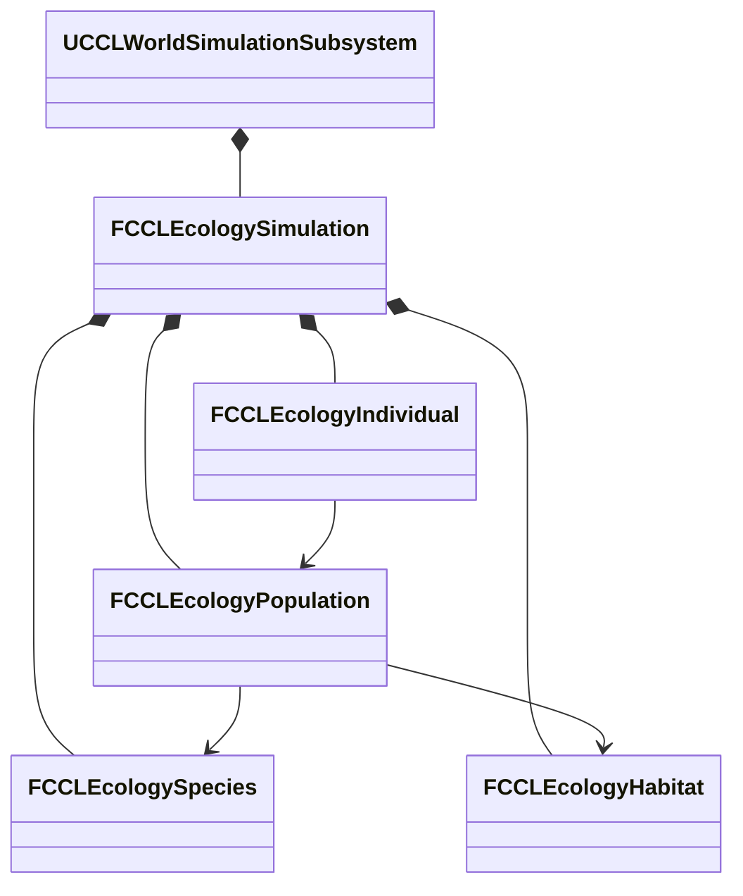
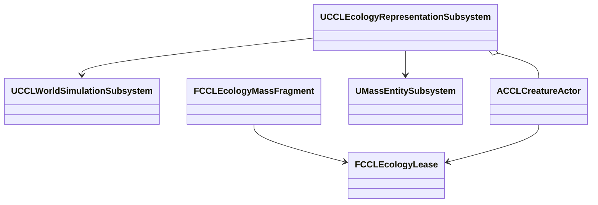
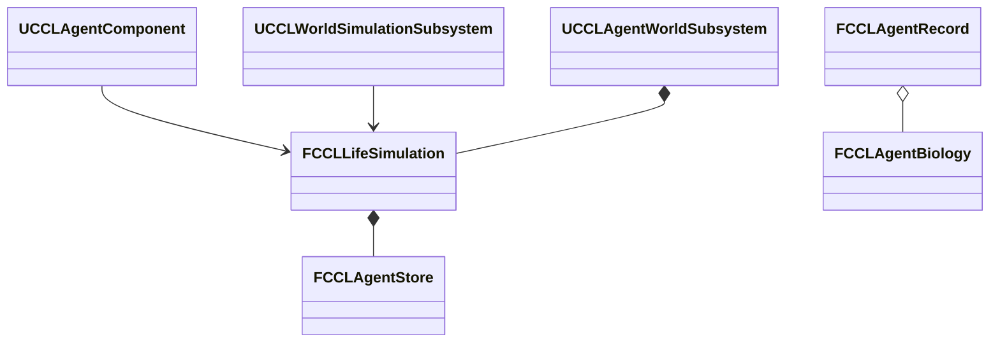
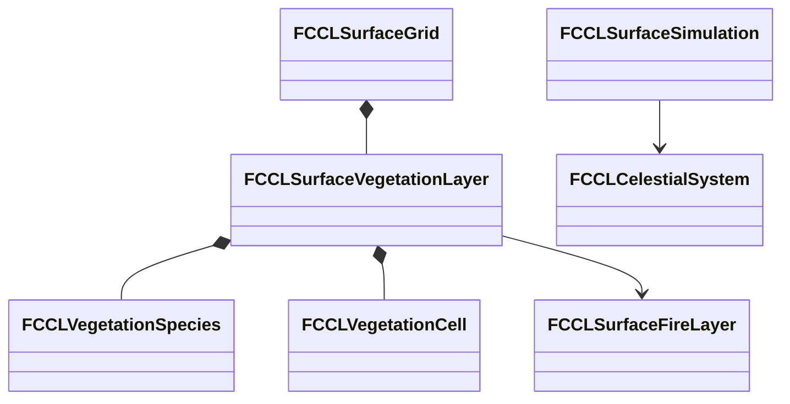

# 생태계·생애 구현과 검증

단계 8의 범위는 [환경 계획](EnvironmentPlan.md#생태계와-생애-주기)을 따른다. 현재 작업은 개체군·식생·부패·Agent 나이를 공통 세계 시간과 저장에 연결하는 것이다. 개체군 값 모델과 시간순 생애 계산을 구현하고 월드 공통 진행·저장에 연결했다. 실제 Actor/Mass 전환과 Actor의 첫·늦은 접속자 복제를 검증했다. Agent의 공통 시간 나이·수명·자연 노화 보호와 실제 Actor 제거·복원도 연결했다. 식생·음식과 구역 06·07 조작은 후속 작업이다.

## 목표와 제약

서식지·개체군·무리·개체를 구분하고 먼 집계에서 가까운 표현으로 전환할 때 수를 보존한다. 출생·사망·포획·이주는 사건 ID로 한 번 적용한다. 기억·서사·소유권을 가진 개체는 안정적인 ID를 유지한다. 화면 밖의 집계를 임의로 다시 채우지 않는다. 대표 지상 생물·물고기·새·곤충으로 같은 계약을 검사한다.

세계 시간은 생물의 나이와 생태 진행의 기준이다. Actor/Mass는 표현·실행을 맡고 권위 수량의 원본이 아니다. 기존 Agent의 ID·실행권과 생태계 예약을 연결하되 직업·재산·기억 Feature를 모든 생물에 강제하지 않는다. 핵심 NPC의 자연 노화 보호는 아래 Agent 생애 연결이 소유한다. 식물·버섯과 음식 부패도 이 단계의 필수 후속 작업이다.

## 책임과 수명

| 값 또는 소유자 | 책임과 수명 |
|---|---|
| `FCCLEcologySpecies` | 종 ID·이동 방식·성숙·수명·번식 간격. 저장과 검증에 쓰는 종 데이터 |
| `FCCLEcologyHabitat` | 공간 경계·서식 매체·수용 규모. 종과 개체군이 참조 |
| `FCCLEcologyPopulation` | 종·서식지에 속한 집계, 출생 시각별 연령군과 수량 원장 |
| `FCCLEcologyIndividual` | 집계에서 예약한 한 개체의 ID·출생 시각·상태. 중요 개체는 먼 상태에서도 유지 |
| `FCCLEcologySimulation` | 서버 값 상태와 사건 영수증·표현 실행권. 실패 시 후보를 폐기 |
| `UCCLWorldSimulationSubsystem` | 생태·표면·시계의 월드 수명과 서버 권한. Agent 진행까지 성공한 후보를 함께 게시 |
| `FCCLWorldSnapshotCodec` | 같은 세계 ID·완료 시각·저장 세대의 생태·시계·표면·Agent 검증과 복원 |
| `UCCLEcologyRepresentationSubsystem` | 실제 Actor·Mass Entity의 생성·전환·위치 수집·폐기. 서버 실행권과 예약을 연결 |
| `ACCLCreatureActor` / `FCCLEcologyMassFragment` | 가까운 복제 Actor / 서버 Mass 표현. 개체군 수량은 직접 소유하지 않음 |



## 값 모델 인터페이스

```cpp
bool Apply(const FCCLEcologyEvent& Event, FString& Error);
bool Materialize(FGuid RequestId, FGuid PopulationId, FGuid CohortId,
    FGuid IndividualId, bool bPersistent, FString& Error);
bool Acquire(FGuid IndividualId, ECCLEcologyRepresentation Representation,
    FGuid Writer, FCCLEcologyLease& OutLease, FString& Error);
bool Release(const FCCLEcologyLease& Lease, FString& Error);
bool AdvanceTo(double TargetWorldSeconds, FString& Error, int32 MaxBoundaries = 256);
bool Capture(TArray<uint8>& Bytes, FString& Error) const;
bool Restore(const TArray<uint8>& Bytes, FString& Error);
```

집계 수는 연령군의 수량이고, 예약된 살아 있는 개체는 별도 수량이다. 현재 개체군은 종·서식지별 수량 단위이며 이동 무리의 별도 그룹·행동은 아직 구현하지 않았다. 원장 검사는 두 수량을 합산한다. `Materialize`는 한 마리를 집계에서 빼고 지속 레코드에 넣는다. `Acquire`는 수량을 바꾸지 않고 Actor 또는 Mass의 실행권을 발급한다. 같은 개체에 두 실행권을 주지 않는다. 일반 개체의 `Release`는 집계로 돌려보내고, 중요 개체는 레코드를 남긴 채 먼 상태로 전환한다.

```cpp
FCCLEcologySimulation Candidate = *this;
// 요청 검증과 수량 변경은 후보에서 수행한다.
if (!Candidate.Validate(Error))
{
    return false;
}
*this = MoveTemp(Candidate);
return true;
```

## 시간순 생애 계산

`AdvanceTo`는 번식 주기와 수명 종료 시각을 시간순으로 처리한다. 같은 시각에는 모든 사망을 적용한 뒤 번식한다. 성체 두 마리당 한 마리의 출생을 기본 규칙으로 삼고 서식지의 남은 수용 규모로 제한한다. 여러 개체군이 같은 서식지의 수용 규모를 다투면 안정적인 개체군 ID 순서로 배정한다. 이 순서는 재현성을 보장하지만 공정한 먹이 경쟁 모델은 아니다.

종의 `BirthIntervalSeconds`가 0이면 자동 번식을 끈다. 양수는 세계 원점에 맞춘 정수 초 간격이다. 태어난 시각은 연령군과 개체에 저장하며 진행을 나눠도 변경하지 않는다. 자동 사건 ID는 세계·개체군·연령군·개체·발생 시각·종류에서 생성한다. 입력 사건은 동일 ID·동일 내용일 때만 재전송으로 인정한다.

실행 중인 개체도 수명 종료 시 실행권을 먼저 회수하고 사망을 기록한다. 반환이 늦게 도착해도 죽은 개체가 집계로 돌아오지 않는다. 멸종 뒤에는 번식이 없으며 새로 기록된 유입만 수량을 늘린다. 수명이 지난 연령군은 초기 살아 있는 수량이나 외부 유입으로 등록하지 못한다. 중요 개체의 ID 유지와 핵심 NPC의 자연 노화 보호는 별개다. 자연 노화 보호는 Agent의 선택 생애 Feature에 적용하며 생태 개체의 중요 ID만으로 수명을 면제하지 않는다.

한 호출의 시간 경계 예산은 기본 256개다. 예산이나 수량 검사가 실패하면 진행 시각·원장·사건 영수증·실행권을 포함한 후보 전체를 폐기한다. 호출자는 더 짧은 세계 시간 구간으로 재시도해야 한다. 월드 공통 진행은 같은 후보 경계를 사용한다. 큰 시간 건너뛰기와 대규모 계산 비용은 단계 9에서 추가 검증한다.

## 월드 진행과 저장

`UCCLWorldSimulationSubsystem`은 생태 상태를 소유하고 서버에서만 종·서식지·개체군 등록과 사건·실행권 변경을 허용한다. 생태 전용 시계는 진행시키지 않는다. `CCLWorldAdvance::Advance`가 공통 시계의 구간으로 표면과 생태 후보를 계산하고 Agent의 원자적 진행까지 성공한 뒤 세 후보를 게시한다. 생태의 시간 예산 초과나 Agent 실패는 미처리 입력을 보존하며 다른 모델을 먼저 진행시키지 않는다.

월드 저장 스키마 4는 환경 입력·표면 다음에 크기가 제한된 생태 바이트를 넣고 기존 Agent 바이트를 보존한다. 생태의 세계 ID·완료 세계 시각은 월드 헤더·시계와 같아야 한다. 손상·다른 세계·다른 시각은 Agent를 교체하기 전에 거부한다. 복원 뒤 생태 실행권에는 새 세대를 적용하므로 저장 전 Actor/Mass의 늦은 반납을 거부한다.

스키마 1-3에는 생태 바이트가 없다. 이 저장은 같은 세계 ID와 저장 당시 완료 시각의 빈 생태 상태로 변환한다. 초기 개체군을 임의 생성하거나 종료 중 현실 시간을 더하지 않는다. 생태가 포함된 저장의 예약·영수증·연령군은 그대로 복원하며 남아 있던 시간 구간을 다시 진행할 수 있다. 지역 지형 묶음도 기존 월드 저장 바이트를 포함하므로 같은 완료 표식에 생태가 함께 들어간다. 지형을 수정하면서 생태를 저장하는 통합 실패 조합은 단계 9에서 추가 검사한다.

## 검증 방법

대표 네 종에서 예약·반환을 반복해 총수가 바뀌지 않는지 검사한다. 이주 양쪽 원장, 중복 사건, 같은 ID의 다른 요청, 부족한 수량, 다른 종·서식 매체, 실행권 충돌, 오래된 실행권, 저장 재개와 손상 저장 거부를 확인한다. 저장은 실행권을 포함하지 않으며 복원 후 새 세대를 발급해 복원 전 쓰기를 거부해야 한다.

후속 검증은 Agent와 생태 사이의 생애 소유권 이전과 원거리 집계 복제, 식생의 성장·화재·재생, 음식의 보관·합치기, 생물의 이동·먹이·무리, 구역 06·07 조작·네트워크·저장이다. 이 문서의 초기 값 모델 검사가 전체 단계 8의 완료를 뜻하지 않는다.

## 트레이드오프와 UE 통합

값 모델은 Actor의 생성·소멸에 수량이 끌려가지 않게 하지만 실행권과 예약을 연결하는 어댑터가 필요하다. 일반 개체는 집계로 돌려보내 메모리를 제한하고 중요 개체만 ID·기록을 유지한다. 과거 사건 영수증과 사용한 개체 ID는 재적용 방지를 위해 보존하며 설정한 예산을 넘으면 실패한다. 영수증 정리 정책과 큰 월드의 비용은 단계 9에서 측정한다.

기존 `FCCLAgentStore`는 세대·실행권으로 의도 쓰기를 보호하고 `CCLMassAgentBridge`는 실제 Mass Entity에 그 실행권을 연결한다. 생태 예약은 개체군 수량의 소유권이며 Agent 의도 쓰기와 다른 계약이다. 이를 하나의 전역 잠금으로 합치지 않는다. 이 설계는 UE4와 UE5의 Actor 수명 차이에 기대지 않으며 Mass 어댑터는 UE5의 별도 실행 경로다.

## 실행 근거와 남은 연결

초기 생태 코어를 UE 5.8.3의 로컬 작업 트리에서 검사한 결과는 아래 표와 같다. 월드 통합 이후의 최종 검증은 다음 절에서 구분한다. 경로는 저장소 상대 경로이며 원본 로그는 로컬 `Saved/`에 보관한다.

| 검사 | 결과와 근거 |
|---|---|
| 프로젝트 파일 생성 | 성공. `Saved/EnvironmentStages/Ecology-GPF.log` |
| Editor 빌드 | 성공. `Saved/EnvironmentStages/Ecology-Build.log` |
| 환경 자동화 | 88/88 성공. 생태 검사 9개 포함, 경고·실패·미실행 0. `Saved/Tests/Automation/20261010-135234-767/report/index.json` |
| 생태 값 모델 | 네 매체의 예약·반환, 실행권 충돌, 중요 ID 유지, 사건 재전송·충돌, 이주·사망·포획·유입 원장 |
| 저장과 시간 | 손상·길이·버전·할당 상한 거부, 복원 세대 변경, 시간 분할·중간 저장 재개 일치, 멸종 유지, 시간 예산 실패 원본 보존 |

구현은 `CCLEcologySimulation.h/.cpp`, `CCLEcologyAdvance.cpp`와 `CCLEcologyTests.cpp`에 있다. 저장은 정렬된 키 순서와 CRC를 사용하며 최대 8MiB로 제한한다. 실행권은 저장하지 않고 개체 예약과 영수증을 저장한다. 버전 2에는 종의 번식 간격이 추가되었다. 버전 1의 자동 번식은 꺼진 상태로 읽도록 구현했으며 과거 저장의 전체 통합 검사는 단계 9에서 수행한다.

위의 초기 값 모델과 월드 통합 검사에서 Actor/Mass는 실행권 종류다. 실제 Actor 생성·Mass Entity 전환의 검증은 아래 별도 절에 기록한다. 종의 이동 매체도 서식지 적합성 검사이며 이동·먹이 탐색 구현을 뜻하지 않는다. 식생·버섯·음식 부패, 종별 이동·먹이·무리 행동과 구역 06·07의 조작·네트워크를 연결해야 단계 8을 완료할 수 있다. Agent 나이·보호의 구현·검증은 아래 별도 절에서 구분한다.


### 월드 통합 실행 근거

2026-10-10 월드 통합 코드의 환경 자동화는 90/90을 통과했다. `WorldAdvanceAtomicity`는 생태 예산 실패와 후속 Agent 실패에서 네 소유자의 상태가 유지되고 재시도 출생이 한 번만 적용되는지 검사한다. `WorldSaveRestoreAndRejectedCandidate`는 예약을 포함한 전체 저장·손상·다른 세계·다른 시각 거부와 대기 시간 재개를 검사한다. 기존 `EnvironmentSchemaMigration`은 스키마 1·2에 더해 실제 스키마 3 배치의 생태 누락 변환을 검사한다.

`Tools/Validation/run_ecology_smoke.ps1`은 실제 맵에서 네 이동 매체의 개체군을 등록하고 공통 월드 시간을 진행한다. 출생 후 저장하고 포획으로 상태를 바꾼 뒤 정식 Agent 복원 경로로 되돌린다. 프로세스를 종료한 다음 새 프로세스에서 같은 파일을 읽고 생태 바이트·완료 시각을 검사하며 다시 번식을 진행한다. 로그의 비교 체크섬은 저장 끝의 CRC를 제외한 본문에서 계산한다. Actor의 시각적 생물 표현이나 네트워크 복제 결과는 이 검사에 포함하지 않는다.

| 검사 | 결과와 근거 |
|---|---|
| 최종 프로젝트 파일 생성·Editor 빌드 | 성공. `Saved/EnvironmentStages/EcologyWorld-GPF.log`, `EcologyWorld-Build.log` |
| 환경 자동화 | 90/90, 경고·실패·미실행 0. `Saved/Tests/Automation/20261010-140023-357/report/index.json` |
| 기존 시나리오·새 프로세스 회귀 | 통과. `Saved/Tests/Environment/EnvironmentScenario-Standalone-20261010-140103-101` |
| EnvironmentScenario 생태 저장·새 프로세스 재개 | 통과. `Saved/Tests/Ecology/EnvironmentScenario-20261010-140252-611` |
| EnvironmentPlayground 생태 저장·새 프로세스 재개 | 통과. `Saved/Tests/Ecology/EnvironmentPlayground-20261010-140251-169` |
| 캠페인 세션 저장·재개 | 통과. `Saved/Tests/SessionSmoke/20261010-140251` |


### Actor/Mass 연결과 실행 근거

실제 표현은 `UCCLEcologyRepresentationSubsystem`이 월드 수명으로 관리한다. `ACCLCreatureActor`와 `FCCLEcologyMassFragment`는 개체 ID·위치와 현재 실행권을 읽고, 수량 원장은 `FCCLEcologySimulation`에 유지한다. 새 표현을 준비한 다음 실행권을 원자적으로 교체하고 이전 표현을 제거한다. 준비나 전환이 실패하면 기존 표현·실행권을 유지한다.



`SetRepresentation(IndividualId, Representation, Error)`는 예약된 개체의 표현을 바꾼다. `Transfer`는 같은 개체의 예약을 보존하고 실행권 순번·소유자를 교체한다. `UpdatePosition`과 `Finish`는 현재 실행권으로만 위치·사망·포획·이주를 반영한다. 초기 위치는 서식지 중심이며, 위치도 저장한다. 자동 거리 전환·먹이 탐색·종별 이동과 네트워크 관심 영역은 이 연결 위에서 별도로 검증한다.

```cpp
FCCLEcologyLease NewLease;
if (!Runtime->TransferEcologyIndividual(OldLease, NewRepresentation,
    NewWriter, NewLease, Error))
{
    DestroyPreparedRepresentation();
    return false;
}
PublishPreparedRepresentation(NewLease);
DestroyPreviousRepresentation();
```

실제 Actor와 Mass Entity의 존재, 전환 전후 집계·예약 합계, 오래된 Actor 종료, 외부 Entity 제거, 저장 복원 뒤 표현 폐기, 사망과 중복 반환을 검사한다. Mass의 즉시 생성·파괴는 처리 중이 아닌 게임 스레드에서만 수행하고 처리 중이면 재시도를 요청한다. 기존 `MassEntity`, `MassCore` 의존을 사용한다. UE5 Mass Entity는 실행 표현이며 개체군 보존·저장 계약을 대신하지 않는다. 임시 표현을 준비하는 동안 메모리를 조금 더 쓰는 대신 실패 시 기존 상태를 보존한다.


표현 전환과 저장 직전에는 현재 Actor 또는 Fragment의 위치를 값 모델에 반영한다. 잘못된 위치는 거부하고 표현을 마지막 유효 위치로 되돌린다. 생태 저장 버전 3은 예약 개체의 위치를 포함하며 이전 버전 1·2의 위치는 서식지 중심으로 읽도록 구현했다. 이전 위치 형식의 별도 파일 검증은 아직 수행하지 않았다. 저장에 실행권은 넣지 않는다. 복원 성공 시 이전 표현을 즉시 폐기하고 저장된 예약을 새 실행권으로 다시 표현할 수 있다.

`Suspend`는 표현만 해제하고 예약을 보존한다. 일반적인 언로드는 `Release`로 집계에 반환한다. `Transfer`는 준비된 표현에 새 실행권을 발급한 뒤 이전 표현을 폐기하므로 오래된 Actor의 `EndPlay`가 새 실행권을 반납하지 못한다. 자연 사망이 실행권을 회수한 경우에도 같은 규칙으로 객체만 정리한다. Mass 처리가 진행 중인 즉시 생성·파괴 요청은 거부한다. 근거는 UE 5.8.3의 `<Engine>/Source/Runtime/MassEntity/Public/MassEntitySubsystem.h`의 `GetMutableEntityManager`와 `MassEntityManager.h`의 `IsProcessing`이다.

`Tools/Validation/run_ecology_representation.ps1`은 실제 네 매체의 Actor와 Mass Entity를 생성한다. 직접 변경한 Actor·Fragment 위치의 인계, 집계 합계, 외부 객체 제거, 준비 실패 시 Entity 회수, 처리 중 변경 거부, 저장·복원과 자연 사망을 검사한다. Listen·Dedicated에서는 첫 클라이언트가 네 개체를 확인한 뒤 두 번째 클라이언트를 접속시킨다. 양쪽의 ID·매체·위치와 쓰기 거부를 확인한 다음 세계 시간을 진행하고 양쪽에서 사망 제거를 확인한다.

| 검사 | 결과와 근거 |
|---|---|
| 최종 프로젝트 파일 생성·Editor 빌드 | 성공. `Saved/EnvironmentStages/EcologyRepresentation-GPF.log`, `EcologyRepresentation-Build.log` |
| 환경 자동화 | 92/92, 경고·실패·미실행 0. `Saved/Tests/Automation/20261010-142038-105/report/index.json` |
| 두 맵의 실제 Actor/Mass 전환 | 통과. `Saved/Tests/EcologyRepresentation/EnvironmentScenario-20261010-142159-887`, `EnvironmentPlayground-20261010-142156-736` |
| 최종 Standalone 검사 | 통과. `Saved/Tests/EcologyRepresentation/EnvironmentScenario-Standalone-20261010-142833-091` |
| Listen 첫·늦은 접속자 | 통과. `Saved/Tests/EcologyRepresentation/EnvironmentScenario-Listen-20261010-142833-759` |
| Dedicated 첫·늦은 접속자 | 통과. `Saved/Tests/EcologyRepresentation/EnvironmentScenario-Dedicated-20261010-142834-865` |
| 생태 저장·새 프로세스 재개 회귀 | 통과. `Saved/Tests/Ecology/EnvironmentScenario-20261010-142157-584` |

이 검사는 NullRHI의 Editor 실행 파일을 사용했다. Dedicated는 `-server` 실행이며 별도 Server 타깃 빌드나 패키지 검증은 아니다. Actor 외형은 기본 Sphere·Cube로 구분한 임시 표현이고 충돌·애니메이션·종별 이동·먹이 탐색·거리 자동 전환은 아직 없다. 실제 렌더링 외관, 지연·손실·재접속, 원거리 집계와 Mass의 클라이언트 표현은 후속 검증이다. 이 표현 검사의 Agent 생애 연결은 아래 별도 검증으로 구분한다.


### Agent 생애 연결과 실행 근거

Agent의 출생 시각·성숙·수명·사망 원인과 자연 노화 보호는 선택적인 `FCCLAgentBiology` Feature가 소유한다. 나이는 공통 완료 세계 시각에서 출생 시각을 뺀 값이며 사망 뒤에는 사망 시각에서 멈춘다. 원래 주민·전투 기록에 없는 출생일을 복원 때 임의로 만들지 않는다. 기존 저장에 Feature가 없으면 기존 행동을 유지하며 나이는 미기록이다. 새 주민 시나리오는 편집 가능한 초기 Feature를 가진다. 첫 주민의 퀘스트 역할은 자연 노화 보호로 표시한다. 시험 초기 나이·수명은 제작용 확정 밸런스가 아니다.

생태 집계가 소유하는 생물과 LifeSimulation이 소유하는 Agent는 이 연결에서 별개의 집단이다. 같은 ID가 생태 예약과 Agent 생애 Feature에 동시에 존재하면 공통 진행과 저장·복원을 거부한다. 이후 두 모델을 잇는 개체 승격은 나이·생존 상태의 소유권을 명시적으로 이전해야 한다. 표현 전환 자체가 Agent를 자동 생성하지 않는다.



LifeSimulation은 다른 예정 사건과 함께 자연 수명 종료 시각에서 진행 구간을 나눈다. 같은 시각의 사망을 모두 후보에 반영한 뒤 생활 거래를 평가하므로 죽은 제공자와 거래하지 않는다. 생애 계산은 기존 후보 복사 안에서 수행하며 예산 초과·Writer 충돌은 공통 시계와 생태·표면까지 유지한다. 사망 시 의도·실행 예약을 해제하고 Actor는 권위 기록을 확인해 제거한다. 기억·재산과 사망 기록은 저장에 남긴다. 상속·장례는 이번 연결의 범위가 아니다.

```cpp
bool EndLife(FGuid AgentId, ECCLAgentDeathCause Cause, FString& Error);
bool IsAlive(FGuid AgentId) const;
// 나이는 별도 Tick 누적값을 저장하지 않는다.
double Age = Biology.DeathCause == ECCLAgentDeathCause::None
    ? WorldSeconds - Biology.BirthWorldSeconds
    : Biology.DeathWorldSeconds - Biology.BirthWorldSeconds;
```

보호 플래그는 자연 사망 판정에만 사용한다. 외부 원인의 사망 요청과 기존 피해 판정은 보호 여부로 면제하지 않는다. 저장·재개, 시간 분할과 배율, 정확한 수명 경계, 보호 개체의 외부 사망, 죽은 Agent의 거래·새 의도 거부, 실패 시 원본 보존을 검증한다. 실제 맵에서는 일반 주민의 Actor 제거와 보호 주민 유지, 복원 후 사망 상태 유지를 확인한다. 검사에서는 실제 피해 판정과 명시적인 외부 사망 요청을 각각 사용한다. 모든 피해·화재를 생애 사망 원인으로 자동 연결한 결과는 아니다.

선택 Feature는 기억·직업 없는 생물에 주민 데이터를 강제하지 않는 대신, 기존 콘텐츠의 생애 설정과 소유권 전환을 명시적으로 관리해야 한다. UE5의 기존 `FInstancedStruct` Registry·버전 검증 경로를 사용하며 추가 모듈은 필요 없다. 이 생애 규칙은 UE 엔진의 자동 노화 기능이 아니다.


| 검사 | 결과와 근거 |
|---|---|
| 최종 프로젝트 파일 생성·Editor 빌드 | 성공. `Saved/EnvironmentStages/AgentBiology-GPF.log`, `AgentBiology-Build.log` |
| 환경 자동화 | 96/96, 경고·실패·미실행 0. 생애 검사 4개 포함. `Saved/Tests/Automation/20261010-144010-588/report/index.json` |
| 기존 Agent 자동화 | 9/9, 경고·실패·미실행 0. `Saved/Tests/Automation/20261010-144007-841/report/index.json` |
| Campaign 실제 생애 검사 | 통과. `Saved/Tests/AgentBiology/Campaign-20261010-144249-352` |
| EnvironmentScenario 실제 생애 검사 | 통과. `Saved/Tests/AgentBiology/EnvironmentScenario-20261010-144247-282` |
| EnvironmentPlayground 실제 생애 검사 | 통과. `Saved/Tests/AgentBiology/EnvironmentPlayground-20261010-144249-101` |
| 주민 에셋 추가·새 프로세스 재확인 | 8명에 빠진 Feature만 추가. 재실행 추가 0명, 파일 SHA-256 동일. `Saved/EnvironmentStages/AgentBiology-Assets.log`, `AgentBiology-AssetsReload.log` |
| 갱신된 주민 에셋의 생활 실행 회귀 | 통과. 실제 StateTree 이동·작업·피해·저장·복원. `Saved/Tests/AgentWorld/20261010-144734` |
| 갱신된 주민 에셋의 새 프로세스 세션 재개 | 통과. `Saved/Tests/SessionSmoke/20261010-144736`의 write·read |

자동화는 배율 0·10의 나이, 정확한 수명 종료 시각, 보호 개체의 외부 사망, 사망 뒤 나이 고정, 잘못된 생애·미래 출생·중복 소유권 거부를 검사한다. 생애 경계를 넘은 후보가 예산 초과로 실패하면 저장 바이트가 그대로 남는지도 확인했다. `Tools/Validation/run_agent_biology.ps1`은 실제 월드에서 두 주민을 만들고 자연 사망·보호 유지·실제 피해·외부 사망·Actor 폐기·저장 복원을 검사한다. Campaign 첫 실행은 시험 좌표가 바닥 밖에 있어 실패했으며 실제 지면 질의로 배치를 고친 뒤 세 맵에서 통과했다.

`Tools/Validation/update_agent_biology.py`는 `DA_MerchantLifeScenario`에서 알려진 주민의 누락 Feature만 추가하고 기존 Feature·경제·목표·StateTree를 보존한다. 신규 주민의 시험 기본값은 20-27년 나이, 18년 성숙, 80년 수명이며 1년을 365일의 초로 작성한다. 첫 주민은 자연 노화 보호를 사용한다. 이 수치는 짧은 자동 검사에서 쓰는 100초 수명과 별개이며 최종 제작 밸런스가 아니다. 기존 저장의 누락 Feature에는 이 기본값을 소급 주입하지 않는다.

현재 생애 Actor 검사는 Standalone·NullRHI 결과다. 생애 사망의 첫·늦은 접속자·재접속 검증, 개체군에서 Agent로 생애 소유권 이전, 생애 관측 UI, 성숙에 따른 외형·행동과 플레이어 노화는 이 결과에 포함하지 않는다. 플레이어 노화는 원래 범위에서 제외된다. 식생·음식 부패·실제 종별 이동과 구역 06·07은 계속 작업한다.


### 식생·토양 결합 설계

`FCCLSurfaceVegetationLayer`는 표면 지역의 셀별 식생 패치와 토양 양분·유기물을 소유한다. 한 셀은 한 종의 패치를 표현하며 종 데이터는 나무·풀·꽃·관목·이끼·양치류·조류·수생 식물·버섯을 구분할 수 있다. 패치의 성장·성숙·휴면·죽음, 생체량·고사량·탄 누계·재생 횟수와 현재 생장 주기의 시작 시각을 저장한다. 개별 잎·줄기는 시뮬레이션 개체로 만들지 않는다. PCG와 Actor·인스턴스 메시는 이후 이 저장 상태를 배치·표현한다.

성장은 공통 세계 시간과 실제 토양 물·양분으로 제한한다. 광합성 종은 천체 일조와 셀의 햇빛 통과율을 사용한다. 버섯은 토양 유기물도 소비하며 그늘 조건을 적용한다. 위도와 주광원의 적위로 얻은 낮 길이, 온도와 수분이 생장·휴면을 정한다. 자연 수명과 가뭄 스트레스가 끝나는 경계에서 죽음을 기록하고, 재생 가능한 뿌리·균사와 대기 시간·자원이 남아 있을 때만 새 생장 주기를 시작한다. 재생 자체가 생체량을 채우지는 않는다.



식생 패치가 있는 셀의 연소 가능한 생체·고사량은 같은 셀의 연료와 일치해야 한다. 연료 원장에 성장 유입·분해 유출을 추가한다. 화재의 실제 연소량을 식생에서 차감하고 탄 누계·양분 환원을 기록한다. 열에 죽은 생체는 고사량으로 옮기며 심한 열은 재생 원본도 없앤다. 고사체 분해는 연료를 줄이고 토양 유기물·양분을 늘린다. 토양 수분 소비는 식생의 증산 누계와 기존 표면 증발 유출에 한 번 기록한다. 실내에서는 같은 물을 방의 수증기로 옮기고 잠열을 방의 가용 열에서 차감한다. 앞서 예약한 표면·식생의 열 소비를 제외한 잔여량으로 성장을 제한한다. 질소·탄소·산소 화학을 모두 푸는 정밀 물질 모델은 아니다.

```cpp
bool Initialize(FCCLSurfaceGrid& Grid, const TArray<FCCLVegetationSpecies>& Species,
    const TArray<FCCLVegetationSeed>& Seeds, double WorldSeconds, FString& Error);
bool AdvanceCandidate(FCCLSurfaceGrid& Grid, double WorldFrom, double WorldDelta,
    double IrradianceWattsPerM2, double DaylightHours, FString& Error,
    FCCLSurfaceThermalContext* Context = nullptr);
// 호출자는 게시 전 표면 후보만 전달한다.
if (!CCLSurfaceVegetation::AdvanceCandidate(Candidate, From, Delta, Sun, Daylight, Error))
{
    return false;
}
```

표면 저장 버전 7에 식생과 연료 유입·유출을 추가한다. 이전 버전은 식생 없는 표면으로 읽는다. 지형의 지지 높이가 패치 허용치를 넘게 바뀌면 같은 지형 후보 안에서 식생을 죽이고 재생을 막는다. 물 수용량 등 후속 지형 검증이 실패하면 식생 변경도 폐기한다. 같은 표면 저장 바이트가 기존 월드 저장·지역 묶음·복제로 전달된다.

값 모델 검증은 물·양분·유기물·연료 수지, 맑음·차광·계절 휴면·가뭄, 버섯 유기물 고갈, 자연 사망·재생·심한 화재·지형 지지 제거, 저장 재개·이전 형식·손상·실패 원본 보존을 포함한다. 실제 두 환경 맵의 구역 07 조작·표현·네트워크와 음식 부패는 이 값 모델 위의 필수 연결이다. 값 모델과 런타임 검증 결과는 아래에 구분한다. 구역 전체의 완료 판정으로 확대하지 않는다.

셀 패치는 멀리 있는 식생의 비용을 제한하는 대신 같은 셀에 여러 종이 겹치는 경쟁을 직접 표현하지 못한다. 대표 종마다 셀·지역을 나눠 검사하고 밀도·세부 메시는 표현 계층에서 처리한다. 기존 UE5 표면 값 모델과 월드 수명을 사용하며 새로운 엔진 모듈은 필요 없다.


### 식생 값 모델과 실제 월드 검증

2026-10-10 UE 5.8.3의 로컬 작업 트리에서 표면 버전 7과 식생 진행을 검증했다. 나무·풀·꽃·관목·이끼·양치류·조류·수생 식물·버섯의 9개 분류를 저장하며 수생 종은 표면 물, 다른 종은 토양 물을 소비한다. 버섯은 유기물이 없으면 성장하지 않는다. 종별 외형·실제 생물학 수치를 완성한 결과는 아니다.

식생 자동 검사 6개는 일조·그늘·계절 휴면·가뭄 사망, 정확한 수명 경계와 자원 기반 재생, 연소·분해, 실내 증산의 물·열 수지, 공통 진행 실패의 원본 보존, 저장 재개와 지형 지지 제거를 확인한다. 기존 표면 형식 1–6은 식생 없이 복원되며 원래 연료 원장을 유지한다. 성장 유입을 여러 번 누적할 때 부동소수점 반올림으로 정상 연료 상태를 거부하던 상한 검사를 보완했다. 별도의 연료 잔량 수지 검사도 유지한다.

| 검사 | 결과와 근거 |
|---|---|
| 프로젝트 파일 생성·Editor 빌드 | 성공. `Saved/EnvironmentStages/Vegetation-GPF.log`, `Vegetation-Build.log` |
| 환경 자동화 | 102/102, 경고·실패·미실행 0. `Saved/Tests/Automation/20261010-151606-674/report/index.json` |
| EnvironmentScenario 실제 월드·새 프로세스 | 통과. `Saved/Tests/Vegetation/EnvironmentScenario-20261010-151634-489` |
| EnvironmentPlayground 실제 월드·새 프로세스 | 통과. `Saved/Tests/Vegetation/EnvironmentPlayground-20261010-151635-660` |

두 맵의 검사는 실행 중 임시 표면에 9종을 넣고 실제 공통 시계로 자연 사망·고사체 분해·재생을 진행했다. 세계 시계·표면·Agent 시각의 일치, 버섯의 실제 유기물 소비, 월드 저장·변경·복원을 확인했다. 별도 프로세스는 저장된 전체 표면 바이트와 CRC가 같은지 확인한 뒤 생장 주기를 이어 갔다. 검사 명령은 다음과 같다.

```powershell
& Tools/Validation/run_automation.ps1 -Filter CCL.Environment -TimeoutSeconds 300
& Tools/Validation/run_vegetation_smoke.ps1 -Map EnvironmentScenario
& Tools/Validation/run_vegetation_smoke.ps1 -Map EnvironmentPlayground
```

위 실행은 Editor 바이너리의 Standalone·NullRHI 검사다. 저장된 맵에 식생 배치를 추가하거나 PCG·메시·재질을 표시한 검사는 아니다. 식생은 서버 표면의 같은 저장 바이트를 사용하지만 이번 검사에서 식생이 있는 상태의 Listen·Dedicated 복제를 실행하지는 않았다. 구역 07의 직접 조작·표시·초기화, 식생 에셋과 장거리 배치, 음식의 신선도·곰팡이·합치기는 다음 연결 대상이다. 단계 8은 진행 중이며 단계 9의 최종 통합·규모 검증도 남아 있다.
