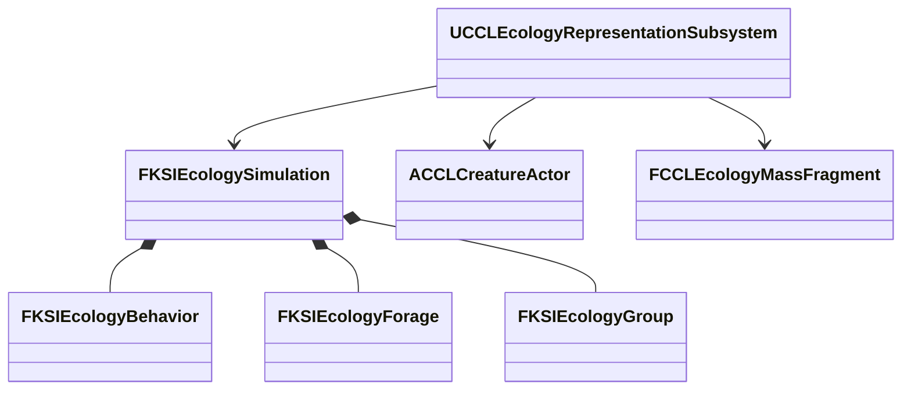
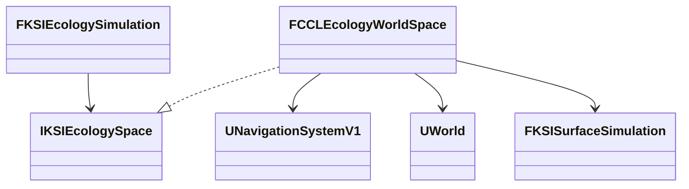
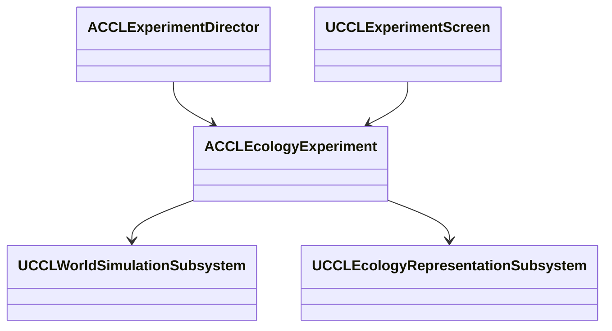

# 생물 행동

지속 예약 개체의 행동, 먹이 수지, 실제 공간 경로, 구역 06 실험과 검증 기록을 소유한다. 상위 문서는 [생태계·생애](../EnvironmentEcology.md)다.

## 생물 행동과 먹이 수지 연결 설계

예약된 생물의 이동·먹이 섭취·무리 복귀를 공통 세계 시간의 후보 상태에서 계산한다. `FKSIEcologyBehavior`는 개체별 이동 속도·먹이 종류·에너지·굶주림·선택 대상을, `FKSIEcologyForage`는 서식지의 먹이 위치·잔량·재생·누적 소비를, `FKSIEcologyGroup`은 같은 서식지의 무리 기준점·반경을 소유한다. 표현 객체의 Tick에서 먹이를 다시 소비하지 않는다. 기존 종·개체군 수량과 사건 원장은 그대로 생태 모델이 소유한다.



최초 연결은 지속 ID를 유지하는 예약 개체에 적용한다. 일반 집계의 평균 에너지로 개별 먹이 이력을 축약하는 정책은 아직 없으므로 비지속 예약의 행동 등록을 거부한다. Actor·Mass·표현 없는 지속 예약은 같은 모델의 위치와 에너지를 읽는다. 행동을 등록한 개체의 위치는 생태 모델이 쓰며 표현의 오래된 위치를 다시 원본에 반영하지 않는다. 기존 수동 표현의 위치 인계 계약은 유지한다.

`AddGroup`, `AddForage`, `AddBehavior`는 등록 후보 전체를 검증하고 실패 시 원본을 보존한다. 행동 진행은 세계의 정수 초 경계에서 순서가 고정된 개체 ID로 처리한다. 각 개체와 먹이는 마지막 처리 시각을 저장하므로 소수 시각의 등록·저장·분할 진행에도 경과 시간이 중복되지 않는다. 먹이 잔량과 소비·재생 원장을 같은 후보에서 갱신한다. 먹이 부족·처리 예산 초과·후속 Agent 실패는 다른 세계 소유자와 함께 검증한다.

```cpp
FKSIEcologySimulation Candidate = Simulation;
if (!Candidate.AddForage(Source, Error) || !Candidate.AddBehavior(Behavior, Error))
{
    return false;
}
Simulation = MoveTemp(Candidate);
```

지상·기어 다니는 곤충은 초기 수평면, 물고기·새는 서식지 체적에서 이동 후보를 계산한다. 굶주린 개체는 허용된 먹이 중 가장 가까운 잔량을 찾고, 도착 후 남은 시간만큼 섭취한다. 배부른 개체는 무리의 공통 이동 목표와 개체별 간격을 따른다. 먹이·무리의 콘텐츠 좌표는 데이터로 입력한다. 이 후보 계산만으로 실제 지형 충돌·내비게이션, 물 깊이와 비행 장애물 회피가 해결되지는 않는다. 해당 공간 경로 연결과 구역 06의 실제 배치는 후속 실행 검증에 포함한다.

고정 경계는 저장 재개와 실행 분할의 재현성을 얻는 대신 큰 시간 가속에서 처리량을 제한한다. 예산 초과는 시간을 버리지 않고 더 짧은 구간으로 재시도한다. 전역 행동 Tree 대신 값 상태의 의도 계산을 공통 모델에 두며, UE5의 Actor·Mass 실행기는 같은 결과를 표현한다. 먹이 수치는 게임 자원 단위이며 실제 생태 에너지 모델의 정확도를 주장하지 않는다. 검증은 네 이동 매체·먹이 종류 거부·경쟁 소비·기아 사망·무리 복귀, 저장 바이트 일치·이전 형식 변환, 실패 후 원본 보존과 실제 Actor/Mass 전환을 포함한다.

## 생물 행동 기반 실행 검증

`KSIEcologyBehavior.cpp`는 지속 예약 개체의 이동 후보·먹이 선택·섭취와 무리 목표를 계산한다. 지상 생물과 기어 다니는 곤충은 고정 수평면, 물고기와 새는 서식지 상자 안에서 높이를 포함해 이동한다. 기존 표현 위치를 직접 수정하는 방식은 행동을 등록하지 않은 개체에 유지한다. 행동이 있는 개체의 Actor·Mass 위치는 확정된 모델에서 읽으며 표현의 오래된 위치를 반영하는 요청은 거부한다.

먹이는 잔량과 함께 초기량·재생량·소비량을 기록한다. 검증은 `초기량 + 재생량 = 잔량 + 소비량`과 전체 먹이 소비량·개체별 누적 섭취량의 합을 대조한다. 같은 먹이를 두 개체가 중복 소비하지 않도록 안정적인 ID 순서로 처리한다. 이 순서는 재현하기 쉽지만 먼저 처리되는 개체가 부족한 자원을 먼저 얻는다. 공정한 분배나 경쟁의 생태적 정확성을 구현한 것은 아니다. 허용된 종류·같은 서식지·잔량을 만족하는 가까운 먹이만 선택하며, 도착에 쓴 시간을 제외하고 섭취한다.

에너지가 없는 시간이 정책의 기아 한도에 도달하면 기존 사망 원장에 한 번 반영하고 실행권을 무효화한다. 사망과 먹이 수지는 표현이 없는 지속 예약에서도 같은 경계로 진행한다. 생태 저장 형식 4는 행동·무리·먹이 기록을 함께 보관하며 이전 형식 1-3에는 이 기록을 만들지 않는다. 형식 3의 실제 바이트 배치를 읽는 변환 검사와 유효한 CRC를 갖더라도 섭취 합계가 맞지 않는 기록의 거부를 추가했다. 외부 세계 저장 형식은 5를 유지한다.

2026-10-10 UE 5.8.3의 검증 결과는 다음과 같다.

| 검사 | 결과와 근거 |
|---|---|
| 최종 프로젝트 파일 생성·Editor 빌드 | 성공 |
| 최종 환경 자동화 | 115/115, 경고·실패·미실행 0 |
| Scenario 행동·별도 프로세스 복원 | 통과 |
| 최종 Playground 행동·별도 프로세스 복원 | 통과 |
| 최종 Dedicated Playground 첫·늦은 접속 | 통과 |
| 최종 Listen Scenario 첫·늦은 접속 | 통과 |
| 기존 수동 Actor/Mass 전환 회귀 | 통과 |

자동화의 새 행동 검사 6개는 네 이동 매체의 실제 위치 변화·섭취, 소수 구간 분할·저장 재개 뒤 바이트 일치, 무리 기준점 복귀와 개체별 목표 차이, 등록 전 시간의 먹이 재생 방지, 먹이 경쟁·종류 거부·기아 사망·실행권 무효화, 예산 실패와 후속 Agent 실패의 원본 보존을 확인한다. 먹이를 실제 식생에서 가져오거나 피식 개체를 제거하는 검사까지 포함하지는 않는다.

실제 월드 검사는 네 매체의 Actor를 만들고 공통 시간을 진행해 이동과 섭취를 확인한다. Actor에서 Mass로, 다시 Actor로 바꾸며 위치·ID·수량과 과거 Actor 종료 콜백의 거부를 대조한다. 저장 이후 더 진행한 상태를 되돌린 뒤 생태 본문 전체를 바이트 단위로 비교하고, 별도 프로세스에서도 같은 파일을 읽는다. Scenario의 첫 검사는 마지막 무리 검사·소비 합계 검증 보강 전 결과이며 최종 Playground·네트워크·기존 표현 회귀는 마지막 빌드에서 수행했다.

네트워크의 첫 접속자는 초기 위치를 관측한 뒤 이동·저장 복원이 끝난 위치를 확인한다. 늦은 접속자는 복원 이후에 들어온다. 두 접속자 모두 서버가 기록한 위치와 이동 매체를 대조하고 클라이언트의 행동 변경 거부를 검사한다. 첫 Dedicated 실행은 위치 허용 오차를 0.2cm로 두어 시간 초과됐다. `FRepMovement`의 기본 위치 양자화가 `RoundWholeNumber`인 것을 확인하고 1cm로 맞춘 뒤 통과했다. 근거는 `<Engine>/Source/Runtime/Engine/Private/Engine/ReplicatedState.cpp:24`의 `FRepMovement::FRepMovement()`다. 엔진의 위치 전송 정밀도를 바꾸지는 않았다.

재실행은 `Tools/Validation/run_ecology_behavior.ps1 -Map EnvironmentPlayground`다. 기본 Standalone은 별도 읽기 프로세스까지 실행한다. `-Mode Listen -Port 20322` 또는 `-Mode Dedicated`를 지정하면 첫·늦은 접속을 검사한다. 이번 실행은 모두 NullRHI이며 Dedicated는 Editor의 서버 모드다. 렌더링·실제 Server 타깃 패키지와 성능 측정의 근거로 쓰지 않는다.

이 기반은 고정 공간 입력의 행동 진행을 검증한 상태다. 지형·내비게이션과 물 깊이·비행 장애물, 무리의 충돌 회피·먹이 경쟁 정책, 식생·피식자와 연결한 실제 먹이 공급, 일반 집계의 에너지·기아 계산, Agent 생애 소유권 이전, 구역 06의 상시 배치·관측·조작과 원거리 집계 복제는 남아 있다. 1초 경계와 상태 예산은 재현·보호 기준이며 대규모 또는 장기간 실행 비용을 측정한 수치가 아니다. 단계 8·9 전체는 계속 진행 중이다.

## 실제 공간 경로 연결 설계

행동의 이동 후보를 실제 충돌·내비게이션·수역으로 검증하는 경로 제공자를 추가한다. `IKSIEcologySpace`는 읽기 전용 경로 요청 계약, `FCCLEcologyWorldSpace`는 게임 스레드의 UE 월드·확정 지형과 같은 시각의 표면 후보를 읽는 어댑터다. 행동은 경로 길이에 따른 이동 시간을 빼고 목적지까지 도착했을 때만 남은 시간으로 섭취한다. 장애물 뒤의 먹이를 직선 거리만으로 먹지 않는다.



행동 정책의 `bUseWorldSpace`와 몸체 반경을 저장한다. 기존 형식의 고정 공간 실험에는 이 정책을 소급 적용하지 않는다. 지상·기어 다니는 곤충은 UE 내비게이션의 완전한 경로를 사용하고 몸체 충돌을 확인한다. 부분 경로나 준비되지 않은 지형·내비게이션을 성공 경로로 쓰지 않는다. 수중·공중은 서식지 안에서 제한된 3차원 격자를 탐색하며 각 연결을 구형 몸체의 Sweep으로 검사한다. 수중 연결은 몸체 범위가 실제 액체 수량으로 계산한 바닥·수면 사이에 있는지도 확인한다.

`FindRoute(Request, SurfaceCandidate, OutPoints, Error)`는 질의 실패와 경로 없음을 구분한다. 질의 준비 실패는 세계 후보를 폐기하고, 경로 없음은 빈 경로를 반환해 현재 위치를 유지한다. 이동은 경로의 누적 길이를 사용하므로 우회한 구간의 시간도 소비한다. 공간 정책이 켜진 행동이 있으면 세계 후보를 다음 정수 초 경계까지만 준비해 해당 행동 시각의 물 상태를 전달한다. 현재 물 상태를 여러 과거 행동 초에 소급 적용하지 않는다.

UE의 지상 경로 탐색을 재사용하면 실제 내비게이션과 지형 갱신을 따르지만 동기 경로 질의 비용이 든다. 수중·공중의 제한 격자는 Recast 지상 경로로 표현할 수 없는 체적 이동을 검사하는 초기 연결이며 좁은 틈을 놓치거나 예산 안에 경로를 찾지 못할 수 있다. 이때 관통이나 순간 이동으로 대체하지 않는다. 검증은 실제 벽 우회·몸체 충돌·건조 구간 거부·액체 깊이 변화, 지형 준비 거부와 같은 시각 후보, 경로 길이·섭취 시각·저장 재개의 보존을 포함한다. 공간 경로를 붙이는 것만으로 구역 06의 화면이나 최종 이동 표현을 완료 처리하지 않는다.

## 실제 공간 경로 실행 검증

공간 정책을 켠 생물은 UE 월드의 몸체 충돌과 경로를 확인한 뒤 이동한다. 지상·곤충은 게시된 지형 세대와 내비게이션의 완전한 경로를 확인한다. 새·물고기는 서식지의 제한 격자에서 우회 경로를 찾는다. 물고기는 얼음을 제외한 액체 깊이에 몸체가 들어가는지도 검사한다. 먹이까지의 마지막 구간도 충돌 검사에 포함하며, 경로 없음은 `Blocked` 상태로 남긴다.

생태 저장 형식 5는 행동의 공간 정책과 반경을 보존한다. 형식 4는 기존 고정 공간 정책으로 읽고 이력 값을 보존한다. 이 공간 행동 검증 당시의 바깥 세계 형식은 5였다. 현재 세계 형식 6의 플레이어 본문과 연결 범위는 [세계 플레이어 본문](../SessionFoundation.md#세계-플레이어-본문-구현검증)을 따른다. 경로 자체는 저장하지 않고 다음 진행에서 현재 확정 기하로 다시 계산한다. 따라서 저장 이후 장애물이 달라진 세계의 이동 결과까지 같은 바이트로 재현한다고 주장하지 않는다.

2026-10-10 UE 5.8.3의 결과다.

| 검사 | 결과와 근거 |
|---|---|
| 최종 프로젝트 파일 생성·Editor 빌드 | 성공 |
| 최종 환경 자동화 | 119/119, 경고·실패·미실행 0 |
| Scenario 실제 공간 | 통과 |
| Playground 실제 공간 | 통과 |
| 저장 형식 5의 기존 행동·별도 프로세스 복원 | 통과. 이후 공간 준비 조건·검사 좌표 수정 전 결과 |

추가 자동화 4개는 우회 거리만큼의 이동 시간과 도착 후 섭취, 질의 실패의 원본 보존과 막힌 경로의 정지, 같은 시각의 표면 후보와 형식 4 변환, 몸체 깊이·건조 셀·얼음 거부를 확인한다. 실제 월드 검사는 지형 경로, 벽 우회와 완전히 막힌 벽, 수중 우회와 건조 띠를 확인한다. 이어서 네 매체의 Actor를 만들어 공통 세계 시간 20초 이상 진행하고 섭취 이력·모델과 Actor 위치·세계 저장 복원을 대조한다. 먹은 뒤 다시 배회할 수 있으므로 종료 시점에 계속 먹이 쪽에 있어야 한다는 조건은 두지 않는다.

검사 중 물 초기 수지를 누락한 테스트 데이터를 수정했다. 지형 경로 검사는 0.5m 격자의 실제 범위로 좌표를 맞췄다. 경로 제공자가 `IsNavigationDirty()`를 준비 완료의 필수 조건으로 쓰면 지형 완료 후에도 대기하는 문제가 재현됐다. 이 함수는 비 Shipping 빌드에서 누적 잠금 중 보고된 dirty 이력도 읽는다. 근거는 `<Engine>/Source/Runtime/NavigationSystem/Private/NavigationSystem.cpp:5697`이다. 제공자는 관련 지형의 완료 세대, 남은 빌드 작업과 빌드 잠금을 확인하고 실제 완전 경로·충돌을 검사한다. 전역 dirty 이력을 지우지는 않는다.

재실행은 `Tools/Validation/run_ecology_space.ps1 -Map EnvironmentScenario` 또는 `-Map EnvironmentPlayground`다. 이번 공간 실행은 NullRHI Standalone이며 공간 정책을 켠 상태의 별도 프로세스 재개·네트워크·렌더링 검사는 포함하지 않는다. 이전 고정 공간 행동의 네트워크 결과와 구분한다.

격자 탐색은 축당 최대 64칸, 방문 최대 512개, 간격은 0.5m와 몸체 지름 중 큰 값이다. 수중 연결은 셀 간격을 고려한 표본으로 검사한다. 좁은 통로·여러 수역의 연결·대규모 탐색 성능은 추가 검증이 필요하다. 지상 목적지의 높이는 콘텐츠가 실제 도달 가능한 몸체 중심으로 제공해야 한다. 자동 표면 목표 선택, 경사·계단·이동 장애물의 연속 실행, 개체 간 회피·무리 경로 유지, 실제 식생·피식자 공급과 구역 06 연결은 남아 있다. 이 검증만으로 단계 8·9 전체를 완료 처리하지 않는다.

## 공간 정책의 재시작·접속 검증 설계

공간 이동의 재개 검사는 저장 직후의 상태뿐 아니라 같은 기하에서 더 진행한 결과를 비교한다. 쓰기 프로세스는 세계·생태 본문을 저장하고 8세계초를 더 진행한 생태 본문을 기준으로 남긴다. 읽기 프로세스는 같은 맵의 지형과 검사 벽을 준비한 뒤 저장을 복원하고 같은 구간을 진행한다. 두 결과에서 위치·에너지·섭취·먹이 잔량을 포함한 생태 본문 전체가 일치해야 한다. 벽은 검사용 고정 기하로 다시 만들므로 임의 Actor의 영구 저장을 검증하는 것으로 해석하지 않는다.

접속 검사는 서버가 공간 이동 전 위치를 게시한 뒤 첫 클라이언트의 관측을 기다린다. 서버는 이동·섭취 후 저장을 복원하고 Actor를 다시 만든다. 첫 클라이언트와 이후 접속한 클라이언트가 서버의 복원 위치·이동 매체를 확인한다. 위치 허용 오차는 기존 `FRepMovement` 기준인 1cm이며 생태 변경 권한은 서버에 유지한다. 수중·공중 검사 공간을 기본 Actor 거리 범위 안의 상공에 배치해 실제 거리 관련성을 유지한다. 기본 반경을 늘리거나 검사 Actor를 항상 관련 상태로 만들지 않는다.

## 공간 정책의 재시작·접속 결과

공간 정책을 켠 상태에서 새 프로세스의 후속 진행과 실제 첫·늦은 접속 검사를 통과했다. 2026-10-10 UE 5.8.3에서 확인했으며 아래 경로는 저장소 기준이다.

| 검사 | 결과와 근거 |
|---|---|
| 최종 프로젝트 파일 생성·Editor 빌드 | 성공 |
| 최종 환경 자동화 | 119/119, 경고·실패·미실행 0 |
| Scenario 새 프로세스 재개 | 통과 |
| Playground 새 프로세스 재개 | 통과 |
| Dedicated Playground 첫·늦은 접속 | 통과 |
| Listen Scenario 첫·늦은 접속 | 통과 |

두 Standalone 실행의 읽기 프로세스는 저장 직후의 생태 본문을 먼저 대조했다. 복원한 세계에서 8세계초를 더 진행한 생태 본문도 쓰기 프로세스의 결과와 바이트 단위로 일치했다. 이 비교에는 네 매체의 위치·행동·에너지·섭취 이력과 먹이 잔량·원장이 포함된다. 이후 다시 원래 저장으로 복원하고 실제 Actor를 재생성했다. 실행기는 읽기 프로세스의 `CONTINUATION_MATCH`와 `PASS`, 정상 종료를 확인한다.

첫 재시작 실행에서는 저장 복원 직후 내비게이션이 다시 준비되는 구간을 즉시 실패로 처리해 검사가 중단됐다. 검사기는 한 번 등록한 시간 입력을 대기에 다시 등록하지 않고 재시도하도록 수정했다. 실패 시 생태·표면 본문과 세계 시각이 원래 값인지 대조한다. 두 최종 읽기 프로세스에서 `RETRY_PRESERVED` 뒤 `CONTINUATION_MATCH`를 확인했다. 생산 코드의 경로 준비 거부나 원본 보존 조건을 완화하지 않았다.

네트워크의 첫 접속자는 네 Actor의 초기 위치를 먼저 관측한다. 서버가 공간 이동·섭취 후 저장을 복원하면 첫 접속자와 이후에 들어온 접속자가 복원 위치와 이동 매체를 확인한다. 클라이언트의 생태 행동 변경 요청도 거부됐다. 검사 생물의 `NetCullDistanceSquared`와 관련성 설정은 변경하지 않았다. 복제된 위치의 허용 오차는 1cm다. 클라이언트의 전체 생태 원장 복제나 클라이언트 자체 경로 계산까지 검사한 것은 아니다.

재실행은 `Tools/Validation/run_ecology_space.ps1 -Map EnvironmentPlayground`다. 기본 Standalone은 쓰기 프로세스 종료 후 읽기 프로세스까지 실행한다. `-Mode Dedicated -Port 20331` 또는 `-Mode Listen -Port 20332`는 첫·늦은 접속을 검사한다. 모두 NullRHI이며 Dedicated는 Editor의 서버 모드다. 렌더링·실제 Server 타깃 패키지·손실 및 지연·자동 거리 전환은 별도 검증 대상이다. 고정 검사 벽을 새 프로세스에서 다시 만드는 절차는 월드 Actor의 일반 저장 기능을 대신하지 않는다.

## 구역 06 상시 생태 실험 설계

구역 06에 지상·물고기·새·곤충의 네 서식지를 배치한다. 개체군마다 초기 20마리 중 3마리를 지속 개체로 예약하며 17마리는 집계에 남긴다. 지속 개체의 행동·먹이·무리·위치는 기존 생태 모델이 소유한다. `ACCLEcologyExperiment`는 초기 콘텐츠, 네 행의 공개 관측, 먹이 추가 요청과 표현 모드 조정을 담당한다. 지상·곤충은 구역의 실제 플랫폼 내비게이션을, 물고기는 보존되는 시험 수역을 사용한다. 최종 생물 아트와 식생에서 가져오는 먹이는 별도 후속 범위다.



초기 생태는 빈 모델에만 검증된 후보를 한 번 적용한다. 저장을 읽은 세계에는 생물을 자동으로 다시 채우지 않는다. 초기화 기준에는 같은 초기 시각의 생태와 시험 수역을 넣는다. 세계 복원 뒤에는 살아 있는 고정 ID의 표현만 재생성하며 사망 기록을 되돌려 만들지 않는다. 표현 선택은 Actor·Mass·표현 숨김이며, 숨긴 지속 개체의 행동은 세계 시간에서 계속된다. 일반 집계의 에너지 모델과 자동 거리 전환을 구현했다고 표시하지 않는다.

메뉴의 네 먹이 버튼은 해당 서식지에 새 자원 원장을 추가한다. 원래 먹이의 생성량·소비 이력을 덮지 않는다. 공개 행은 집계·예약·Actor·Mass 수, 살아 있는 예약 개체의 평균 에너지와 섭취량·먹이 잔량을 같은 서버 시각에서 계산한다. 상세 세계 모델 전체 대신 작은 관측을 복제하므로 메뉴 조회 비용은 낮지만 원거리 개체군 복제의 일반 계약을 대신하지 않는다. 실제 UI 조작, 전환 전후 수량, 표현 없는 진행, 세계 저장·복원·초기화, 첫·늦은 접속과 렌더링을 확인한다.

## 구역 06 실행·관측·복원 검증

2026-10-10 UE 5.8.3에서 위 배치를 두 환경 맵에 연결했다. 메뉴에서 구역 06을 선택하면 네 개체군의 전체·집계·예약 수, Actor·Mass 수, 경로 막힘, 평균 에너지와 살아 있는 예약 개체의 섭취량을 읽는다. 먹이 버튼은 해당 서식지에 10단위의 독립된 자원을 추가한다. `Actor 표현`, `Mass 표현`, `표현 숨김`은 고정 예약 개체의 표현을 바꾼다. Mass와 숨김은 현재 월드에 모형을 그리지 않는다. 한글 표지는 `F_EcologyLabel`을 사용한다.

검사기는 4개체군 각각의 20마리 = 집계 17 + 예약 3을 대조한다. Actor 3 → Mass 3 → 표현 없음으로 전환해도 예약 수는 같다. 표현이 없는 동안 24세계초 이상 진행해 12개체 모두의 위치 변화와 양수 섭취 이력을 확인하고 Actor를 다시 만든다. 이후 저장 → 추가 먹이 → 불러오기에서 생태 본문 전체가 같고, 초기화 뒤에는 각 먹이 30·섭취 0·에너지 35%로 돌아온다. 마지막 불러오기 뒤 실제 12개 Actor의 위치도 모델과 1cm 이내로 일치했다. 기존 모델에 대한 재시드 요청은 거부되며 본문이 바뀌지 않았다. 구역 06의 자동 검사도 실제 Director 경로로 시작해 통과했다.

첫 접속자는 초기 80마리와 Actor 12개의 공개 관측을 먼저 확인한다. 서버의 복원 이후 첫·늦은 접속자는 네 행의 먹이·에너지·섭취량과 세계 시각, 12개 Actor의 매체·위치를 서버의 기록과 대조한다. 관측 수치의 허용 오차는 1e-8, Actor 위치는 1cm다. 클라이언트의 직접 먹이 변경은 거부됐다. 전체 생태 모델을 클라이언트에 복제한 검사는 아니다.

| 검사 | 결과와 로컬 근거 |
|---|---|
| 최종 프로젝트 파일 생성 | 성공 |
| 최종 CCLEditor Win64 Development | 성공 |
| 에셋·한글 글꼴 생성 | 성공 |
| Scenario 실제 메뉴·렌더링·자동 검사·복원 | 통과 |
| Playground 실제 메뉴·렌더링·복원 | 통과 |
| Dedicated Playground 첫·늦은 접속 | 통과 |
| Listen Scenario 첫·늦은 접속 | 통과 |
| 기존 Scenario 환경 통합 검사 | 통과 |
| 상시 생태와 음식 보관·노화·저장 회귀 | 통과 |
| 최종 환경 자동화 | 119/119, 경고·실패·미실행 0 |

재실행은 `Tools/Validation/run_ecology_zone.ps1 -Map EnvironmentScenario -Rendered`다. Playground는 `-Map EnvironmentPlayground`, 네트워크는 `-Mode Dedicated -Port 20401` 또는 `-Mode Listen -Port 20402`를 쓴다. 렌더링 검사는 Standalone에서 실행했다. 네트워크는 NullRHI이며 Dedicated는 Editor 서버 모드다. 실제 Server 타깃 패키지·지연 및 손실·대규모 부하는 이 결과에 포함하지 않는다.

상시 공간 행동이 들어오면서 기존 시간 자동 검사의 큰 단일 진행 가정이 맞지 않게 됐다. `RunClock`은 화면에서 끝낼 수 있도록 요청을 120세계초로 제한하고, 생애 처리 예산 0으로 거부를 주입한 뒤 정상 예산의 분할 재시도를 확인한다. 이는 실제 큰 시각 점프의 성능이나 유효 예산 소진 시험을 대체하지 않는다. 기존 통합 검사도 초기화 직후의 내비게이션 재생성을 기다린 뒤 저장 후 진행을 요청한다. 생산 코드가 경로 준비 실패를 무시하도록 바꾸지 않았다.

캡처 요청은 프레임 끝에 처리되므로 요청 직후 같은 Tick에서 숨김·불러오기를 실행하면 모형이 빠졌다. 검사기를 별도 단계로 나눠 캡처가 끝난 다음 상태를 바꾸었다. 최종 두 맵의 캡처에서 메뉴 조작·한글 표지·지상 및 비행 모형을 확인했다. 모형은 기본 도형이며, 곤충은 작고 물고기는 불투명 수면 아래에 가려진다. 먹이 주변의 개체 겹침, 수중 관측성·색상·최종 생물 아트는 후속 시각·회피 작업에 남긴다. 수중 이동과 복원 위치는 실행 검사로 따로 확인했다.

구역 06 연결은 완료했지만 단계 8·9 전체는 진행 중이다. 다음은 Agent 생애 관측·조작, 환경 기반 보관 조건과 픽업 이력, 식생·피식자 먹이와 집계 에너지, 자동 목표 선택·회피·거리 전환, 전체 저장 통합과 규모·패키지 검증이다.
