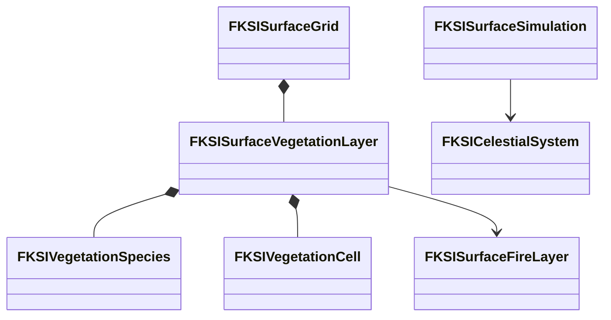

# 식생

식생의 값 모델, 토양 결합, 구역 07 조작·표현·복제와 검증 기록을 소유한다. 상위 문서는 [생태계·생애](../EnvironmentEcology.md)다.

## 식생·토양 결합 설계

`FKSISurfaceVegetationLayer`는 표면 지역의 셀별 식생 패치와 토양 양분·유기물을 소유한다. 한 셀은 한 종의 패치를 표현하며 종 데이터는 나무·풀·꽃·관목·이끼·양치류·조류·수생 식물·버섯을 구분할 수 있다. 패치의 성장·성숙·휴면·죽음, 생체량·고사량·탄 누계·재생 횟수와 현재 생장 주기의 시작 시각을 저장한다. 개별 잎·줄기는 시뮬레이션 개체로 만들지 않는다. PCG와 Actor·인스턴스 메시는 이후 이 저장 상태를 배치·표현한다.

성장은 공통 세계 시간과 실제 토양 물·양분으로 제한한다. 광합성 종은 천체 일조와 셀의 햇빛 통과율을 사용한다. 버섯은 토양 유기물도 소비하며 그늘 조건을 적용한다. 위도와 주광원의 적위로 얻은 낮 길이, 온도와 수분이 생장·휴면을 정한다. 자연 수명과 가뭄 스트레스가 끝나는 경계에서 죽음을 기록하고, 재생 가능한 뿌리·균사와 대기 시간·자원이 남아 있을 때만 새 생장 주기를 시작한다. 재생 자체가 생체량을 채우지는 않는다.



식생 패치가 있는 셀의 연소 가능한 생체·고사량은 같은 셀의 연료와 일치해야 한다. 연료 원장에 성장 유입·분해 유출을 추가한다. 화재의 실제 연소량을 식생에서 차감하고 탄 누계·양분 환원을 기록한다. 열에 죽은 생체는 고사량으로 옮기며 심한 열은 재생 원본도 없앤다. 고사체 분해는 연료를 줄이고 토양 유기물·양분을 늘린다. 토양 수분 소비는 식생의 증산 누계와 기존 표면 증발 유출에 한 번 기록한다. 실내에서는 같은 물을 방의 수증기로 옮기고 잠열을 방의 가용 열에서 차감한다. 앞서 예약한 표면·식생의 열 소비를 제외한 잔여량으로 성장을 제한한다. 질소·탄소·산소 화학을 모두 푸는 정밀 물질 모델은 아니다.

```cpp
bool Initialize(FKSISurfaceGrid& Grid, const TArray<FKSIVegetationSpecies>& Species,
    const TArray<FKSIVegetationSeed>& Seeds, double WorldSeconds, FString& Error);
bool AdvanceCandidate(FKSISurfaceGrid& Grid, double WorldFrom, double WorldDelta,
    double IrradianceWattsPerM2, double DaylightHours, FString& Error,
    FKSISurfaceThermalContext* Context = nullptr);
// 호출자는 게시 전 표면 후보만 전달한다.
if (!KSISurfaceVegetation::AdvanceCandidate(Candidate, From, Delta, Sun, Daylight, Error))
{
    return false;
}
```

표면 저장 버전 7에 식생과 연료 유입·유출을 추가한다. 이전 버전은 식생 없는 표면으로 읽는다. 지형의 지지 높이가 패치 허용치를 넘게 바뀌면 같은 지형 후보 안에서 식생을 죽이고 재생을 막는다. 물 수용량 등 후속 지형 검증이 실패하면 식생 변경도 폐기한다. 같은 표면 저장 바이트가 기존 월드 저장·지역 묶음·복제로 전달된다.

값 모델 검증은 물·양분·유기물·연료 수지, 맑음·차광·계절 휴면·가뭄, 버섯 유기물 고갈, 자연 사망·재생·심한 화재·지형 지지 제거, 저장 재개·이전 형식·손상·실패 원본 보존을 포함한다. 실제 두 환경 맵의 구역 07 조작·표현·네트워크와 음식 부패는 이 값 모델 위의 필수 연결이다. 값 모델과 런타임 검증 결과는 아래에 구분한다. 구역 전체의 완료 판정으로 확대하지 않는다.

셀 패치는 멀리 있는 식생의 비용을 제한하는 대신 같은 셀에 여러 종이 겹치는 경쟁을 직접 표현하지 못한다. 대표 종마다 셀·지역을 나눠 검사하고 밀도·세부 메시는 표현 계층에서 처리한다. 기존 UE5 표면 값 모델과 월드 수명을 사용하며 새로운 엔진 모듈은 필요 없다.

## 식생 값 모델과 실제 월드 검증

2026-10-10 UE 5.8.3의 로컬 작업 트리에서 표면 버전 7과 식생 진행을 검증했다. 나무·풀·꽃·관목·이끼·양치류·조류·수생 식물·버섯의 9개 분류를 저장하며 수생 종은 표면 물, 다른 종은 토양 물을 소비한다. 버섯은 유기물이 없으면 성장하지 않는다. 종별 외형·실제 생물학 수치를 완성한 결과는 아니다.

식생 자동 검사 6개는 일조·그늘·계절 휴면·가뭄 사망, 정확한 수명 경계와 자원 기반 재생, 연소·분해, 실내 증산의 물·열 수지, 공통 진행 실패의 원본 보존, 저장 재개와 지형 지지 제거를 확인한다. 기존 표면 형식 1–6은 식생 없이 복원되며 원래 연료 원장을 유지한다. 성장 유입을 여러 번 누적할 때 부동소수점 반올림으로 정상 연료 상태를 거부하던 상한 검사를 보완했다. 별도의 연료 잔량 수지 검사도 유지한다.

| 검사 | 결과와 근거 |
|---|---|
| 프로젝트 파일 생성·Editor 빌드 | 성공 |
| 환경 자동화 | 102/102, 경고·실패·미실행 0 |
| EnvironmentScenario 실제 월드·새 프로세스 | 통과 |
| EnvironmentPlayground 실제 월드·새 프로세스 | 통과 |

두 맵의 검사는 실행 중 임시 표면에 9종을 넣고 실제 공통 시계로 자연 사망·고사체 분해·재생을 진행했다. 세계 시계·표면·Agent 시각의 일치, 버섯의 실제 유기물 소비, 월드 저장·변경·복원을 확인했다. 별도 프로세스는 저장된 전체 표면 바이트와 CRC가 같은지 확인한 뒤 생장 주기를 이어 갔다. 검사 명령은 다음과 같다.

위 실행은 Editor 바이너리의 Standalone·NullRHI 검사다. 저장된 맵에 식생 배치를 추가하거나 PCG·메시·재질을 표시한 검사는 아니다. 식생은 서버 표면의 같은 저장 바이트를 사용하지만 이번 검사에서 식생이 있는 상태의 Listen·Dedicated 복제를 실행하지는 않았다. 구역 07의 직접 조작·표시·초기화, 식생 에셋과 장거리 배치, 음식의 신선도·곰팡이·합치기는 다음 연결 대상이다. 단계 8은 진행 중이며 단계 9의 최종 통합·규모 검증도 남아 있다.

## 구역 07 식생 조작·표현 연결 설계

구역 07의 식생 부분을 9종 × 3조건의 저장 가능한 표면으로 배치한다. 채광, 그늘, 양분·유기물 부족을 비교하며 비·건조·겨울 휴면·생장 기온·발화를 직접 조작한다. 종별 분류를 구분하는 단순 입체 메시와 생체량에 따른 크기, 휴면·고사·탄 흔적을 인스턴스로 표시한다. 이 표현은 서버 계산을 쓰지 않는 클라이언트에서도 같은 표면 복제 상태를 읽으며 전용 서버에서는 메시를 만들지 않는다. 최종 식생 아트와 PCG 대규모 배치는 별도 제작·성능 검증 대상이다.

최초 표면을 만드는 새 실험 세계에만 초기 식생을 넣는다. 저장된 세계에 해당 지역이 없을 때는 자동으로 채우지 않으며 명시적인 실험 초기화로 새 기본 배치를 사용할 수 있다. 저장·불러오기·초기화는 기존 세계 세대와 시계에 묶는다. 자동 검사는 표시 계층과 분리한 후보를 진행해 수지와 저장 재현성을 확인한다. 이 구역의 식생 통과 결과가 Agent 생애 관측이나 음식 부패까지 검증했다는 의미는 아니다.

구역 조작, 권한 거부, 초기화·저장 복원, 두 맵의 실제 렌더링, Listen·Dedicated의 첫 접속·늦은 접속을 검증한다. 표시에는 전체 생체·고사량, 성장·휴면·고사 패치 수, 탄 양과 재생 누계를 제공한다. 상호 경쟁 없이 조건별 패치를 나누는 단순 모델의 한계는 유지한다.

## 구역 07 식생 조작과 복제 검증

2026-10-10 UE 5.8.3에서 두 환경 맵에 식생 표면과 표시 Actor를 연결했다. F7 메뉴의 **07 생애·식생·부패**를 선택하면 비·가뭄·겨울 휴면·생장 기온·첫 나무 발화를 조작할 수 있다. 9종을 채광·그늘·양분 부족의 세 줄로 비교한다. 메뉴의 통과 표시는 식생 후보의 진행·저장 검사 결과이며 음식 부패·Agent 생애 조작의 완료 판정은 아니다.

`ACCLVegetationPresentation`은 확정된 표면 복제 상태에서 16개 인스턴스 메시 묶음을 갱신한다. 종·상태·생체량·지면과 조류의 수면 높이가 바뀌면 외형을 다시 만든다. 성장·휴면·고사는 크기와 색으로, 연소 누계는 탄 흔적으로 표시한다. 한글 종 이름은 별도 오프라인 폰트 에셋을 사용한다. 전용 서버는 표시 Tick을 끄고 인스턴스를 비운다. 단순 입체 도형으로 구분한 실험용 표현이며 최종 식생 아트와 PCG 배치·대규모 비용 검증은 남았다.

첫 생성 때만 기본 식생을 넣고 기존 저장에 없는 식생은 자동으로 채우지 않는다. 실제 월드 검사에서 식생이 없는 유효한 저장을 불러온 뒤 Tick이 지나도 지역이 생기지 않는지 확인했다. 이 부재 검사용 저장은 공기 원장의 초기량을 현재 보유량으로 맞춰 만든 별도 시험 입력이며 과거 공기 이력의 동일성을 검사한 자료는 아니다. 식생이 있는 저장은 전체 표면 바이트가 같은지 대조한다. 실험 초기화 후 기본 상태가 돌아오고 저장 복원 후 탄 흔적·뿌리 소실이 돌아오는 것도 확인했다.

| 검사 | 결과와 근거 |
|---|---|
| 프로젝트 파일 생성·Editor 빌드 | 성공 |
| 환경 자동화 | 102/102, 경고·실패·미실행 0 |
| Scenario 최종 렌더링·조작 | 통과 |
| Playground 렌더링·조작 | 통과 |
| Listen 첫·늦은 접속 | 통과 |
| Dedicated 첫·늦은 접속 | 통과 |
| 기존 불 구역 회귀 | 통과 |
| 폰트·두 맵 식생 에셋 저장 | 작업 PASS 확인 |

`Tools/Validation/run_vegetation_zone.ps1`은 `-Map EnvironmentScenario` 또는 `EnvironmentPlayground`, `-Mode Standalone`, `Listen`, `Dedicated`를 받는다. Standalone에 `-Rendered`를 더하면 조작 메뉴·성장·연소 화면을 저장한다. 검사는 서버의 구역 조작 API를 호출하고 화면을 렌더링한다. Slate 버튼을 마우스로 클릭한 검사는 아니다. Dedicated는 실제 조작 담당 클라이언트가 들어오고 권한을 얻은 뒤 조작을 시작한다.

두 네트워크 실행에서 첫·늦은 접속자 모두 27개 식생 패치, 그늘 버섯 성장, 첫 나무의 탄 누계·뿌리 소실을 받았다. 표시 인스턴스가 존재하고 클라이언트의 직접 상태 변경이 거부되는지도 검사했다. Dedicated는 Editor 바이너리의 서버 모드이며 실제 Server 타깃 패키지·지연·손실·재접속 검사는 단계 9에 남아 있다. Listen 결과는 이후 한글 폰트 참조와 Dedicated 검사 시작 순서를 고치기 전의 실행이며 시뮬레이션·복제 코드는 동일하다.

화면 검토에서 식생을 덮던 일반 연료 블록을 제외했다. 불이 붙지 않은 셀이 128개 효과 슬롯을 먼저 소비해 뒤쪽 화재가 보이지 않던 문제도 고쳤다. 현재 불꽃·표면 연기는 타는 셀만 슬롯을 소비한다. 성장 화면의 낮은 식생·수면 조류·9종 한글 이름과 연소 화면의 첫 나무 불꽃·탄 흔적을 확인했다. 날씨 Niagara 생성 이력 경고의 원인과 수정은 [날씨 표현 보완](../EnvironmentWeather.md#눈-niagara-생성-이력-보완)이 소유한다.

마지막 표현 검토에서 조류의 수면 높이만 바뀌면 메시 갱신을 건너뛸 수 있는 누락을 수정했다. 지역 ID와 수면 높이도 변경 판정에 포함하고 새 클래스의 선언·제어문 배치를 정리했다. 위 표의 최종 생성·빌드·환경 자동화·Scenario 렌더링은 이 수정 이후 결과다. Playground와 네트워크 결과는 이 표시 갱신 보완 전의 실행이며 시뮬레이션·저장·복제 코드는 동일하다.
