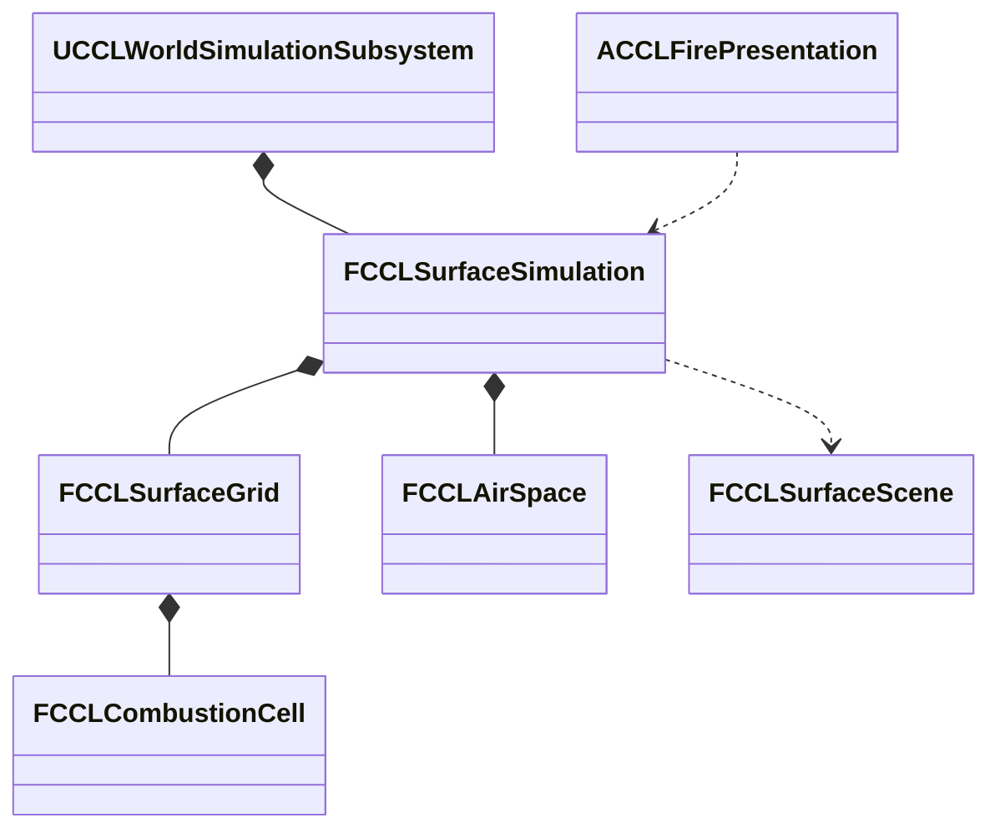
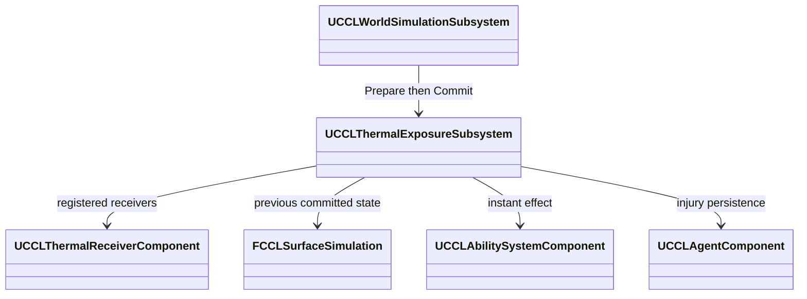

# 불·열·공간 환경

단계 7은 연소·소화·확산과 공간별 온습도·연기를 공통 환경 상태에 연결한다. 범위는 [결정 19](decisions/0019-natural-environment-and-labs.md)와 [환경 계획](EnvironmentPlan.md#불열공간-차폐)을 따른다. 연소·표면·공기를 공통 진행·저장·복제에 연결하고 자동 검사와 실제 월드 실행을 검증했다. 구역 10·11의 상시 조작과 Niagara 불꽃·연기 표현까지 실제 실행했다. 식생의 탄 상태 연결은 단계 8에서 이어 갔고, 식생 생체량과 연료 원장의 연결은 [생태계·생애](EnvironmentEcology.md)가 소유한다. 표현 조정과 규모 검증은 단계 9의 범위다. 이 문서는 연소 코어, 표면의 융해·건조와 열 확산, 공간 환기, 구역 10·11의 조작과 표현, 열 노출의 GAS 피해와 검증 기록을 소유한다.

2026-10-12에 공용 계산을 KSI 모듈로 옮겼다. 소유 모듈과 현재 코드 위치는 [Framework 단계 4](FrameworkPlan.md#단계-4-구현과-검증)가 소유한다. 아래 구현·검증 기록의 CCL 이름은 당시 이름이며 이동 대상만 KSI로 바뀌었다. 게임 연결과 당시 검증 범위는 그대로다.

## 목표와 단위

연소는 연료 kg, 연료 수분 kg, 열 J, 열용량 J/K, 연기 kg를 사용한다. 불의 진행과 공간 환기는 게임 초를 쓴다. 세계 시간을 가속해 계절을 바꿔도 불꽃 확산과 플레이어의 소화 반응 시간이 같은 배율로 빨라지지 않게 한다. 비·눈의 유입은 기존 세계 초 기준을 유지한다. 시험 수치는 콘텐츠의 초기값이며 실제 물질의 정확한 열역학이나 최종 밸런스를 뜻하지 않는다.

연료 수지는 초기 연료 = 남은 연료 + 연소 누계다. 소화는 온도를 낮추거나 수분을 공급하며 소모한 연료를 복원하지 않는다. 연소 열량과 냉각·외부 손실을 기록하고, 융해·건조가 이동시킨 물은 표면 수지에 남긴다. 연기는 발생·공간 보유·환기 배출을 구분한다.

## 목표 책임과 수명

서버 World의 기존 표면 값 상태가 셀별 연료·열·연소 흔적을 소유한다. 계산 코어는 인접 셀로 보내는 열을 같은 이전 상태에서 구하고 한 번 적용한다. 공간 값 상태는 안정적인 공간 ID와 체적, 온도·수분·연기를 보관한다. `FCCLSurfaceScene`의 개구부는 공간과 외부 또는 다른 공간을 연결한다. 표현 Actor와 Niagara 컴포넌트는 확정 상태를 읽으며 연료를 직접 소모하지 않는다.



## 착수 전 인터페이스 초안

착수 전에 정한 초안이다. 아래 이름은 구현할 때 기존 API와 맞춰 확정했고, 실제 계약은 "연소 코어의 현재 구현" 이후의 절이 소유한다.

```cpp
bool Ignite(FGuid RegionId, int32 CellIndex, double HeatJoules, FString& Error);
bool AddAirSpace(const FCCLAirSpace& Space, FString& Error);
bool Advance(const FCCLWorldStep& Step, FString& Error);
```

날씨·열·물·공기 후보를 먼저 계산하고 생활 진행까지 성공한 뒤 공통 시계를 확정한다. 중간 오류에서 불만 타거나 환기만 진행한 상태를 게시하지 않는다. 저장·복제는 같은 표면 스냅샷 버전을 확장한다.

## 구현과 검증 순서

1. 연료·수분·발화·열 전달·소화의 값 코어와 수지를 검사한다. 건조 연료, 젖은 연료, 비, 바람, 연료 고갈, 실패 재시도와 저장 재개를 포함한다.
2. 열을 기존 물·눈의 융해·건조에 연결한다. 불이 없거나 게임 시간이 0이면 연소량이 늘지 않아야 한다. 같은 물을 연료 습기와 표면에 중복 저장하지 않는다.
3. 공간 체적과 개구부 면적으로 공기를 교환한다. 닫힘·반 열림·열림, 두 실내 공간 사이 전송과 외부 배출을 확인한다. 닫힌 공간의 연기가 원인 없이 없어지지 않아야 한다.
4. 구역 10에 마른 연료·젖은 연료·눈과 소화 조작을, 구역 11에 실내 열원·문·연기 조작을 연결한다. 메뉴와 Niagara는 서버의 확정 결과를 표시한다.
5. 실제 Standalone·Listen·Dedicated 실행에서 조작 권한, 늦은 참가자, 저장·복원과 장면을 확인한다. 자동 검사만으로 시각 검토를 대신하지 않는다.

## 대안과 비용

공간 평균 모델은 셀 전체를 3D 유체로 계산하는 방식보다 적은 상태로 환기·열 축적을 검증할 수 있다. 대신 정밀 연기 흐름과 실내 온도 분포는 제공하지 않는다. 이는 계획의 초기 제외 범위와 일치한다. UE5 Niagara는 표현을 맡고 값 코어는 화면 없는 서버에서도 실행한다. 기존 복제와 저장을 재사용하며 별도 Framework 분리는 진행하지 않는다.


## 연소 코어의 현재 구현

`CCLCombustionModel.h/.cpp`가 연료·열 상태와 전달량을 계산한다. 2026-10-12 이후 위치는 `Source/KSIEnvironment/`의 `KSICombustionModel.h`·`KSICombustionModel.cpp`이고, 표면 연소는 `KSISurfaceFire.h`·`KSISurfaceFire.cpp`다. `FCCLCombustionCell`은 남은 연료·연소 누계와 초기·추가·연소·손실·전달 열량을 저장한다. 열은 절대온도 기준의 열용량 곱으로 저장하며 표시 기온은 섭씨로 환산한다. `FCCLCombustionFlux`는 증발시킨 물 kg, 표면·공기에 넘길 열 J와 발생 연기 kg를 반환한다. 공기 전달 열이 음수이면 공기에서 연료로 열을 옮긴다. `CCLSurfaceFire`가 실제 표면의 물과 눈·얼음에 전달량을 반영한다. 연기 발생 누계를 보관하며 셀이 속한 공간에 같은 발생량을 넣는다.

```cpp
static bool Advance(const FCCLCombustionMaterial& Material,
    double GameSeconds, double AmbientCelsius, double WindMetersPerSecond,
    double AvailableWaterKg, FCCLCombustionCell& State,
    FCCLCombustionFlux& Flux, FString& Error, double AvailableAirHeatJoules = 1.e15);
```

계산은 최대 0.1게임 초로 나누며 한 요청은 409.6게임 초까지 허용한다. 실패하면 상태와 출력 전달량을 모두 보존한다. 물은 호출자가 소유하며 모델 내부의 지역 변수에서 가용량을 차감한다. 같은 물을 연료 상태에 영구 복제하지 않는다. 열·연료 검증 뒤에 후보 상태와 출력 전달량을 한 번 교체한다.

```cpp
if (!Validate(M, S, Error)) { return false; }
State = S;
Flux = F;
return true;
```

초기 연료 1kg·섭씨 20도에 외부 열 500kJ를 넣은 검사에서 건조 연료는 타고 물 1kg이 접촉한 연료는 발화하지 않았다. 풍속 8m/s에서 연소량이 증가하며, 물 공급으로 추가 연소를 멈추는 것을 확인했다. 기본값은 실험용 근사치다. 상변화에 쓰는 2.5MJ/kg도 가열·증발을 합친 게임용 계수이며 정밀 물성표를 대신하지 않는다.

2026-10-10 검증 근거는 `Saved/EnvironmentStages/Fire-GPF.log`, `Fire-Build.log`와 `Saved/Tests/Automation/20261010-120839-890/report/index.json`이다. 프로젝트 파일 생성·Editor 빌드가 성공했고 환경 자동 검사 60/60, 경고·실패·미실행 0이다. 새 검사는 `CCL.Environment.Fire.FuelHeatWaterAndWind`, `CCL.Environment.Fire.ResumeValidationAndExhaustion`이며 연료·열 수지, 물·열·연기 전달량, 연료 고갈, 실패 시 상태·출력 보존, 0게임 초와 저장 후 동일 진행을 포함한다.

아래 코어·표면 검증은 당시의 범위다. 후속 실내 통합과 구역 10·11 실행은 문서 뒤의 검증 절을 따른다.


## 표면의 융해·건조와 열 확산

`FCCLSurfaceGrid::Fire`는 선택적인 `FCCLSurfaceFireLayer`를 소유한다. `Cells`가 비어 있으면 연소 상태를 할당하지 않으며, 사용하면 표면 셀 수와 같아야 한다. 재질은 지역 단위로 한 번 저장한다. `UCCLWorldSimulationSubsystem::IgniteSurface`는 서버 권위를 검사하고 기존 연료 셀에 외부 열을 더한다. 발화 요청으로 소모한 연료를 채우지는 않는다.

`CCLSurfaceSimulation`은 최대 0.25게임 초인 표면 하위 단계마다 `CCLSurfaceFire::AdvanceCandidate`를 호출한다. 비·눈 유입과 기존 상변화 뒤에 연소를 계산하고 물 흐름을 적용한다. 연소에 제공하는 물은 표면 액체와 토양의 실제 보유량이다. 증발량은 액체, 토양 순서로 차감하고 기존 물 수지의 증발 항목에 한 번 넣는다. 표면에 남은 열은 얼음, 눈 순서로 녹이며 눈 부피도 남은 질량에 비례해 줄인다. 융해에는 게임용 계수 334kJ/kg를 쓴다.

열 수지는 셀별 저장·추가·연소·손실·전달량과 지역별 전달 내역을 함께 검사한다. 지역의 전달 내역에는 인접 셀 전송, 융해, 증발과 나머지 표면 방출 열을 기록한다. 연기 발생 누계는 연소한 연료와 재질의 연기 비율에 일치해야 한다. 실내 셀은 연료의 냉각 열과 융해·증발에 쓰지 않은 표면 전달 열을 공간에 넣는다. 실외 셀의 방출 열은 기존 외부 손실로 남는다.

인접 열 전달은 각 하위 단계의 연소가 끝난 상태에서 한 번 계산한다. 각 경계는 이전 열 차이의 최대 1/8을 전송하므로 네 이웃이 모두 차가워도 보낸 셀의 열 절반 이상이 남는다. 받은 열은 다음 하위 단계부터 다시 전송한다. 기본 전도 계수는 실험값 60W/K이며 풍속과 두 셀의 바람 노출률을 반영한다. 전송은 네 방향 이웃 중 바닥·천장 사이 높이 범위가 겹치는 셀에 한한다. 런타임의 직접 열 전송은 두 셀 사이의 확정 표면 질의로 차단한다. 불투명 벽은 전송을 막고 실제 문 개구는 허용한다. 풍향에 따른 비대칭 확산은 아직 구현하지 않았다.

이 방식은 같은 시간 단계 안에서 순회 순서에 따라 열이 여러 셀을 건너뛰는 문제를 막는다. 대신 정밀 복사열·대류·연료 형상은 계산하지 않으며, 열 확산 속도와 계수는 콘텐츠 장면에서 추가 조정해야 한다. 화재는 기반 지형의 높이·재질을 변경하지 않는다.

## 저장 형식과 실패 경계

표면 스냅샷 버전 6은 각 지역의 표면 셀 뒤에 연소 활성 여부를 저장한다. 활성 지역에는 재질·확산 계수·전달 수지 120바이트와 셀당 73바이트가 추가된다. 연소 비활성 지역은 표시 1바이트만 추가한다. 버전 6에서는 모든 지역에 공기·표면 사이 열 전달 누계 16바이트를 더 저장한다. 전체 공기 모델은 기본 헤더·수지 104바이트와 공간당 184바이트를 저장한다. 전체 스냅샷의 기존 8MiB 제한은 유지하므로 모든 최대 크기 지역에 연료를 채울 수 있다는 보장은 없다.

버전 1-4의 표면 저장은 연소 비활성으로 복원한다. 버전 5의 연소 상태는 유지하며 버전 1-5에는 새 공간을 만들지 않는다. 새 저장의 연료·탄 양·열·전달 수지는 동일 표면 스냅샷에 포함되며 기존 분할 복제 경로를 사용한다. 연소 계산이 실패하면 물·날씨·불과 완료 시각의 후보 전체를 버린다. 손상된 저장이나 잘못된 발화 요청도 기존 상태를 유지한다.

## 실행 검증

2026-10-10 UE 5.8.3에서 다음을 실행했다. 경로는 저장소 기준이며 원본 로그와 보고서는 로컬 `Saved/`에 있다.

| 검사 | 결과와 근거 |
|---|---|
| 프로젝트 파일 생성 | 성공, `Saved/EnvironmentStages/FireSurface-GPF.log` |
| CCLEditor Win64 Development 빌드 | 성공, `Saved/EnvironmentStages/FireSurface-Build.log` |
| 환경 자동 검사 | 64/64, 경고·실패·미실행·진행 중 0. `Saved/Tests/Automation/20261010-122053-736/report/index.json` |
| Standalone 화재 | 건조 연료 연소·젖은 연료 억제·눈 융해·토양 건조·비 소화·저장 복원 통과. `Saved/Tests/Fire/Standalone-20261010-122352-516` |
| Dedicated 첫·늦은 참가자 | 서버와 두 참가자의 연소 누계·연기 발생 누계·융해 열량 일치, 직접 발화 거부. `Saved/Tests/Fire/Dedicated-20261010-122351-621` |
| Listen 첫·늦은 참가자 | 같은 수치 비교와 권위 검사 통과. `Saved/Tests/Fire/Listen-20261010-122352-146` |

새 표면 자동 검사는 `CCL.Environment.Fire.SurfaceMeltDryAndQuench`, `NeighbourSpreadAndFrozenBudget`, `SurfaceSaveResumeAndRollback`, `LegacySurfaceVersions`다. 열 전송의 대칭성과 같은 단계에서 받은 열을 다시 쓰지 않는 조건, 연결된 이웃 발화와 분리된 높이의 비발화, 버전 1-4 복원, 손상·잘못된 입력·후속 계산 실패의 상태 보존을 검사한다. 기존 연소 코어 두 검사도 유지한다.

실제 월드 검사는 `-CCLFireSmoke`로만 생성되는 서브시스템이 임시 연료 지역을 추가한다. 세계 시간 배율 0에서 10게임 초 동안 연소한 뒤 세계 시간을 진행해 비를 공급한다. 저장 후 발화 열을 추가하고 복원한 결과는 이전 표면 스냅샷과 바이트 단위로 같다. Dedicated 실행의 서버·첫·늦은 참가자 값은 연소량 `0.098085674kg`, 연기 발생량 `0.003908419kg`, 융해 열량 `24973.987631J`다. 연소량은 첫 셀, 연기와 융해 열량은 지역 합계이므로 서로 다른 집계 범위를 비교하지 않는다.

```powershell
& Tools/Validation/run_fire_smoke.ps1 -Mode Standalone
& Tools/Validation/run_fire_smoke.ps1 -Mode Dedicated -Port 19892
& Tools/Validation/run_fire_smoke.ps1 -Mode Listen -Port 19893
```

세 실행은 NullRHI를 사용했다. 이 표의 실행은 공간 통합 전 결과이며 화재 전용 메뉴·Niagara 화면과 공간 환기를 검증한 결과가 아니다. 서버 실행도 실제 Server 타깃 패키지 검증과 구분한다. 공간 연결의 후속 결과는 아래 공통 월드 실행 검증에 있다. 구역 10·11의 상시 콘텐츠와 화면 검토는 남았다.


## 공간 환기 구현 계약

공간 모델은 안정적인 공간 ID, 위치 범위, 공기 체적과 열 J·수증기 kg·연기 kg를 보관한다. 초기량, 외부 열원·증발·연기 유입, 공간 사이 교환과 외부 출입을 구분해 수지를 검사한다. 표시 기온은 공기 체적당 열용량의 게임용 기본값 1200J/(m³·K)로 환산한다. 공간 평균 모델이며 수증기 포화에 따른 응결·상세 압력·산소 반응은 이 계산에 포함하지 않는다.

문 개구부의 실제 열린 면적과 양 끝 공간 ID를 사용한다. 한쪽 공간 ID가 비어 있으면 외부다. 각 개구부에서 같은 부피를 양방향으로 교환하고, 모든 경계의 전송량을 이전 상태에서 구한 뒤 함께 반영한다. 여러 문이 한 공간의 보유 공기를 중복 소비하지 않도록 총 교환량을 제한한다. 닫힌 문은 교환량이 0이며 수치가 직접 줄어드는 누출 항목은 두지 않는다.

구현 검사는 문 닫힘·절반 열림·완전 열림, 두 방 사이 열·수증기·연기 보존, 여러 개구부의 동시 전송, 외부 배출·유입, 입력 실패와 저장 재개를 포함한다. 값 모델을 검증한 뒤 기존 표면·연소 후보와 공통 시간, 저장·복제에 연결한다.


## 공간 환기 값 모델과 검증

`FCCLAirSimulation`은 최대 64개의 평균 공기 상태를 소유한다. 각 `FCCLAirSpace`는 겹치지 않는 위치 범위와 안정적인 ID를 가진다. 공간의 기하 범위와 공기 체적은 별도 입력이며 복잡한 방의 실제 체적을 자동 계산하지 않는다. 경계 위치는 최솟값을 포함하고 최댓값을 제외해 인접 공간 중 한 곳만 소유한다.

`AddSource`는 열·수증기·연기를 외부에서 넣거나 저장된 열을 꺼낸다. 열은 양수·음수 입력을 허용하지만 수증기와 연기의 음수 생성 및 보유 열 초과 출금은 거부한다. 공간마다 초기량·입출량을 저장하며 전체 공간 합계에서도 열원·외부 출입을 검사한다. 두 방 사이 교환은 전체 합계를 바꾸지 않는다.

`Advance`는 `FCCLSurfaceOpening` 배열과 공간 ID별 외부 기온·수증기 농도·풍속을 받는다. 닫힌 문은 교환량이 0이다. 열린 문은 면적, 풍속과 온도 차이로 교환 부피를 구한다. 단위 면적당 교환 속도는 실험식 `0.05 + 0.1 × 풍속 + 0.01 × sqrt(온도 차이의 절댓값)`을 쓰며 정밀 대류 공식으로 해석하지 않는다.

최대 0.25게임 초마다 개구부별 교환 부피를 작은 공간 체적의 1/4 이하로 제한한다. 여러 개구부의 합계가 한 공간 체적의 절반을 넘으면 양 끝 공간의 제한을 함께 적용한다. 모든 문을 안정적인 ID 순서로 계산하고 같은 이전 상태에서 열·수증기·연기의 양방향 전달량을 구한다. 한 단계에서 방금 받은 연기를 다음 방으로 바로 넘기지 않는다.

다음 인터페이스의 실패는 기존 공기 상태를 보존한다. `Serialize`는 값 모델의 버전 1 형식을 읽고 쓰며, 읽을 때 개수·길이·공간 중복·수지를 검증한 후보만 적용한다. 공기 모델은 표면 버전 6 스냅샷 내부에 포함되며 같은 게임 월드 완료 상태로 복제된다.

```cpp
bool AddSource(FGuid SpaceId, double HeatJoules, double VaporKg, double SmokeKg, FString& Error);
bool Advance(double GameSeconds, const TArray<FCCLSurfaceOpening>& Openings,
    const TMap<FGuid, FCCLAirExterior>& Exteriors, FString& Error);
```

2026-10-10 최종 실행은 `Saved/EnvironmentStages/Air-GPF.log`, `Air-Build.log`, `Saved/Tests/Automation/20261010-123742-532/report/index.json`이다. 프로젝트 파일 생성과 CCLEditor Win64 Development 빌드가 성공했으며 환경 자동 검사 69/69, 경고·실패·미실행·진행 중 0이다. `CCL.Environment.Air`의 다섯 검사에서 다음을 확인했다.

- 닫힌 문에서 30게임 초 뒤 직렬화 상태가 같고, 절반·완전 개방 및 풍속 증가에 따라 연기 배출량이 커진다.
- 체적 64m³·128m³인 두 방의 기온이 서로 가까워지며 전체 열·수증기·연기량을 보존한다.
- 큰 문 네 개가 한 방에 연결돼도 첫 단계에서 연기의 절반을 남긴다. 네 이웃은 각각 1/8을 받고 그 너머 방은 아직 받지 않는다.
- 개구부 배열을 뒤집거나 저장·복원한 뒤 진행해도 같은 직렬화 결과를 얻는다.
- 중복 개구부·없는 연결 공간·NaN 외기·과도한 열 출금·잘린 저장을 거부하고 기존 상태를 보존한다.

이 다섯 검사는 독립 값 모델의 결과다. 실제 연소·표면·월드와 결합한 검증은 아래 절에서 구분한다.


## 연소·실내·표면의 공통 진행

공간이 있는 월드는 표면 진행을 최대 0.25게임 초의 공통 구간으로 나눈다. 각 구간에서 모든 지역이 같은 이전 공기 상태를 읽고 연소·증발 전달량을 모은다. 모은 열·수증기·연기를 공간에 적용한 뒤 환기를 한 번 실행한다. 지역 수가 늘어도 같은 시간 구간을 중복 소비하지 않는다. `CCLWorldAdvance`가 생활·시계와 함께 후보 전체를 확정한다.

공기에서 연료와 표면으로 열을 꺼낼 때는 같은 방에 있는 셀 수로 예산을 나눈다. 연료 가열은 섭씨 -100도보다 높은 공기 열량의 절반, 융해·건조는 섭씨 0도보다 높은 열량의 절반까지만 사용한다. 두 예산을 모두 써도 같은 이전 공기의 가용 열량을 초과하지 않는다. 냉각 요청이 예산을 넘으면 전달량을 줄이므로 작은 방이 차가운 연료 여러 개를 한꺼번에 가열하며 음수 열량이 되지 않는다.

실내 표면의 상변화는 공통 게임 초와 공간 기온을 사용한다. 따뜻한 공기는 눈·얼음을 녹이고 남은 열로 액체·토양의 물을 증발시킨다. 추운 공기에서 물이 얼면 융해열에 대응하는 열을 공기로 돌려준다. 실제로 이동한 열은 지역의 `AirHeatToSurfaceJoules`, `SurfaceHeatToAirJoules`에 기록한다. 실내에는 기존 지역 기온 기반 상변화·증발을 중복 적용하지 않는다. 실외 표면의 기존 세계 시간 입력은 유지한다.

외기는 공간의 선택적 `ClimateRegionId`로 찾는다. 지정한 지역의 기온·풍속을 사용하고, 수증기 깊이는 높이 1000m인 혼합층의 게임 근사로 kg/m³ 농도로 환산한다. 기후 지역을 지정하지 않으면 섭씨 20도·수증기 0.008kg/m³·풍속 0을 사용한다. 이는 현재 경계 입력 규칙이며 실제 대기 수직 구조를 계산하는 모델은 아니다.

서버 `AddAirSpace`와 환경 입력 교체는 공간·개구부 연결을 검증한 뒤 게시한다. 공통 저장 검사도 한쪽만 존재하는 실내 연결을 거부한다. 환기 계산이나 기하 질의가 실패하면 연소·물·공기·완료 시각을 모두 보존한다. 클라이언트는 공간 추가와 직접 발화를 실행할 권한이 없다.

## 공통 월드 실행 검증

2026-10-10 UE 5.8.3의 최종 근거는 다음과 같다. 모든 경로는 저장소 기준이다.

| 검사 | 결과와 근거 |
|---|---|
| 프로젝트 파일 생성 | 성공, `Saved/EnvironmentStages/AirCoupling-GPF.log` |
| CCLEditor Win64 Development | 성공, `Saved/EnvironmentStages/AirCoupling-Build.log` |
| 환경 자동 검사 | 76/76, 경고·실패·미실행·진행 중 0. `Saved/Tests/Automation/20261010-125549-503/report/index.json` |
| Standalone | 열·연기 축적, 비 소화, 문 절반·완전 개방, 다시 닫기, 연소·공기·문 저장 복원 통과. `Saved/Tests/Fire/Standalone-20261010-125623-826` |
| Dedicated 첫·늦은 참가자 | 서버와 두 참가자의 연소량·연기 발생량·융해 열량·실내 연기량·배출량 일치, 직접 변경 거부. `Saved/Tests/Fire/Dedicated-20261010-125624-515` |
| Listen 첫·늦은 참가자 | 같은 다섯 값 비교와 권위 검사 통과. `Saved/Tests/Fire/Listen-20261010-125623-598` |

새 자동 검사는 `CCLSurfaceAirTests.cpp`의 일곱 항목이다. 연료·공기의 합산 열과 연기 수지, 따뜻한 방의 융해·건조와 추운 방의 결빙, 작은 방의 열 초과 차감 방지, 여러 지역에서의 환기 시간 중복 방지, 동일 저장 재개와 실패 시 보존을 확인했다. 실제 벽·문 표면 질의로 직접 열 전달의 차단·허용을 확인했으며, 공통 저장의 없는 공간 연결을 복원 전에 거부하는 검사도 포함한다. 표면 버전 5 연료를 유지하고 공간을 새로 만들지 않는 복원 검사도 통과했다.

실제 서버 검사는 임시 공간에 열·연기가 쌓인 뒤 문을 절반·완전히 열어 배출량을 확인한다. 다시 닫은 후 연기량이 바뀌지 않고 발생량이 실내 보유량과 외부 배출량의 합에 맞는지 검사한다. 저장 뒤 문을 열었다가 복원하면 문은 닫힌 상태로 돌아오며 표면·공기 스냅샷이 이전 바이트와 같다. Dedicated 서버·두 참가자의 최종 실내 연기량은 `0.002609855kg`, 외부 배출량은 `0.001316323kg`였다. 기온·수증기는 복제된 상태의 유효성과 조건을 검사했으며 서로 다른 수신 시각의 기온을 같은 순간의 값으로 비교하지 않았다.

이 실행은 NullRHI 기반이며 구역 10·11의 상시 콘텐츠와 화면을 검증하지 않았다. 이 표의 실행 당시 환기는 개구부 면적과 연결 ID를 사용했다. 이후 추가한 기하 차폐의 결과는 다음 절에서 구분한다.


## 환기 개구의 기하 차폐

환기 입력의 소유자는 환경 입력이며, 표면 장면은 확정 기하에서 개구부의 유효 개방률을 계산한다. 공기 모델은 계산된 면적을 받아 기존 보존 교환을 수행한다. 문 상태와 기하 결과를 영구 상태에 중복 저장하지 않고 공통 진행 후보에서 질의한다. 질의 실패는 전체 표면·공기 진행을 취소한다.

개방된 직사각형 내부의 4×4 지점에서 문 법선 양쪽 0.5m 구간을 검사한다. 구조물의 바람 투과율과 지형 차폐를 반영하며, 문 지점의 확정 지형 밀도로 완전히 매몰된 개구도 막는다. 지형 provider는 충돌과 함께 게시된 스냅샷을 보유하므로 아직 확정하지 않은 굴착 후보는 영향을 주지 않는다. 16개 면적 표본으로 계산 범위를 제한하므로 표본보다 작은 틈과 원거리 통로의 연결을 모두 해석하지 않는다.

`ICCLSurfaceProvider::QueryOpeningFraction`은 전달받은 문 상태가 확정 장면과 다르면 실패한다. `FCCLSurfaceScene`은 같은 리비전·세대의 표면 교차와 체적 질의를 수행한다. `FCCLTerrainSurface::QuerySolidPoint`는 월드 좌표를 지역 좌표로 변환해 게시된 밀도를 읽고 메시와 같은 -0.5mm 기준을 적용한다. 이 질의를 지원하지 않는 provider는 빈 공간으로 간주하지 않고 실패를 반환한다.

2026-10-10 UE 5.8.3의 최종 실행 근거는 다음과 같다.

| 검사 | 결과와 근거 |
|---|---|
| 프로젝트 파일 생성·CCLEditor 빌드 | 모두 성공. `Saved/EnvironmentStages/VentGeometry-GPF.log`, `VentGeometry-Build.log` |
| 환경 자동 검사 | 79/79, 경고·실패·미실행·진행 중 0. `Saved/Tests/Automation/20261010-131358-881/report/index.json` |
| Standalone | 열린 문 앞 벽으로 배출 중지, 제거 후 재개, 문 닫기·저장 복원 통과. `Saved/Tests/Fire/Standalone-20261010-131427-555` |
| Dedicated·두 참가자 | 같은 차폐 검사와 첫·늦은 참가자의 연소·연기·열량 수치 비교 통과. `Saved/Tests/Fire/Dedicated-20261010-131427-768` |
| Listen·두 참가자 | 같은 검사 통과. `Saved/Tests/Fire/Listen-20261010-131428-303` |
| 실제 지형 편집 회귀 | Editor game mode, NullRHI 실행 통과. `Saved/Tests/Terrain/20261010-131440-854` |

새 검사 세 개는 `CCLVentilationGeometryTests.cpp`에 있다. `GeometryApertureAndTransmission`은 전체·절반 차폐, 실제 문이 열리는 쪽과 장애물의 겹침, 투과 재질, 닫힘과 오래된 문 입력을 검사한다. `BuriedApertureAndCommittedExcavation`은 광선이 표면을 만나지 않는 매몰 상태, 변환된 지형 좌표, 미확정 굴착, 저장소 확정과 provider 게시 사이, 게시 후 재개방과 되메우기를 검사한다. `GeometryControlsExchangeAndRollback`은 유효 면적이 실제 연기 교환량을 줄이며 기하 질의 실패 시 모든 상태의 저장 바이트가 유지되는지 확인한다.

첫 자동 검사에서는 굴착 보간 여유가 테스트 지형 하단 경계를 넘어 새 검사 하나가 실패했다. 테스트 영역을 확장한 뒤 최종 79개 검사를 통과했다. 실제 멀티플레이 실행에서 지형 굴착에 의한 환기 변화까지 검증한 것은 아니다. 굴착·환기 연결은 값 모델 자동 검사, 벽·환기 연결은 실제 서버 실행으로 확인했다. 이 표 이후 추가한 구역 10·11의 조작·표현 검증은 다음 절에 기록한다.


## 구역 10·11 조작과 표현

구역 10에는 연료 표면을, 구역 11에는 기존 방·문과 일치하는 공기 공간과 연료 표면을 둔다. 시작 상태와 초기화용 스냅샷을 함께 구성한다. 발화와 실외 비 조작은 서버 권위로 실행하고 화면은 복제된 연료·연소량·기온·수증기·연기량을 읽는다. 기존 자동 시험은 별도 후보에서 수지와 저장 재개를 검사하며 사용자가 조작한 월드를 덮어쓰지 않는다.

불꽃과 연기는 Niagara로 표시하고 연료의 남은 양·탄 양은 연료 블록과 탄 흔적에 연결한다. 타는 셀이 있으면 주황색 점광원을 켠다. 표현은 복제된 환경 상태를 읽으며 파티클·조명·메시 인스턴스를 저장하지 않는다. 가까운 지역의 파티클 컴포넌트는 최대 128개로 제한한다. 실내 연기 생성률은 공간의 연기 농도에 비례한다. 현재는 단순 원형 스프라이트를 사용하며 정밀 유동이나 최종 아트 품질을 뜻하지 않는다.

구역 10의 **마른 연료에 발화**는 중앙 셀에 600kJ를 추가한다. **소화용 비 켜기 / 끄기**는 1mm/세계 초의 시험 강수를 전환한다. 비에는 세계 시간 진행이 필요하다. 각 셀은 0.5kg의 연료로 시작하며 눈·젖은 흙·마른 셀을 나눠 놓았다. 구역 11에는 같은 연료 시험과 192m³ 공간을 넣고 기존 문으로 환기한다. 메뉴에는 남은 연료·탄 양·발생 연기·실내 기온·수증기와 연기 농도를 표시한다. 실내 수분은 상대습도 백분율이 아니라 g/m³다.

발화·연소·환기는 게임 초, 강수는 세계 초를 사용한다. 시간 0배에서도 불은 타며, 세계 시간만 정지한다. 전체 초기화의 기준 스냅샷에도 새 연료와 공간을 포함했다. 날씨 자동 시험이 같은 전체 환경 후보를 진행할 때 문 입력을 함께 넘기도록 수정했다.

2026-10-10 UE 5.8.3 검증 근거는 다음과 같다.

| 검사 | 결과와 근거 |
|---|---|
| 최종 프로젝트 파일 생성·Editor 빌드 | 성공. `Saved/EnvironmentStages/FireZones-GPF.log`, `FireZones-Build.log` |
| 두 맵 에셋 생성·새 에디터 재로드 | 구역 정의·표현 Actor·Niagara·재질 확인. `FireZones-Assets.log`, `FireZones-Reload.log` (같은 폴더) |
| 환경 자동 검사 | 79/79, 경고·실패·미실행·진행 중 0. `Saved/Tests/Automation/20261010-132752-448/report/index.json` |
| 격리 실험장 실제 조작·최종 화면 | 발화·비 소화·문 환기·저장 복원, 네 화면 캡처 통과. `Saved/Tests/FireZone/Standalone-20261010-133151-218` |
| 종합 실험장 실제 조작 | 같은 기능 검사 통과. `Saved/Tests/FireZone/Standalone-20261010-133308-997` |
| Dedicated 첫·늦은 참가자 | 상시 연료·실내 상태 수신, 유효성 및 직접 변경 거부. `Saved/Tests/FireZone/Dedicated-20261010-132850-891` |
| Listen 첫·늦은 참가자 | 같은 검사 통과. `Saved/Tests/FireZone/Listen-20261010-132846-178` |
| 기존 격리 실험장 회귀 | 통과. `Saved/Tests/Environment/EnvironmentScenario-Standalone-20261010-132847-283` |

네트워크 검사는 연소가 계속되는 월드의 수신 조건을 검사하며 서로 다른 수신 시각의 기온·연료를 바이트 단위로 비교하지 않는다. 동일 확정 수치 비교는 앞 절의 소화 후 서버 검사에서 다룬다. 네트워크·자동·기존 실험장 검사는 최종 표현 수정 전의 동일 계산 코드에서 실행했고, 최종 표현 수정 후에는 두 맵 조작과 격리 맵 렌더링을 재실행했다.

첫 빌드의 `TObjectPtr` 포인터 추론 오류를 수정했다. 첫 렌더링에서는 재질의 `InstancedStaticMeshes`·`NiagaraSprites` 사용 플래그 누락으로 체크무늬가 나타났고, 연기 수명 4초와 반복 주기 0.25초의 조합에서 생성 구간 예산 경고가 났다. 사용 플래그를 저장하고 연기 반복 주기를 2초로 바꿨다. 최종 별도 프로세스에서 해당 경고가 없고 불꽃·실내 연기·연료·탄 흔적이 표시되는 것을 캡처로 확인했다.

이 절을 쓸 때의 후속 작업은 단계 8의 식생 상태와 연소 결과 연결이었고, 그 결과는 [생태계·생애](EnvironmentEcology.md)에 있다. 단계 9에서 연기 모양·밝기·차폐 진단 화살표와의 겹침을 조정하고 장시간·넓은 범위의 표현 비용을 측정한다. 실제 굴착으로 환기를 바꾸는 멀티플레이 통합 장면도 전체 통합 검증에 포함한다.


## 열 노출의 GAS 피해 연결 설계

목표는 플레이어·적·생활 주민이 뜨거운 연료 위에 있거나 고온 실내에 있을 때 실제 GAS 체력을 잃도록 연결하는 것이다. 연소와 같은 게임 초를 사용하며 세계 시간 배율 0에서도 피해가 진행한다. 게임 일시정지와 세계 진행 실패에서는 피해를 적용하지 않는다. 연기 중독은 EnvironmentPlan의 기존 제외 범위를 유지한다.

`UCCLThermalReceiverComponent`는 Actor의 수신 정책과 등록 수명을 소유한다. 서버의 `UCCLThermalExposureSubsystem`이 공통 진행 시작의 표면·실내 상태와 현재 Actor 위치를 읽어 피해 후보를 만든다. 시계·표면·생애 확정 뒤에 한 번만 GAS 효과를 적용하며 기존 Agent 피해 기록과 외부 사망 요청으로 연결한다. 컴포넌트를 가진 Actor만 수신한다. 표현이 없는 Agent·생태 집계의 열 피해는 이 Actor 수신 계약에 포함하지 않는다.



핵심 인터페이스는 `Prepare(const FCCLWorldStep&, const FCCLSurfaceSimulation&, FString&)`, `Commit()`, `Cancel()`이다. 후보는 Actor·ASC의 약한 참조, 피해량과 현재 세계 Epoch·StepId를 보관한다. 실패·복원 뒤 후보는 적용하지 않는다. 영향을 받을 Agent의 Writer를 미리 확인해 예약 충돌이면 세계 진행 전체를 거부한다.

```cpp
if (!Exposure->Prepare(Step, PreviousSurface, Error)) { return false; }
// The common world advance commits its candidates before this call.
Exposure->Commit();
```

초기 시험 정책은 60°C 초과분에 연료 접촉 0.05 HP/(°C·게임초), 실내 공기 0.1 HP/(°C·게임초)를 적용하고 합계를 100 HP/게임초로 제한한다. 접촉은 해당 셀의 XY 범위와 지면 위 2m 안에서만 검사한다. 셀 중앙에서 수신 위치까지 확정 기하의 바람 통과율을 열 차폐 근사로 사용한다. 겹친 연료 지역은 최대 접촉 노출 하나를 사용하고 공기 피해는 공간 하나에서 더한다. 피해량은 물리 열량을 빼는 에너지 교환이 아니라 게임 체력 정책이다. 수치는 컴포넌트에서 조정할 수 있으며 최종 밸런스가 아니다.

진행 시작의 노출을 최대 0.25게임초 구간에 적용하는 근사다. 더 작은 입력 분할은 열 변화 적분값을 바꿀 수 있다. 시공간 연속 적분보다 비용이 적지만 빠른 이동·급격한 냉각의 정확도와 수신자 수에 따른 질의 비용은 따로 측정해야 한다. GAS의 즉시 효과와 Attribute 복제는 UE4에도 있던 체계이며 UE5 신규 기능으로 설명하지 않는다.

검증은 온도 임계·높이·겹침·벽 차폐·실내·잘못된 정책의 값 검사, 실제 불 위 Actor의 체력 감소·바깥 이동 후 중지, Writer 충돌과 생활 진행 실패의 체력 보존, 나이 보호 주민의 열 사망, 저장 복원과 첫·늦은 접속 체력 관측으로 구성한다.


## 열 피해 구현·검증

플레이어·적·생활 주민에 `UCCLThermalReceiverComponent`를 추가했다. 구역 10·11에서 발화한 연료 위로 이동하면 실제 체력이 줄고, 실내가 임계 온도를 넘으면 연료 셀 밖에서도 공기 피해를 받는다. F7 화재 메뉴에는 세계 시간 0배에서도 열 피해가 진행된다는 안내를 표시한다. 공통 진행은 최대 0.25게임초로 제한하며 컴포넌트 자체 Tick이나 별도 피해 타이머를 사용하지 않는다.

`CCLThermalExposure::Sample`은 이전 확정 표면에서 접촉·실내 노출을 계산한다. 표면의 `BedMeters`와 `CeilingMeters`는 절대 높이로 비교한다. `Prepare`는 다음 StepId·시작 시각·세계 ID·티켓과 피해 대상의 쓰기 실행권을 확인한다. 생애나 음식 후보가 실패하면 `Cancel`로 피해 후보도 버린다. 확정 후 `Commit`은 저장 복원 Epoch와 완료 StepId를 다시 확인하고 후보를 먼저 비운 뒤 즉시 GAS 효과를 적용한다. 실제 적용된 체력으로 기존 Agent 부상 기록을 갱신하며 치명 피해는 외부 사망 경로를 사용한다.

서버에서 예측 없이 적용한 GAS의 즉시 효과는 활성 지속 효과로 등록하지 않고 `ExecuteGameplayEffect`로 실행된다. UE 5.8.3 근거는 `<Engine>/Plugins/Runtime/GameplayAbilities/Source/GameplayAbilities/Private/AbilitySystemComponent.cpp:1158`의 `EGameplayEffectDurationType::Instant` 분기다. 열 피해는 서버에서만 적용하고 기존 Health Attribute 복제를 사용한다. 환경 시각 표현은 체력을 쓰지 않는다.

실제 검사에서는 같은 위치의 플레이어·적·주민에게 같은 열 피해량이 적용됐다. Writer 충돌과 생애 진행 실패에서 체력·시계·표면이 유지됐고, 후보 취소 뒤 Commit과 중복 Commit은 추가 피해를 만들지 않았다. 뜨거운 셀 밖으로 이동하면 접촉 피해가 멈췄다. 별도 100°C 실내에서는 0.25게임초 동안 1 HP가 줄었다. 이 수치는 기본 정책의 `(100 - 60) × 0.1 × 0.25`와 대조한 시험 결과다.

접촉·공기 피해로 다친 상태를 저장한 뒤 노화 보호 주민을 열로 사망시켰다. 부상 저장을 복원하면 저장 당시의 실제 GAS 체력이 돌아왔고, 사망 저장을 복원하면 주민 Actor가 제거됐다. 이전 Epoch에서 준비한 열 피해를 복원 뒤 확정해도 새 세계에 적용되지 않았다. 세계 배율은 0으로 두어 부상·사망 검사 중 나이와 세계 시각이 늘지 않는 것도 확인했다.

| 검사 | 결과와 로컬 근거 |
|---|---|
| 프로젝트 생성·최종 Editor 빌드 | 통과. `Saved/EnvironmentStages/Thermal-GPF.log`, `Saved/EnvironmentStages/Thermal-FinalBuild.log` |
| 환경 자동화 | 127/127, 경고·실패·미실행 0. `Saved/Tests/Automation/20261010-210332-415/report/index.json` |
| Scenario 접촉·플레이어·적·주민·열 사망·부상 복원 | 통과. `Saved/Tests/Thermal/Standalone-20261010-210518-673` |
| Playground 접촉·고온 실내·열 사망·부상 복원 | 통과. `Saved/Tests/Thermal/Standalone-20261010-210719-259` |
| Listen Scenario 첫·늦은 접속·고온 실내 | 통과. `Saved/Tests/Thermal/Listen-20261010-210718-348` |
| Dedicated Playground 첫·늦은 접속·고온 실내 | 통과. `Saved/Tests/Thermal/Dedicated-20261010-210720-606` |
| 화재 구역 조작·화면·저장 회귀 | 통과. `Saved/Tests/FireZone/Standalone-20261010-210518-393` |
| 음식 구역·위치 조건·저장 회귀 | 통과. `Saved/Tests/FoodZone/Standalone-20261010-210719-590` |
| Campaign 생애·Writer 충돌·Actor 제거·복원 회귀 | 통과. `Saved/Tests/AgentBiology/Campaign-20261010-210814-222` |

자동화의 두 새 검사는 `CCLThermalExposureTests.cpp`에 있다. 접촉·높이·XY 경계·겹친 지역의 최대 노출·실내 합산·피해 상한과 잘못된 정책의 출력 보존을 확인했다. 별도 차폐 검사는 절대 지면 높이, 불투과·부분 투과 바닥과 미준비 기하의 거부를 확인했다. 기존 환경 자동화도 같은 게임 구현에서 실행했다.

네트워크 검사는 첫 접속자가 초기 주민과 부상 상태를 관측할 때까지 서버가 기다린다. 첫 접속자는 복제된 실제 GAS 체력과 공개 생애의 체력을 대조한다. 최종 사망 저장 복원 후 첫·늦은 접속자가 Epoch·세계 시각·사망 원인·체력·노화 보호와 Actor 부재를 비교한다. 클라이언트의 직접 열 피해 준비는 거부됐다. Dedicated는 Editor 서버 모드이며 실제 Server 타깃 패키지나 지연·손실의 증거가 아니다.

처음 실행에서는 검사기가 내비게이션 준비 대기를 즉시 실패로 처리했고, Dedicated 검사기는 첫 접속 전 플레이어를 기다렸다. 준비 대기는 기존 `awaits` 계약으로 재시도하고 초기 준비 표식은 플레이어 없이 게시하도록 검사기를 수정했다. 표의 열 실행은 수정 후 결과다. Scenario Standalone은 실내 피해 단계를 추가하기 전이며 나머지 세 열 실행은 그 단계까지 포함한다. 이후 게임 구현 변경은 없었다. 로그 경로는 프로젝트 기준이고 실행 환경은 UE 5.8.3이다.

재실행은 `Tools/Validation/run_thermal_smoke.ps1 -Map EnvironmentPlayground`를 사용한다. 네트워크는 `-Mode Listen -Map EnvironmentScenario -Port 20544` 또는 `-Mode Dedicated -Map EnvironmentPlayground -Port 20543`이다. 화재 화면은 `Tools/Validation/run_fire_zones.ps1 -Rendered -Map EnvironmentScenario`로 확인한다.

이번 저장 검사는 Agent의 지속 부상·생애와 환경 상태를 대상으로 한다. 플레이어의 현재 체력·장비·계정 전체를 같은 세계 저장에 묶은 검사는 아니다. 표현이 없는 Agent·생태 개체군의 열 사망, 방어 장비별 열 저항, 연기 중독, 장시간·대규모 열 질의 비용과 공간·시간 적분 정밀도는 이 구현의 확인 범위 밖이다. 단계 8·9의 남은 통합·규모 검증은 EnvironmentPlan을 따른다.
