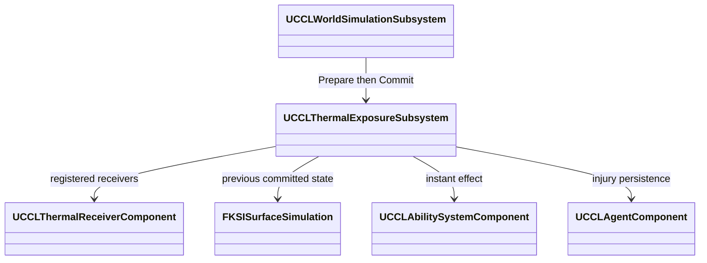

# 열 피해

뜨거운 연료와 고온 실내가 플레이어·적·생활 주민의 실제 GAS 체력에 주는 피해를 소유한다. 상위 문서는 [불·열·공간 환경](../EnvironmentFire.md)이다.

## 열 노출의 GAS 피해 연결 설계

목표는 플레이어·적·생활 주민이 뜨거운 연료 위에 있거나 고온 실내에 있을 때 실제 GAS 체력을 잃도록 연결하는 것이다. 연소와 같은 게임 초를 사용하며 세계 시간 배율 0에서도 피해가 진행한다. 게임 일시정지와 세계 진행 실패에서는 피해를 적용하지 않는다. 연기 중독은 EnvironmentPlan의 기존 제외 범위를 유지한다.

`UCCLThermalReceiverComponent`는 Actor의 수신 정책과 등록 수명을 소유한다. 서버의 `UCCLThermalExposureSubsystem`이 공통 진행 시작의 표면·실내 상태와 현재 Actor 위치를 읽어 피해 후보를 만든다. 시계·표면·생애 확정 뒤에 한 번만 GAS 효과를 적용하며 기존 Agent 피해 기록과 외부 사망 요청으로 연결한다. 컴포넌트를 가진 Actor만 수신한다. 표현이 없는 Agent·생태 집계의 열 피해는 이 Actor 수신 계약에 포함하지 않는다.

핵심 인터페이스는 `Prepare(const FKSIWorldStep&, const FKSISurfaceSimulation&, FString&)`, `Commit()`, `Cancel()`이다. 후보는 Actor·ASC의 약한 참조, 피해량과 현재 세계 Epoch·StepId를 보관한다. 실패·복원 뒤 후보는 적용하지 않는다. 영향을 받을 Agent의 Writer를 미리 확인해 예약 충돌이면 세계 진행 전체를 거부한다.

초기 시험 정책은 60°C 초과분에 연료 접촉 0.05 HP/(°C·게임초), 실내 공기 0.1 HP/(°C·게임초)를 적용하고 합계를 100 HP/게임초로 제한한다. 접촉은 해당 셀의 XY 범위와 지면 위 2m 안에서만 검사한다. 셀 중앙에서 수신 위치까지 확정 기하의 바람 통과율을 열 차폐 근사로 사용한다. 겹친 연료 지역은 최대 접촉 노출 하나를 사용하고 공기 피해는 공간 하나에서 더한다. 피해량은 물리 열량을 빼는 에너지 교환이 아니라 게임 체력 정책이다. 수치는 컴포넌트에서 조정할 수 있으며 최종 밸런스가 아니다.

진행 시작의 노출을 최대 0.25게임초 구간에 적용하는 근사다. 더 작은 입력 분할은 열 변화 적분값을 바꿀 수 있다. 시공간 연속 적분보다 비용이 적지만 빠른 이동·급격한 냉각의 정확도와 수신자 수에 따른 질의 비용은 따로 측정해야 한다. GAS의 즉시 효과와 Attribute 복제는 UE4에도 있던 체계이며 UE5 신규 기능으로 설명하지 않는다.

## 열 피해 구현·검증

플레이어·적·생활 주민에 `UCCLThermalReceiverComponent`를 추가했다. 구역 10·11에서 발화한 연료 위로 이동하면 실제 체력이 줄고, 실내가 임계 온도를 넘으면 연료 셀 밖에서도 공기 피해를 받는다. F7 화재 메뉴에는 세계 시간 0배에서도 열 피해가 진행된다는 안내를 표시한다. 공통 진행은 최대 0.25게임초로 제한하며 컴포넌트 자체 Tick이나 별도 피해 타이머를 사용하지 않는다.

`CCLThermalExposure::Sample`은 이전 확정 표면에서 접촉·실내 노출을 계산한다. 표면의 `BedMeters`와 `CeilingMeters`는 절대 높이로 비교한다. `Prepare`는 다음 StepId·시작 시각·세계 ID·티켓과 피해 대상의 쓰기 실행권을 확인한다. 생애나 음식 후보가 실패하면 `Cancel`로 피해 후보도 버린다. 확정 후 `Commit`은 저장 복원 Epoch와 완료 StepId를 다시 확인하고 후보를 먼저 비운 뒤 즉시 GAS 효과를 적용한다. 실제 적용된 체력으로 기존 Agent 부상 기록을 갱신하며 치명 피해는 외부 사망 경로를 사용한다.

서버에서 예측 없이 적용한 GAS의 즉시 효과는 활성 지속 효과로 등록하지 않고 `ExecuteGameplayEffect`로 실행된다. UE 5.8.3 근거는 `<Engine>/Plugins/Runtime/GameplayAbilities/Source/GameplayAbilities/Private/AbilitySystemComponent.cpp:1158`의 `EGameplayEffectDurationType::Instant` 분기다. 열 피해는 서버에서만 적용하고 기존 Health Attribute 복제를 사용한다. 환경 시각 표현은 체력을 쓰지 않는다.

실제 검사에서는 같은 위치의 플레이어·적·주민에게 같은 열 피해량이 적용됐다. Writer 충돌과 생애 진행 실패에서 체력·시계·표면이 유지됐고, 후보 취소 뒤 Commit과 중복 Commit은 추가 피해를 만들지 않았다. 뜨거운 셀 밖으로 이동하면 접촉 피해가 멈췄다. 별도 100°C 실내에서는 0.25게임초 동안 1 HP가 줄었다. 이 수치는 기본 정책의 `(100 - 60) × 0.1 × 0.25`와 대조한 시험 결과다.

접촉·공기 피해로 다친 상태를 저장한 뒤 노화 보호 주민을 열로 사망시켰다. 부상 저장을 복원하면 저장 당시의 실제 GAS 체력이 돌아왔고, 사망 저장을 복원하면 주민 Actor가 제거됐다. 이전 Epoch에서 준비한 열 피해를 복원 뒤 확정해도 새 세계에 적용되지 않았다. 세계 배율은 0으로 두어 부상·사망 검사 중 나이와 세계 시각이 늘지 않는 것도 확인했다.

2026-10-10 UE 5.8.3에서 프로젝트 생성과 최종 Editor 빌드가 통과했고 환경 자동화는 127/127, 경고·실패·미실행 0이었다. Scenario의 접촉·플레이어·적·주민·열 사망·부상 복원과 Playground의 접촉·고온 실내·열 사망·부상 복원이 통과했다. Listen Scenario와 Dedicated Playground의 첫·늦은 접속·고온 실내가 통과했다. 화재 구역의 조작·화면·저장, 음식 구역의 위치 조건·저장, Campaign의 생애·Writer 충돌·Actor 제거·복원 회귀도 통과했다. Scenario Standalone은 실내 피해 단계를 추가하기 전 결과이며 나머지 세 열 실행은 그 단계까지 포함한다.

자동화의 두 새 검사는 `CCLThermalExposureTests.cpp`에 있다. 접촉·높이·XY 경계·겹친 지역의 최대 노출·실내 합산·피해 상한과 잘못된 정책의 출력 보존을 확인했다. 별도 차폐 검사는 절대 지면 높이, 불투과·부분 투과 바닥과 미준비 기하의 거부를 확인했다. 기존 환경 자동화도 같은 게임 구현에서 실행했다.

네트워크 검사는 첫 접속자가 초기 주민과 부상 상태를 관측할 때까지 서버가 기다린다. 첫 접속자는 복제된 실제 GAS 체력과 공개 생애의 체력을 대조한다. 최종 사망 저장 복원 후 첫·늦은 접속자가 Epoch·세계 시각·사망 원인·체력·노화 보호와 Actor 부재를 비교한다. 클라이언트의 직접 열 피해 준비는 거부됐다. Dedicated는 Editor 서버 모드이며 실제 Server 타깃 패키지나 지연·손실의 증거가 아니다.

이번 저장 검사는 Agent의 지속 부상·생애와 환경 상태를 대상으로 한다. 플레이어의 현재 체력·장비·계정 전체를 같은 세계 저장에 묶은 검사는 아니다. 표현이 없는 Agent·생태 개체군의 열 사망, 방어 장비별 열 저항, 연기 중독, 장시간·대규모 열 질의 비용과 공간·시간 적분 정밀도는 이 구현의 확인 범위 밖이다. 단계 8·9의 남은 통합·규모 검증은 EnvironmentPlan을 따른다.
