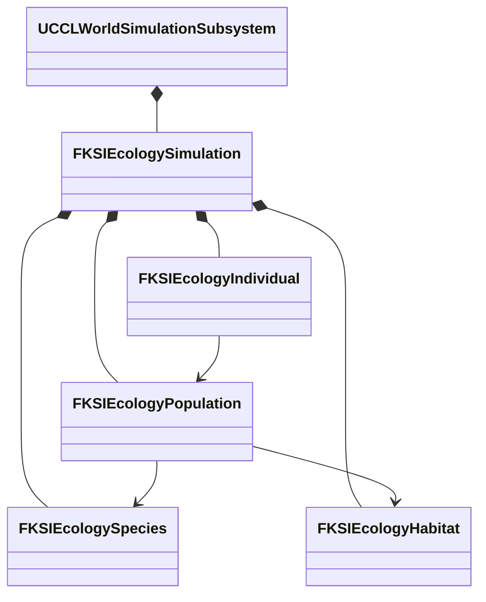
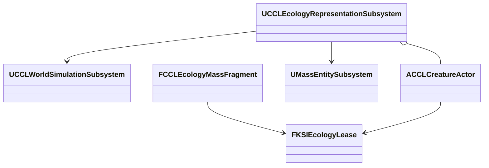

# 생태계·생애 구현과 검증

단계 8의 개체군·식생·부패·Agent 나이를 공통 세계 시간과 저장에 연결했고, Actor/Mass 전환, 첫·늦은 접속자 복제, 저장 복원, 실제 공간 경로를 검증했다. 이 문서는 단계 8의 값 모델, 시간순 생애 계산, 월드 진행·저장 연결과 영역별 설계·구현·검증 기록을 소유한다. 범위는 [환경 계획](../EnvironmentPlan.md#생태계와-생애-주기)과 [결정 19](../decisions/0019-natural-environment-and-labs.md)를 따른다.

기능별 전용 레벨과 단일 종류·표본 수 선택은 [환경 실험장 사용법](Laboratories.md)을 따른다. 아래 구역 06·07의 비교 배치 설명은 기존 통합 실험장 기준이다.

## 하위 문서

| 문서 | 읽는 때 |
|---|---|
| [식생](Ecology/Vegetation.md) | 식물 성장·연소·재생, 토양 결합, 구역 07 식생 표현을 바꿀 때 |
| [음식](Ecology/Food.md) | 음식 부패, 보관 조건, 픽업, 컨테이너와 세계 저장을 바꿀 때 |
| [생물 행동](Ecology/Behavior.md) | 이동 후보, 먹이 수지, 실제 공간 경로, 구역 06을 바꿀 때 |
| [Agent 생애](Ecology/AgentLife.md) | 나이, 수명, 노화 보호, GAS 치명 피해와 Actor 제거를 바꿀 때 |

## 구현 현황

아래 절은 영역별 설계와 구현·검증을 날짜순으로 쌓은 기록이다. 이 표는 영역마다 연결한 내용과 검증 기록의 위치를 가리킨다.

| 영역 | 연결하고 검증한 내용 | 기록 |
|---|---|---|
| 개체군·생애 계산 | 개체군 값 모델과 시간순 생애 계산을 월드 공통 진행·저장에 연결 | [월드 통합 실행 근거](#월드-통합-실행-근거) |
| Actor/Mass 전환 | 실제 Actor/Mass 전환과 Actor의 첫·늦은 접속자 복제 | [Actor/Mass 연결과 실행 근거](#actormass-연결과-실행-근거) |
| Agent 생애 | 공통 시간 나이·수명·자연 노화 보호와 실제 Actor 제거·복원 | [Agent 생애 연결과 실행 근거](Ecology/AgentLife.md#agent-생애-연결과-실행-근거) |
| 식생 | 성장·연소·재생과 구역 07 식생 조작·표현·복제 | [식생 값 모델과 실제 월드 검증](Ecology/Vegetation.md#식생-값-모델과-실제-월드-검증), [구역 07 식생 조작과 복제 검증](Ecology/Vegetation.md#구역-07-식생-조작과-복제-검증) |
| 음식 부패 | 음식 묶음의 부패·곰팡이, 인벤토리 이동과 세션 저장 | [음식 상태·인벤토리·세션 검증](Ecology/Food/State.md#음식-상태인벤토리세션-검증) |
| 세계 저장의 보관함 | 전체 세계 저장의 컨테이너 연결 | [컨테이너 세계 저장 검증](Ecology/Food/Containers.md#컨테이너-세계-저장-검증) |
| 구역 07 음식 비교 | 보관 비교·표시·조작과 첫·늦은 접속자의 공개 관측 복제 | [음식 비교 조작과 실행 검증](Ecology/Food/Storage.md#음식-비교-조작과-실행-검증) |
| 생물 행동과 먹이 | 지속 예약 개체의 이동 후보·먹이 수지·무리 목표·기아 사망을 공통 시간과 저장에 연결하고 실제 Actor/Mass 및 접속자로 검증 | [생물 행동 기반 실행 검증](Ecology/Behavior.md#생물-행동-기반-실행-검증) |
| 실제 공간 경로 | 실제 지형 내비게이션과 수중·공중 장애물 경로, 두 환경 맵의 네 매체 Actor 이동·섭취·저장 복원. 같은 기하의 새 프로세스 재개와 Listen·Dedicated 첫·늦은 접속자의 복원 위치 | [실제 공간 경로 실행 검증](Ecology/Behavior.md#실제-공간-경로-실행-검증), [공간 정책의 재시작·접속 결과](Ecology/Behavior.md#공간-정책의-재시작접속-결과) |
| 구역 06 | 네 서식지·공개 관측·먹이 추가·Actor/Mass/숨김과 저장·초기화, 실제 메뉴 조작·렌더링·첫·늦은 접속 | [구역 06 실행·관측·복원 검증](Ecology/Behavior.md#구역-06-실행관측복원-검증) |
| 집계 생물의 영양 | 에너지·먹이·기아와 생태 본문 형식 6. [집계 생물의 영양 상태](Ecology/Nutrition.md)가 소유 | [집계 생물의 에너지·기아 구현](#집계-생물의-에너지기아-구현) |
| 환경 연동 음식 보관 | 음식 보관 조건을 날씨·실내 온습도에 연결, 실패 원본 보존·언로드 진행·새 프로세스 재개·공개 관측 복제 | [환경 연동 음식 보관 구현·검증](Ecology/Food/Storage.md#환경-연동-음식-보관-구현검증) |
| 음식 픽업 이력 | 이력 이동·일부 및 전체 드롭·공개 품질 복제 | [음식 픽업 이력 구현·검증](Ecology/Food/Pickup.md#음식-픽업-이력-구현검증) |
| 음식 픽업의 세계 저장 | 바닥 음식 픽업의 세계 저장·재생성·회수 기록·언로드 후 재등록, 두 맵의 새 프로세스 재개 | [음식 픽업의 세계 저장 구현·검증](Ecology/Food/Pickup.md#음식-픽업의-세계-저장-구현검증) |
| 위치에 따른 음식 보관 | 바닥 음식의 실내·날씨 지역 선택과 구역 07 꺼내기·회수 | [위치에 따른 음식 보관 구현·검증](Ecology/Food/Storage.md#위치에-따른-음식-보관-구현검증) |
| GAS 치명 피해와 생애 | GAS 체력 0의 외부 사망 기록과 구역 07 생애 실험 | [Agent 치명 피해와 구역 07 생애 실험 구현·검증](Ecology/AgentLife.md#agent-치명-피해와-구역-07-생애-실험-구현검증) |

음식 픽업의 세계 저장까지 정리한 시점에는 상시 픽업 조작과 환경 전체 저장 통합이 남아 있었다. 그 뒤 추가된 "위치에 따른 음식 보관"과 "GAS 치명 피해" 절이 이 둘을 얼마나 다뤘는지는 이 표를 쓸 때 확인하지 않았다.

## 목표와 제약

서식지·개체군·무리·개체를 구분하고 먼 집계에서 가까운 표현으로 전환할 때 수를 보존한다. 출생·사망·포획·이주는 사건 ID로 한 번 적용한다. 기억·서사·소유권을 가진 개체는 안정적인 ID를 유지한다. 화면 밖의 집계를 임의로 다시 채우지 않는다. 대표 지상 생물·물고기·새·곤충으로 같은 계약을 검사한다.

세계 시간은 생물의 나이와 생태 진행의 기준이다. Actor/Mass는 표현·실행을 맡고 권위 수량의 원본이 아니다. 기존 Agent의 ID·실행권과 생태계 예약을 연결하되 직업·재산·기억 Feature를 모든 생물에 강제하지 않는다. 핵심 NPC의 자연 노화 보호는 아래 Agent 생애 연결이 소유한다.

## 책임과 수명

| 값 또는 소유자 | 책임과 수명 |
|---|---|
| `FKSIEcologySpecies` | 종 ID·이동 방식·성숙·수명·번식 간격. 저장과 검증에 쓰는 종 데이터 |
| `FKSIEcologyHabitat` | 공간 경계·서식 매체·수용 규모. 종과 개체군이 참조 |
| `FKSIEcologyPopulation` | 종·서식지에 속한 집계, 출생 시각별 연령군과 수량 원장 |
| `FKSIEcologyIndividual` | 집계에서 예약한 한 개체의 ID·출생 시각·상태. 중요 개체는 먼 상태에서도 유지 |
| `FKSIEcologySimulation` | 서버 값 상태와 사건 영수증·표현 실행권. 실패 시 후보를 폐기 |
| `UCCLWorldSimulationSubsystem` | 생태·표면·시계의 월드 수명과 서버 권한. Agent 진행까지 성공한 후보를 함께 게시 |
| `FCCLWorldSnapshotCodec` | 같은 세계 ID·완료 시각·저장 세대의 생태·시계·표면·Agent 검증과 복원 |
| `UCCLEcologyRepresentationSubsystem` | 실제 Actor·Mass Entity의 생성·전환·위치 수집·폐기. 서버 실행권과 예약을 연결 |
| `ACCLCreatureActor` / `FCCLEcologyMassFragment` | 가까운 복제 Actor / 서버 Mass 표현. 개체군 수량은 직접 소유하지 않음 |



## 값 모델 인터페이스

`Apply`, `Materialize`, `Acquire`, `Release`, `AdvanceTo`, `Capture`, `Restore`의 서명은 `Source/KSIEnvironment/Public/KSIEcologySimulation.h`가 소유한다.

집계 수는 연령군의 수량이고, 예약된 살아 있는 개체는 별도 수량이다. 현재 개체군은 종·서식지별 수량 단위이며 이동 무리의 별도 그룹·행동은 아직 구현하지 않았다. 원장 검사는 두 수량을 합산한다. `Materialize`는 한 마리를 집계에서 빼고 지속 레코드에 넣는다. `Acquire`는 수량을 바꾸지 않고 Actor 또는 Mass의 실행권을 발급한다. 같은 개체에 두 실행권을 주지 않는다. 일반 개체의 `Release`는 집계로 돌려보내고, 중요 개체는 레코드를 남긴 채 먼 상태로 전환한다.

요청 검증과 수량 변경은 후보에서 수행하고, 검증을 통과해야 후보로 원본을 교체한다.

## 시간순 생애 계산

`AdvanceTo`는 번식 주기와 수명 종료 시각을 시간순으로 처리한다. 같은 시각에는 모든 사망을 적용한 뒤 번식한다. 성체 두 마리당 한 마리의 출생을 기본 규칙으로 삼고 서식지의 남은 수용 규모로 제한한다. 여러 개체군이 같은 서식지의 수용 규모를 다투면 안정적인 개체군 ID 순서로 배정한다. 이 순서는 재현성을 보장하지만 공정한 먹이 경쟁 모델은 아니다.

종의 `BirthIntervalSeconds`가 0이면 자동 번식을 끈다. 양수는 세계 원점에 맞춘 정수 초 간격이다. 태어난 시각은 연령군과 개체에 저장하며 진행을 나눠도 변경하지 않는다. 자동 사건 ID는 세계·개체군·연령군·개체·발생 시각·종류에서 생성한다. 입력 사건은 동일 ID·동일 내용일 때만 재전송으로 인정한다.

실행 중인 개체도 수명 종료 시 실행권을 먼저 회수하고 사망을 기록한다. 반환이 늦게 도착해도 죽은 개체가 집계로 돌아오지 않는다. 멸종 뒤에는 번식이 없으며 새로 기록된 유입만 수량을 늘린다. 수명이 지난 연령군은 초기 살아 있는 수량이나 외부 유입으로 등록하지 못한다. 중요 개체의 ID 유지와 핵심 NPC의 자연 노화 보호는 별개다. 자연 노화 보호는 Agent의 선택 생애 Feature에 적용하며 생태 개체의 중요 ID만으로 수명을 면제하지 않는다.

한 호출의 시간 경계 예산은 기본 256개다. 예산이나 수량 검사가 실패하면 진행 시각·원장·사건 영수증·실행권을 포함한 후보 전체를 폐기한다. 호출자는 더 짧은 세계 시간 구간으로 재시도해야 한다. 월드 공통 진행은 같은 후보 경계를 사용한다. 큰 시간 건너뛰기와 대규모 계산 비용은 단계 9에서 추가 검증한다.

## 월드 진행과 저장

`UCCLWorldSimulationSubsystem`은 생태 상태를 소유하고 서버에서만 종·서식지·개체군 등록과 사건·실행권 변경을 허용한다. 생태 전용 시계는 진행시키지 않는다. `CCLWorldAdvance::Advance`가 공통 시계의 구간으로 표면과 생태 후보를 계산하고 Agent의 원자적 진행까지 성공한 뒤 세 후보를 게시한다. 생태의 시간 예산 초과나 Agent 실패는 미처리 입력을 보존하며 다른 모델을 먼저 진행시키지 않는다.

현재 월드 저장 스키마는 7이다. 스키마 4부터 환경 입력·표면 다음에 크기가 제한된 생태 바이트를 넣고 기존 Agent 바이트를 보존한다. 생태의 세계 ID·완료 세계 시각은 월드 헤더·시계와 같아야 한다. 손상·다른 세계·다른 시각은 Agent를 교체하기 전에 거부한다. 복원 뒤 생태 실행권에는 새 세대를 적용하므로 저장 전 Actor/Mass의 늦은 반납을 거부한다.

스키마 1-3에는 생태 바이트가 없다. 이 저장은 같은 세계 ID와 저장 당시 완료 시각의 빈 생태 상태로 변환한다. 초기 개체군을 임의 생성하거나 종료 중 현실 시간을 더하지 않는다. 생태가 포함된 저장의 예약·영수증·연령군은 그대로 복원하며 남아 있던 시간 구간을 다시 진행할 수 있다. 지역 지형 묶음도 기존 월드 저장 바이트를 포함하므로 같은 완료 표식에 생태가 함께 들어간다. 지형을 수정하면서 생태를 저장하는 통합 실패 조합은 단계 9에서 추가 검사한다.

## 검증 방법

대표 네 종에서 예약·반환을 반복해 총수가 바뀌지 않는지 검사한다. 이주 양쪽 원장, 중복 사건, 같은 ID의 다른 요청, 부족한 수량, 다른 종·서식 매체, 실행권 충돌, 오래된 실행권, 저장 재개와 손상 저장 거부를 확인한다. 저장은 실행권을 포함하지 않으며 복원 후 새 세대를 발급해 복원 전 쓰기를 거부해야 한다.

## 트레이드오프와 UE 통합

값 모델은 Actor의 생성·소멸에 수량이 끌려가지 않게 하지만 실행권과 예약을 연결하는 어댑터가 필요하다. 일반 개체는 집계로 돌려보내 메모리를 제한하고 중요 개체만 ID·기록을 유지한다. 과거 사건 영수증과 사용한 개체 ID는 재적용 방지를 위해 보존하며 설정한 예산을 넘으면 실패한다. 영수증 정리 정책과 큰 월드의 비용은 단계 9에서 측정한다.

기존 `FKSIAgentStore`는 세대·실행권으로 의도 쓰기를 보호하고 `CCLMassAgentBridge`는 실제 Mass Entity에 그 실행권을 연결한다. 생태 예약은 개체군 수량의 소유권이며 Agent 의도 쓰기와 다른 계약이다. 이를 하나의 전역 잠금으로 합치지 않는다. 이 설계는 UE4와 UE5의 Actor 수명 차이에 기대지 않으며 Mass 어댑터는 UE5의 별도 실행 경로다.

## 실행 근거와 남은 연결

초기 생태 코어를 UE 5.8.3의 로컬 작업 트리에서 검사한 결과는 아래 표와 같다. 월드 통합 이후의 최종 검증은 다음 절에서 구분한다.

| 검사 | 결과와 근거 |
|---|---|
| 프로젝트 파일 생성 | 성공 |
| Editor 빌드 | 성공 |
| 환경 자동화 | 88/88 성공. 생태 검사 9개 포함, 경고·실패·미실행 0 |
| 생태 값 모델 | 네 매체의 예약·반환, 실행권 충돌, 중요 ID 유지, 사건 재전송·충돌, 이주·사망·포획·유입 원장 |
| 저장과 시간 | 손상·길이·버전·할당 상한 거부, 복원 세대 변경, 시간 분할·중간 저장 재개 일치, 멸종 유지, 시간 예산 실패 원본 보존 |

구현은 `KSIEcologySimulation.h/.cpp`, `KSIEcologyAdvance.cpp`와 `CCLEcologyTests.cpp`에 있다. 저장은 정렬된 키 순서와 CRC를 사용하며 최대 8MiB로 제한한다. 실행권은 저장하지 않고 개체 예약과 영수증을 저장한다. 버전 2에는 종의 번식 간격이 추가되었다. 버전 1의 자동 번식은 꺼진 상태로 읽도록 구현했으며 과거 저장의 전체 통합 검사는 단계 9에서 수행한다.

위의 초기 값 모델과 월드 통합 검사에서 Actor/Mass는 실행권 종류다. 실제 Actor 생성·Mass Entity 전환의 검증은 아래 별도 절에 기록한다. 종의 이동 매체도 서식지 적합성 검사이며 이동·먹이 탐색 구현을 뜻하지 않는다. Agent 나이·보호의 구현·검증은 아래 별도 절에서 구분한다.

## 월드 통합 실행 근거

2026-10-10 월드 통합 코드의 환경 자동화는 90/90을 통과했다. `WorldAdvanceAtomicity`는 생태 예산 실패와 후속 Agent 실패에서 네 소유자의 상태가 유지되고 재시도 출생이 한 번만 적용되는지 검사한다. `WorldSaveRestoreAndRejectedCandidate`는 예약을 포함한 전체 저장·손상·다른 세계·다른 시각 거부와 대기 시간 재개를 검사한다. 기존 `EnvironmentSchemaMigration`은 스키마 1·2에 더해 실제 스키마 3 배치의 생태 누락 변환을 검사한다.

`Tools/Validation/run_ecology_smoke.ps1`은 실제 맵에서 네 이동 매체의 개체군을 등록하고 공통 월드 시간을 진행한다. 출생 후 저장하고 포획으로 상태를 바꾼 뒤 정식 Agent 복원 경로로 되돌린다. 프로세스를 종료한 다음 새 프로세스에서 같은 파일을 읽고 생태 바이트·완료 시각을 검사하며 다시 번식을 진행한다. 로그의 비교 체크섬은 저장 끝의 CRC를 제외한 본문에서 계산한다. Actor의 시각적 생물 표현이나 네트워크 복제 결과는 이 검사에 포함하지 않는다.

| 검사 | 결과와 근거 |
|---|---|
| 최종 프로젝트 파일 생성·Editor 빌드 | 성공 |
| 환경 자동화 | 90/90, 경고·실패·미실행 0 |
| 기존 시나리오·새 프로세스 회귀 | 통과 |
| EnvironmentScenario 생태 저장·새 프로세스 재개 | 통과 |
| EnvironmentPlayground 생태 저장·새 프로세스 재개 | 통과 |
| 캠페인 세션 저장·재개 | 통과 |

## Actor/Mass 연결과 실행 근거

실제 표현은 `UCCLEcologyRepresentationSubsystem`이 월드 수명으로 관리한다. `ACCLCreatureActor`와 `FCCLEcologyMassFragment`는 개체 ID·위치와 현재 실행권을 읽고, 수량 원장은 `FKSIEcologySimulation`에 유지한다. 새 표현을 준비한 다음 실행권을 원자적으로 교체하고 이전 표현을 제거한다. 준비나 전환이 실패하면 기존 표현·실행권을 유지한다.



`SetRepresentation(IndividualId, Representation, Error)`는 예약된 개체의 표현을 바꾼다. `Transfer`는 같은 개체의 예약을 보존하고 실행권 순번·소유자를 교체한다. `UpdatePosition`과 `Finish`는 현재 실행권으로만 위치·사망·포획·이주를 반영한다. 초기 위치는 서식지 중심이며, 위치도 저장한다. 자동 거리 전환·먹이 탐색·종별 이동과 네트워크 관심 영역은 이 연결 위에서 별도로 검증한다.

```cpp
FKSIEcologyLease NewLease;
if (!Runtime->TransferEcologyIndividual(OldLease, NewRepresentation,
    NewWriter, NewLease, Error))
{
    DestroyPreparedRepresentation();
    return false;
}
PublishPreparedRepresentation(NewLease);
DestroyPreviousRepresentation();
```

실제 Actor와 Mass Entity의 존재, 전환 전후 집계·예약 합계, 오래된 Actor 종료, 외부 Entity 제거, 저장 복원 뒤 표현 폐기, 사망과 중복 반환을 검사한다. Mass의 즉시 생성·파괴는 처리 중이 아닌 게임 스레드에서만 수행하고 처리 중이면 재시도를 요청한다. 기존 `MassEntity`, `MassCore` 의존을 사용한다. UE5 Mass Entity는 실행 표현이며 개체군 보존·저장 계약을 대신하지 않는다. 임시 표현을 준비하는 동안 메모리를 조금 더 쓰는 대신 실패 시 기존 상태를 보존한다.

표현 전환과 저장 직전에는 현재 Actor 또는 Fragment의 위치를 값 모델에 반영한다. 잘못된 위치는 거부하고 표현을 마지막 유효 위치로 되돌린다. 생태 저장 버전 3은 예약 개체의 위치를 포함하며 이전 버전 1·2의 위치는 서식지 중심으로 읽도록 구현했다. 이전 위치 형식의 별도 파일 검증은 아직 수행하지 않았다. 저장에 실행권은 넣지 않는다. 복원 성공 시 이전 표현을 즉시 폐기하고 저장된 예약을 새 실행권으로 다시 표현할 수 있다.

`Suspend`는 표현만 해제하고 예약을 보존한다. 일반적인 언로드는 `Release`로 집계에 반환한다. `Transfer`는 준비된 표현에 새 실행권을 발급한 뒤 이전 표현을 폐기하므로 오래된 Actor의 `EndPlay`가 새 실행권을 반납하지 못한다. 자연 사망이 실행권을 회수한 경우에도 같은 규칙으로 객체만 정리한다. Mass 처리가 진행 중인 즉시 생성·파괴 요청은 거부한다. 근거는 UE 5.8.3의 `<Engine>/Source/Runtime/MassEntity/Public/MassEntitySubsystem.h`의 `GetMutableEntityManager`와 `MassEntityManager.h`의 `IsProcessing`이다.

`Tools/Validation/run_ecology_representation.ps1`은 실제 네 매체의 Actor와 Mass Entity를 생성한다. 직접 변경한 Actor·Fragment 위치의 인계, 집계 합계, 외부 객체 제거, 준비 실패 시 Entity 회수, 처리 중 변경 거부, 저장·복원과 자연 사망을 검사한다. Listen·Dedicated에서는 첫 클라이언트가 네 개체를 확인한 뒤 두 번째 클라이언트를 접속시킨다. 양쪽의 ID·매체·위치와 쓰기 거부를 확인한 다음 세계 시간을 진행하고 양쪽에서 사망 제거를 확인한다.

| 검사 | 결과와 근거 |
|---|---|
| 최종 프로젝트 파일 생성·Editor 빌드 | 성공 |
| 환경 자동화 | 92/92, 경고·실패·미실행 0 |
| 두 맵의 실제 Actor/Mass 전환 | 통과 |
| 최종 Standalone 검사 | 통과 |
| Listen 첫·늦은 접속자 | 통과 |
| Dedicated 첫·늦은 접속자 | 통과 |
| 생태 저장·새 프로세스 재개 회귀 | 통과 |

이 검사는 NullRHI의 Editor 실행 파일을 사용했다. Dedicated는 `-server` 실행이며 별도 Server 타깃 빌드나 패키지 검증은 아니다. Actor 외형은 기본 Sphere·Cube로 구분한 임시 표현이고 충돌·애니메이션·종별 이동·먹이 탐색·거리 자동 전환은 아직 없다. 실제 렌더링 외관, 지연·손실·재접속, 원거리 집계와 Mass의 클라이언트 표현은 후속 검증이다. 이 표현 검사의 Agent 생애 연결은 아래 별도 검증으로 구분한다.

## 집계 생물의 에너지·기아 구현

연령군과 행동 없는 예약의 대사·섭식·기아를 공통 정수 세계초에 연결했다. 예약·반환에서 에너지를 이전하고 음식 소비 원장과 사망 사건을 검증한다. 생태 본문 형식 6의 저장 계약, 기존 코드와의 비교, 구역 06의 입력 조정과 규모 검사는 [집계 생물의 영양 상태](Ecology/Nutrition.md)가 소유한다.
