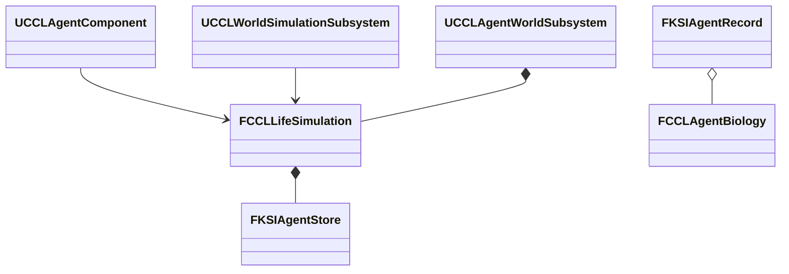

# Agent 생애

Agent의 나이, 수명, 자연 노화 보호, GAS 치명 피해와 실제 Actor 제거·복원을 소유한다. 상위 문서는 [생태계·생애](../Ecology.md)다.

## Agent 생애 연결과 실행 근거

Agent의 출생 시각·성숙·수명·사망 원인과 자연 노화 보호는 선택적인 `FCCLAgentBiology` Feature가 소유한다. 나이는 공통 완료 세계 시각에서 출생 시각을 뺀 값이며 사망 뒤에는 사망 시각에서 멈춘다. 원래 주민·전투 기록에 없는 출생일을 복원 때 임의로 만들지 않는다. 기존 저장에 Feature가 없으면 기존 행동을 유지하며 나이는 미기록이다. 새 주민 시나리오는 편집 가능한 초기 Feature를 가진다. 첫 주민의 퀘스트 역할은 자연 노화 보호로 표시한다. 시험 초기 나이·수명은 제작용 확정 밸런스가 아니다.

생태 집계가 소유하는 생물과 LifeSimulation이 소유하는 Agent는 이 연결에서 별개의 집단이다. 같은 ID가 생태 예약과 Agent 생애 Feature에 동시에 존재하면 공통 진행과 저장·복원을 거부한다. 이후 두 모델을 잇는 개체 승격은 나이·생존 상태의 소유권을 명시적으로 이전해야 한다. 표현 전환 자체가 Agent를 자동 생성하지 않는다.



LifeSimulation은 다른 예정 사건과 함께 자연 수명 종료 시각에서 진행 구간을 나눈다. 같은 시각의 사망을 모두 후보에 반영한 뒤 생활 거래를 평가하므로 죽은 제공자와 거래하지 않는다. 생애 계산은 기존 후보 복사 안에서 수행하며 예산 초과·Writer 충돌은 공통 시계와 생태·표면까지 유지한다. 사망 시 의도·실행 예약을 해제하고 Actor는 권위 기록을 확인해 제거한다. 기억·재산과 사망 기록은 저장에 남긴다. 상속·장례는 이번 연결의 범위가 아니다.

```cpp
bool EndLife(FGuid AgentId, ECCLAgentDeathCause Cause, FString& Error);
bool IsAlive(FGuid AgentId) const;
// 나이는 별도 Tick 누적값을 저장하지 않는다.
double Age = Biology.DeathCause == ECCLAgentDeathCause::None
    ? WorldSeconds - Biology.BirthWorldSeconds
    : Biology.DeathWorldSeconds - Biology.BirthWorldSeconds;
```

보호 플래그는 자연 사망 판정에만 사용한다. 외부 원인의 사망 요청과 기존 피해 판정은 보호 여부로 면제하지 않는다. 저장·재개, 시간 분할과 배율, 정확한 수명 경계, 보호 개체의 외부 사망, 죽은 Agent의 거래·새 의도 거부, 실패 시 원본 보존을 검증한다. 실제 맵에서는 일반 주민의 Actor 제거와 보호 주민 유지, 복원 후 사망 상태 유지를 확인한다. 검사에서는 실제 피해 판정과 명시적인 외부 사망 요청을 각각 사용한다. 모든 피해·화재를 생애 사망 원인으로 자동 연결한 결과는 아니다.

선택 Feature는 기억·직업 없는 생물에 주민 데이터를 강제하지 않는 대신, 기존 콘텐츠의 생애 설정과 소유권 전환을 명시적으로 관리해야 한다. UE5의 기존 `FInstancedStruct` Registry·버전 검증 경로를 사용하며 추가 모듈은 필요 없다. 이 생애 규칙은 UE 엔진의 자동 노화 기능이 아니다.

| 검사 | 결과와 근거 |
|---|---|
| 최종 프로젝트 파일 생성·Editor 빌드 | 성공 |
| 환경 자동화 | 96/96, 경고·실패·미실행 0. 생애 검사 4개 포함 |
| 기존 Agent 자동화 | 9/9, 경고·실패·미실행 0 |
| Campaign 실제 생애 검사 | 통과 |
| EnvironmentScenario 실제 생애 검사 | 통과 |
| EnvironmentPlayground 실제 생애 검사 | 통과 |
| 주민 에셋 추가·새 프로세스 재확인 | 8명에 빠진 Feature만 추가. 재실행 추가 0명, 파일 SHA-256 동일 |
| 갱신된 주민 에셋의 생활 실행 회귀 | 통과. 실제 StateTree 이동·작업·피해·저장·복원 |
| 갱신된 주민 에셋의 새 프로세스 세션 재개 | 통과|

자동화는 배율 0·10의 나이, 정확한 수명 종료 시각, 보호 개체의 외부 사망, 사망 뒤 나이 고정, 잘못된 생애·미래 출생·중복 소유권 거부를 검사한다. 생애 경계를 넘은 후보가 예산 초과로 실패하면 저장 바이트가 그대로 남는지도 확인했다. `Tools/Validation/run_agent_biology.ps1`은 실제 월드에서 두 주민을 만들고 자연 사망·보호 유지·실제 피해·외부 사망·Actor 폐기·저장 복원을 검사한다. Campaign 첫 실행은 시험 좌표가 바닥 밖에 있어 실패했으며 실제 지면 질의로 배치를 고친 뒤 세 맵에서 통과했다.

`Tools/Validation/update_agent_biology.py`는 `DA_MerchantLifeScenario`에서 알려진 주민의 누락 Feature만 추가하고 기존 Feature·경제·목표·StateTree를 보존한다. 신규 주민의 시험 기본값은 20-27년 나이, 18년 성숙, 80년 수명이며 1년을 365일의 초로 작성한다. 첫 주민은 자연 노화 보호를 사용한다. 이 수치는 짧은 자동 검사에서 쓰는 100초 수명과 별개이며 최종 제작 밸런스가 아니다. 기존 저장의 누락 Feature에는 이 기본값을 소급 주입하지 않는다.

현재 생애 Actor 검사는 Standalone·NullRHI 결과다. 생애 사망의 첫·늦은 접속자·재접속 검증, 개체군에서 Agent로 생애 소유권 이전, 생애 관측 UI, 성숙에 따른 외형·행동과 플레이어 노화는 이 결과에 포함하지 않는다. 플레이어 노화는 원래 범위에서 제외된다. 식생·음식 부패·실제 종별 이동과 구역 06·07은 계속 작업한다.

## GAS 치명 피해와 Agent 생애 연결 설계

생애 Feature가 있는 Agent의 GAS 체력이 0이 되면 공통 완료 세계 시각에서 외부 사망을 기록한다. 자연 노화 보호는 이 요청을 막지 않는다. 기존 피해 관측 경로와 체력 변경 delegate를 함께 사용해 일반 명중과 직접 GameplayEffect를 처리한다. 생애 Feature가 없는 기존 전투 Actor의 사망 정책은 유지한다.

Writer 충돌로 사망을 바로 기록하지 못하면 Actor가 아닌 세계 Agent 소유자가 ID·현재 Epoch를 가진 요청을 보관한다. 저장과 다음 세계 진행 전에 요청을 재시도한다. 아직 확정하지 못한 요청이 있으면 저장·시간 진행을 거부하고 큐의 시간은 보존한다. Actor가 제거돼도 요청은 남으며, 저장 복원으로 Epoch가 바뀌면 이전 세계의 미확정 요청을 폐기한다. 이는 Actor Tick만으로 재시도하는 방법보다 세계 소유자의 연결 비용이 늘지만 사망 요청의 Actor 수명 의존과 저장 누락을 방지한다.

실행 검사는 기존 세 맵의 생애 시나리오에 실제 치명 GameplayEffect, Writer 충돌 중 저장·진행 거부, 해제 뒤 사망 확정, 이전 세대 요청 폐기와 저장 복원을 추가한다. 구역 07의 상시 관측·조작은 이 경계를 사용해 후속 연결한다. 화재 노출량의 피해 변환과 생태 개체의 Agent 승격은 별도 구현 범위다.

구역 07은 일반 주민과 자연 노화 보호 주민 두 명을 사용한다. 초기 나이 20초·성숙 10초·수명 300초는 실험 입력이다. 일반 주민의 남은 수명을 10초로 줄이는 조작, 보호 주민의 자연 노화 보호 전환, 보호 주민에게 실제 치명 GameplayEffect를 적용하는 조작을 제공한다. 이미 수명을 넘긴 주민의 보호 해제는 거부하며 전체 초기화로 처음 상태에서 다시 비교한다. 공개 관측은 완료 세대·세계 시각·나이·수명·보호·사망 원인·현재 체력만 복제한다.

생애 값은 기존 LifeSimulation에 저장한다. 실험 표현 Actor는 살아 있는 실험 ID만 만들고, 복원 Epoch가 바뀌면 이전 표현을 제거한 뒤 저장 상태에서 다시 만든다. 처음 채우기는 새 환경 세계에만 적용하며 이전 저장에 표본이 없다면 전체 초기화로 기준 상태를 적용한다. 저장 기준 상태에 두 표본을 포함한다. 표본은 지면 위에 정지한 Manny이며 일반 주민 AI·직업·거래를 별도로 만들지 않는다.

## Agent 치명 피해와 구역 07 생애 실험 구현·검증

두 환경 맵에서 F7 메뉴의 **07 생애·식생·부패**를 선택하면 일반 주민과 노화 보호 주민의 나이·수명·체력·사망 원인을 볼 수 있다. **일반 주민: 남은 수명 10초**를 누르고 세계 시간을 진행하면 자연 사망을 확인할 수 있다. **보호 주민: 노화 보호 전환**으로 보호를 켜고 끄며, **보호 주민: 치명 피해**는 실제 GAS 효과를 적용한다. 전체 초기화는 두 주민을 처음 생애 상태로 되돌린다. 구역 08에서 저장한 뒤 초기화·불러오기를 하면 저장 당시 살아 있던 주민만 다시 생성한다.

`UCCLAgentComponent`는 서버 ASC의 체력 변경을 관측하고 `UCCLAgentWorldSubsystem::RequestExternalDeath`가 외부 사망을 요청한다. 기존 명중 경로의 `RecordDamage`도 같은 요청을 사용한다. 이미 죽은 기록의 사망 원인은 바꾸지 않는다. `FlushExternalDeaths`는 세계 진행과 저장 전에 보류 요청을 확정한다. 실험 Actor `ACCLBiologyExperiment`는 생애 원본을 소유하지 않고 두 ID의 공개 관측과 표현 재구성만 담당한다. 저장 형식은 기존 생애 Feature를 사용한다.

실제 치명 효과를 Writer 예약 중 적용한 뒤 저장·세계 진행이 거부되는 것을 확인했다. 충돌 상태에서 Actor를 먼저 제거해도 요청이 남았으며, 예약 반환 후 저장은 외부 사망과 충격 당시 세계 시각을 확정했다. 다른 검사에서는 보류 요청이 있는 상태에서 이전 저장을 복원하고, 이전 Epoch의 요청이 살아 있는 복원 기록을 죽이지 않는 것을 확인했다. 이는 프로세스 충돌 뒤 요청 복구까지 검증한 결과는 아니다. 보류 요청 자체를 파일에 쓰지 않으므로 확정하지 못한 저장은 거부한다.

| 검사 | 결과와 로컬 근거 |
|---|---|
| 프로젝트 생성·최종 Editor 빌드 | 통과 |
| Campaign 치명 효과·Actor 제거·Writer 충돌·세대 복원 | 통과 |
| Scenario 같은 생애 경계 검사 | 통과 |
| Playground 같은 생애 경계 검사 | 통과 |
| Scenario 실제 Slate 조작·화면·자연/외부 사망·초기화·복원 | 통과 |
| Playground 실제 Slate 조작·화면·생애 복원 | 통과 |
| Listen Scenario 첫·늦은 접속 | 통과 |
| Dedicated Playground 첫·늦은 접속 | 통과 |
| 환경 자동화 | 125/125, 경고·실패·미실행 0 |
| 기존 음식 메뉴·위치 환경·저장·초기화 회귀 | 통과 |

모든 검사는 UE 5.8.3의 로컬 작업 트리에서 수행했다. 표의 경로는 프로젝트 기준이며 원본 로그의 기기별 절대 경로는 옮기지 않았다. Scenario 화면·Dedicated·환경 자동화 이후 변경은 생애 검사에 Actor 선제 제거 조건을 추가한 것뿐이다. 나머지 검사는 그 조건을 포함한 최종 빌드에서 실행했다. 두 렌더링 실행의 생존·자연 사망·외부 사망 화면을 확인했다. 실제 Slate 입력은 남은 수명과 치명 피해 버튼에 적용했고 보호 전환은 Director 명령 경로로 검사했다.

네트워크 검사는 최초의 두 Actor를 첫 접속자가 관측한 뒤 시작한다. 최종 복원 후 두 클라이언트가 서버의 Epoch·세계 시각·두 공개 행 전체와 죽은 Actor의 부재를 대조했다. 클라이언트의 직접 조작은 거부됐다. Dedicated는 Editor 서버 모드이며 실제 Server 타깃 패키지, 지연·손실과 대규모 비용 검증은 포함하지 않는다.

재실행은 `Tools/Validation/run_biology_zone.ps1 -Rendered -Map EnvironmentScenario`를 사용한다. 다른 맵은 `-Map EnvironmentPlayground`, 네트워크는 `-Mode Listen -Port 20446` 또는 `-Mode Dedicated -Port 20445`로 실행한다. 생애 경계 검사는 `Tools/Validation/run_agent_biology.ps1 -Map Campaign`에 같은 두 환경 맵 이름도 지정할 수 있다.

Actor의 연료 접촉·실내 고온은 [열 피해 구현·검증](../Fire/ThermalDamage.md#열-피해-구현검증)에 연결했다. 생태 개체와 Agent 사이의 소유권 이전, 전체 플레이어 장비·계정 저장은 남아 있다. 직접 GAS 비치명 피해의 모든 종류를 지속 부상 값으로 변환한 것은 아니다. 기존 명중의 부상 기록과 이번 치명 사망 연결을 구분한다. 단계 8·9는 진행 중이다.
