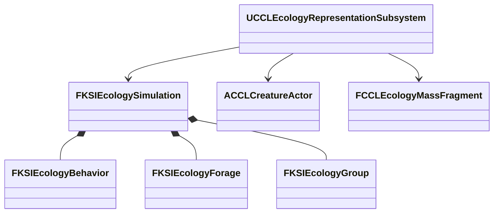

# 생물 행동과 먹이 수지

지속 예약 개체의 이동, 먹이 섭취, 무리 복귀를 공통 세계 시간의 후보 상태에서 계산하는 모델이다. 검증은 2026-10-10 UE 5.8.3의 NullRHI이고 Dedicated는 Editor 서버 모드다.

## 생물 행동 기반 실행 검증

`FKSIEcologyBehavior`는 개체별 이동 속도, 먹이 종류, 에너지, 굶주림, 선택 대상을, `FKSIEcologyForage`는 서식지의 먹이 위치, 잔량, 재생, 누적 소비를, `FKSIEcologyGroup`은 같은 서식지의 무리 기준점과 반경을 소유한다. 종, 개체군 수량, 사건 원장은 그대로 생태 모델이 소유한다. 표현 객체의 Tick에서 먹이를 다시 소비하지 않는다.

- **대상:** 지속 ID를 유지하는 예약 개체만 행동을 등록한다. 일반 집계의 평균 에너지로 먹이 이력을 축약하는 정책은 없으므로 비지속 예약의 등록을 거부한다. Actor, Mass, 표현 없는 지속 예약은 같은 모델의 위치와 에너지를 읽는다. 행동이 있는 개체의 위치는 모델이 쓰고, 표현의 오래된 위치를 반영하는 요청은 거부한다.
- **등록:** `AddGroup`, `AddForage`, `AddBehavior`는 후보 전체를 검증하고 실패 시 원본을 보존한다.
- **시간:** 세계의 정수 초 경계에서 고정된 개체 ID 순서로 처리한다. 개체와 먹이는 마지막 처리 시각을 저장해 소수 시각의 등록, 저장, 분할 진행에도 경과 시간이 겹치지 않는다. 예산 초과는 시간을 버리지 않고 더 짧은 구간으로 재시도한다. 고정 경계는 재현성을 얻는 대신 큰 시간 가속에서 처리량을 제한한다.
- **이동:** 지상과 기어 다니는 곤충은 수평면, 물고기와 새는 서식지 상자 안에서 높이를 포함해 이동한다. 굶주린 개체는 허용된 종류, 같은 서식지, 잔량을 만족하는 가장 가까운 먹이를 찾고, 도착에 쓴 시간을 뺀 나머지만큼 섭취한다. 배부른 개체는 무리의 공통 목표와 개체별 간격을 따른다. 좌표는 데이터로 입력한다.
- **먹이 수지:** 먹이는 초기량, 재생량, 소비량을 기록하고 `초기량 + 재생량 = 잔량 + 소비량`과 소비량과 개체별 누적 섭취량의 합을 대조한다. 안정적인 ID 순서로 처리해 중복 소비를 막는다. 먼저 처리되는 개체가 부족한 자원을 먼저 얻으므로 공정한 분배나 생태적 정확성을 구현한 것은 아니다. 수치는 게임 자원 단위다.
- **기아:** 에너지가 없는 시간이 정책의 한도에 도달하면 사망 원장에 한 번 반영하고 실행권을 무효화한다. 표현이 없는 지속 예약에서도 같은 경계로 진행한다.
- **저장:** 생태 저장 형식 4가 행동, 무리, 먹이 기록을 보관한다. 이전 형식 1-3에는 이 기록을 만들지 않는다. 유효한 CRC를 갖더라도 섭취 합계가 맞지 않는 기록은 거부한다.

전역 행동 Tree 대신 값 상태의 의도 계산을 공통 모델에 두고, UE5의 Actor와 Mass 실행기가 같은 결과를 표현한다.

| 검사 | 결과 |
|---|---|
| 환경 자동화 | 115/115, 경고, 실패, 미실행 0 |
| Scenario, Playground 행동과 별도 프로세스 복원 | 통과 |
| Dedicated Playground, Listen Scenario 첫 접속과 늦은 접속 | 통과 |
| 기존 수동 Actor/Mass 전환 회귀 | 통과 |

- 자동 검사 6개는 네 이동 매체의 위치 변화와 섭취, 소수 구간 분할과 저장 재개 뒤 바이트 일치, 무리 복귀, 등록 전 시간의 먹이 재생 방지, 경쟁, 종류 거부, 기아 사망, 실행권 무효화, 예산 실패와 후속 Agent 실패의 원본 보존을 본다.
- 실제 월드 검사는 Actor에서 Mass로, 다시 Actor로 바꾸며 위치, ID, 수량, 과거 Actor 종료 콜백의 거부를 대조하고, 저장 뒤 더 진행한 상태를 되돌려 생태 본문을 바이트로 비교한다.
- 접속자는 서버가 기록한 위치와 이동 매체를 대조하고 클라이언트의 행동 변경 거부를 본다. 위치 허용 오차 1cm는 `FRepMovement`의 기본 위치 양자화 `RoundWholeNumber`에 맞춘 값이다(`<Engine>/Source/Runtime/Engine/Private/Engine/ReplicatedState.cpp:24`).

1초 경계와 상태 예산은 재현과 보호 기준이고, 대규모나 장기간 실행 비용을 측정한 수치가 아니다. 먹이를 실제 식생에서 가져오거나 피식 개체를 없애는 검사는 포함하지 않는다.
