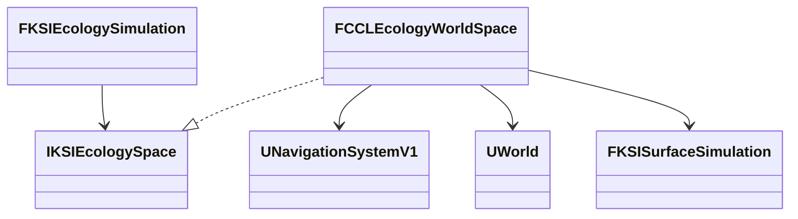

# 생물의 실제 공간 경로

행동의 이동 후보를 실제 충돌, 내비게이션, 수역으로 검증하는 경로 제공자다. 검증은 2026-10-10 UE 5.8.3의 NullRHI이고 Dedicated는 Editor 서버 모드다. 렌더링, 실제 Server 타깃 패키지, 손실과 지연, 자동 거리 전환은 포함하지 않는다.

## 실제 공간 경로 실행 검증

`IKSIEcologySpace`는 읽기 전용 경로 요청 계약이고, `FCCLEcologyWorldSpace`는 게임 스레드의 UE 월드, 확정 지형, 같은 시각의 표면 후보를 읽는 어댑터다. 행동은 경로의 누적 길이만큼 이동 시간을 쓰고, 목적지에 도착했을 때만 남은 시간으로 섭취한다. 장애물 뒤의 먹이를 직선 거리만으로 먹지 않는다.

- **정책:** 행동 정책의 `bUseWorldSpace`와 몸체 반경을 저장한다. 생태 저장 형식 5가 이를 보존하고, 형식 4는 고정 공간 정책으로 읽어 이력 값을 보존한다.
- **지상과 곤충:** UE 내비게이션의 완전한 경로를 쓰고 몸체 충돌을 확인한다. 부분 경로나 준비되지 않은 지형, 내비게이션을 성공 경로로 쓰지 않는다.
- **수중과 공중:** 서식지 안의 제한된 3차원 격자를 탐색하고 연결마다 구형 몸체의 Sweep을 검사한다. 격자는 축당 최대 64칸, 방문 최대 512개, 간격은 0.5m와 몸체 지름 중 큰 값이다. 물고기는 몸체 범위가 얼음을 뺀 실제 액체의 바닥과 수면 사이에 있는지도 본다.
- **실패:** `FindRoute`는 질의 실패와 경로 없음을 구분한다. 질의 준비 실패는 세계 후보를 폐기하고, 경로 없음은 빈 경로를 돌려 현재 위치를 유지하며 `Blocked`로 남긴다. 관통이나 순간 이동으로 대체하지 않는다.
- **시각:** 공간 정책이 켜진 행동이 있으면 세계 후보를 다음 정수 초 경계까지만 준비해 그 시각의 물 상태를 넘긴다. 현재 물 상태를 여러 과거 행동 초에 소급 적용하지 않는다.
- **내비게이션 준비:** `IsNavigationDirty()`를 준비 조건으로 쓰면 비 Shipping 빌드에서 누적 잠금 중 보고된 dirty 이력까지 읽어 지형 완료 뒤에도 대기한다(`<Engine>/Source/Runtime/NavigationSystem/Private/NavigationSystem.cpp:5697`). 제공자는 관련 지형의 완료 세대, 남은 빌드 작업, 빌드 잠금을 확인한 뒤 실제 완전 경로와 충돌을 검사한다.
- **경로 저장:** 경로는 저장하지 않고 다음 진행에서 현재 확정 기하로 다시 계산한다. 저장 뒤 장애물이 달라진 세계의 이동까지 같은 바이트로 재현하지는 않는다.

UE의 지상 경로 탐색을 재사용하면 실제 내비게이션과 지형 갱신을 따르지만 동기 경로 질의 비용이 든다. 제한 격자는 Recast 지상 경로로 표현할 수 없는 체적 이동을 검사하는 초기 연결이라 좁은 틈을 놓치거나 예산 안에 경로를 못 찾을 수 있다.

| 검사 | 결과 |
|---|---|
| 환경 자동화 | 119/119, 경고, 실패, 미실행 0 |
| Scenario, Playground 실제 공간 | 통과 |
| 저장 형식 5의 행동과 별도 프로세스 복원 | 통과. 공간 준비 조건과 검사 좌표 수정 전 결과 |

자동 검사 4개는 우회 거리만큼의 이동 시간과 도착 후 섭취, 질의 실패의 원본 보존과 막힌 경로의 정지, 같은 시각의 표면 후보와 형식 4 변환, 몸체 깊이, 건조 셀, 얼음 거부를 본다. 실제 월드 검사는 지형 경로, 벽 우회와 완전히 막힌 벽, 수중 우회와 건조 띠를 확인하고, 네 매체의 Actor로 공통 세계 시간 20초 이상 진행해 섭취 이력, 모델과 Actor 위치, 세계 저장 복원을 대조한다.

## 공간 정책의 재시작·접속 결과

공간 정책을 켠 상태에서 새 프로세스의 후속 진행과 첫 접속, 늦은 접속 검사를 통과했다.

| 검사 | 결과 |
|---|---|
| 환경 자동화 | 119/119, 경고, 실패, 미실행 0 |
| Scenario, Playground 새 프로세스 재개 | 통과 |
| Dedicated Playground, Listen Scenario 첫 접속과 늦은 접속 | 통과 |

- **재개:** 쓰기 프로세스는 세계와 생태 본문을 저장하고 8세계초를 더 진행한 본문을 기준으로 남긴다. 읽기 프로세스는 같은 맵의 지형과 검사 벽을 준비한 뒤 저장을 복원해 같은 구간을 진행한다. 네 매체의 위치, 행동, 에너지, 섭취 이력, 먹이 잔량, 원장을 포함한 본문이 바이트로 일치했다. 벽은 고정 기하로 다시 만드므로 임의 Actor의 영구 저장을 검증한 것이 아니다.
- **재시도:** 저장 복원 직후 내비게이션이 다시 준비되는 구간은 실패한다. 검사기는 등록한 시간 입력을 다시 넣지 않고 재시도하며, 실패 시 생태와 표면 본문, 세계 시각이 원래 값인지 대조한다. 생산 코드의 경로 준비 거부는 완화하지 않았다.
- **접속:** 서버가 이동과 섭취 뒤 저장을 복원하면 첫 접속자와 늦은 접속자가 복원 위치와 이동 매체를 확인한다. 위치 허용 오차는 1cm이고 클라이언트의 행동 변경 요청은 거부됐다. 수중과 공중 검사 공간은 기본 Actor 거리 범위 안의 상공에 두어 실제 거리 관련성을 유지했고, `NetCullDistanceSquared`와 관련성 설정은 바꾸지 않았다. 전체 생태 원장 복제나 클라이언트 자체 경로 계산은 검사하지 않았다.

지상 목적지의 높이는 콘텐츠가 실제 도달 가능한 몸체 중심으로 줘야 한다. 좁은 통로, 여러 수역의 연결, 대규모 탐색 성능, 경사, 계단, 이동 장애물의 연속 실행, 개체 간 회피는 이 검증에 없다.
