# 구역 06 상시 생태 실험

지상, 물고기, 새, 곤충의 네 서식지를 두 환경 맵에 배치한 실험이다. 검증은 2026-10-10 UE 5.8.3이다. 렌더링 검사는 Standalone이고, 네트워크는 NullRHI이며 Dedicated는 Editor 서버 모드다. 실제 Server 타깃 패키지, 지연과 손실, 대규모 부하는 포함하지 않는다.

## 구역 06 실행·관측·복원 검증

개체군마다 초기 20마리 중 3마리를 지속 개체로 예약하고 17마리는 집계에 남긴다. 지속 개체의 행동, 먹이, 무리, 위치는 생태 모델이 소유한다. `ACCLEcologyExperiment`는 초기 콘텐츠, 네 행의 공개 관측, 먹이 추가 요청, 표현 모드 조정을 맡는다. 지상과 곤충은 구역의 실제 플랫폼 내비게이션을, 물고기는 보존되는 시험 수역을 쓴다.

```mermaid
classDiagram
    ACCLExperimentDirector --> ACCLEcologyExperiment
    ACCLEcologyExperiment --> UCCLWorldSimulationSubsystem
    ACCLEcologyExperiment --> UCCLEcologyRepresentationSubsystem
    UCCLExperimentScreen --> ACCLEcologyExperiment
```

- **초기값:** 초기 생태는 빈 모델에만 검증된 후보를 한 번 적용한다. 저장을 읽은 세계에는 생물을 다시 채우지 않고, 재시드 요청은 거부한다. 초기화 기준에는 같은 초기 시각의 생태와 시험 수역을 넣는다. 세계 복원 뒤에는 살아 있는 고정 ID의 표현만 다시 만들고 사망 기록을 되돌리지 않는다.
- **표현:** `Actor 표현`, `Mass 표현`, `표현 숨김`이 고정 예약 개체의 표현을 바꾼다. Mass와 숨김은 월드에 모형을 그리지 않고, 숨긴 개체의 행동은 세계 시간에서 계속된다. 한글 표지는 `F_EcologyLabel`을 쓴다. 모형은 기본 도형이다.
- **먹이:** 네 먹이 버튼은 해당 서식지에 10단위의 독립된 자원 원장을 더한다. 원래 먹이의 생성량과 소비 이력을 덮지 않는다.
- **관측:** 공개 행은 전체, 집계, 예약, Actor, Mass 수, 경로 막힘, 살아 있는 예약 개체의 평균 에너지와 섭취량, 먹이 잔량을 같은 서버 시각에서 계산한다. 상세 모델 대신 작은 관측을 복제하므로 메뉴 조회 비용은 낮지만 원거리 개체군 복제의 일반 계약을 대신하지 않는다.

| 검사 | 결과 |
|---|---|
| 에셋과 한글 글꼴 생성 | 성공 |
| Scenario 메뉴, 렌더링, 자동 검사, 복원 | 통과 |
| Playground 메뉴, 렌더링, 복원 | 통과 |
| Dedicated Playground, Listen Scenario 첫 접속과 늦은 접속 | 통과 |
| 기존 Scenario 환경 통합, 음식 보관, 노화, 저장 회귀 | 통과 |
| 환경 자동화 | 119/119, 경고, 실패, 미실행 0 |

- 네 개체군 각각 20마리 = 집계 17 + 예약 3을 대조한다. Actor 3, Mass 3, 표현 없음으로 바꿔도 예약 수는 같다.
- 표현이 없는 동안 24세계초 이상 진행해 12개체 모두의 위치 변화와 양수 섭취 이력을 확인하고 Actor를 다시 만든다.
- 저장, 추가 먹이, 불러오기에서 생태 본문이 같고, 초기화 뒤에는 각 먹이 30, 섭취 0, 에너지 35%로 돌아온다. 마지막 불러오기 뒤 12개 Actor의 위치가 모델과 1cm 이내로 일치했다.
- 첫 접속자는 초기 80마리와 Actor 12개의 공개 관측을 본다. 복원 뒤 두 접속자는 네 행의 먹이, 에너지, 섭취량, 세계 시각, 12개 Actor의 매체와 위치를 서버 기록과 대조했다. 관측 수치의 허용 오차는 1e-8, 위치는 1cm다. 클라이언트의 직접 먹이 변경은 거부됐다.

기존 시간 자동 검사의 `RunClock`은 상시 공간 행동이 들어오면서 요청을 120세계초로 제한하고, 생애 예산 0으로 거부를 주입한 뒤 정상 예산의 분할 재시도를 확인한다. 실제 큰 시각 점프의 성능이나 유효 예산 소진 시험을 대체하지 않는다.

캡처 요청은 프레임 끝에 처리되므로 요청 직후 같은 Tick에서 표현을 바꾸면 모형이 빠진다. 검사기는 캡처가 끝난 다음 상태를 바꾼다. 곤충은 작고 물고기는 불투명 수면 아래에 가려지므로, 먹이 주변의 개체 겹침과 수중 관측성은 화면으로 확인하지 못했다. 수중 이동과 복원 위치는 실행 검사로 따로 확인했다.
