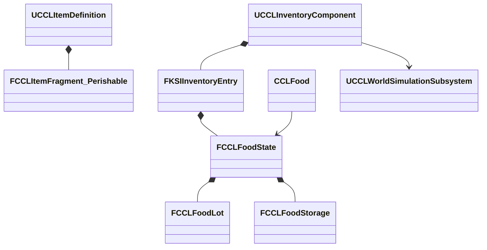
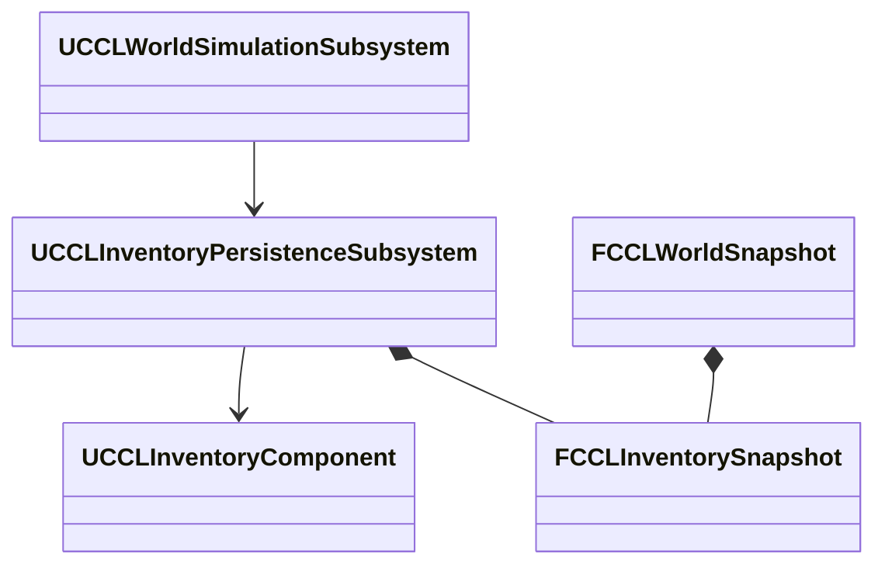
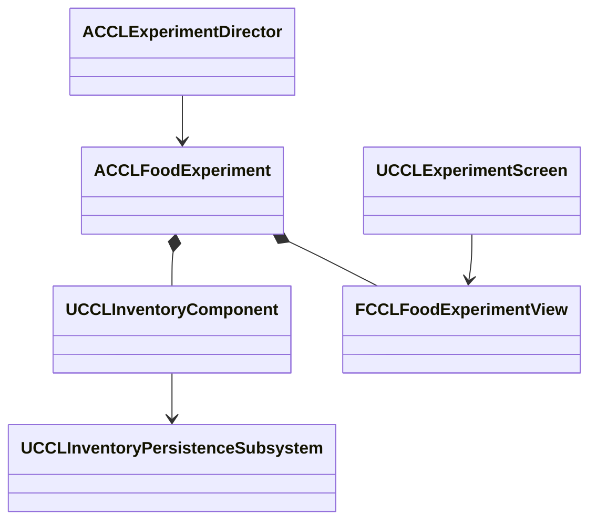
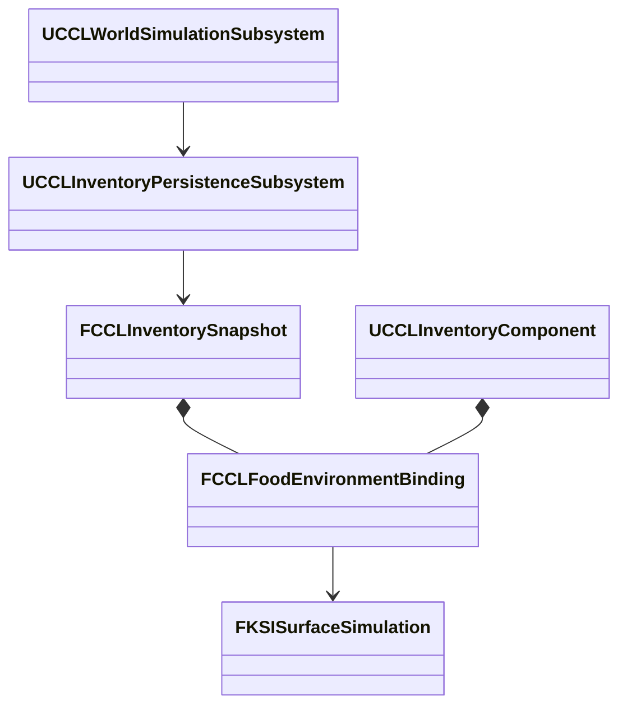
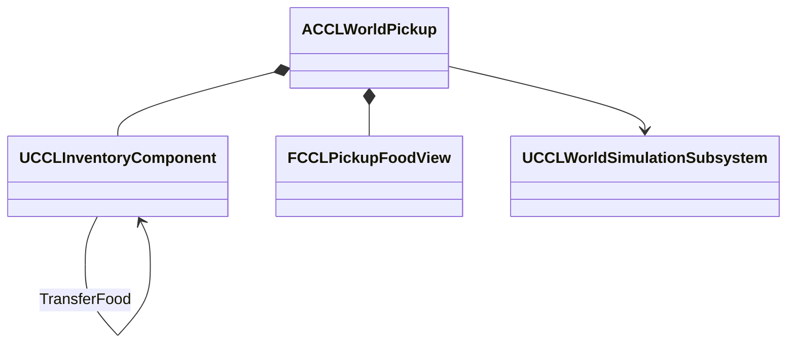
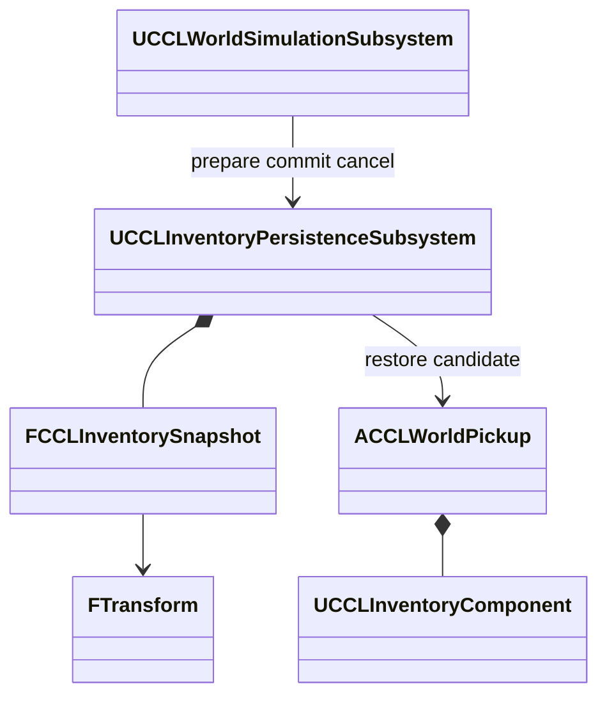

# 음식

음식 묶음의 부패와 곰팡이, 인벤토리, 보관 환경, 픽업, 세계 저장과 검증 기록을 소유한다. 상위 문서는 [생태계·생애](../Ecology.md)다.

## 음식 부패와 인벤토리 연결 설계

음식은 선택적인 `FCCLItemFragment_Perishable`로 정의한다. 공유 정의에는 기준 보존 시간과 곰팡이 발현·성장 시간을 두고, 인벤토리 항목은 생성 묶음별 수량·생성 시각·누적 부패 노출·곰팡이 노출을 소유한다. 묶음의 원본 ID는 분할해도 유지한다. 같은 슬롯에 새 음식과 오래된 음식이 들어가도 묶음을 평균 내거나 생성 시각을 다시 쓰지 않는다. 단계 8의 음식 요구와 아이템 조합 원칙인 결정 9·15를 따른다.

서버 인벤토리가 변경 권한을 갖고 현재 완료 세계 시각을 부패 계산에 전달한다. 상태에는 세계 ID와 마지막 평가 시각, 당시 보관 조건을 저장한다. 같은 조건에서는 누적 노출에 경과 시간을 더하며 조회는 복사본을 평가한다. 조건 변경·합치기·분할 전에 이전 조건으로 현재 시각까지 계산한다. 온도·습도·보존 계수와 곰팡이 노출 계수는 게임용 입력이다. 0°C 이하에서 계산을 정지하는 초기 정책은 실제 식품 안전의 근거가 아니다.

| 소유자 | 책임과 수명 |
|---|---|
| `FCCLFoodState` | 아이템 묶음의 생성 이력·노출·보관 조건. 인벤토리 이동·저장 수명을 따른다 |
| `CCLFood` | UObject 없이 값 후보의 진행·합치기·분할·검증을 수행한다 |
| `UCCLInventoryComponent` | 서버에서 음식 생성·묶음 이동·조건 변경을 요청하고 Fast Array에 게시한다 |
| 세션 저장 | 아이템의 음식 상태와 공통 세계 저장을 함께 보관하고 세계 ID·완료 시각을 대조한다 |



```cpp
bool Advance(FCCLFoodState& State, double WorldSeconds, FString& Error);
bool Merge(FCCLFoodState& Destination, const FCCLFoodState& Source,
    double WorldSeconds, FString& Error);
bool Split(FCCLFoodState& Source, int32 Quantity, double WorldSeconds,
    FCCLFoodState& Removed, FString& Error);
// 실패하면 원본 묶음과 출력 값을 모두 보존한다.
FCCLFoodState Candidate = Current;
if (!CCLFood::Advance(Candidate, WorldSeconds, Error))
{
    return false;
}
Candidate.Storage = NewStorage;
Current = MoveTemp(Candidate);
```

기준 보존 시간으로 누적 부패 노출을 나눈 값을 신선도 감소로 사용한다. 기준 조건은 20°C·상대 습도 100%·보존 계수 1이다. 곰팡이는 습한 조건에서 별도의 누적 노출이 발현 시간을 넘으면 증가하며 건조·냉각만으로 이전 노출을 지우지 않는다. 영구 상태의 이력은 그대로 두고 화면에는 0-1 범위의 신선도·곰팡이 비율을 제공한다. 소비는 생성 시각이 가장 오래된 묶음부터 수행한다. 같은 원본·생성 시각·노출이 완전히 같은 묶음만 수량을 합친다. 한 항목의 묶음 수를 256개로 제한하고 초과 요청은 원본을 보존한 채 거부한다.

평균 한 개보다 저장·복제 데이터와 검증 비용이 늘지만 합치기를 통한 신선도 회복과 일부 소비 후 남은 음식의 나이 변경을 막을 수 있다. 새 음식 상태에는 생성 시점의 부패 정책 값을 함께 보존해 에셋 수치 변경이 기존 음식의 과거를 소급 바꾸지 않게 한다. UE5의 기존 Fragment·Fast Array를 사용하며 별도 모듈은 추가하지 않는다. Fast Array는 UE4에도 있던 기능이고 현재 사용하는 구조체 Fragment는 이 프로젝트의 UE5 조합 방식이다.

값 검사는 시간 분할·냉장·고온·습도·밀폐, 정확한 신선도·곰팡이 경계, 혼합·분할·소비 후 원본 시각, 다른 세계·시간 역행·비정상 수치·묶음 예산 실패를 포함한다. 실제 월드에서는 공통 시각과 인벤토리 수량의 일치, 상태 이전·복원·새 프로세스 재개를 확인한다. 세션 형식의 이전 버전은 음식 상태가 없는 그대로 읽으며 기존 아이템에 생성 시각을 임의로 주입하지 않는다. 구역 07의 식품 조작·화면·네트워크와 환경 전체 저장의 인벤토리 원자 복원은 후속 통합까지 확인해야 완료다.

## 음식 상태·인벤토리·세션 검증

2026-10-10 UE 5.8.3에서 `CCLFoodState.h/.cpp`의 값 모델과 `CCLInventoryFood.cpp`의 실제 인벤토리 연결을 검증했다. 기존 비식품에는 빈 음식 상태를 유지한다. `DA_Bread`는 최대 20개, 기준 보존 시간 86,400초와 곰팡이 발현·성장 각 43,200초의 선택 Fragment를 가진다. 이 값은 기능 검증용 초기 설정이며 생물학적 정확도나 최종 게임 밸런스를 뜻하지 않는다. 실제 보급·섭취 콘텐츠와 화면은 아직 연결하지 않았다.

식품 합치기는 묶음별 이력을 유지하고 화면용 평균 신선도·곰팡이 비율만 수량 가중으로 계산한다. 부패한 개수와 곰팡이가 있는 개수도 별도로 반환한다. FIFO 소비·분할은 생성 시각 순서로 선택하며 같은 원본 ID에 서로 다른 생성 시각을 넣으면 거부한다. 전체 묶음을 빈 컨테이너로 옮기면 아이템 GUID를 유지한다. 일부만 옮기거나 기존 묶음에 합치면 대상 항목의 GUID 규칙을 따르되 음식 원본 ID·시각은 보존한다.

기존 대상 음식과 합칠 때는 양쪽을 각자의 이전 조건으로 현재 완료 시각까지 계산한 뒤 대상의 보관 조건을 사용한다. 빈 컨테이너로 옮긴 음식은 기존 조건을 유지한다. 보관 조건은 현재 서버 API 입력이며 컨테이너 위치의 날씨·실내 온도로 자동 변경하는 연결은 후속 작업이다. 동일 조건의 경과는 조회 복사본에서 계산하므로 음식만 따로 Tick해 공통 시계보다 먼저 진행하지 않는다. 현재 조회 API는 서버의 공통 시계에 연결됐으며 클라이언트 관측 UI는 별도 연결해야 한다.

세션 형식 7은 음식 바이트를 Base64로 보관한다. 내부 형식 1은 세계 ID, 마지막 평가 시각, 생성 당시 정책, 보관 조건과 최대 256개 묶음을 CRC와 함께 검증한다. 음식 수량은 인벤토리 수량과 같아야 하며 음식의 세계 ID는 함께 저장된 Campaign 세계와 같아야 한다. 마지막 평가 시각이 저장 세계 시각보다 미래면 거부한다. 이전 세션 형식 1-6은 음식 생성 시각을 주입하지 않고 빈 상태로 변환한다. 구조와 CRC는 손상 검사용이며 신뢰할 수 없는 외부 파일의 보안 경계를 제공하지 않는다.

| 검사 | 결과와 근거 |
|---|---|
| 프로젝트 파일 생성·Editor 빌드 | 성공 |
| 환경 자동화 | 107/107, 경고·실패·미실행 0 |
| Campaign 음식·새 프로세스 | 통과 |
| Scenario 음식·새 프로세스 | 통과 |
| Playground 음식·새 프로세스 | 통과 |
| 기존 세션 저장·불러오기 회귀 | 통과 |
| 음식 에셋 생성 | 작업 PASS와 새 프로세스 로드 확인 |
| 장비 태그·저장 호환 회귀 | 통과 |
| 기존 획득·장착·회복·성장과 캠페인 | 통과 |

음식 자동 검사 5개는 온도·습도·밀폐·냉각, 정확한 만료·곰팡이 경계, 조회 원본 보존, 시간 분할, 오래된 음식과 새 음식 혼합·분할·소비, 다른 세계·정책·시간 역행·묶음 예산 거부, 직렬화 재개·손상·미지원 버전을 확인한다. 기존 세션 변환 검사에는 형식 6에서 7로의 변환을 추가했다. 중복 Fragment 검사에서 같은 TArray 내부 원소를 직접 Add해 발생한 테스트 assert는 별도 값 복사로 수정했다.

`Tools/Validation/run_food_smoke.ps1 -Map Campaign`은 실제 월드에서 공통 시간을 진행하며 합치기·분할·컨테이너 이동·소비·슬롯 이동을 검사한다. 대상 컨테이너가 가득 차면 원본 음식 바이트가 유지되고, 양쪽 상태가 확정된 뒤 알림이 발생하는지도 확인했다. `EnvironmentScenario`, `EnvironmentPlayground`도 같은 옵션으로 실행한다. 첫 검사에서는 정지 배율의 기존 대기 구간을 한 번의 Advance로 모두 처리한다고 가정해 실패했다. 대기 구간을 순서대로 처리하도록 검사를 고친 뒤 세 맵이 통과했다.

새 프로세스는 저장한 공통 세계와 음식 항목을 복원하고 음식 바이트·아이템 GUID·세계 시각을 대조한 뒤 부패를 계속 진행했다. Campaign은 같은 음식이 들어간 세션 형식 7의 왕복과 미래 음식 시각 거부도 확인했다. 이는 Editor Standalone·NullRHI 검사다. 구역 07 음식 조작·렌더링, Listen·Dedicated 음식 복제, 실제 음식 픽업의 이력 전달, 모든 컨테이너를 포함한 환경 전체 저장·원자 복원과 패키지 검증은 남았다. 세션 검사의 개별 파일 복원을 구역 08 전체 저장 완료로 확대하지 않는다.

장비 회귀의 이전 기대값은 복원 버전을 6으로 고정하고 있었다. 현재 형식 7을 반환하는 계약과 맞춰 기대값을 갱신한 뒤 태그·양손 점유·이전 형식 변환 검사가 통과했다. 표의 최종 생성·빌드와 장비·캠페인 회귀는 이 테스트 수정 이후 결과이며, 앞선 음식·환경·세션 실행과 음식·저장 구현은 같다.

## 전체 세계 저장의 컨테이너 연결 설계

음식이 들어 있는 컨테이너는 명시적인 지속 ID로 세계 저장에 참여한다. 배치 상자는 콘텐츠가 ID를 제공하고 동적 컨테이너는 생성 기록이 같은 ID를 다시 공급한다. Actor 이름·포인터·새 프로세스에서 만든 임의 ID를 복원 식별자로 사용하지 않는다. 등록되지 않은 음식이 있으면 일반 세계 저장과 시간 복원을 거부한다. 플레이어의 계정·장비 상태 연결은 이 계약 위에서 별도로 통합한다.

`FCCLInventorySnapshot`은 컨테이너 ID·용량과 아이템 ID·정의 경로·슬롯·수량·탄창·음식 이력을 가진 값 기록이다. `UCCLInventoryPersistenceSubsystem`은 등록된 컴포넌트와 언로드된 기록을 관리한다. 세계 형식 5는 이 기록을 기존 시계·생활·표면·생태계와 같은 CRC 및 완료 세대에 보관한다. 형식 1-4는 빈 컨테이너 기록으로 변환하며 음식의 생성 이력을 만들지 않는다.



등록·복원은 정의 조회와 현재 용량·항목 검증을 먼저 끝낸다. 세계 복원은 모든 연결된 컨테이너의 트랜잭션을 확보하고 생활 복원까지 성공한 뒤 항목을 교체한다. 실패하면 트랜잭션만 해제하고 현재 시계·항목·보관 기록을 유지한다. 성공 알림은 모든 항목과 공통 시계가 최종 상태인 뒤 발생한다. 저장에 없는 등록 컨테이너는 빈 상태로 되돌린다. 언로드된 기록도 보존해 다시 등록할 때 적용한다. 초기 구현은 장착 슬롯을 가진 컨테이너의 세계 복원을 거부한다. 장비의 참조·효과까지 같은 시점으로 되돌릴 참여자가 아직 없기 때문이다.

```cpp
bool BindPersistence(FGuid ContainerId, FString& Error);
bool CanRestore(const TArray<FKSIInventoryEntry>& Entries) const;
// PrepareRestore가 검증과 잠금을 끝낸 뒤 세계를 적용한다.
// 실패하면 CancelRestore, 성공하면 CommitRestore를 호출한다.
```

전체 컨테이너 기록 복사는 저장 크기와 정의 조회 비용이 늘지만 음식의 수량·소유자·생성 시각을 같은 상태로 복원할 수 있다. 검증은 별도 프로세스 재등록, 언로드 후 저장, 현재에만 있는 음식 제거, 중복 ID·아이템·손상·미래 시각 거부, 열려 있는 인벤토리 트랜잭션 및 생활 쓰기 예약에 의한 전체 복원 실패를 포함한다. 이는 저장 기반의 작업 단위이며 플레이어 장비·월드 픽업·구역 08 통합 완료를 뜻하지 않는다.

세션 저장은 호스트 인벤토리를 세션 항목이 소유한다. 이 기존 경로에는 `SessionInventory`를 명시해 같은 호출에서 수집한 개인 항목만 세계 컨테이너 수집에서 제외한다. 다른 미등록 음식은 계속 거부한다. 세션 검증은 세계 컨테이너와 개인 항목의 GUID 중복을 거부하며 복원은 세계를 먼저 적용한 뒤 개인 항목·장비를 적용한다. 일반 세계 저장이나 맵 전환에 이 예외를 자동 적용하지 않는다. 개인 계정·장비까지 포함한 일반 세계 복원은 후속 범위다.

## 컨테이너 세계 저장 검증

2026-10-10 UE 5.8.3에서 명시적으로 등록한 보관함을 세계 형식 5에 연결했다. `CCLInventorySnapshot.h/.cpp`는 값 기록과 제한된 직렬화를, `CCLInventoryPersistenceSubsystem.h/.cpp`는 살아 있는 컴포넌트·언로드 기록·복원 후보를 맡는다. `CCLWorldSimulationSubsystem`의 시작·저장·복원이 이를 호출한다. 자동 등록, 배치 Actor 생성과 계정 재접속의 ID 복구까지 구현한 상태는 아니다.

일반 보관함의 아이템 GUID·정의 경로·수량·슬롯·탄창과 음식 바이트를 함께 저장한다. 컨테이너는 최대 1,024개, 전체 항목은 최대 4,096개, 내부 바이트는 최대 8 MiB로 제한했다. 이 값은 `CCLInventorySnapshot.cpp`의 초기 검증 예산이며 해당 규모의 성능을 측정한 결과는 아니다. 문자열과 배열은 할당 전에 남은 바이트와 제한을 검사한다. 세계 CRC와 기존 전체 크기 제한도 적용한다. 정의의 실제 존재·최대 중첩·탄창·음식 Fragment와 현재 컴포넌트의 용량은 실행 복원 전에 확인한다.

복원은 모든 연결된 보관함의 후보를 준비한 뒤 트랜잭션을 확보한다. 생활 저장의 쓰기 예약 때문에 세계 적용이 실패하면 인벤토리 잠금을 모두 해제한다. 성공하면 공통 시계와 모든 보관함 항목을 바꾼 뒤 알림을 보낸다. 검사 중인 두 보관함의 구독자가 최종 시각·수량을 함께 보는 것을 확인했다. 알림에서 다른 객체를 임의로 파괴·수정하는 모든 재진입 상황까지 검증한 것은 아니다.

언로드 시 마지막 항목을 기록으로 넘기며, 컴포넌트가 없는 상태에서도 세계 저장에 포함한다. 새 프로세스에서 같은 지속 ID와 용량으로 등록하면 기록을 적용한다. 살아 있는 동일 ID의 중복 소유자와 저장 용량이 다른 컴포넌트는 거부한다. 복원 파일에 없는 현재 등록 보관함은 비운다. Actor 생성·삭제·위치와 맵 배치 생명주기는 이 저장소 밖의 책임이며, 미등록 콘텐츠를 자동 재생성하지 않는다.

| 검사 | 결과와 근거 |
|---|---|
| 최종 프로젝트 파일 생성·Editor 빌드 | 성공 |
| 최종 환경 자동화 | 109/109, 경고·실패·미실행 0 |
| Scenario 보관함 저장·새 프로세스 | 통과 |
| Campaign 보관함 저장·새 프로세스 | 통과 |
| 최종 Playground 보관함 저장·새 프로세스 | 통과 |
| 최종 실제 개인 장비·음식 세션 | 통과 |

실제 맵 검사는 같은 저장의 시계와 두 보관함을 되돌리고 음식 바이트를 대조한다. 인벤토리 트랜잭션·생활 쓰기 예약·손상 파일·미등록 음식에 의한 거부, 중복 컨테이너 ID, 잘못된 용량, 언로드 이후 저장과 재등록도 검사했다. 최초 실행에서는 세계 저장 함수의 컨테이너 수집 연결 누락을 발견했다. 연결을 수정하고 저장 파일의 컨테이너 개수까지 검사하도록 보강한 뒤 통과했다. Scenario·Campaign 검사는 최종 개인 세션 소유자 인계 추가 전 결과이며, 같은 일반 세계 저장·복원 경로를 사용한다. 마지막 변경 뒤에는 표의 최종 빌드·환경·Playground·실제 세션 검사를 수행했다.

실제 세션 검사는 호스트가 장갑을 장착하고 스킬·물약·빵 2개를 가진 상태로 저장했다. 새 프로세스의 초기 불러오기와 메뉴 복귀 후 재불러오기에서 음식 GUID·수량·이력 바이트와 기존 장비·효과·진행을 확인했다. 승리 후 재저장·불러오기도 통과했다. 개인 세션 항목과 세계 컨테이너의 동일 아이템 GUID는 Campaign 음식 검사에서 거부했다. 이전 세계 형식 1-4의 빈 컨테이너 변환은 환경 자동화에 포함한다.

검증 범위는 Editor Standalone·NullRHI다. 일반 세계 저장에서 플레이어 장비·계정 인벤토리를 함께 되돌리는 참여자, 음식이 있는 개인 상태의 일반 맵 전환, 실제 배치 상자·픽업의 지속 ID 연결, 구역 07 음식 표시·조작과 네트워크·패키지 검증은 남았다. 호스트의 명시적 세션 저장 외에는 개인 음식의 저장 예외를 자동 적용하지 않는다. 이 기반 검증을 구역 08의 모든 저장 대상 통합 완료로 확대하지 않는다.

## 구역 07 음식 비교 실험

구역 07에 노출·냉각·밀폐 보관함을 추가한다. 각 보관함은 지속 ID를 가진 실제 인벤토리이며 공통 세계 저장에 참여한다. `ACCLFoodExperiment`가 고정된 실험 배치와 생성 조건을 소유하고, 인벤토리와 부패 값 모델은 기존 공통 API를 사용한다. 서버는 항목을 소유하며 복제한 읽기 전용 관측값으로 메뉴와 월드 표현을 갱신한다.



실험용 음식 정의는 기준 부패 300초, 곰팡이 발현 120초·성장 180초로 작성한다. 기본 빵의 정책은 유지한다. 노출 조건은 20°C·습도 100%, 냉각은 -5°C, 밀폐는 부패 계수 0.2·곰팡이 노출 0이다. 빠르게 상태 차이를 관찰하기 위한 시험 입력이며 실제 식품 안전 또는 최종 게임 밸런스를 뜻하지 않는다. 저장된 묶음의 정책·조건은 복원 때 새 기본값으로 덮지 않는다.

새 음식 추가, 노출 보관함의 한 개를 냉각 보관함으로 이동, 냉각 음식의 해동·재냉각을 기존 실험 조작 권한과 세대 검사로 처리한다. 이전 조건에서 현재 완료 시각까지 먼저 평가한 뒤 조건을 바꾼다. 화면에는 보관 조건·수량·원본 묶음 수·경과 시간·신선도·곰팡이와 부패 수량을 표시한다. 월드에서는 각 보관함의 이름과 음식 상태에 따른 색을 보여 준다. 공개 관측값을 복제하는 방식은 상세 인벤토리의 소유자 전용 복제를 유지하지만 표시에 필요한 집계 계산·복제 비용이 든다.

최초의 새 실험만 기본 음식을 생성한다. 일반 저장 복원과 재방문에서는 저장된 빈 상태도 그대로 보존하며 전체 초기화만 작성한 초기 음식으로 되돌린다. 검증은 두 맵의 실제 조작·화면, 저장·복원·초기화, Listen·Dedicated 첫·늦은 접속자의 관측 일치와 클라이언트 변경 거부를 포함한다. 실험의 고정 조건을 날씨·실내 환경 자동 입력 완료로 확대하지 않는다. 동적 환경 조건은 공통 시간의 구간 경계와 함께 후속 연결한다.

## 음식 비교 조작과 실행 검증

두 환경 맵에서 F7을 열고 **07 생애·식생·부패**를 선택하면 음식 보관 비교를 볼 수 있다. **새 음식 2개 추가**, **노출 → 냉각 1개 이동**, **냉각 음식 해동 / 재냉각**을 조작한다. 시간 배율을 높이면 노출 음식의 신선도 감소와 곰팡이, 냉각 보존과 밀폐의 느린 변화를 비교할 수 있다. 월드의 세 음식 표본과 글자도 같은 공개 관측값을 사용한다. 곰팡이가 있으면 초록, 곰팡이 없이 부패했으면 짙은 갈색, 그 밖에는 음식 기본색으로 표시한다. 메시·재질은 실험용 표현이며 최종 아트가 아니다.

`DA_FoodSample`은 이 비교에 사용하는 별도 음식 정의다. 시험의 300초 부패 정책은 `DA_Bread`에 적용하지 않는다. 세 보관함은 고정된 지속 ID로 세계 저장에 참여한다. 저장·불러오기는 수량과 음식 이력을 공통 시계와 함께 되돌리고, 전체 초기화는 작성된 세 보관함의 기본 음식 4개씩을 복원한다. 일반 저장 복원에는 초기 음식 보충을 적용하지 않는다.

서버가 `FCCLFoodExperimentView`에 세계 ID·실행 세대·완료 시각과 세 보관함의 집계를 함께 게시한다. `UCCLInventoryComponent::List`의 `COND_OwnerOnly`는 유지한다. 소유자가 없는 실험 Actor의 상세 항목은 일반 관찰 클라이언트에 보내지 않으며, 표시에 필요한 수량·품질 집계만 복제한다. `OnRep_View`와 서버 조작 완료에서 월드 표현을 갱신한다. 이 실험의 관측은 0.2초 간격이므로 매 프레임 시계와 같은 빈도로 변하는 화면은 아니다.

2026-10-10 UE 5.8.3에서 다음 검사를 수행했다. 프로젝트 파일 생성 뒤 `CCLEditor Win64 Development` 빌드를 수행했다.

| 검사 | 결과와 근거 |
|---|---|
| 최종 생성·Editor 빌드 | 성공 |
| 환경 자동화 | 109/109, 경고·실패·미실행 0 |
| 음식 저장·새 프로세스 회귀 | 통과 |
| Scenario 실제 메뉴·렌더링 | 통과 |
| Playground 실제 메뉴·렌더링 | 통과 |
| Listen Scenario 첫·늦은 접속 | 통과 |
| Dedicated Playground 첫·늦은 접속 | 통과 |
| 기존 구역 07 식생 조작·저장 회귀 | 통과 |

음식 검사는 추가 버튼의 실제 Slate 클릭, 한 개 이동, 노출 부패·냉각 보존·밀폐 지연, 해동 후 기존 이력의 진행을 확인한다. 실험 저장·불러오기 뒤 음식 직렬화 바이트를 대조하고, 전체 초기화 뒤 다시 저장을 복원한다. 네트워크 검사는 접속자 두 명의 관측·복원 상태, 상세 인벤토리 비공개와 클라이언트의 직접 변경 거부를 확인한다. 늦은 접속자는 복원 완료 후 접속한다. 초기 실행에서 두 렌더링 검사를 동시에 돌렸을 때 클릭 직후 판정이 한 번 실패했다. 클릭 결과를 다음 프레임부터 제한 시간 동안 기다리도록 보강하고 두 맵은 순서대로 검사한다. 실패 원인이 병렬 실행이라고 확정한 것은 아니다.

환경 자동화·음식 재시작은 마지막 글자 위치·촬영 대기 조정 전 결과다. Dedicated 검사는 공개 관측의 RepNotify 연결 뒤, 마지막 글자 위치 조정 전에 수행했다. Listen 검사는 RepNotify 연결 전에도 같은 공개 집계를 확인했다. 최종 렌더링과 식생 회귀는 마지막 빌드에서 수행했다. 캡처는 음식 패널과 세 표본의 수량, 글자 배치, 부패 후 색을 직접 확인한다. `DefaultTextMaterialOpaque`를 복제해 폰트 매개변수를 보존하고 발광 색을 적용한 글자 재질을 사용한다. 엔진 근거는 `<Engine>/Source/Runtime/Engine/Private/Components/TextRenderComponent.cpp:334`의 폰트 매개변수 연결이다.

재실행은 `Tools/Validation/run_food_zone.ps1 -Map EnvironmentScenario -Rendered`와 `-Map EnvironmentPlayground -Rendered`로 한다. `-Mode Listen` 또는 `-Mode Dedicated`는 렌더링 없는 서버·클라이언트 검사를 실행한다. Dedicated는 Editor의 `-server` 실행이며 실제 Server 타깃 패키지 검증이 아니다. 구역 메뉴의 기존 **자동 검사**는 식생 검사이며 음식 검사는 이 별도 실행기가 소유한다.

음식 실험 조건은 고정 입력이다. 날씨·실내 온습도의 시간 구간 연결, 월드 픽업의 생성·이동 이력, 플레이어 계정·장비와 배치 컨테이너의 전체 저장·맵 전환은 남아 있다. Agent 관측·조작과 생물의 이동·먹이·무리, 원거리 집계 복제, 최종 아트·PCG 규모, 실제 Server 타깃과 단계 9 통합·장시간 검증도 남아 있다.

## 환경 연동 음식 보관 설계

목표는 날씨·실내 온습도의 변화 구간을 음식 이력에 남기고 저장·언로드·복원 후에도 같은 출처로 이어가는 것이다. 현재 온도를 이전 보관 시간 전체에 소급하지 않는다. 기존 고정 조건 비교도 유지하며 구역 07에서 환경 연동을 선택할 수 있게 한다.

`FCCLFoodEnvironmentBinding`은 외기 지역 또는 실내 공간 ID, 마지막 관측 시각과 보관 조건을 가진 값이다. `UCCLInventoryComponent`가 살아 있을 때의 연결을 소유하고 `FCCLInventorySnapshot`이 빈 보관함과 언로드된 보관함까지 보존한다. `UCCLInventoryPersistenceSubsystem`은 공통 시간 후보에서 음식 기록과 연결 조건을 준비한다. 권위 서버만 연결을 바꾸며 복제는 기존 상세 항목·공개 집계 경계를 유지한다.



인터페이스는 `CCLFoodEnvironment::Sample(Binding, Surface, Error)`와 `Advance(Record, SurfaceCandidate, WorldFrom, Error)`, 인벤토리의 `ChangeFoodEnvironment(Binding, Error)`다. 세계 진행의 선택적 Prepare 콜백이 음식 후보를 준비한 뒤 생애 진행이 성공해야 공통 시계·표면·생태와 음식 후보를 게시한다. 실패는 예약한 인벤토리를 해제하고 원래 기록과 시간 입력을 유지한다. 모든 컨테이너 교체가 끝난 다음 알림을 보낸다.

```cpp
FCCLFoodState Candidate = Entry.Food;
if (!CCLFood::Advance(Candidate, Step.WorldToSeconds, Error))
{
    return false;
}
// 새 환경은 이미 지난 구간을 바꾸지 않고 다음 구간부터 적용한다.
return CCLFood::ChangeStorage(Candidate, NextConditions, Step.WorldToSeconds, Error);
```

연결 시점에 기존 조건의 노출을 먼저 확정한다. 이후 정수 세계초 경계마다 환경을 관측하고 그 사이에는 마지막 관측값을 유지한다. 관측값을 저장하므로 경계 중간의 저장·이동과 빈 보관함에 들어오는 음식도 같은 조건을 상속한다. 외기 습도는 기존 날씨 모델의 포화 수분 근사, 실내 습도는 같은 근사와 공간의 수증기 밀도로 계산한다. 음식 모델 범위 밖의 온도는 -80~80도로 제한한다. 이는 게임용 보관 근사다. 날씨 자체의 수치 적분 오차와 실제 열전달은 별도 범위다.

보관 연결이 하나라도 있으면 세계 진행을 다음 정수초까지만 준비한다. 값 복사·음식 인코딩과 1초 간격 처리 비용이 늘지만 Actor 존재 여부와 프레임 조회 순서에 노출 이력이 좌우되지 않는다. 인벤토리 본문 버전 2에 연결을 추가하고 버전 1은 고정 조건으로 읽는다. 새 음식과 이동 음식은 대상 보관함의 현재 조건을 적용하되 생성 시각·과거 노출은 보존한다.

검증은 차갑고 따뜻한 구간의 누적 노출, 관측 사이 분할 진행·중간 저장, 누락된 환경 출처와 생애 실패의 원본 보존, 언로드 상태의 진행, 빈 대상 보관함 이동, 버전 1 변환, 실제 외기·실내 변화와 메뉴·저장·복제를 포함한다. 이번 연결은 UE5의 기존 WorldSubsystem·값 후보·인벤토리 트랜잭션을 사용하며 새로운 엔진 모듈 의존은 없다. UE4에서 UE5로 바뀐 엔진 전용 API를 도입하는 작업은 아니다.

## 환경 연동 음식 보관 구현·검증

2026-10-10 UE 5.8.3에서 구역 07에 `노출: 외기 / 고정`, `밀폐: 실내 / 고정` 조작을 연결했다. 외기는 구역 02의 날씨 지역, 실내는 구역 11의 공기 공간을 명시적으로 참조한다. 실제 보관함 위치에서 지역·방을 자동으로 찾는 기능은 아니다. 메뉴에 출처와 온도·습도를 표시하고 온도는 소수 첫째 자리까지 보인다. 냉각 표본의 고정 -5°C 조건과 기존 이동·해동 조작은 유지한다.

환경 관측은 `CCLFoodEnvironment::Sample`이 맡는다. 외기 수증기 값과 실내 수증기 밀도를 기존 날씨 모델의 포화량 근사 `0.005 * exp(clamp(0.06 * T, -10, 10))`에 대조해 상대 습도를 구하고 0~1로 제한한다. 보관 온도는 -80~80°C로 제한한다. 밀폐의 부패 계수·곰팡이 노출 계수는 컨테이너 조건으로 보존한다. 음식 자체의 열관성, 냉장 장치의 전력과 실제 식품 안전을 계산한 결과는 아니다.

등록된 동적 보관함의 음식은 세계 진행 후보에 참여한다. 표면·생태 후보와 음식 후보를 만든 뒤 생애 진행까지 성공해야 공통 시계와 함께 확정한다. 생애 예산 0을 주입한 실제 검사에서 시계·표면·음식 본문이 유지됐고, 이미 대기 중인 시간 입력을 다시 추가하지 않고 정상 예산으로 재시도했다. 세계 시간이 그대로인 진행은 음식 변경 알림을 만들지 않는다.

인벤토리 본문 버전 2는 환경 출처·ID·마지막 관측 시각·보관 조건을 저장한다. 버전 1은 고정 조건으로 변환하며 바깥 세계 형식 5와 세션 형식 7은 유지한다. 월드 저장을 검증할 때 참조 지역·공간의 존재도 확인한다. 검증용 관측은 복사본에서 수행하므로 저장된 구간 중간의 보관 조건을 현재 환경값으로 덮지 않는다. 빈 동적 보관함도 연결을 보존하고 새 음식·이동 음식이 현재 조건을 상속한다. 언로드된 기록은 Actor 없이 진행한다.

실행 검사는 -5°C 외기 구간에서 부패 노출이 늘지 않는 것을 확인한 뒤 외기를 30°C로 바꾸고 실내 불을 켰다. 노출 보관함을 언로드한 상태로 진행해 다시 연결했을 때 과거 이력을 유지하면서 새 고온 구간의 부패가 늘었다. 실내는 초기값보다 0.01°C 이상 상승했고 음식의 보관 온도가 공기 공간의 온도와 일치했다. 빈 동적 대상에 전체 음식을 옮겼다 돌려도 항목 ID와 묶음 이력이 유지됐다.

저장 → 추가 진행 → 불러오기, 전체 초기화 → 다시 불러오기에서 컨테이너 본문 전체를 대조했다. 별도 프로세스에서도 저장된 관측값과 대기 시간을 읽어 10세계초를 이어 진행한 본문이 원래 프로세스의 결과와 일치했다. 이는 해당 환경과 진행 순서의 재개 검사이며 임의 프레임 분할에서 날씨 적분 자체가 같다는 보장은 아니다.

첫·늦은 접속자는 복원 세대, 세계 시각과 세 표본의 출처·수량·온도·습도·신선도·곰팡이를 서버 기록과 대조했다. 수치 허용 오차는 1e-8이다. 상세 음식 항목은 기존 소유자 전용 복제에 남으며 관찰 클라이언트에서는 비어 있었다. 클라이언트가 보관 조건을 직접 바꾸는 요청도 거부됐다.

| 검사 | 결과와 로컬 근거 |
|---|---|
| 최종 프로젝트 파일 생성·Editor 빌드 | 성공 |
| 최종 환경 자동화 | 123/123, 경고·실패·미실행 0 |
| Scenario 메뉴·렌더링·새 프로세스 재개 | 통과 |
| 최종 Playground 메뉴·렌더링·새 프로세스 재개 | 통과 |
| 최종 Listen Scenario 첫·늦은 접속 | 통과 |
| 최종 Dedicated Playground 첫·늦은 접속 | 통과 |
| 기존 고정 음식 조작·저장 회귀 | 통과 |

Scenario 렌더링 검사는 최종 온도 소수 표시와 세대 비교 강화 전의 실행이다. 최종 Playground 캡처에서 외기 30.0°C·습도 13%, 실내 20.1°C·습도 24%와 다섯 음식 조작 버튼을 확인했다. 표의 네트워크 최종 검사는 복원 세대 비교까지 포함한다. Dedicated는 Editor 서버 모드이고 네트워크 검사는 NullRHI다. 실제 Server 타깃 패키지·지연·손실과 대규모 보관함 비용은 아직 검사하지 않았다.

첫 값 검사에서 따뜻한 구간의 부패 기대값이 상대 습도 계수를 빠뜨렸고, 실내 시험 입력은 빈 개구 배열을 전달하지 않았다. 두 시험 입력을 수정한 뒤 최종 123개를 통과했다. 재실행은 `Tools/Validation/run_food_environment.ps1 -Map EnvironmentPlayground -Rendered`다. 네트워크는 `-Mode Listen -Map EnvironmentScenario -Port 20412` 또는 `-Mode Dedicated -Map EnvironmentPlayground -Port 20411`을 쓴다.

단계 8·9 전체는 진행 중이다. 다음 범위는 실제 음식 픽업의 이력·복제, 플레이어 장비·계정과 배치 컨테이너의 전체 저장 통합, Agent 생애 관측·조작과 피해 연결, 생태 먹이·회피·거리 전환 및 규모·패키지 검증이다.

## 음식 픽업 이력 설계

목표는 음식이 바닥에 머문 시간과 생성 묶음을 줍기에서 보존하는 것이다. 변경 전 `ACCLWorldPickup::TryCollect`는 정의·수량으로 새 항목을 만들어 음식 생성 시각을 다시 시작했다. 픽업이 단일 슬롯 인벤토리를 소유하고 음식은 `TransferFood`로 옮긴다. 일반 보급품의 기존 지급은 유지한다. 서버만 생성·이동·회수를 수행하고 거리·가시선 검사를 유지한다.

픽업 Actor는 생성부터 회수까지 상세 음식의 소유자다. 내부 `UCCLInventoryComponent`는 원본 ID·생성 시각·노출 이력을 가지며 소유자 전용 복제 조건을 유지한다. 별도 `FCCLPickupFoodView`는 완료 시각·복원 세대·나이·신선도·곰팡이만 관찰자에게 공개한다. 음식의 고정 보관 노출은 조회 시 현재 세계 시각까지 평가하며 조회 자체는 원본을 변경하지 않는다. 드롭은 이전 조건의 노출을 확정한 뒤 기본 20°C·습도 50%를 적용한다. 위치 기반 외기·실내 선택은 저장 소유권 통합 뒤 연결한다.



인터페이스는 `InitializeFood(Definition, Food, ItemId, Error)`, 서버의 `DropFood(Source, ItemId, Count, Transform, Error)`와 기존 `TryCollect(Inventory, Collector)`다. 초기화는 한 번만 허용한다. 전체 이동은 항목 ID를 유지하고 일부 이동은 새 항목 ID와 기존 음식 묶음 ID를 사용한다. 공간 생성 실패·대상 부족·이동 실패는 원본을 유지하며 지급 중 재진입 회수는 거부한다.

```cpp
bCollected = 1;
const bool bMoved = FoodInventory->TransferFood(Entry.Id, Entry.Quantity, Inventory);
if (!bMoved)
{
    bCollected = 0;
    return false;
}
Destroy();
return true;
```

실제 바닥 픽업에서 시간이 지난 뒤의 회수, 혼합·분할 드롭, 가득 찬 가방·거리·중복 회수의 실패 보존, 서버 공개 품질과 첫·늦은 접속을 검사한다. 픽업 Actor의 생성·삭제 기록과 위치를 전체 세계 저장에 통합하는 것은 다음 저장 작업이다. 그 전에는 미등록 음식 인벤토리의 기존 저장 차단이 적용되며 저장에서 음식을 조용히 누락하지 않는다. 상시 실험 메뉴의 드롭 조작은 이 저장 통합 후 연결한다.

값 하나를 픽업에 직접 저장하는 대안보다 컴포넌트 비용이 늘지만 기존 이력 이동·실패 복원·저장 누락 검사를 재사용한다. Actor·컴포넌트 복제는 UE4에도 있던 구조이며 이번 연결에서 UE5 전용 신규 API나 엔진 모듈 의존은 추가하지 않는다.

## 음식 픽업 이력 구현·검증

2026-10-10 UE 5.8.3에서 `ACCLWorldPickup`에 단일 슬롯 음식 인벤토리를 추가했다. 월드가 준비된 후 서버 초기화 시점에 새 음식 이력을 만들고, 이미 이력이 있는 음식은 `InitializeFood` 또는 `DropFood`로 받는다. 줍기는 기존 거리 225cm·가시선 검사를 거친 뒤 전체 이력을 대상 인벤토리로 옮긴다. 이미 회수 중인 픽업의 재진입 요청과 열린 대상 트랜잭션은 거부한다. 비음식 보급품의 지급은 기존 경로를 사용한다.

실제 실행에서 바닥에 20세계초 이상 있던 음식의 나이·부패를 먼저 확인했다. 회수 후 항목 ID·묶음 원본 ID·생성 시각·노출이 유지됐다. 새 음식 두 개를 합친 뒤 세 개만 드롭하면 기존 묶음의 원본 ID와 노출을 유지하면서 새 항목 ID를 받는다. 다시 주워 합친 뒤 여섯 개 전체를 드롭하면 항목 ID와 두 묶음이 유지된다. 냉각 조건에서 드롭해도 과거 노출은 같고 이후 조건만 기본 20°C·습도 50%로 바뀐다.

가득 찬 가방, 225cm 밖의 수집자와 벽으로 가린 수집자는 회수하지 못했고 픽업의 음식 본문은 같았다. 대상 인벤토리 알림 중 중복 회수도 실패했다. 미래 시각 이력과 이미 초기화한 픽업의 재초기화는 거부됐다. 유효하지 않은 드롭 수량도 원본을 유지했다. 일반 탄약 픽업과 기존 캠페인 흐름은 회귀 검사를 통과했다.

서버는 `FCCLPickupFoodView`로 완료 시각·복원 세대·나이·신선도·곰팡이를 공개한다. Listen·Dedicated 첫·늦은 접속자는 수량과 공개 수치를 1e-8 오차 이내로 대조하고 회수 후 Actor 제거를 확인했다. 상세 인벤토리는 관찰 클라이언트에 복제되지 않았으며 클라이언트의 직접 회수는 거부됐다. 이 검사는 서버의 실제 `TryCollect`를 호출했으며 음식용 E 키 입력이나 드롭 UI·렌더링을 검사한 것은 아니다.

회수된 음식은 등록한 컨테이너의 저장 본문을 인코딩·디코딩해 두 묶음과 원본 ID·생성 시각을 확인했다. 바닥에 음식이 남은 상태에서는 기존 미등록 인벤토리 검사가 저장을 거부했다. 바닥 픽업의 위치·생성·회수 기록을 세계 저장과 함께 복원하는 작업은 아직 남아 있다. 그 통합을 마친 뒤 상시 메뉴와 위치 기반 보관 조건을 연결한다.

| 검사 | 결과와 로컬 근거 |
|---|---|
| 최종 프로젝트 생성·Editor 빌드 | 성공 |
| Scenario Standalone 픽업·드롭·실패·저장 본문 | 통과 |
| Listen Scenario 첫·늦은 접속·회수 제거 | 통과 |
| Dedicated Playground 첫·늦은 접속·회수 제거 | 통과 |
| 환경 자동화 | 123/123, 경고·실패·미실행 0 |
| 기존 캠페인 Standalone | 통과 |

검사는 NullRHI이며 Dedicated는 Editor 서버 모드다. 검사 이후 헤더의 기존 `RefreshVisual` 선언을 함수 영역으로 옮겼으며 동작 코드는 바꾸지 않았다. 최종 프로젝트 생성·빌드는 이 선언 정리를 포함한다. 재실행은 `Tools/Validation/run_food_pickup.ps1 -Mode Standalone -Map EnvironmentScenario`이며 Listen은 `-Port 20422`, Dedicated는 `-Map EnvironmentPlayground -Port 20421`을 쓴다. 실제 Server 타깃·지연·손실·대규모 픽업 비용과 바닥 픽업의 새 프로세스 복원은 아직 검증하지 않았다.

## 음식 픽업의 세계 저장 설계

목표는 바닥 음식·등록 컨테이너·시계를 같은 저장 세대로 되돌리고 새 프로세스에서도 픽업을 재생성하는 것이다. 컨테이너 본문 버전 3에 소유자 종류와 Transform을 추가한다. 일반 컨테이너는 기존대로 연결하고 음식 픽업은 하나의 슬롯과 명시적 지속 ID를 사용한다. 빈 픽업 기록은 회수된 상태다. 이전 버전 1·2는 일반 컨테이너로 읽으며 바깥 세계 형식 5는 유지한다.

`UCCLInventoryPersistenceSubsystem`이 살아 있는 픽업·언로드 기록·복원 후보를 관리한다. `ACCLWorldPickup`은 음식 초기화 때 등록하고 회수 후 빈 인벤토리를 남겨 중복 재생성을 막는다. 런타임 드롭은 새 지속 ID를 만들고 맵에 저장한 음식 픽업은 작성된 지속 ID를 요구한다. 항목 ID와 픽업 소유자 ID는 별개다.



인터페이스는 `BindPickup(Pickup, Error)`와 기존 `Capture`, `PrepareRestore`, `CommitRestore`, `CancelRestore`다. Prepare는 저장 정의·슬롯·Transform과 현재 소유자를 검증하고 필요한 픽업을 복제·표현하지 않는 지연 생성 후보로 확보한다. 실패하면 후보만 폐기한다. 시계·생활 복원이 성공한 뒤 기존 픽업을 제거하고 후보를 완성하며 모든 배열이 확정된 다음 알림을 보낸다.

```cpp
if (!Inventories->PrepareRestore(Records, WorldId, WorldSeconds, Error))
{
    return false;
}
if (!RestoreWorldCandidate())
{
    Inventories->CancelRestore();
    return false;
}
Inventories->CommitRestore();
```

검증은 변환·중복 ID·잘못된 소유자 거부, 저장 전후 드롭·회수·빈 기록, 복원 실패의 원래 Actor 보존, 새 프로세스 재생성·노화 재개와 첫·늦은 접속자의 세대·위치·품질이다. 플레이어 장비·계정과 모든 콘텐츠 픽업을 저장하는 범위로 확대하지 않는다. 음식 픽업만 이 소유자 종류에 등록하고 일반 보급품의 기존 세션 정책은 유지한다.

값 기록과 실제 Actor를 분리하면 언로드 중에도 상태를 보존하고 복원 전에 실패를 검사할 수 있다. 대신 복원 시 Actor 교체와 후보 메모리 비용이 든다. 살아 있는 Actor를 즉시 수정하는 방식보다 실패 원본 보존이 쉽다. UE4에도 있던 지연 Actor 생성과 UE5에서 사용하는 기존 WorldSubsystem·인벤토리 계약을 조합하며 새 엔진 모듈 의존은 없다.

## 음식 픽업의 세계 저장 구현·검증

2026-10-10 UE 5.8.3에서 음식 픽업을 지속 컨테이너 소유자로 등록했다. 인벤토리 본문 버전 3의 `ECCLInventoryOwner::FoodPickup`은 지속 ID·Transform과 단일 슬롯 음식 이력을 가진다. 위치·회전·배율은 저장 값이며 빈 항목 배열은 회수된 상태를 뜻한다. 버전 1·2는 일반 컨테이너로 변환하고 바깥 세계 형식 5·개인 세션 형식 7은 유지한다. 아이템 ID의 소유자 중복, 픽업의 비음식 항목·추가 슬롯·잘못된 Transform은 거부한다.

`InitializeFood`와 `DropFood`는 등록된 픽업을 만든다. 새 런타임 픽업에는 지속 ID를 발급하며 맵에서 로드한 음식 픽업에는 작성된 ID를 요구한다. 같은 ID의 언로드 기록이 있으면 저장된 음식·수량·Transform을 적용한다. 이미 회수된 기록이면 새 음식 생성을 취소하고 Actor를 제거한다. 일반 보급품은 기존 개인 세션의 남은 보급품 정책을 유지한다.

세계 복원은 정의·수량·소유자 종류를 검증하고 실제 음식 픽업 후보를 지연 생성한다. 후보는 준비 중에 표시·복제하지 않는다. 생활 상태 복원이 실패하면 후보를 제거하고 현재 Actor와 항목을 보존한다. 성공하면 이전 픽업을 제거하고 저장된 후보를 완성한 뒤 모든 컨테이너의 변경 알림을 보낸다. 이 순서는 기존 월드 시계·표면·생태 확정 경계를 사용한다.

저장 Transform을 적용하는 생성에는 `ESpawnActorScaleMethod::OverrideRootScale`을 명시한다. 기본 `MultiplyWithRoot`는 이미 저장된 배율에 생성자 루트 배율을 다시 곱할 수 있다. UE 5.8.3의 근거는 `<Engine>/Source/Runtime/Engine/Classes/Engine/World.h:3851`의 `SpawnActorDeferred`와 `Source/Runtime/Engine/Private/Actor.cpp:4314`의 배율 선택 분기다. 제거 판정은 `Classes/GameFramework/Actor.h:2152`의 `IsActorBeingDestroyed`와 4679줄의 `FMarkActorIsBeingDestroyed`에서 확인했다. 뒤 두 파일 경로의 기준은 `<Engine>/Source/Runtime/Engine/`이다.

실제 검사는 회전 `(10, 20, 30)`과 비균일 입력 배율 `(2, 3, 4)`의 픽업을 사용한다. 생성자 루트 배율 0.4가 반영된 실제 `(0.8, 1.2, 1.6)`을 저장하고, 복원·언로드 재등록·새 프로세스에서 전체 Transform을 대조했다. 서버의 Transform 허용 오차는 1e-6이다. 접속자는 위치 0.01cm, 회전 0.01도, 배율 0.001과 지속 ID를 확인했다. 공개 품질·시각은 1e-8로 대조한다.

바닥 상태를 저장하고 회수·혼합·드롭한 뒤 불러오면 원래 항목을 가진 픽업이 재생성되고 대상 컨테이너는 저장 당시의 빈 상태로 돌아왔다. 반대로 회수된 상태를 불러오면 바닥 Actor가 제거되고 대상의 여섯 음식·두 묶음이 복원됐다. 회수된 지속 ID를 다시 생성하려는 요청에서도 음식이 늘어나지 않았다. 언로드 후에는 다른 위치·수량으로 같은 ID를 등록해도 저장된 위치·수량·이력을 적용했다. Actor가 없는 상태로 저장한 기록에서도 픽업을 다시 만들었다.

생활 상태의 쓰기 예약을 확보해 복원을 실패시키는 검사도 수행했다. 새 후보가 필요한 경우에는 후보가 남지 않았고, 현재 픽업을 제거해야 하는 경우에는 원래 Actor 포인터와 항목이 유지됐다. 컨테이너 잠금은 해제됐으며, 소유자 종류가 현재 컴포넌트와 다른 저장도 현재 Actor를 유지한 채 거부했다.

두 맵의 별도 프로세스에서 바닥 저장을 읽어 음식 본문 전체와 Transform을 확인했다. 10세계초 더 진행해 나이가 늘어나는 것을 확인한 뒤 회수 상태 저장을 읽었을 때 바닥 Actor는 없고 대상 수량은 여섯 개였다. Listen·Dedicated 첫·늦은 접속자는 같은 실행 중 바닥 복원 세대·지속 ID·Transform·품질과 회수 상태의 Actor 제거를 확인했다. 접속자는 상세 음식 인벤토리를 받지 않았다.

| 검사 | 결과와 로컬 근거 |
|---|---|
| 최종 프로젝트 생성·Editor 빌드 | 성공 |
| Scenario 저장·실패·언로드·재등록·새 프로세스 | 통과 |
| Playground 저장·실패·언로드·재등록·새 프로세스 | 통과 |
| Listen Scenario 첫·늦은 접속·복원 | 통과 |
| Dedicated Playground 첫·늦은 접속·복원 | 통과 |
| 환경 자동화와 이전 본문 변환 | 124/124, 경고·실패·미실행 0 |
| 기존 음식 이동·컨테이너 복원·새 프로세스 | 통과 |
| 기존 환경 연동 음식 재개 | 통과 |
| 개인 세션 저장·재개 회귀 | 통과 |

기존 음식 검사기의 100세계초 진행은 최대 32회 반복을 전제해 첫 회귀 검사에서 미완료로 실패했다. 상시 생태 경로가 세계 진행을 다음 정수초까지 제한하므로 요청 초 수에 32회 여유를 더하는 검사 예산으로 수정했다. 세계 진행 제한을 풀거나 시간 입력을 버리지 않았다. 위 음식 회귀는 수정 후 결과다.

자동화·기존 음식·환경·개인 세션 회귀는 픽업의 배율 덮어쓰기와 재등록 위치 보완 전의 같은 저장 형식에서 실행했다. 표의 네 픽업 실행은 두 보완을 포함한 최종 빌드다. 모든 실행은 NullRHI이며 Dedicated는 Editor 서버 모드다. 실제 렌더링·Server 타깃 패키지·지연과 손실·대규모 비용은 포함하지 않는다. 맵에 작성된 음식 픽업 에셋의 ID 편집·중복 검증, 회수 기록의 장시간 누적과 압축 정책도 후속 작업이다.

재실행은 `Tools/Validation/run_food_pickup.ps1`에 `-Map EnvironmentScenario` 또는 `-Map EnvironmentPlayground`를 지정한다. Standalone은 저장 후 새 프로세스까지 실행하며 Listen은 `-Mode Listen -Port 20422`, Dedicated는 `-Mode Dedicated -Port 20421`을 쓴다. 단계 8·9는 진행 중이다. 다음은 구역 07의 상시 픽업·드롭 조작과 관측, 위치 기반 보관 조건, Agent 생애 관측·피해 연결과 플레이어 장비·계정을 포함한 전체 저장 통합이다.

## 위치에 따른 바닥 음식과 구역 07 조작 설계

바닥 음식은 현재 위치에 포함되는 실내 공기 공간을 우선하고, 없으면 XY 범위가 겹치는 날씨 지역을 사용한다. 중복 날씨 지역은 수평 면적이 작은 지역, 동률은 GUID 순으로 선택한다. 실내 공간은 기존 등록 계약이 중복을 거부한다. 지역 밖에서는 20°C·상대습도 50%를 사용한다. 실내는 3차원 경계, 날씨는 지면 격자의 수평 범위를 사용하며 고도별 대기는 이번 범위에 포함하지 않는다.

픽업의 환경 선택은 공통 세계 진행의 시작 시각에 현재 위치 또는 언로드 기록의 저장 위치로 결정한다. 환경이 바뀌면 이전 조건의 이력을 시작 시각까지 정산한 뒤 새 조건을 적용한다. 같은 영역에서는 기존 정수 세계초 관측 경계를 유지한다. 생애 등 다른 참여자가 실패하면 위치에 따른 음식 후보도 폐기한다. 순간이동은 다음 세계 진행의 시작에서 관측하며 물리 이동 궤적의 연속 적분은 제공하지 않는다. 등록 픽업은 영역 밖에서도 다음 진행에서 영역 진입을 감지하도록 세계초 경계를 사용한다. 이는 작은 실험장에 맞춘 정확성 우선 선택이며 대량 픽업 비용은 단계 9에서 측정한다.

구역 07에 노출 보관함에서 바닥으로 1개 꺼내기와 바닥 음식을 노출 보관함으로 회수하는 실험 조작을 추가한다. 보관함 Actor를 회수 주체로 사용하고 기존 거리·가시선 검사를 유지한다. 한 번에 근처 실험 음식 하나를 놓으며 공개 관측에 바닥 수량을 표시한다. 실제 플레이어 E 회수 및 플레이어 장비의 세계 저장 참여는 별도 후속 범위다. 검증은 위치 우선순위·경계·조건 전환 이력의 자동화, 실제 Slate 버튼 입력·화면 확인, 저장·복원·초기화와 기존 음식 픽업의 네트워크 검사로 나눈다.

실행 검사에서 보관함 Actor의 원점이 바닥 충돌 안에 있어 회수 가시선이 시작점에서 막히는 것을 확인했다. 회수 거리는 Actor 원점 기준 225cm를 유지하고 가시선 시작은 `GetActorEyesViewPoint`를 사용한다. 보관함은 이 지점을 원점보다 80cm 높게 제공한다. UE 5.8.3의 기본 Actor 구현은 위치·회전을 그대로 반환한다(`Engine/Source/Runtime/Engine/Private/Actor.cpp:3769`). 일반 Actor를 쓰는 기존 픽업 검사는 기존 원점을 유지하며 캐릭터는 자신의 시점을 사용한다. 음식의 별도 DroppedMesh가 없으면 기본 구체로 표시한다. 최종 음식 외형은 별도 에셋 작업 범위다.

## 위치에 따른 음식 보관 구현·검증

구역 07의 음식 메뉴에서 **노출 → 바닥 1개 꺼내기**, **바닥 → 노출 회수**를 사용할 수 있다. 음식 조작과 바닥 수량은 보관 상태 설명 위에 표시한다. 꺼낸 음식은 노출·냉각 보관함 사이의 바닥에 기본 구체로 표시한다. 한 번에 놓을 수 있는 실험 표본은 하나이며 회수 후 다시 꺼낼 수 있다. 이 조작은 등록된 실험 보관함으로 돌아오므로 기존 세계 저장 범위를 유지한다.

`CCLFoodEnvironment::ResolveAt`이 위치의 실내·날씨·기본 조건을 선택하고 `RelocatePickup`이 이전 노출을 정산한다. `UCCLInventoryPersistenceSubsystem::PrepareAdvance`가 살아 있는 픽업의 현재 배치 또는 언로드 기록의 배치에 이를 적용한다. 드롭은 음식 이동 전에 대상 환경을 설정한다. 세계 형식 5와 인벤토리 본문 형식 3의 기존 환경·배치 필드를 사용하며 새 저장 형식을 추가하지 않았다.

위치 경계·실내 우선·동률 지역 선택과 실내 진입 전 이력 보존, 지역 밖 기본 조건 복귀를 자동화했다. 실험장 실행에서는 실제 Slate 입력으로 꺼내고 회수한 뒤 저장 복원·초기화를 확인했다. 실외·실내·지역 밖 이동, 실내 언로드 후 노화와 같은 위치·환경의 재생성도 검사했다. 아래 실행은 UE 5.8.3의 로컬 작업 트리다. 원본 로그의 기기별 경로는 표에서 프로젝트 상대 경로로 바꿨다.

| 검사 | 결과와 근거 |
|---|---|
| 프로젝트 파일 생성·Editor 빌드 | 통과 |
| 환경 자동화 | 125/125, 경고·실패·미실행 0 |
| Scenario 실제 메뉴·화면·위치 전환·실내 언로드·복원 | 통과 |
| Playground 실제 메뉴·화면·최종 시간 검사 | 통과 |
| Scenario Listen 구역 07·첫·늦은 접속 | 통과 |
| Playground Dedicated 구역 07·첫·늦은 접속 | 통과 |
| 픽업의 새 프로세스 저장 재개 | 통과 |
| 기존 픽업 Listen·Dedicated 회귀 | 통과 |
| 기존 환경 연동 보관·새 프로세스 회귀 | 통과 |

최종 구역 07 검사는 합성 시간 입력을 4배율·0.25게임초로 넣어 1세계초씩 진행한다. 초기화가 되돌린 시간 배율을 다시 일시정지하며, 최종 복원 뒤 서버가 공개한 세대·세계 시각·세 보관함의 수량·신선도·곰팡이·부패 수량을 두 클라이언트가 직접 대조한다. 실제 프레임 시간으로 60배율을 진행하던 검사에서는 큐에 남은 입력 때문에 늦은 접속 시각의 신선도가 고정 임계값을 벗어났다. 또한 수동 입력 0.25게임초를 60배율에서 1세계초로 반복 분할하면 정밀도보다 작은 시간이 보류되는 경우를 재현했다. 음식 검사는 이진수로 정확한 입력 단위를 사용하며 세계 시계의 잔여 시간을 버리거나 허용 오차를 완화하지 않았다. 이 잔여 시간의 일시정지·재개 계약은 단계 9에서 별도로 검증한다.

환경 자동화는 공간 선택·이력 계산을 검증한다. Scenario 화면 검사는 최종 시간 제어 보강 전의 같은 게임 구현으로 수행했고, Playground 화면과 두 구역 07 네트워크 검사는 보강 후 결과다. Dedicated는 Editor 서버 모드다. 최종 음식 아트, 실제 플레이어 E 회수·장비를 포함한 세계 저장, 위치 이동 궤적의 연속 노출, 대량 픽업 비용·회수 기록 정리, Server 타깃 패키지·지연과 손실 검증은 남아 있다.

재실행은 `Tools/Validation/run_food_zone.ps1 -Rendered -Map EnvironmentPlayground`로 화면을 확인한다. 네트워크는 `-Mode Listen -Map EnvironmentScenario -Port 20282` 또는 `-Mode Dedicated -Map EnvironmentPlayground -Port 20281`을 사용한다. 단계 8·9는 진행 중이며 다음은 Agent 생애 관측·조작과 피해 연결, 플레이어 장비·계정을 포함한 저장 통합이다.
