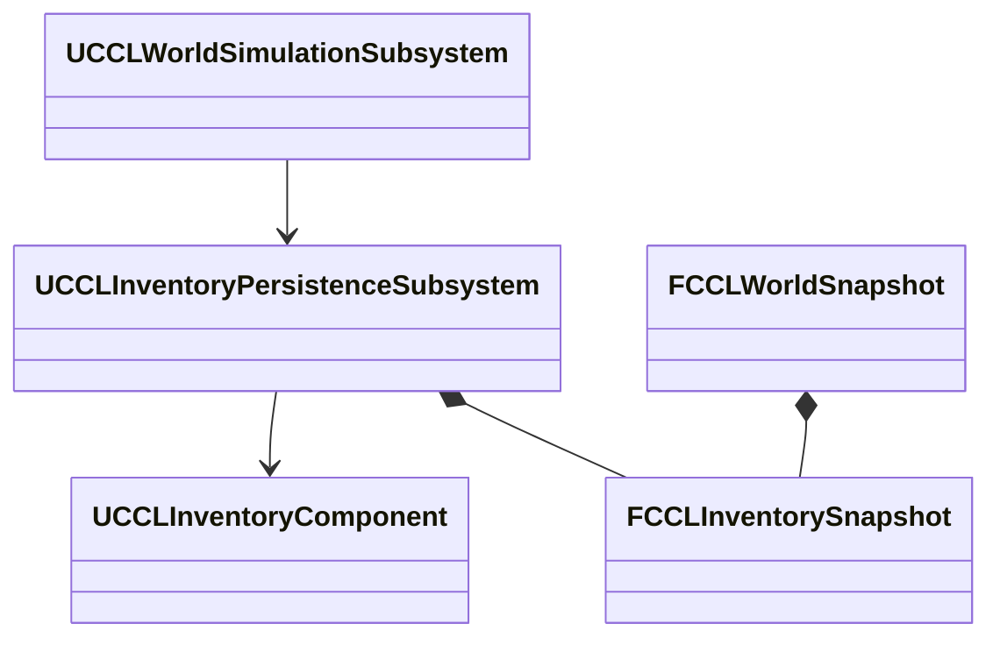

# 음식 컨테이너의 세계 저장

음식이 든 컨테이너가 세계 저장에 참여하는 계약이다. 세계 형식 번호는 당시 값이다. 검증은 2026-10-10 UE 5.8.3의 Editor Standalone과 NullRHI다.

## 전체 세계 저장의 컨테이너 연결 설계

음식이 든 컨테이너는 명시적인 지속 ID로 세계 저장에 참여한다. 배치 상자는 콘텐츠가 ID를 제공하고, 동적 컨테이너는 생성 기록이 같은 ID를 다시 공급한다. Actor 이름, 포인터, 새 프로세스에서 만든 임의 ID를 복원 식별자로 쓰지 않는다. 등록되지 않은 음식이 있으면 일반 세계 저장과 시간 복원을 거부한다.

`FCCLInventorySnapshot`은 컨테이너 ID, 용량, 아이템 ID, 정의 경로, 슬롯, 수량, 탄창, 음식 이력을 가진 값 기록이다. `UCCLInventoryPersistenceSubsystem`은 등록된 컴포넌트와 언로드된 기록을 관리한다. 세계 형식 5는 이 기록을 시계, 생활, 표면, 생태계와 같은 CRC와 완료 세대에 보관한다. 형식 1-4는 빈 컨테이너 기록으로 변환하며 음식의 생성 이력을 만들지 않는다.

전체 기록을 복사하면 저장 크기와 정의 조회 비용이 늘지만 음식의 수량, 소유자, 생성 시각을 같은 상태로 복원할 수 있다.

### 복원 순서

1. 정의의 실제 존재, 최대 중첩, 탄창, 음식 Fragment와 현재 컴포넌트의 용량을 먼저 검증한다.
2. 연결된 모든 컨테이너의 트랜잭션을 확보한다.
3. 생활 복원까지 성공한 뒤 항목을 교체한다. 실패하면 트랜잭션만 풀고 현재 시계, 항목, 보관 기록을 유지한다.
4. 모든 항목과 공통 시계가 최종 상태가 된 뒤 알린다.

호출은 `PrepareRestore` 뒤에 세계를 적용하고, 실패하면 `CancelRestore`, 성공하면 `CommitRestore`다. 저장에 없는 등록 컨테이너는 비운다. 언로드 시 마지막 항목을 기록으로 넘겨 컴포넌트가 없어도 세계 저장에 넣고, 같은 ID와 용량으로 등록하면 적용한다. 살아 있는 같은 ID의 중복 소유자와 용량이 다른 컴포넌트는 거부한다. Actor 생성, 삭제, 위치, 맵 배치 생명주기는 이 저장소 밖의 책임이다.

초기 구현은 장착 슬롯을 가진 컨테이너의 세계 복원을 거부한다. 장비의 참조와 효과까지 같은 시점으로 되돌릴 참여자가 없기 때문이다.

### 세션 저장과의 경계

세션 저장은 호스트 인벤토리를 세션 항목이 소유한다. 이 경로는 `SessionInventory`를 명시해 같은 호출에서 수집한 개인 항목만 세계 컨테이너 수집에서 뺀다. 다른 미등록 음식은 계속 거부한다. 세계 컨테이너와 개인 항목의 GUID 중복은 거부하고, 복원은 세계를 먼저 적용한 뒤 개인 항목과 장비를 적용한다. 일반 세계 저장이나 맵 전환에 이 예외를 자동 적용하지 않는다.

## 컨테이너 세계 저장 검증

명시적으로 등록한 보관함을 세계 형식 5에 연결했다. `CCLInventorySnapshot`이 값 기록과 제한된 직렬화를, `CCLInventoryPersistenceSubsystem`이 살아 있는 컴포넌트, 언로드 기록, 복원 후보를 맡는다. 컨테이너는 최대 1,024개, 전체 항목은 최대 4,096개, 내부 바이트는 최대 8 MiB다. `CCLInventorySnapshot.cpp`의 초기 검증 예산이고 그 규모의 성능을 측정한 결과는 아니다. 문자열과 배열은 할당 전에 남은 바이트와 제한을 검사한다.

| 검사 | 결과 |
|---|---|
| 환경 자동화 | 109/109, 경고, 실패, 미실행 0 |
| Scenario, Campaign, Playground 보관함 저장과 새 프로세스 | 통과 |
| 실제 개인 장비와 음식 세션 | 통과 |

- 실제 맵 검사는 같은 저장의 시계와 두 보관함을 되돌리고 음식 바이트를 대조한다.
- 인벤토리 트랜잭션, 생활 쓰기 예약, 손상 파일, 미등록 음식에 의한 거부, 중복 컨테이너 ID, 잘못된 용량, 언로드 뒤 저장과 재등록을 검사했다.
- 두 보관함의 구독자가 최종 시각과 수량을 함께 보는 것을 확인했다. 알림에서 다른 객체를 임의로 파괴, 수정하는 모든 재진입 상황은 검증하지 않았다.
- 세션 검사는 호스트가 장갑을 장착하고 스킬, 물약, 빵 2개를 가진 상태로 저장했다. 새 프로세스의 불러오기와 메뉴 복귀 뒤 재불러오기에서 음식 GUID, 수량, 이력 바이트와 장비, 효과, 진행을 확인했고 승리 뒤 재저장도 통과했다.
- Scenario, Campaign 검사는 최종 개인 세션 소유자 인계 추가 전 결과다. 같은 일반 세계 저장과 복원 경로를 쓴다.
