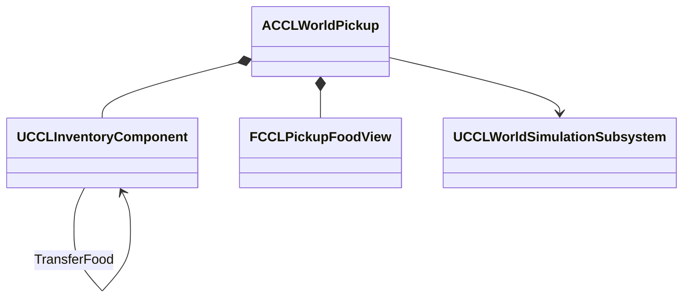
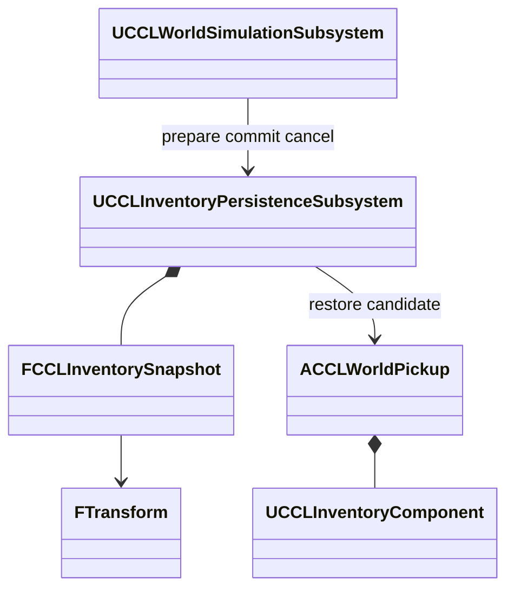

# 음식 픽업

바닥 음식의 이력 보존과 세계 저장을 다룬다. 검증은 2026-10-10 UE 5.8.3의 NullRHI이고 Dedicated는 Editor 서버 모드다. 실제 렌더링, Server 타깃 패키지, 지연과 손실, 대규모 픽업 비용은 포함하지 않는다.

## 음식 픽업 이력 구현·검증

`ACCLWorldPickup::TryCollect`가 정의와 수량으로 새 항목을 만들면 음식의 생성 시각이 다시 시작된다. 그래서 픽업이 단일 슬롯 인벤토리를 소유하고 음식은 `TransferFood`로 옮긴다. 비음식 보급품은 기존 지급 경로를 쓴다. 값 하나를 픽업에 직접 저장하는 대안보다 컴포넌트 비용이 늘지만 이력 이동, 실패 복원, 저장 누락 검사를 재사용한다.

- **소유:** 픽업 Actor가 생성부터 회수까지 상세 음식을 소유한다. 내부 `UCCLInventoryComponent`는 소유자 전용 복제를 유지한다. `FCCLPickupFoodView`가 완료 시각, 복원 세대, 나이, 신선도, 곰팡이만 관찰자에게 공개한다.
- **생성:** 월드가 준비된 뒤 서버 초기화 시점에 새 음식 이력을 만들고, 이력이 있는 음식은 `InitializeFood` 또는 `DropFood`로 받는다. 초기화는 한 번만 허용한다.
- **드롭:** 이전 조건의 노출을 확정한 뒤 조건을 적용한다. 전체 이동은 항목 ID를 유지하고 일부 이동은 새 항목 ID와 기존 음식 묶음 ID를 쓴다. 공간 생성 실패, 대상 부족, 이동 실패는 원본을 유지한다.
- **회수:** 거리 225cm와 가시선 검사를 거친 뒤 전체 이력을 대상 인벤토리로 옮긴다. 회수 중인 픽업의 재진입 요청과 열린 대상 트랜잭션은 거부한다.

| 검사 | 결과 |
|---|---|
| Scenario Standalone 픽업, 드롭, 실패, 저장 본문 | 통과 |
| Listen Scenario, Dedicated Playground 첫 접속, 늦은 접속, 회수 제거 | 통과 |
| 환경 자동화 | 123/123, 경고, 실패, 미실행 0 |
| 기존 캠페인 Standalone | 통과 |

- 바닥에 20세계초 이상 있던 음식을 회수해도 항목 ID, 묶음 원본 ID, 생성 시각, 노출이 유지됐다.
- 새 음식 두 개를 합친 뒤 세 개만 드롭하면 기존 묶음의 원본 ID와 노출을 유지하면서 새 항목 ID를 받는다. 다시 주워 합친 뒤 여섯 개 전체를 드롭하면 항목 ID와 두 묶음이 유지된다.
- 가득 찬 가방, 225cm 밖의 수집자, 벽으로 가린 수집자는 회수하지 못했고 음식 본문은 같았다. 알림 중 중복 회수, 미래 시각 이력, 재초기화, 유효하지 않은 드롭 수량도 거부했다.
- 접속자는 수량과 공개 수치를 1e-8 오차로 대조했다. 상세 인벤토리는 관찰 클라이언트에 복제되지 않았고 클라이언트의 직접 회수는 거부됐다. 서버의 실제 `TryCollect`를 호출한 검사이고 E 키 입력이나 드롭 UI는 검사하지 않았다.

## 음식 픽업의 세계 저장 구현·검증

바닥 음식, 등록 컨테이너, 시계를 같은 저장 세대로 되돌리고 새 프로세스에서 픽업을 다시 만든다. 값 기록과 실제 Actor를 나누면 언로드 중에도 상태를 보존하고 복원 전에 실패를 검사할 수 있다. 대신 복원 때 Actor 교체와 후보 메모리 비용이 든다.

- **기록:** 인벤토리 본문 버전 3의 `ECCLInventoryOwner::FoodPickup`은 지속 ID, Transform, 단일 슬롯 음식 이력을 가진다. 빈 항목 배열은 회수된 상태다. 버전 1, 2는 일반 컨테이너로 읽는다. 아이템 ID의 소유자 중복, 픽업의 비음식 항목, 추가 슬롯, 잘못된 Transform은 거부한다.
- **식별:** 런타임 드롭은 새 지속 ID를 만들고 맵에 저장한 음식 픽업은 작성된 ID를 요구한다. 항목 ID와 픽업 소유자 ID는 별개다. 같은 ID의 언로드 기록이 있으면 저장된 음식, 수량, Transform을 적용하고, 이미 회수된 기록이면 음식 생성을 취소하고 Actor를 없앤다.
- **복원:** Prepare가 정의, 슬롯, Transform, 현재 소유자를 검증하고 픽업을 복제, 표현하지 않는 지연 생성 후보로 확보한다. 시계와 생활 복원이 성공한 뒤 이전 픽업을 없애고 후보를 완성하며, 모든 배열이 확정되면 알린다. 실패하면 후보만 없앤다.
- **범위:** 음식 픽업만 이 소유자 종류에 등록한다. 일반 보급품은 기존 세션 정책을 유지한다.

저장 Transform을 적용하는 생성에는 `ESpawnActorScaleMethod::OverrideRootScale`을 명시한다. 기본 `MultiplyWithRoot`는 저장된 배율에 생성자 루트 배율을 다시 곱할 수 있다. UE 5.8.3 근거는 `<Engine>/Source/Runtime/Engine/` 아래의 `Classes/Engine/World.h:3851`, `Private/Actor.cpp:4314`, `Classes/GameFramework/Actor.h:2152`, 같은 파일 4679줄의 `FMarkActorIsBeingDestroyed`다.

| 검사 | 결과 |
|---|---|
| Scenario, Playground 저장, 실패, 언로드, 재등록, 새 프로세스 | 통과 |
| Listen Scenario, Dedicated Playground 첫 접속, 늦은 접속, 복원 | 통과 |
| 환경 자동화와 이전 본문 변환 | 124/124, 경고, 실패, 미실행 0 |
| 기존 음식, 환경 연동, 개인 세션 회귀 | 통과 |

- 회전 `(10, 20, 30)`, 비균일 입력 배율 `(2, 3, 4)`의 픽업을 쓴다. 생성자 루트 배율 0.4가 반영된 `(0.8, 1.2, 1.6)`을 저장하고 복원, 언로드 재등록, 새 프로세스에서 전체 Transform을 대조했다. 서버 허용 오차는 1e-6이다. 접속자는 위치 0.01cm, 회전 0.01도, 배율 0.001, 공개 품질과 시각 1e-8로 대조했다.
- 바닥 상태를 저장하고 회수, 혼합, 드롭한 뒤 불러오면 원래 항목의 픽업이 다시 생기고 대상은 빈 상태로 돌아왔다. 회수 상태를 불러오면 바닥 Actor가 없어지고 여섯 음식과 두 묶음이 복원됐다.
- 생활 쓰기 예약으로 복원을 실패시키면 후보가 남지 않고 원래 Actor 포인터와 항목이 유지되며 잠금이 풀렸다.
- 두 맵의 별도 프로세스에서 음식 본문과 Transform을 확인했고 10세계초를 더 진행해 나이가 늘어나는 것을 봤다.
- 자동화와 기존 회귀는 배율 덮어쓰기와 재등록 위치 보완 전의 같은 저장 형식에서 실행했다. 네 픽업 실행은 두 보완을 포함한다.

맵에 작성된 음식 픽업 에셋의 ID 편집과 중복 검증, 회수 기록의 장시간 누적과 압축 정책은 이 기록 시점에 다루지 않았다.
