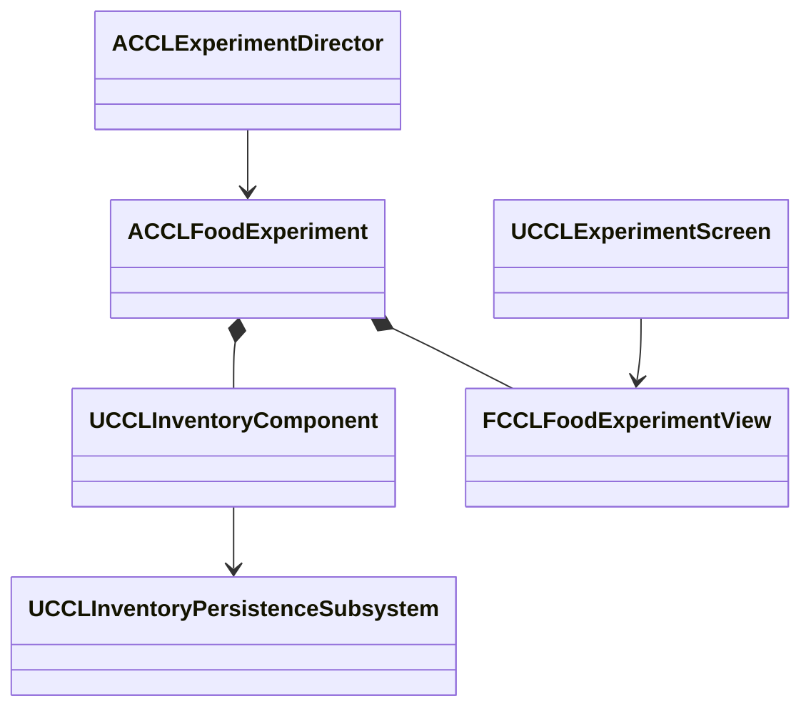
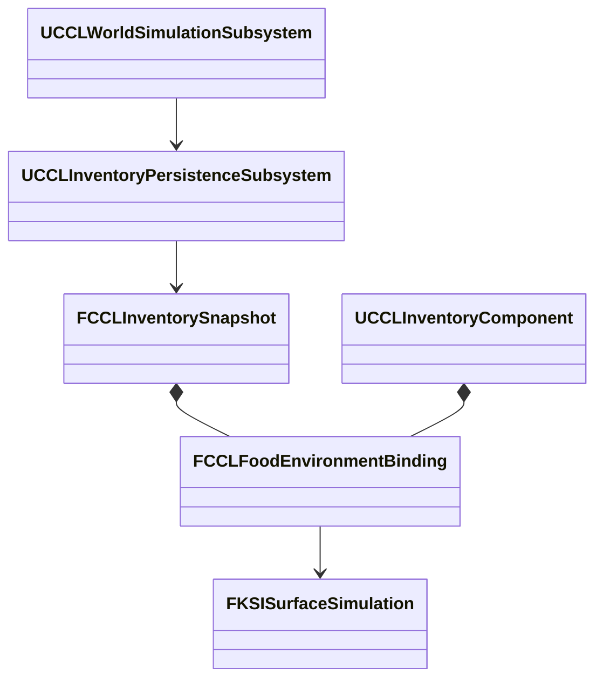

# 음식 보관 환경과 구역 07

고정 조건 비교, 날씨와 실내 환경 연동, 위치에 따른 바닥 음식의 보관 조건을 다룬다. 검증은 2026-10-10 UE 5.8.3이다. 네트워크 검사는 NullRHI이고 Dedicated는 Editor 서버 모드라, 실제 Server 타깃 패키지의 증거가 아니다.

## 음식 비교 조작과 실행 검증

구역 07의 노출, 냉각, 밀폐 보관함은 지속 ID를 가진 실제 인벤토리이고 공통 세계 저장에 참여한다. `ACCLFoodExperiment`가 고정 배치와 생성 조건을 소유하고, 인벤토리와 부패 모델은 공통 API를 쓴다.

- **입력:** `DA_FoodSample`은 이 비교 전용 정의로 기준 부패 300초, 곰팡이 발현 120초, 성장 180초다. `DA_Bread`에는 적용하지 않는다. 노출은 20°C, 습도 100%, 냉각은 -5°C, 밀폐는 부패 계수 0.2, 곰팡이 노출 0이다. 상태 차이를 빠르게 보려는 시험 입력이다. 저장된 묶음의 정책과 조건은 복원 때 새 기본값으로 덮지 않는다.
- **조작:** 새 음식 2개 추가, 노출에서 냉각으로 1개 이동, 냉각 음식의 해동과 재냉각을 기존 실험 권한과 세대 검사로 처리한다. 이전 조건에서 현재 완료 시각까지 평가한 뒤 조건을 바꾼다.
- **초기값:** 최초의 새 실험만 기본 음식을 만든다. 일반 복원과 재방문은 저장된 빈 상태도 보존하고, 전체 초기화만 세 보관함을 기본 음식 4개씩으로 되돌린다.
- **표시:** 곰팡이가 있으면 초록, 곰팡이 없이 부패했으면 짙은 갈색, 그 밖에는 음식 기본색이다. 메시와 재질은 실험용이다.
- **복제:** 서버가 `FCCLFoodExperimentView`에 세계 ID, 실행 세대, 완료 시각, 세 보관함의 집계를 게시한다. `UCCLInventoryComponent::List`의 `COND_OwnerOnly`는 유지해 상세 항목은 일반 관찰 클라이언트에 보내지 않고, 표시에 필요한 수량과 품질 집계만 복제한다. 관측은 0.2초 간격이다. 공개 관측은 소유자 전용 복제를 유지하는 대신 집계 계산과 복제 비용이 든다.

글자 재질은 `DefaultTextMaterialOpaque`를 복제해 폰트 매개변수를 보존하고 발광 색을 적용한다. 엔진 근거는 `<Engine>/Source/Runtime/Engine/Private/Components/TextRenderComponent.cpp:334`다.

| 검사 | 결과 |
|---|---|
| 환경 자동화 | 109/109, 경고, 실패, 미실행 0 |
| Scenario, Playground 실제 메뉴와 렌더링 | 통과 |
| Listen Scenario, Dedicated Playground 첫 접속과 늦은 접속 | 통과 |
| 음식 저장, 새 프로세스, 구역 07 식생 회귀 | 통과 |

음식 검사는 추가 버튼의 실제 Slate 클릭, 한 개 이동, 노출 부패, 냉각 보존, 밀폐 지연, 해동 뒤 이력 진행을 본다. 저장과 불러오기 뒤 직렬화 바이트를 대조하고, 초기화 뒤 다시 저장을 복원한다. 네트워크 검사는 접속자 두 명의 관측과 복원 상태, 상세 인벤토리 비공개, 클라이언트 직접 변경 거부를 본다. 첫 실행에서 두 렌더링 검사를 동시에 돌렸을 때 클릭 직후 판정이 한 번 실패했다. 클릭 결과를 다음 프레임부터 기다리도록 보강하고 두 맵은 순서대로 검사한다. 원인이 병렬 실행이라고 확정한 것은 아니다.

## 환경 연동 음식 보관 구현·검증

날씨와 실내 온습도의 변화 구간을 음식 이력에 남기고 저장, 언로드, 복원 뒤에도 같은 출처로 잇는다. 현재 온도를 이전 보관 시간 전체에 소급하지 않는다. 구역 07의 `노출: 외기 / 고정`, `밀폐: 실내 / 고정` 조작으로 고른다. 외기는 구역 02의 날씨 지역, 실내는 구역 11의 공기 공간을 명시적으로 참조한다.

`FCCLFoodEnvironmentBinding`은 외기 지역 또는 실내 공간 ID, 마지막 관측 시각, 보관 조건을 가진 값이다. `UCCLInventoryComponent`가 살아 있을 때의 연결을 소유하고 `FCCLInventorySnapshot`이 빈 보관함과 언로드된 보관함까지 보존한다. 권위 서버만 연결을 바꾼다.

- **진행:** 세계 진행의 선택적 Prepare 콜백이 음식 후보를 준비하고, 생애 진행까지 성공해야 공통 시계, 표면, 생태와 함께 게시한다. 실패하면 예약한 인벤토리를 풀고 원래 기록과 시간 입력을 유지한다. 모든 컨테이너 교체가 끝난 뒤 알린다. 세계 시간이 그대로인 진행은 알림을 만들지 않는다.
- **관측 경계:** 연결 시점에 기존 조건의 노출을 먼저 확정한다. 이후 정수 세계초 경계마다 환경을 관측하고 그 사이에는 마지막 관측값을 유지한다. 관측값을 저장하므로 경계 중간의 저장과 이동, 빈 보관함에 들어오는 음식도 같은 조건을 상속한다. 보관 연결이 하나라도 있으면 세계 진행을 다음 정수초까지만 준비한다. 값 복사와 1초 간격 처리 비용이 늘지만 Actor 존재 여부와 프레임 조회 순서가 노출 이력을 좌우하지 않는다.
- **습도와 온도:** `CCLFoodEnvironment::Sample`이 외기 수증기 값과 실내 수증기 밀도를 날씨 모델의 포화량 근사 `0.005 * exp(clamp(0.06 * T, -10, 10))`에 대조해 상대 습도를 구하고 0~1로 제한한다. 보관 온도는 -80~80°C로 제한한다. 게임용 근사이고 음식의 열관성, 냉장 장치 전력, 식품 안전은 계산하지 않는다.
- **저장:** 인벤토리 본문 버전 2가 환경 출처, ID, 마지막 관측 시각, 보관 조건을 저장한다. 버전 1은 고정 조건으로 읽는다. 월드 저장을 검증할 때 참조 지역과 공간의 존재도 본다. 검증용 관측은 복사본에서 해서 구간 중간의 저장 조건을 현재 환경값으로 덮지 않는다. 언로드된 기록은 Actor 없이 진행한다.

| 검사 | 결과 |
|---|---|
| 환경 자동화 | 123/123, 경고, 실패, 미실행 0 |
| Scenario, Playground 메뉴, 렌더링, 새 프로세스 재개 | 통과 |
| Listen Scenario, Dedicated Playground 첫 접속과 늦은 접속 | 통과 |
| 고정 음식 조작과 저장 회귀 | 통과 |

- -5°C 외기에서 부패 노출이 늘지 않는 것을 본 뒤 외기를 30°C로 바꾸고 실내 불을 켰다. 언로드 상태로 진행해 다시 연결하니 과거 이력을 유지하면서 고온 구간의 부패가 늘었다.
- 실내는 초기값보다 0.01°C 이상 올랐고 음식의 보관 온도가 공기 공간과 일치했다.
- 생애 예산 0을 주입한 검사에서 시계, 표면, 음식 본문이 유지됐고, 대기 중인 입력을 다시 더하지 않고 재시도했다.
- 별도 프로세스에서 저장된 관측값과 대기 시간을 읽어 10세계초를 이어 간 본문이 원래 프로세스의 결과와 일치했다. 해당 환경과 진행 순서의 재개 검사이고, 임의 프레임 분할에서 날씨 적분이 같다는 보장은 아니다.
- 첫 접속자와 늦은 접속자는 복원 세대, 세계 시각, 세 표본의 출처, 수량, 온도, 습도, 신선도, 곰팡이를 서버 기록과 1e-8 오차로 대조했다.
- 최종 Playground 캡처에서 외기 30.0°C, 습도 13%, 실내 20.1°C, 습도 24%와 다섯 조작 버튼을 확인했다. Scenario 렌더링은 온도 소수 표시와 세대 비교 강화 전 실행이다.

## 위치에 따른 음식 보관 구현·검증

바닥 음식은 위치로 보관 조건을 고른다. `CCLFoodEnvironment::ResolveAt`이 조건을 선택하고 `RelocatePickup`이 이전 노출을 정산하며, `UCCLInventoryPersistenceSubsystem::PrepareAdvance`가 살아 있는 픽업의 현재 배치 또는 언로드 기록의 배치에 적용한다. 드롭은 음식 이동 전에 대상 환경을 정한다. 세계 형식 5와 인벤토리 본문 형식 3의 기존 필드를 써서 새 저장 형식은 없다.

- **선택 순서:** 위치를 포함하는 실내 공기 공간을 먼저 쓰고, 없으면 XY 범위가 겹치는 날씨 지역을 쓴다. 중복 날씨 지역은 수평 면적이 작은 지역, 동률은 GUID 순이다. 지역 밖은 20°C, 상대습도 50%다. 실내는 3차원 경계, 날씨는 수평 범위이고 고도별 대기는 없다.
- **시점:** 공통 세계 진행의 시작 시각에 위치를 본다. 환경이 바뀌면 이전 조건의 이력을 시작 시각까지 정산한 뒤 새 조건을 적용한다. 다른 참여자가 실패하면 음식 후보도 폐기한다. 순간이동은 다음 진행의 시작에서 관측하고 이동 궤적의 연속 적분은 없다. 등록 픽업은 영역 밖에서도 세계초 경계를 쓴다. 작은 실험장에 맞춘 정확성 우선 선택이다.
- **조작:** 구역 07에서 노출 보관함의 음식 1개를 바닥에 꺼내고 다시 회수한다. 보관함 Actor가 회수 주체이고 기존 거리와 가시선 검사를 유지한다. 한 번에 표본 하나만 놓는다.
- **가시선:** 보관함 원점이 바닥 충돌 안에 있어 회수 가시선이 막혔다. 거리는 Actor 원점 기준 225cm를 유지하고, 가시선 시작은 `GetActorEyesViewPoint`로 원점보다 80cm 높게 준다. UE 5.8.3의 기본 Actor 구현은 위치와 회전을 그대로 반환한다(`Engine/Source/Runtime/Engine/Private/Actor.cpp:3769`).

| 검사 | 결과 |
|---|---|
| 환경 자동화 | 125/125, 경고, 실패, 미실행 0 |
| Scenario 메뉴, 화면, 위치 전환, 실내 언로드, 복원 | 통과 |
| Playground 메뉴, 화면, 최종 시간 검사 | 통과 |
| Listen Scenario, Dedicated Playground 구역 07 | 통과 |
| 픽업 새 프로세스, 기존 픽업 네트워크, 환경 연동 보관 회귀 | 통과 |

최종 구역 07 검사는 합성 시간 입력을 4배율, 0.25게임초로 넣어 1세계초씩 진행한다. 실제 프레임 시간으로 60배율을 진행하던 검사는 큐에 남은 입력 때문에 늦은 접속 시각의 신선도가 고정 임계값을 벗어났다. 수동 입력 0.25게임초를 60배율에서 1세계초로 반복 분할하면 정밀도보다 작은 시간이 보류되는 경우도 재현했다. 음식 검사는 이진수로 정확한 입력 단위를 쓰고, 세계 시계의 잔여 시간을 버리거나 허용 오차를 완화하지 않았다. 이 잔여 시간의 일시정지와 재개 계약은 단계 9에서 따로 검증한다.
