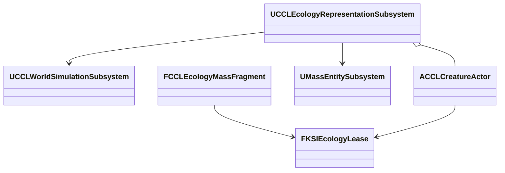

# Actor와 Mass 표현

생물의 실제 표현과 실행권 전환을 바꿀 때 읽는다.

## Actor/Mass 연결과 실행 근거

실제 표현은 `UCCLEcologyRepresentationSubsystem`이 월드 수명으로 관리한다. `ACCLCreatureActor`와 `FCCLEcologyMassFragment`는 개체 ID·위치와 현재 실행권을 읽고, 수량 원장은 `FKSIEcologySimulation`에 유지한다. 새 표현을 준비한 다음 실행권을 원자적으로 교체하고 이전 표현을 제거한다. 준비나 전환이 실패하면 기존 표현·실행권을 유지한다.

`SetRepresentation(IndividualId, Representation, Error)`는 예약된 개체의 표현을 바꾼다. `Transfer`는 같은 개체의 예약을 보존하고 실행권 순번·소유자를 교체한다. `UpdatePosition`과 `Finish`는 현재 실행권으로만 위치·사망·포획·이주를 반영한다. 초기 위치는 서식지 중심이며, 위치도 저장한다. 자동 거리 전환·먹이 탐색·종별 이동과 네트워크 관심 영역은 이 연결 위에서 별도로 검증한다.

준비한 표현에 새 실행권을 받지 못하면 준비한 표현을 없애고 실패한다. 받으면 준비한 표현을 게시한 뒤 이전 표현을 없앤다.

실제 Actor와 Mass Entity의 존재, 전환 전후 집계·예약 합계, 오래된 Actor 종료, 외부 Entity 제거, 저장 복원 뒤 표현 폐기, 사망과 중복 반환을 검사한다. Mass의 즉시 생성·파괴는 처리 중이 아닌 게임 스레드에서만 수행하고 처리 중이면 재시도를 요청한다. 기존 `MassEntity`, `MassCore` 의존을 사용한다. UE5 Mass Entity는 실행 표현이며 개체군 보존·저장 계약을 대신하지 않는다. 임시 표현을 준비하는 동안 메모리를 조금 더 쓰는 대신 실패 시 기존 상태를 보존한다.

표현 전환과 저장 직전에는 현재 Actor 또는 Fragment의 위치를 값 모델에 반영한다. 잘못된 위치는 거부하고 표현을 마지막 유효 위치로 되돌린다. 생태 저장 버전 3은 예약 개체의 위치를 포함하며 이전 버전 1·2의 위치는 서식지 중심으로 읽도록 구현했다. 이전 위치 형식의 별도 파일 검증은 아직 수행하지 않았다. 저장에 실행권은 넣지 않는다. 복원 성공 시 이전 표현을 즉시 폐기하고 저장된 예약을 새 실행권으로 다시 표현할 수 있다.

`Suspend`는 표현만 해제하고 예약을 보존한다. 일반적인 언로드는 `Release`로 집계에 반환한다. `Transfer`는 준비된 표현에 새 실행권을 발급한 뒤 이전 표현을 폐기하므로 오래된 Actor의 `EndPlay`가 새 실행권을 반납하지 못한다. 자연 사망이 실행권을 회수한 경우에도 같은 규칙으로 객체만 정리한다. Mass 처리가 진행 중인 즉시 생성·파괴 요청은 거부한다. 근거는 UE 5.8.3의 `<Engine>/Source/Runtime/MassEntity/Public/MassEntitySubsystem.h`의 `GetMutableEntityManager`와 `MassEntityManager.h`의 `IsProcessing`이다.

`Tools/Validation/run_ecology_representation.ps1`은 실제 네 매체의 Actor와 Mass Entity를 생성한다. 직접 변경한 Actor·Fragment 위치의 인계, 집계 합계, 외부 객체 제거, 준비 실패 시 Entity 회수, 처리 중 변경 거부, 저장·복원과 자연 사망을 검사한다. Listen·Dedicated에서는 첫 클라이언트가 네 개체를 확인한 뒤 두 번째 클라이언트를 접속시킨다. 양쪽의 ID·매체·위치와 쓰기 거부를 확인한 다음 세계 시간을 진행하고 양쪽에서 사망 제거를 확인한다.

| 검사 | 결과와 근거 |
|---|---|
| 최종 프로젝트 파일 생성·Editor 빌드 | 성공 |
| 환경 자동화 | 92/92, 경고·실패·미실행 0 |
| 두 맵의 실제 Actor/Mass 전환 | 통과 |
| 최종 Standalone 검사 | 통과 |
| Listen 첫·늦은 접속자 | 통과 |
| Dedicated 첫·늦은 접속자 | 통과 |
| 생태 저장·새 프로세스 재개 회귀 | 통과 |

이 검사는 NullRHI의 Editor 실행 파일을 사용했다. Dedicated는 `-server` 실행이며 별도 Server 타깃 빌드나 패키지 검증은 아니다. Actor 외형은 기본 Sphere·Cube로 구분한 임시 표현이고 충돌·애니메이션·종별 이동·먹이 탐색·거리 자동 전환은 아직 없다. 실제 렌더링 외관, 지연·손실·재접속, 원거리 집계와 Mass의 클라이언트 표현은 후속 검증이다.
