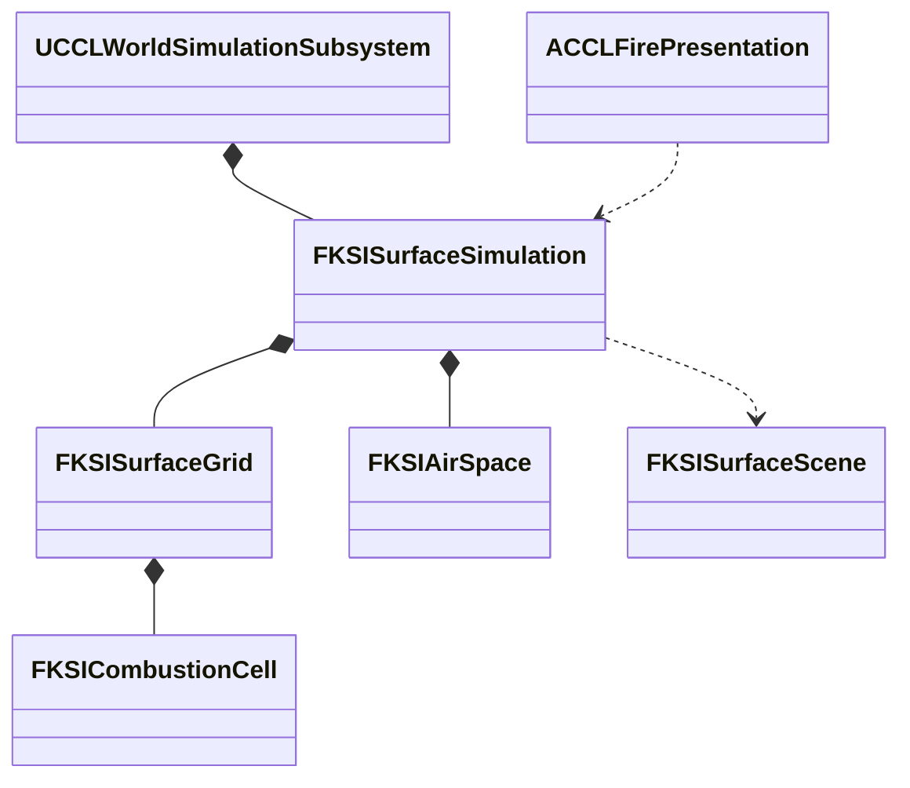

# 불·열·공간 환경

단계 7은 연소·소화·확산과 공간별 온습도·연기를 공통 환경 상태에 연결한다. 범위는 [결정 19](../decisions/0019-natural-environment-and-labs.md)와 [환경 계획](../EnvironmentPlan/Design.md#불열공간-차폐)을 따른다. 연소·표면·공기를 공통 진행·저장·복제에 연결하고 자동 검사와 실제 월드 실행을 검증했다. 구역 10·11의 상시 조작과 Niagara 불꽃·연기 표현까지 실제 실행했다. 식생의 탄 상태 연결은 단계 8에서 이어 갔고, 식생 생체량과 연료 원장의 연결은 [생태계·생애](Ecology.md)가 소유한다. 표현 조정과 규모 검증은 단계 9의 범위다. 이 문서는 연소 코어, 표면의 융해·건조와 열 확산, 공간 환기, 구역 10·11의 조작과 표현, 열 노출의 GAS 피해와 검증 기록을 소유한다.

## 하위 문서

| 문서 | 읽는 때 |
|---|---|
| [공간 환기](Fire/Ventilation.md) | 실내 공기, 문·개구부 교환, 연기 배출, 연소·실내·표면의 공통 진행을 바꿀 때 |
| [열 피해](Fire/ThermalDamage.md) | 불과 고온 실내가 체력에 주는 피해, GAS와 Agent 부상 연결을 바꿀 때 |

## 목표와 단위

연소는 연료 kg, 연료 수분 kg, 열 J, 열용량 J/K, 연기 kg를 사용한다. 불의 진행과 공간 환기는 게임 초를 쓴다. 세계 시간을 가속해 계절을 바꿔도 불꽃 확산과 플레이어의 소화 반응 시간이 같은 배율로 빨라지지 않게 한다. 비·눈의 유입은 기존 세계 초 기준을 유지한다. 시험 수치는 콘텐츠의 초기값이며 실제 물질의 정확한 열역학이나 최종 밸런스를 뜻하지 않는다.

연료 수지는 초기 연료 = 남은 연료 + 연소 누계다. 소화는 온도를 낮추거나 수분을 공급하며 소모한 연료를 복원하지 않는다. 연소 열량과 냉각·외부 손실을 기록하고, 융해·건조가 이동시킨 물은 표면 수지에 남긴다. 연기는 발생·공간 보유·환기 배출을 구분한다.

## 목표 책임과 수명

서버 World의 기존 표면 값 상태가 셀별 연료·열·연소 흔적을 소유한다. 계산 코어는 인접 셀로 보내는 열을 같은 이전 상태에서 구하고 한 번 적용한다. 공간 값 상태는 안정적인 공간 ID와 체적, 온도·수분·연기를 보관한다. `FKSISurfaceScene`의 개구부는 공간과 외부 또는 다른 공간을 연결한다. 표현 Actor와 Niagara 컴포넌트는 확정 상태를 읽으며 연료를 직접 소모하지 않는다. 날씨·열·물·공기 후보를 먼저 계산하고 생활 진행까지 성공한 뒤 공통 시계를 확정하므로, 중간 오류에서 불만 타거나 환기만 진행한 상태를 게시하지 않는다.

## 대안과 비용

공간 평균 모델은 셀 전체를 3D 유체로 계산하는 방식보다 적은 상태로 환기·열 축적을 검증할 수 있다. 대신 정밀 연기 흐름과 실내 온도 분포는 제공하지 않는다. 이는 계획의 초기 제외 범위와 일치한다. UE5 Niagara는 표현을 맡고 값 코어는 화면 없는 서버에서도 실행한다. 기존 복제와 저장을 재사용한다.

## 연소 코어의 현재 구현

`Source/KSIEnvironment/`의 `KSICombustionModel`이 연료·열 상태와 전달량을 계산하고, 표면 연소는 `KSISurfaceFire`가 맡는다. `FKSICombustionCell`은 남은 연료·연소 누계와 초기·추가·연소·손실·전달 열량을 저장한다. 열은 절대온도 기준의 열용량 곱으로 저장하며 표시 기온은 섭씨로 환산한다. `FKSICombustionFlux`는 증발시킨 물 kg, 표면·공기에 넘길 열 J와 발생 연기 kg를 반환한다. 공기 전달 열이 음수이면 공기에서 연료로 열을 옮긴다. `KSISurfaceFire`가 실제 표면의 물과 눈·얼음에 전달량을 반영한다. 연기 발생 누계를 보관하며 셀이 속한 공간에 같은 발생량을 넣는다.

계산은 최대 0.1게임 초로 나누며 한 요청은 409.6게임 초까지 허용한다. 실패하면 상태와 출력 전달량을 모두 보존한다. 물은 호출자가 소유하며 모델 내부의 지역 변수에서 가용량을 차감한다. 같은 물을 연료 상태에 영구 복제하지 않는다. 열·연료 검증 뒤에 후보 상태와 출력 전달량을 한 번 교체한다.

초기 연료 1kg·섭씨 20도에 외부 열 500kJ를 넣은 검사에서 건조 연료는 타고 물 1kg이 접촉한 연료는 발화하지 않았다. 풍속 8m/s에서 연소량이 증가하며, 물 공급으로 추가 연소를 멈추는 것을 확인했다. 기본값은 실험용 근사치다. 상변화에 쓰는 2.5MJ/kg도 가열·증발을 합친 게임용 계수이며 정밀 물성표를 대신하지 않는다.

2026-10-10 프로젝트 파일 생성·Editor 빌드가 성공했고 환경 자동 검사 60/60, 경고·실패·미실행 0이다. `CCL.Environment.Fire.FuelHeatWaterAndWind`, `CCL.Environment.Fire.ResumeValidationAndExhaustion`은 연료·열 수지, 물·열·연기 전달량, 연료 고갈, 실패 시 상태·출력 보존, 0게임 초와 저장 후 동일 진행을 검사한다.

## 표면의 융해·건조와 열 확산

`FKSISurfaceGrid::Fire`는 선택적인 `FKSISurfaceFireLayer`를 소유한다. `Cells`가 비어 있으면 연소 상태를 할당하지 않으며, 사용하면 표면 셀 수와 같아야 한다. 재질은 지역 단위로 한 번 저장한다. `UCCLWorldSimulationSubsystem::IgniteSurface`는 서버 권위를 검사하고 기존 연료 셀에 외부 열을 더한다. 발화 요청으로 소모한 연료를 채우지는 않는다.

`KSISurfaceSimulation`은 최대 0.25게임 초인 표면 하위 단계마다 `KSISurfaceFire::AdvanceCandidate`를 호출한다. 비·눈 유입과 기존 상변화 뒤에 연소를 계산하고 물 흐름을 적용한다. 연소에 제공하는 물은 표면 액체와 토양의 실제 보유량이다. 증발량은 액체, 토양 순서로 차감하고 기존 물 수지의 증발 항목에 한 번 넣는다. 표면에 남은 열은 얼음, 눈 순서로 녹이며 눈 부피도 남은 질량에 비례해 줄인다. 융해에는 게임용 계수 334kJ/kg를 쓴다.

열 수지는 셀별 저장·추가·연소·손실·전달량과 지역별 전달 내역을 함께 검사한다. 지역의 전달 내역에는 인접 셀 전송, 융해, 증발과 나머지 표면 방출 열을 기록한다. 연기 발생 누계는 연소한 연료와 재질의 연기 비율에 일치해야 한다. 실내 셀은 연료의 냉각 열과 융해·증발에 쓰지 않은 표면 전달 열을 공간에 넣는다. 실외 셀의 방출 열은 기존 외부 손실로 남는다.

인접 열 전달은 각 하위 단계의 연소가 끝난 상태에서 한 번 계산한다. 각 경계는 이전 열 차이의 최대 1/8을 전송하므로 네 이웃이 모두 차가워도 보낸 셀의 열 절반 이상이 남는다. 받은 열은 다음 하위 단계부터 다시 전송한다. 기본 전도 계수는 실험값 60W/K이며 풍속과 두 셀의 바람 노출률을 반영한다. 전송은 네 방향 이웃 중 바닥·천장 사이 높이 범위가 겹치는 셀에 한한다. 런타임의 직접 열 전송은 두 셀 사이의 확정 표면 질의로 차단한다. 불투명 벽은 전송을 막고 실제 문 개구는 허용한다. 풍향에 따른 비대칭 확산은 아직 구현하지 않았다.

이 방식은 같은 시간 단계 안에서 순회 순서에 따라 열이 여러 셀을 건너뛰는 문제를 막는다. 대신 정밀 복사열·대류·연료 형상은 계산하지 않으며, 열 확산 속도와 계수는 콘텐츠 장면에서 추가 조정해야 한다. 화재는 기반 지형의 높이·재질을 변경하지 않는다.

## 저장 형식과 실패 경계

현재 표면 스냅샷 버전은 7이다. 버전 6은 각 지역의 표면 셀 뒤에 연소 활성 여부를 저장한다. 활성 지역에는 재질·확산 계수·전달 수지 120바이트와 셀당 73바이트가 추가된다. 연소 비활성 지역은 표시 1바이트만 추가한다. 버전 6에서는 모든 지역에 공기·표면 사이 열 전달 누계 16바이트를 더 저장한다. 전체 공기 모델은 기본 헤더·수지 104바이트와 공간당 184바이트를 저장한다. 버전 7은 연료 전달 기록과 식생 층을 더한다. 식생 저장은 [생태계·생애](Ecology.md)가 소유한다. 전체 스냅샷의 기존 8MiB 제한은 유지하므로 모든 최대 크기 지역에 연료를 채울 수 있다는 보장은 없다.

버전 1-4의 표면 저장은 연소 비활성으로 복원한다. 버전 5의 연소 상태는 유지하며 버전 1-5에는 새 공간을 만들지 않는다. 새 저장의 연료·탄 양·열·전달 수지는 동일 표면 스냅샷에 포함되며 기존 분할 복제 경로를 사용한다. 연소 계산이 실패하면 물·날씨·불과 완료 시각의 후보 전체를 버린다. 손상된 저장이나 잘못된 발화 요청도 기존 상태를 유지한다.

## 실행 검증

2026-10-10 UE 5.8.3에서 프로젝트 파일 생성과 CCLEditor Win64 Development 빌드가 성공했고 환경 자동 검사는 64/64, 경고·실패·미실행·진행 중 0이었다. Standalone은 건조 연료 연소·젖은 연료 억제·눈 융해·토양 건조·비 소화·저장 복원이 통과했다. Dedicated의 서버와 두 참가자는 연소 누계·연기 발생 누계·융해 열량이 일치했고 직접 발화를 거부했으며, Listen도 같은 수치 비교와 권위 검사가 통과했다. 실행 절차는 `ccl8-verify`가 소유한다.

새 표면 자동 검사는 `CCL.Environment.Fire.SurfaceMeltDryAndQuench`, `NeighbourSpreadAndFrozenBudget`, `SurfaceSaveResumeAndRollback`, `LegacySurfaceVersions`다. 열 전송의 대칭성과 같은 단계에서 받은 열을 다시 쓰지 않는 조건, 연결된 이웃 발화와 분리된 높이의 비발화, 버전 1-4 복원, 손상·잘못된 입력·후속 계산 실패의 상태 보존을 검사한다. 기존 연소 코어 두 검사도 유지한다.

실제 월드 검사는 `-CCLFireSmoke`로만 생성되는 서브시스템이 임시 연료 지역을 추가한다. 세계 시간 배율 0에서 10게임 초 동안 연소한 뒤 세계 시간을 진행해 비를 공급한다. 저장 후 발화 열을 추가하고 복원한 결과는 이전 표면 스냅샷과 바이트 단위로 같다. Dedicated 실행의 서버·첫·늦은 참가자 값은 연소량 `0.098085674kg`, 연기 발생량 `0.003908419kg`, 융해 열량 `24973.987631J`다. 연소량은 첫 셀, 연기와 융해 열량은 지역 합계이므로 서로 다른 집계 범위를 비교하지 않는다.

세 실행은 NullRHI를 사용했다. 이 실행은 공간 통합 전 결과이며 화재 전용 메뉴·Niagara 화면과 공간 환기를 검증한 결과가 아니다. 서버 실행도 실제 Server 타깃 패키지 검증과 구분한다. 공간 연결의 후속 결과는 [공통 월드 실행 검증](Fire/Ventilation.md#공통-월드-실행-검증)에 있다.

## 구역 10·11 조작과 표현

구역 10에는 연료 표면을, 구역 11에는 기존 방·문과 일치하는 공기 공간과 연료 표면을 둔다. 시작 상태와 초기화용 스냅샷을 함께 구성한다. 발화와 실외 비 조작은 서버 권위로 실행하고 화면은 복제된 연료·연소량·기온·수증기·연기량을 읽는다. 기존 자동 시험은 별도 후보에서 수지와 저장 재개를 검사하며 사용자가 조작한 월드를 덮어쓰지 않는다.

불꽃과 연기는 Niagara로 표시하고 연료의 남은 양·탄 양은 연료 블록과 탄 흔적에 연결한다. 타는 셀이 있으면 주황색 점광원을 켠다. 표현은 복제된 환경 상태를 읽으며 파티클·조명·메시 인스턴스를 저장하지 않는다. 가까운 지역의 파티클 컴포넌트는 최대 128개로 제한한다. 실내 연기 생성률은 공간의 연기 농도에 비례한다. 현재는 단순 원형 스프라이트를 사용하며 정밀 유동이나 최종 아트 품질을 뜻하지 않는다.

구역 10의 **마른 연료에 발화**는 중앙 셀에 600kJ를 추가한다. **소화용 비 켜기 / 끄기**는 1mm/세계 초의 시험 강수를 전환한다. 비에는 세계 시간 진행이 필요하다. 각 셀은 0.5kg의 연료로 시작하며 눈·젖은 흙·마른 셀을 나눠 놓았다. 구역 11에는 같은 연료 시험과 192m³ 공간을 넣고 기존 문으로 환기한다. 메뉴에는 남은 연료·탄 양·발생 연기·실내 기온·수증기와 연기 농도를 표시한다. 실내 수분은 상대습도 백분율이 아니라 g/m³다.

발화·연소·환기는 게임 초, 강수는 세계 초를 사용한다. 시간 0배에서도 불은 타며, 세계 시간만 정지한다. 전체 초기화의 기준 스냅샷에도 새 연료와 공간을 포함했다.

2026-10-10 UE 5.8.3에서 프로젝트 파일 생성과 Editor 빌드가 성공했고 환경 자동 검사는 79/79, 경고·실패·미실행·진행 중 0이었다. 두 맵의 에셋 생성과 새 에디터 재로드에서 구역 정의·표현 Actor·Niagara·재질을 확인했다. 격리 실험장은 발화·비 소화·문 환기·저장 복원과 네 화면 캡처가 통과했고, 종합 실험장도 같은 기능 검사가 통과했다. Dedicated와 Listen의 첫·늦은 참가자는 상시 연료·실내 상태 수신, 유효성과 직접 변경 거부가 통과했다. 기존 격리 실험장 회귀도 통과했다.

네트워크 검사는 연소가 계속되는 월드의 수신 조건을 검사하며 서로 다른 수신 시각의 기온·연료를 바이트 단위로 비교하지 않는다. 동일 확정 수치 비교는 앞 절의 소화 후 서버 검사에서 다룬다. 네트워크·자동·기존 실험장 검사는 최종 표현 수정 전의 동일 계산 코드에서 실행했고, 최종 표현 수정 후에는 두 맵 조작과 격리 맵 렌더링을 재실행했다.

재질의 `InstancedStaticMeshes`·`NiagaraSprites` 사용 플래그가 없으면 체크무늬가 나타난다. 연기 수명 4초와 반복 주기 0.25초의 조합은 생성 구간 예산 경고를 내므로 연기 반복 주기를 2초로 두었다. 최종 별도 프로세스에서 경고가 없고 불꽃·실내 연기·연료·탄 흔적이 표시되는 것을 캡처로 확인했다.

식생의 탄 상태 연결 결과는 [생태계·생애](Ecology.md)에 있다. 단계 9에서 연기 모양·밝기·차폐 진단 화살표와의 겹침을 조정하고 장시간·넓은 범위의 표현 비용을 측정한다. 실제 굴착으로 환기를 바꾸는 멀티플레이 통합 장면도 전체 통합 검증에 포함한다.
