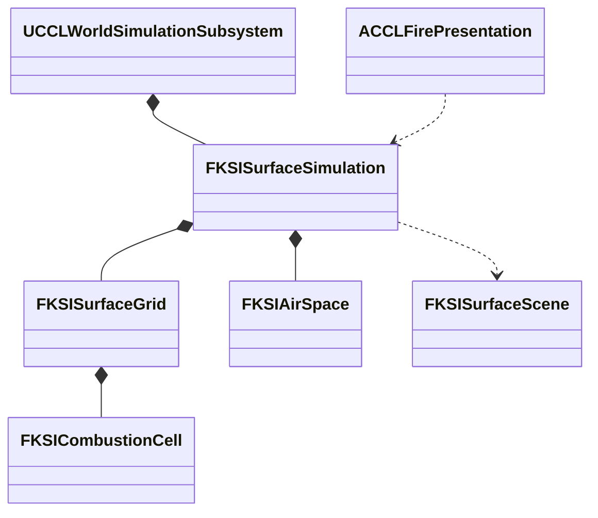

# 불·열·공간 환경

단계 7은 연소, 소화, 확산과 공간별 온습도, 연기를 공통 환경 상태에 연결한다. 범위는 [결정 19](../decisions/0019-natural-environment-and-labs.md)와 [환경 계획](../EnvironmentPlan/Design.md#불열공간-차폐)을 따른다. 식생 생체량과 연료 원장의 연결은 [생태계·생애](Ecology.md)가 소유한다.

## 하위 문서

| 문서 | 읽는 때 |
|---|---|
| [연소 코어와 표면 연결](Fire/Combustion.md) | 연소 계산, 표면의 융해·건조, 열 확산, 저장 형식을 바꿀 때 |
| [공간 환기](Fire/Ventilation.md) | 실내 공기, 문·개구부 교환, 연기 배출, 연소·실내·표면의 공통 진행을 바꿀 때 |
| [구역 10·11](Fire/Zones.md) | 구역 조작, 불꽃과 연기 표현을 바꾸거나 직접 확인할 때 |
| [열 피해](Fire/ThermalDamage.md) | 불과 고온 실내가 체력에 주는 피해, GAS와 Agent 부상 연결을 바꿀 때 |

## 목표와 단위

연소는 연료 kg, 연료 수분 kg, 열 J, 열용량 J/K, 연기 kg를 사용한다. 불의 진행과 공간 환기는 게임 초를 쓴다. 세계 시간을 가속해 계절을 바꿔도 불꽃 확산과 플레이어의 소화 반응 시간이 같은 배율로 빨라지지 않게 한다. 비·눈의 유입은 기존 세계 초 기준을 유지한다. 시험 수치는 콘텐츠의 초기값이며 실제 물질의 정확한 열역학이나 최종 밸런스를 뜻하지 않는다.

연료 수지는 초기 연료 = 남은 연료 + 연소 누계다. 소화는 온도를 낮추거나 수분을 공급하며 소모한 연료를 복원하지 않는다. 연소 열량과 냉각·외부 손실을 기록하고, 융해·건조가 이동시킨 물은 표면 수지에 남긴다. 연기는 발생·공간 보유·환기 배출을 구분한다.

## 목표 책임과 수명

서버 World의 기존 표면 값 상태가 셀별 연료·열·연소 흔적을 소유한다. 계산 코어는 인접 셀로 보내는 열을 같은 이전 상태에서 구하고 한 번 적용한다. 공간 값 상태는 안정적인 공간 ID와 체적, 온도·수분·연기를 보관한다. `FKSISurfaceScene`의 개구부는 공간과 외부 또는 다른 공간을 연결한다. 표현 Actor와 Niagara 컴포넌트는 확정 상태를 읽으며 연료를 직접 소모하지 않는다. 날씨·열·물·공기 후보를 먼저 계산하고 생활 진행까지 성공한 뒤 공통 시계를 확정하므로, 중간 오류에서 불만 타거나 환기만 진행한 상태를 게시하지 않는다.

## 대안과 비용

공간 평균 모델은 셀 전체를 3D 유체로 계산하는 방식보다 적은 상태로 환기·열 축적을 검증할 수 있다. 대신 정밀 연기 흐름과 실내 온도 분포는 제공하지 않는다. 이는 계획의 초기 제외 범위와 일치한다. UE5 Niagara는 표현을 맡고 값 코어는 화면 없는 서버에서도 실행한다. 기존 복제와 저장을 재사용한다.
