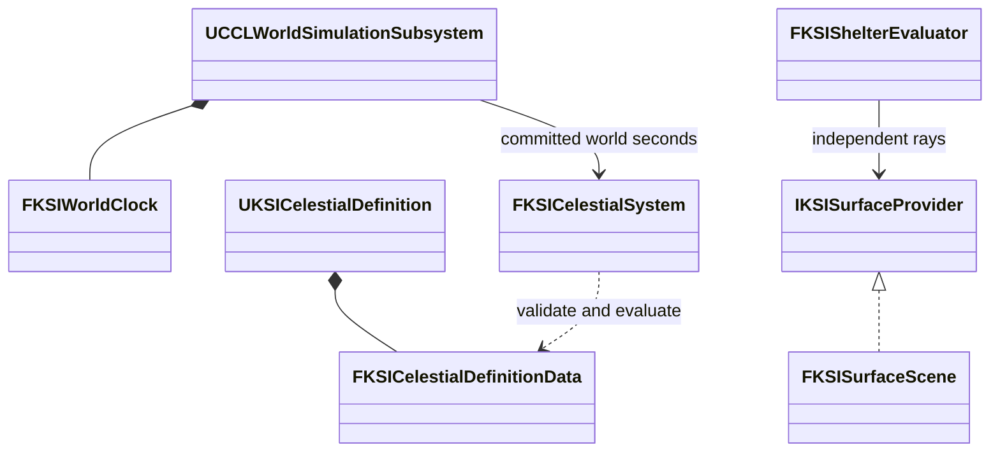

# 천체와 차폐 구현 기록

단계 2의 설계 근거와 당시 검증이다. 검증은 UE 5.8.3 소스 빌드의 Windows Editor에서 했다.

## 천체·표면 질의의 구현 설계

천체 코어에는 별도 시계를 두지 않는다. 확정된 `WorldSeconds`와 정의 버전, Seed에서 위치와 일조를 다시 계산하므로, 같은 정의와 시각을 넣으면 계산 순서와 관계없이 같은 관측값이 나온다. 우주 좌표는 double km, 지역 표면 질의는 double m, 에디터 Actor 좌표는 cm로 구분하고 표현 경계에서만 변환한다.

### 궤도와 일조

`FKSICelestialSystem`은 항성, 행성, 위성의 안정적인 이름 ID와 부모 관계를 검증하고 타원 궤도를 계산한다. 궤도 요소는 부모 위치에 상대적이고 축 방향은 공통 관성 좌표를 기준으로 하며, 자전축은 공전 위치를 따라 회전시키지 않는다. 자전은 부호 있는 항성일 주기로 다룬다. 현지 태양시는 관측 지점 자오선과 항성 방향의 차이로 계산하므로 자전 주기와 태양일은 다른 값이다. 계산식은 [JPL의 케플러 요소와 좌표 변환](https://ssd.jpl.nasa.gov/planets/approx_pos.html)을 참고했다. 게임 천체의 수치와 주기는 정의 데이터이고 실제 태양계 천문력이 아니다.

위도, 경도, 축 기울기에서 지역의 북, 동, 상 방향을 구한다. 항성별 고도, 방위, 현지 태양시, 대기권 밖 복사량을 반환하고, 대기와 구름, 지역 차폐는 뒤의 기후 계산이 적용한다. 계절은 거리 하나로 분류하지 않고 공전 위치에 따른 태양 적위와 일조에서 파생한다. [NASA의 축 기울기와 계절 설명](https://science.nasa.gov/helio-and-you-seasons-on-earth-mars-and-beyond/)과 부합하는지 무기울기, 남북 반구, 극지 시험으로 확인했다.

### 표면 질의

`IKSISurfaceProvider`는 천체 ID, 지역 광선, 종류 필터, 요구 리비전으로 여러 표면을 질의하는 공통 경계다. 공급자를 교체해 실제 지형을 연결한다. 시험용 `FKSISurfaceScene`은 유한 평면 패치와 직사각형 개구부를 쓴다.

- 결과는 안정적인 표면 ID, 천체 ID, 재질, 미터 단위 위치와 법선, 빛, 강수, 바람 투과율을 담는다. Actor 주소나 삼각형 인덱스를 영구 ID로 쓰지 않는다.
- 같은 XY의 바닥, 지붕 윗면과 아랫면을 따로 질의하고 거리순으로 정렬한다.
- 요청 개수 한도를 넘으면 결과를 잘라 차폐가 사라진 것처럼 처리하지 않고 질의 전체를 거부한다.
- 질의는 리비전과 실행 세대 GUID를 함께 쓴다. 복원으로 같은 리비전 숫자가 다시 나와도 이전 실행 세대를 지정한 질의는 거부한다. 지연 작업은 두 값을 함께 보관해야 한다.
- 코어는 게임 스레드의 검증 후 교체를 전제로 하며 공유 가변 장면의 동시 쓰기를 허용하지 않는다.

### 차폐

차폐는 일사, 강수, 바람의 서로 다른 광선과 투과율로 계산한다. 개구부는 닫힘 비율 대신 0-1의 열림 비율과 연결 공간 ID를 가진다. 부분 개방은 열린 실제 사각 영역에 적용하므로 반쯤 열린 문은 열린 쪽의 광선만 통과시킨다. 유효 개구 면적은 환기 입력으로 쓴다. 전체 입력 교체는 먼저 검증하고 성공했을 때만 새 리비전을 게시한다.

### 환경 입력 저장

`FKSIEnvironmentInputs`는 정의 ID, 버전, Seed, 전체 천체 요소, 관측 위치, 표면, 개구부를 길이 제한과 CRC가 있는 입력 묶음으로 저장한다. 세계 스냅샷 스키마 2가 이 묶음을 시계, 생활 상태와 같은 저장 세대에 넣었다. 스키마 1은 원래 세계 ID와 완료 시각을 유지하면서 기본 환경을 받는다.

서버는 환경 후보를 먼저 검증하고 생활 복원이 성공한 뒤 시계와 환경을 게시한다. 현재 실행과 다른 천체 정의 ID나 버전, 오래된 입력 리비전, 클라이언트 변경은 거부한다. 환경이 없는 스키마 1 저장은 해당 맵의 초기 환경을 쓰고, 맵 설정이 없으면 Seed 42의 기본 환경을 쓴다.

### 범위와 한도

계산하는 것은 고정 궤도 요소의 계층 모델, 점광원 기준 천체 차폐, 기하학적 위상, 대기 밖 복사량이다. 다체 중력, 반그림자, 굴절, 대기와 구름 감쇠, 고도에 따른 지평선 하강은 계산하지 않는다.

천체는 최대 64개, 표면과 개구부는 각각 최대 4096개, 환경 입력 직렬화는 최대 4 MiB다. 천체 시각 범위는 0-10¹²초다. 표면 탐색은 선형이라 넓은 지형에는 공간 인덱스가 필요하고, 이 한도는 대규모 월드 성능 검증을 대신하지 않는다. 같은 실행의 정확한 재현은 검사했지만 다른 플랫폼 사이의 비트 단위 일치는 검증하지 않았다.

## 단계 2 완료 결과

천체와 차폐 입력을 두 실험장에 연결해 단계 2를 끝냈다.

- **입력:** `DA_CelestialSystem`과 맵의 `ACCLWorldEnvironmentConfig`가 천체 정의, 관측 지점, 차폐 표면, 문, 진단 위치를 제공한다. 공통 서버 실행은 특정 실험 구역 번호를 알지 않는다. 저장이 있으면 정의 ID와 버전의 호환을 확인한 뒤 저장된 입력을 쓰고, 다른 버전을 자동 치환하지 않는다.
- **복제:** 서버가 확정 시각에서 관측값을 계산해 시계와 같은 `NetSerialize` 메시지로 보낸다. 불완전한 메시지는 기존 값을 유지한다. 진단 위치는 최대 8개, 표시 대상 개구부는 최대 64개다. 실험 화면의 관심 목록 한도이고, 표면 전체를 매 갱신 복제하는 계약이 아니다. 표시 대상 표면이 없거나 표면의 문이 표시 목록에서 빠진 입력은 시작, 변경, 복원 전에 거부한다.
- **조작:** 구역 01에서 천체 재현 검사를 실행한다. 격리 맵에서는 위도, 자전축 기울기, 자전 위상, 공전 위상을 바꿀 수 있다. 위상 조작은 시험용 궤도 요소를 바꾸며 세계 시각이나 NPC 나이를 건너뛰지 않는다. 구역 11은 문을 닫힘, 반 열림, 열림으로 바꾸고 빛, 비, 바람의 투과율을 각각 표시한다. 문을 열어도 지붕의 강수 차폐는 유지된다.
- **표현:** 물리 계산의 W/m²와 실험장 가독성을 위한 조명 강도 배율을 구분한다. 태양 조명은 서버가 보낸 방향을 쓰고 지평선 아래에서는 직접광을 끈다. 달과 행성의 방향, 각반경, 밝은 면 비율은 관측 자료이고, 별도 하늘 메시와 최종 아트는 이 결과에 없다. 방의 표시와 충돌은 질의 평면을 중심으로 두께 5cm 메시를 쓴다.

두 맵은 표면 8개, 문 1개, 실내, 실외, 유리 지붕 아래의 진단 위치 3개를 공유한다.

| 검사 | 결과 |
|---|---|
| CCL 자동 검사 | 42개 성공, 경고, 실패, 미실행 0개 |
| 새 에디터의 저장 맵 확인 | 표면, 개구부, 진단 위치, 태양의 Movable 설정 확인 |
| 격리 맵 조작과 화면 | 자전과 문 버튼의 Slate 클릭, 조명 방향, 문 충돌, 복원 통과 |
| 종합 맵 조작과 화면 | 문 클릭, 전역 조작 제한, 조명, 충돌, 복원 통과 |
| 두 맵의 Listen, Dedicated | 통과 |
| 별도 프로세스 복원 | 위도와 문 개방 상태 포함 통과 |
| 기존 네 맵 왕복 | 원래 세계, 시각, 초기화 기준 유지 |
| 공통 시간 서버 검사, 캠페인 저장 | 통과 |

Dedicated 검사는 서버와 조작, 관찰 클라이언트 두 개로 했다. 늦게 접속한 클라이언트가 받은 시각으로 천체 방향과 현지 시각을 다시 계산해 비교했고, 열린 문과 지붕 차폐의 수신도 확인했다. 실제 Server 타깃 패키지와 지연, 손실의 전체 조합은 단계 9의 범위다. 스키마 1의 바이트 변환은 자동 검사로 확인했고, 과거 실험장 저장 파일을 새 맵에서 직접 여는 조합은 검사하지 않았다.
