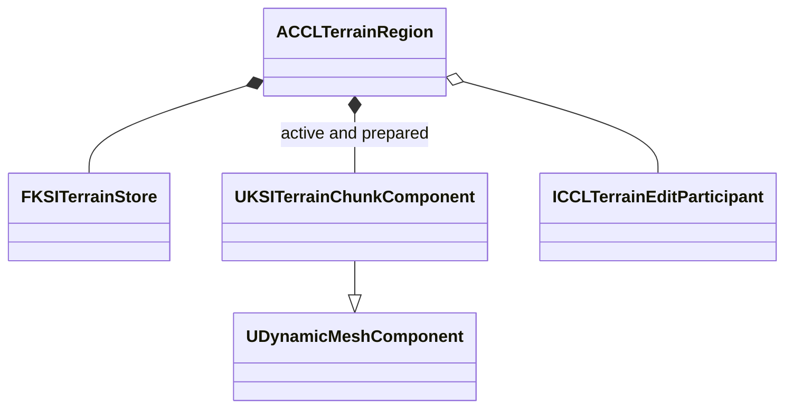

# 지형 코어 구현 기록

단계 3 전반의 코어 설계 근거와 당시 검증이다. 표면 질의, 지역 저장, 내비게이션, 복제, 실험장 연결을 포함한 현재 지형은 [영구 지형 통합과 검증](../Terrain.md)이 소유한다. 검증은 UE 5.8.3 소스 빌드의 Windows Editor에서 했다.

## 저장소와 편집 후보

| 소유자 | 책임과 수명 |
|---|---|
| `FKSITerrainStore` | 서버 지역 수명. 확정된 희소 밀도, 재질, 요청 순번을 소유한다 |
| `FKSITerrainCandidate` | 편집 요청 수명. 불변인 이전 상태와 후보 상태, 영향 청크를 보관한다. 폐기해도 확정 상태는 변하지 않는다 |
| `FKSITerrainCodec` | 별도 지역 저장의 크기 제한, 정렬, 손상 검사와 세계 저장 세대 연결 |
| `ACCLTerrainRegion` | 서버 권한을 해석하고 후보 메시, 충돌, 점유를 검사해 표시와 데이터를 함께 확정한다 |

### 격자와 밀도

- 한 청크는 32³개 표본을 소유한다. 기본 표본 간격 0.5m에서 청크 폭은 16m다.
- 좌표를 청크 크기로 내림 나눈 값이 소유자를 정하므로 음수 좌표에서도 경계 표본을 중복 저장하지 않는다. 메시 생성에 필요한 이웃 표본은 인접 청크에서 읽고, 바뀐 표본에 인접한 모든 셀의 메시 청크를 영향 목록에 넣는다.
- 밀도는 1mm 단위의 부호 있는 정수이고 양수가 빈 공간이다. 거리장은 표본 간격의 네 배로 제한한다. 굴착은 구의 차집합, 성토는 합집합이다. 이 해상도보다 작은 지형은 보장하지 않는다.
- 기본 지형은 지역 정의의 평면과 재질이고 편집된 표본만 저장한다. 정의에는 세계, 지역, 기반 정의의 ID와 버전, 편집 가능한 범위, 재질 목록, 보호 상자가 들어간다.

### 편집 권한과 확정

- 서버가 제공한 권한 주체, 허용 범위, 굴착과 성토 권한, 최대 반경을 검사한다. 권한은 클라이언트가 보낸 값에서 얻지 않는다.
- 요청의 실행 세대와 전역 리비전이 현재 상태와 같아야 후보를 만든다. 보호 영역은 거리장 갱신과 인접 셀의 영향 여유를 포함해 보수적으로 검사한다.
- 요청 주체별 증가 순번으로 재전송을 구분한다. 마지막 요청의 같은 내용은 중복 적용하지 않고, 더 오래된 순번과 같은 순번의 다른 내용은 거부한다.
- `PrepareEdit`는 확정 상태를 바꾸지 않는다. `CommitEdit`는 실행 세대, 리비전, 권한 세대를 다시 검사한다. 밀도 게시만으로 외부 충돌이 준비됐다고 판정하지 않는다.
- 서로 다른 청크를 편집해도 앞선 확정이 있으면 후보를 다시 계산한다. 동시 편집 처리량은 낮아지지만 순서와 실패 동작을 명확하게 검증할 수 있다.

### 지역 저장

지역 저장에는 세계 ID, 기반 버전, 완료 시각, 저장 세대를 넣고 기존 세션의 64MiB 본문에 합치지 않는다. 디코더는 배열 크기와 재질, 표본, 리비전, 중복 키를 검사한 후보만 반환한다. 복원은 정의와 세계 저장 문맥이 일치할 때 적용하고, 새 실행 세대를 발급해 이전 비동기 결과를 거부한다.

지역 레코드는 32MiB, 변경 표본은 지역당 2,097,152개, 한 번의 브러시 작업은 262,144개 표본이 한도다. `KSITerrainStore.h`의 방어 한도이고 목표 프레임 성능을 뜻하지 않는다.

## 청크 표면 추출

`FKSITerrainMesher`는 불변 지역 상태와 실행 세대에서 청크 하나의 정점, 삼각형, 재질을 만든다. 표시 컴포넌트를 직접 바꾸지 않고, 결과에 세계, 지역, 실행 세대, 입력 리비전을 넣어 오래된 결과를 거부할 수 있게 한다. `BuildChunk`가 실패하거나 취소되면 기존 출력을 유지한다.

자체 Marching Cubes 표를 만들지 않고 엔진 `FMarchingCubes`를 `GeometryCore`의 비공개 모듈 의존으로 쓴다.

- 엔진의 셀 수는 `floor(BoundsDimension / CubeSize) + 1`이다. 경계에서 한 셀이 더 생기지 않도록 정수 격자에서 CubeSize를 1, Bounds 최대를 마지막 표본보다 0.5 작게 지정한다. 밀도나 표면을 줄이는 것이 아니라 엔진의 반복 범위를 지정하는 것이다.
- 인접 청크는 같은 전역 격자 좌표에서 밀도를 읽어 교차점을 계산한다. 출력 정점은 청크 원점 기준 미터 좌표다. 지역 끝의 불완전한 청크는 범위에 맞춰 자른다.
- 엔진의 영점 표본 보간은 비다양체를 막으려고 교차점을 모서리 안쪽으로 10⁻⁶만큼 옮긴다. 이 동작을 유지한다.
- 표시 검토에서 삼각형 앞뒷면이 UE 기준과 반대인 결함을 찾아 두 인덱스를 교환했다. 법선 검사는 엔진 `VectorUtil::Normal`을 쓴다.

UE 5.8.3 근거는 `<Engine>/Source/Runtime/GeometryCore/Public/Generators/MarchingCubes.h:50-178`, `:238`, `:793`, `:973`과 `<Engine>/Source/Runtime/GeometryCore/Public/VectorUtil.h:80-96`이다.

첫 추출은 재현과 취소 경계를 먼저 검증하려고 청크 안에서 직렬로 계산한다. 전체 월드의 성능 보장은 아니다.

## 후보 충돌과 서버 확정 실행기 설계

`ACCLTerrainRegion`은 서버 지역의 밀도 저장소, 청크 표시와 충돌, 편집 작업을 소유한다. `UKSITerrainChunkComponent`는 청크 하나의 DynamicMesh와 Chaos 충돌을 준비한다. 준비 중에는 기존 지형을 유지하고, 모든 후보가 준비되면 지역 Actor의 `TG_PrePhysics`에서 영향 청크를 함께 교체한다.

- **동시성:** 메시 추출은 불변 상태를 캡처한 작업으로 실행하고 한 번에 두 개까지 진행한다. 한 지역의 편집은 하나씩 처리한다. 정책 변경과 취소는 준비 중에도 가능하다. 초기 활성 청크는 최대 256개다.
- **비동기 충돌:** 엔진 `CreatePhysicsMeshesAsync`를 쓰고 완료 콜백까지 강한 참조로 수명을 유지한다. 엔진의 개별 컴포넌트 완료 처리는 몸체를 그 자리에서 교체하므로, 여러 청크를 함께 확정하는 부분은 프로젝트가 맡는다. 취소는 결과의 게시를 막고, 이미 시작한 충돌 계산은 완료 후 버린다. 월드 종료 뒤 콜백이 와도 Actor나 월드에 접근하지 않는다.
- **확정 전 재검사:** 서버의 현재 권한과 지형 리비전을 다시 확인한다. 캐릭터 캡슐을 후보 삼각형에 직접 겹침 검사하고 밀도장의 내부 여부도 봐서 완전 매몰을 거부한다. 바닥의 접촉 오차와 실제 침투를 구분하려고 캡슐 반경과 반높이를 1mm 줄여 검사한다.
- **참여자:** `ICCLTerrainEditParticipant`는 물과 눈 같은 계층이 후보에 맞춰 상태를 준비하고 확정 직전에 다시 검사하는 계약이다. 모든 준비가 성공해야 확정하고, 확정 함수에서는 실패 가능한 계산을 하지 않는다.
- **물리 교체:** `FPhysicsCommand::ExecuteWrite`의 장면 쓰기 잠금 안에서 실행한다. 신규 충돌 등록과 데이터 확정이 성공한 뒤 기존 충돌을 없앤다. 등록이 실패하면 새 컴포넌트를 모두 제거하고 이전 지형을 유지한다.
- **요청 경로:** 지역 API는 `InitializeTerrain`, `SetEditAuthority`, `RequestEdit`, `CancelPendingEdit`다. 요청에 권한 자료를 싣지 않고 서버에 등록된 정책을 찾는다.

`IsTerrainReady()`는 게시된 지형 충돌이 있다는 뜻이고 내비게이션, 클라이언트, 저장 준비까지 보장하지 않는다.

UE 5.8.3 근거는 다음과 같다.

- `<Engine>/Source/Runtime/Engine/Private/PhysicsEngine/BodySetup.cpp:493-561`: 게임 스레드 완료와 취소
- `<Engine>/Source/Runtime/GeometryFramework/Public/Components/DynamicMeshComponent.h:804`, `:837`: 준비된 BodySetup과 완료 오버라이드
- `<Engine>/Source/Runtime/GeometryFramework/Private/Components/DynamicMeshComponent.cpp:1598-1707`: 개별 컴포넌트의 비동기 충돌 완료 시 몸체 교체
- `<Engine>/Source/Runtime/Engine/Private/PhysicsEngine/Experimental/PhysInterface_Chaos.cpp:639`: 쓰기 잠금

## 지형 실행기 검증과 인계

지형과 충돌 실행기까지의 검증 결과다. 표면 질의, 지역 파일 묶음, 내비게이션, 복제, 구역 05 조작은 [Terrain](../Terrain.md)에서 이어서 끝냈다.

표면 추출은 평면 청크에서 32×32 셀의 삼각형 2,048개와 정점 1,089개를 만들고 위쪽 청크에 같은 바닥을 중복 생성하지 않았다. 음수 좌표의 불완전한 청크, 굴착 경계 양쪽의 선분 끝점 일치, 지하 공동의 모든 모서리에 삼각형 두 개 연결, 같은 입력의 배열 순서, 도중 취소 시 기존 출력 유지를 확인했다. 임의의 모든 밀도 패턴이나 최종 렌더링 품질을 검증한 결과는 아니다.

실행기는 8개 청크의 초기 지형과 경계 굴착, 성토 후 실제 월드 광선과 캡슐 충돌을 확인했다. 충돌 생성 실패, 준비 중 권한 회수, 캐릭터 완전 매몰과 부분 겹침, 참여자 준비와 확정 거부, 취소는 기존 지형을 유지했다. 취소된 충돌 작업은 GC 이후 완료돼도 게시되지 않고 참조를 해제했다.

| 검사 | 결과 |
|---|---|
| 지형 코어와 메시 자동 검사 | 11개 성공 |
| CCL 전체 자동 검사 | 53개 성공, 경고, 실패, 미실행 0개 |
| 지형 실행 검사 | 성공. Revision 3, 청크 8개, 참여자 Commit 2회, Abort 7회 |
| 화면 검토 | 바닥, 굴착, 성토의 앞면 확인 |

지형 실행 검사는 `-CCLTerrainSmoke`로만 생성되는 `UCCLTerrainSmokeSubsystem`이 맡는다. 검사 Actor와 촬영용 조명, 카메라는 실행 중에 만들고 저장된 맵에 넣지 않는다. 물과 눈 참여자는 이 시점에 시험 구현으로만 확인했다.

첫 GeometryCore 연결 빌드는 컴파일 오류 없이 중간 종료됐다. 병렬 작업을 4개로 제한하고 개별 작업을 NoUba로 실행해 링크와 성공 결과를 확인했다.
