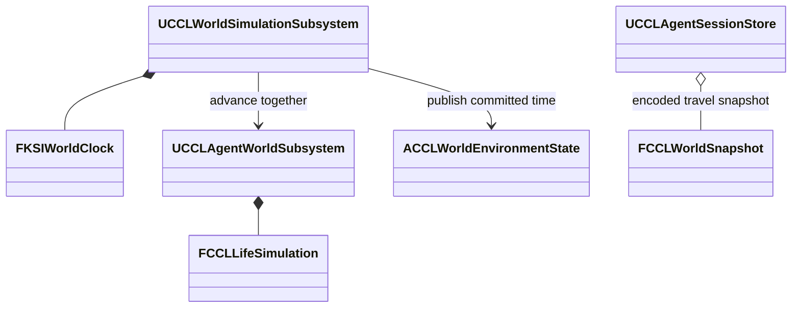

# 시간과 실험장 구현 기록

단계 0과 1의 설계 근거와 당시 검증이다. 검증은 UE 5.8.3 소스 빌드의 Windows Editor에서 했다. 지금 상태는 코드와 [실험실 문서](../Laboratories.md)가 소유한다.

## 단계 0 확인 결과

단계 0은 현재 엔진의 빌드 가능 여부와 기존 실패를 구분하는 기준을 충족했다. 설치 대상은 UE 5.8.3, Changelist 58210709다.

- **설치 판정:** 실행 파일이 있다는 것만으로 설치 완료를 판정하지 않는다. `Tools/Validation/environment_preflight.py`가 로컬 경로 설정을 읽어 설치, 도구, Git, LFS 상태를 모으고, 빌드 성공은 보고하지 않는다. 런처 등록이 없는 소스 설치본을 미설치로 판정하지 않도록 보완했고 단위 검사 12개가 통과했다.
- **도구:** MSVC 14.44.35207, Windows SDK 10.0.22621.0과 10.0.26100.0이 있었다.
- **콘텐츠:** `.uasset`, `.umap` 279개에서 LFS 포인터는 0개였다. 파일 헤더만 본 결과라 5.8.3 로드와 임포트 호환을 증명하지 않는다.
- **기존 에셋 오류:** 저장된 5.8.2 로그에 최신 커스텀 버전으로 인한 `SKM_Manny_Simple`, `ABP_Combat` 로드 실패가 있었다. 재현한 결과는 아니다. 5.9 리소스의 로드, 임포트 문제는 사용자가 보고한 제약이고 이 기기에서 재현하지 않았다.
- **기존 플러그인 오류:** 선택적 EditorToolset의 `AgentSkill`, ToolsetRegistry의 `PythonTestRunner` 초기화 오류가 남아 있다. 게임 회귀 결과와 구분했고 엔진 플러그인은 수정하지 않았다.

## 시간 코어의 책임과 경계

`Source/KSIWorldTime/`의 시계 코어는 Actor와 에셋을 참조하지 않는 일반 C++ 코드다. 호출 계약은 `KSIWorldClock.h`가 소유한다.

| 타입 | 책임 | 수명과 권위 |
|---|---|---|
| `FKSIWorldClock` | 입력 시간, 배율 이력, 처리 대기 구간, 완료 시각 | `UCCLWorldSimulationSubsystem`이 단독 소유한다. 코어는 Tick이나 네트워크 권한을 검사하지 않는다 |
| `FKSIWorldStep` | 후보 시간 구간, 완료 순번, 시도별 Ticket | Prepare부터 Commit 또는 Abort까지 쓴다. 티켓은 재시도, 초기화, 복원 뒤 재사용하지 않는다 |
| `FKSIWorldClockSnapshot` | 완료 시각과 순번, 대기 구간, 입력 시점별 배율의 값 복사 | Capture와 Restore에 쓴다 |

- `Abort`는 시계의 후보만 취소한다. 이미 변경한 Agent, 물리, 자원 상태를 되돌리는 함수가 아니다.
- 실패하면 완료 시각은 그대로 남고 대기 시간은 다음 시도에서 처리한다. 재시도는 같은 시간 구간에 새 Ticket을 쓴다.
- 배율을 바꿔도 이미 받은 시간은 원래 배율로 처리한다. 배율 0에서는 게임 시간이 진행되고 세계 시간만 정지한다. 월드 일시 정지 입력은 두 시간에 모두 누적하지 않는다.
- 대기 구간은 256개, 배율 이력은 4096개가 상한이다. 구현 보호 한도이고 출시 성능 목표가 아니다. 상한을 넘는 입력과 배율 변경은 오류를 반환하고 기존 상태를 유지한다. 호출자는 거부된 입력을 처리 완료로 보고하거나 버려서는 안 된다.

배율 이력을 보관하면 먼 지역과 저장 재개에서 과거 입력을 해석할 수 있지만 검증 비용과 저장량이 늘어난다. 단일 배율만 저장하는 구현은 작지만 대기 중 배율 변경을 잘못 적용하므로 채택하지 않았다.

`CCL.Environment.Clock` 자동 검사 4개가 확정과 재시도, 배율과 일시 정지, 복원과 손상, 입력 상한과 소수 시간 누적을 본다. 소스는 `Source/CCL/Environment/CCLWorldClockTests.cpp`이고 `WITH_DEV_AUTOMATION_TESTS`로 감쌌다.

## 시간 트랜잭션 구현과 검증

Agent 시간 진행은 후보 상태에서 사건, 욕구, 판단, 경제를 계산하고 모든 갱신이 성공했을 때 게시한다. 진행 중인 실행권, 데이터 오류, 처리 예산 초과가 있으면 완료 시각과 자원 상태를 유지하고 재시도 가능한 오류를 반환한다. Activity 처리기와 Goal 정책은 입력 자료만 계산하며 외부 Actor나 자원을 직접 변경하지 않아야 한다.

`FCCLLifeSimulation::TryAdvanceTo`는 실제 완료 시각을 바꾸기 전에 후보 계산을 끝낸다. `CCLWorldAdvance::Advance`는 삶의 소유권을 가져오지 않고 호출자가 넘긴 시계와 삶을 같은 시각으로 확정한다. `UCCLAgentWorldSubsystem`은 삶의 단일 소유자로 남는다. 입력 예산은 호출자가 정하며, 검사의 게임 시간 0.25초와 세계 시간 15초는 예시다. 후보 복사는 비용이 크므로 실제 시간과 메모리를 측정해 변경 기록 방식과 비교해야 한다.

값 상태의 후보 복사와 게임 스레드 확정은 일반 C++ 계약이고, UE4에서 UE5로 바뀐 Tick API가 아니다. `FInstancedStruct`와 강한 UObject 참조를 포함한 복사 코드는 UE 5.8.3에서 컴파일됐다.

검사는 후보의 첫 시간 구간에서 자원이 바뀐 뒤 다음 구간이 예산 때문에 실패하는 상황을 포함한다. 실패 전후 저장 바이트가 같고, 재시도 결과가 중단 없는 실행의 경제와 판단 기록과 같으며, 실행권, 예약, Actor 실행 주체가 보존되는지 본다. 배율 변경 전에 받은 대기 입력이 새 배율로 해석되지 않는지도 본다.

| 검사 | 결과 |
|---|---|
| CCL 자동 검사 | 20개 통과, 실패와 미실행 0개 |
| 30일 경제 검사 | 통과 |
| 실제 생활 Agent | 행동, 경제, 피해 기억, 저장 복원 통과 |
| Dedicated와 클라이언트 2개 | 이동, 사망, 재스폰, 다른 Pawn 유지 통과 |
| 별도 프로세스 저장 복원 | 검증 슬롯 기록, 재시작, 아이템, 진행 복원 통과 |

NullRHI 검사로 최종 화면 품질이나 패키지 실행을 증명하지 않는다.

## 서버 시간과 통합 저장 연결 설계

`UCCLWorldSimulationSubsystem`이 시계를 소유하고 `UCCLAgentWorldSubsystem`의 독립 Tick을 없앴다. Agent 상태의 소유자는 바꾸지 않았다. Tick은 게임 시간 0.25초를 모아 제한된 횟수로 처리하고 남은 시간을 버리지 않는다. 공통 실행은 `QueueGameTime`, `AdvancePending`, `ChangeTimeScale`을 제공한다.

`ACCLWorldEnvironmentState`는 세계 ID, 실행 세대, 확정 시각, 배율, 대기량을 하나의 복제 구조체로 전달한다. 서버만 상태를 갱신하고, 클라이언트는 서버 진행 함수를 실행할 수 없다.

`FCCLWorldSnapshot`은 세계 ID, 기반 세계 버전, 스키마, 저장 세대, 캠페인 또는 실험 영역, 시계 스냅샷, Agent 저장 바이트를 묶는다. 저장은 `Capture`와 `Encode`, 복원은 `Decode`와 `Restore`로 나눠 손상된 입력이 실행 상태를 바꾸지 않게 한다.

- 복원은 CRC, 배열 한도, 두 시각의 일치, 영역을 먼저 검증한다. Agent 교체가 성공한 뒤 시계를 게시한다.
- 기존 `UCCLAgentSessionStore`를 맵 전환 보관소로 확장했고 별도의 삶 시뮬레이터를 만들지 않았다. 캠페인, 실험장, 격리 실험은 맵 전환 저장과 초기화 세대를 따로 보관한다. 캠페인 새 게임은 실험 기록을 지우지 않는다.
- 저장 성공 시 묶음의 세대를 올리고, 복원 시 실행 세대 GUID를 새로 부여한다.
- 세션 버전 6은 기존 `AgentSimulation` 필드에 통합 스냅샷을 넣는다. 버전 5의 Agent 저장은 해당 완료 시각을 새 시계의 시작으로 옮긴다. Agent 데이터가 없는 버전 1-4는 기존 초기화 경로를 쓴다. 오프라인 경과 시간은 더하지 않는다.

엔진 `Source/Runtime/Engine/Private/Subsystems/WorldSubsystem.cpp:94`와 `:104`에서 Tick 등록과 해제가 Initialize와 Deinitialize에 연결된 것을 UE 5.8.3 소스로 확인했다. 새 서브시스템은 Super 호출과 기존 Agent 초기화 의존성을 유지한다.

| 검사 | 결과 |
|---|---|
| 전체 자동 검사 | 24개 성공, 실패와 미실행 0개 |
| `CCL.Environment.Save` 4개 | 미처리 시간과 배율 이력, 손상, 영역, 기반 버전 거부, 쓰기 충돌, 버전 1-5 이전, 영역별 초기화 통과 |
| Standalone | 세계 배율 0에서 게임 시계 진행, Agent 동시 복원, 세계 식별 유지 통과 |
| Listen | 호스트 검사, 클라이언트 권한 거부, 동일 시각 수신 통과 |
| Dedicated | 서버 검사, 순차 접속 클라이언트 2개의 동일 세계 ID와 시각 수신 통과 |
| 실제 NPC | 작업, 부상, 저장 복원, Actor 제거 후 공통 시계 진행 통과 |
| 별도 프로세스 세션 저장 | 쓰기, 읽기, 메뉴 복귀 후 재복원 통과 |

세 실행 모드 검사는 Campaign 맵과 NullRHI를 썼다. Listen, Dedicated, NPC 검사는 영역별 초기화 보완 전에 실행했고, 보완 뒤에는 전체 자동 검사, Standalone, 세션 재시작 검사만 다시 실행했다.

## 실험장 구현과 단계 1 통과

단계 1은 `EnvironmentPlayground`와 `EnvironmentScenario` 두 World Partition 맵으로 통과했다. 두 맵은 구역 표지판 12개와 같은 `UCCLExperimentDefinition` 자산 12개를 쓴다. 조작 화면에서 구역 이동, 시작, 중지, 초기화, 재실행, 저장, 복원, 기존 두 테스트 맵 이동이 된다. 공통 시간 시험과 배율 변경은 격리 맵에서만 실행한다.

- **권위:** `ACCLExperimentDirector`가 서버에서 실행 ID, 세대, 결과, 초기 상태를 소유한다. `ACCLExperimentPlayerController`는 소유 연결의 RPC를 전달하고 기존 CommonUI에 `UCCLExperimentScreen`을 등록한다. 첫 접속자가 조작 담당자이고 다른 참가자는 결과를 볼 수 있다. 서버는 영역, 담당자, 세대, 실행 ID를 확인한다. 시험 실행은 맵마다 하나로 제한한다.
- **초기화:** 쓰기 중 초기화는 상태를 바꾸기 전에 거부한다. 플레이어를 안전 지점으로 옮기고 AI 이동과 판단을 중지한 뒤 공통 시계와 Agent를 초기 스냅샷으로 복원한다. 실행 세대를 바꿔 이전 실행의 타이머와 요청을 거부한다. 종합 맵에서 격리, 전투, 멀티플레이 맵을 왕복해도 원래 세계 ID와 시각을 이어가고, 초기화는 첫 진입 때의 기준 상태로 복원한다.
- **저장:** 맵별 슬롯을 쓰고 캠페인과 분리한다. 자동 검사는 실행 GUID를 붙인 검사용 슬롯을 쓴다. Unreal SaveGame 헤더의 커스텀 버전 등록 순서는 프로세스마다 달라질 수 있어, 읽는 프로세스에서 헤더를 정규화해 비교한다. 시각과 Agent 본문의 차이를 제외하거나 오프라인 경과 시간을 더하지 않는다.
- **결과 기록:** 결과 JSON에는 엔진, Seed, 맵, 세계 ID, 실행 세대, 조작, 기대값, 시각, 배율을 적는다.

| 검사 | 결과 |
|---|---|
| CCL 전체 자동 검사 | 24개 성공, 실패와 미실행 0개 |
| 새 에디터의 저장 맵 검사 | 두 맵의 표지판 12개, 공통 정의 12개 확인 |
| 두 맵의 Standalone, Listen, Dedicated | 통과 |
| 두 맵의 화면 | 1280×720에서 Slate 포인터 클릭과 F8 닫기, 한국어, 배치, 구역 색상 확인 |
| 두 맵의 별도 프로세스 복원 | 세계 ID, 시계 전체, 미처리 시간, Agent 상태 비교 통과 |
| 네 맵 왕복 | UI 해제와 원래 초기 상태 복원 통과 |
| 기존 NPC 행동, 경제, 복원과 캠페인 별도 프로세스 저장 | 통과 |

네트워크 검사는 Editor의 게임과 서버 모드이며 실제 Server 타깃 패키지의 증거가 아니다. 당시 조명은 실험장 가독성을 위한 고정 조명이었다.
