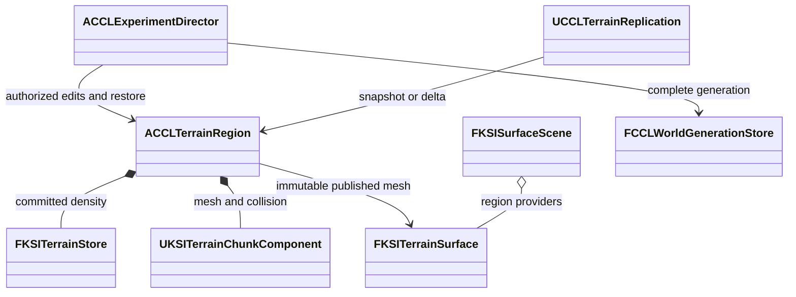

# 영구 지형 통합과 검증

[EnvironmentPlan](../EnvironmentPlan.md) 단계 3의 표면 질의, 저장 세대, 내비게이션, 복제와 구역 05 연결을 다룬다. 구현 위치는 `Source/KSITerrain/`와 `Source/CCL/Environment/`이고 실행 검사는 `Source/CCL/Tests/`와 `Tools/Validation/`에 있다. 물과의 확정·복원 연결은 [물 순환 설계와 검증](Water.md), 눈의 지지와 이동·저장 연결은 [깊은 눈과 캐릭터 이동](Snow.md)이 소유한다.

## 하위 문서

| 문서 | 읽는 때 |
|---|---|
| [저장과 맵 전환](Terrain/Persistence.md) | 완료 세대 저장, 복구, 맵 전환을 바꿀 때 |
| [경로와 복제](Terrain/Replication.md) | 내비게이션 준비와 접속자별 지형 전송을 바꿀 때 |
| [확인과 검증](Terrain/Verification.md) | 구역 05를 직접 확인하거나 검사 결과와 규모 비용을 볼 때 |

## 책임과 게시 순서

`ACCLTerrainRegion`은 한 지역의 밀도, 메시, 실제 충돌과 게시 순번을 소유한다. 서버는 호출자 권한과 예상 순번을 검증한 뒤 후보를 준비한다. 이전 충돌은 후보의 전체 청크가 준비될 때까지 유지한다. 기존 실행기의 점유 검사와 참여자 검증을 통과해야 밀도와 충돌을 함께 바꾼다. 내비게이션과 접속자별 충돌 준비는 그 뒤에 완료될 수 있다.

| 소유자 | 책임과 수명 |
|---|---|
| `FKSITerrainSurface` | 확정 메시의 불변 사본으로 다층 표면을 질의한다. 게시마다 교체한다 |
| `FKSISurfaceScene` | 지역별 표면 공급자를 합성한다. 교체와 제거 시 질의 Epoch를 바꾼다 |
| `FCCLWorldGenerationStore` | 세계와 지역 파일을 같은 문맥으로 검증하고 완료 세대를 게시한다 |
| `ACCLTerrainRegion` | 후보 충돌 준비, 확정 상태, 내비게이션 리비전과 클라이언트 적용 순번을 관리한다 |
| `UCCLTerrainReplication` | PlayerController 하나의 전송, 마지막 확인 바이트와 준비 완료 응답을 관리한다 |
| `ACCLExperimentDirector` | 실험 조작 권한, 구역 05와 세계 저장 복원을 연결한다 |
| `UCCLAgentSessionStore` | GameInstance 수명 동안 도메인별 세계·지형 전환 스냅샷을 보관한다 |

`RequestRestore`는 밀도만 먼저 바꾸지 않는다. 후보 충돌을 준비한 뒤 세계 복원 콜백과 지형 교체를 같은 게임 스레드 확정 구간에서 수행한다. 실패하면 후보를 폐기한다. 정본 지형 바이트가 같은 경우에만 기존 충돌을 재사용하며 새 Epoch와 게시 순번을 발급한다. 등록된 물·눈 참여자는 같은 후보를 `ValidateRestore`로 검증하고 확정 구간에서 `CommitRestore`한다. 참여자가 있는데 세계 상태 없이 요청한 복원은 거부한다.

`RequestRestore`와 준비 상태 함수의 서명은 `Source/CCL/Environment/CCLTerrainRegion.h`가 소유한다.

세 준비 상태의 뜻은 다르다. `IsTerrainReady`는 기존 확정 충돌의 존재를 나타낸다. `IsNavigationReady`는 현재 리비전과 Epoch의 동적 NavMesh 갱신 완료를 나타낸다. `IsReplicaReady`는 해당 클라이언트가 최신 게시를 적용하고 물리 프레임을 지난 상태다. 편집 준비 중에도 이전 지형은 사용할 수 있다.

## 다층 질의와 메시

표면 질의는 실제 충돌에 사용한 메시에서 광선 교차를 계산한다. 지상, 동굴 천장과 바닥을 거리순으로 반환하며 재질과 바깥쪽 법선을 포함한다. 요구 리비전이나 Epoch가 다르거나 결과 예산을 넘으면 출력 배열을 바꾸지 않고 실패한다. 합성 질의는 장면 리비전과 원본 지형 리비전을 별도로 반환한다.

표면 ID는 세계, 지역, 격자 셀과 주 법선 방향으로 계산한다. 청크 순서와 재추출에 영향받지 않지만 지형 편집으로 셀이나 방향이 바뀐 표면의 동일성을 보장하지 않는다. 임의의 지형 변형을 추적하는 영구 객체 ID로 사용하지 않는다.

정수 밀도의 영점 꼭짓점에서는 UE MarchingCubes의 보간 처리가 작은 삼각형을 만든다. 정확한 청크 교차점에서 실제 Chaos 광선 검사가 빠지는 현상을 재현했다. 추출 기준을 `-0.5mm`로 두어 정수 밀도의 고체/공기 분류를 유지하면서 영점 꼭짓점을 피한다. 평면은 밀도 영점보다 0.5mm 안쪽에 생긴다. 밀도 저장값을 바꾸지는 않으며 표시, 충돌과 표면 질의는 같은 추출 결과를 사용한다.

엔진 근거는 `<Engine>/Source/Runtime/GeometryCore/Public/Generators/MarchingCubes.h`의 영점 보간이다. 이 변경은 이번 프로젝트의 추출 정책이며 UE4와 UE5의 일반적인 차이라고 해석하지 않는다.
