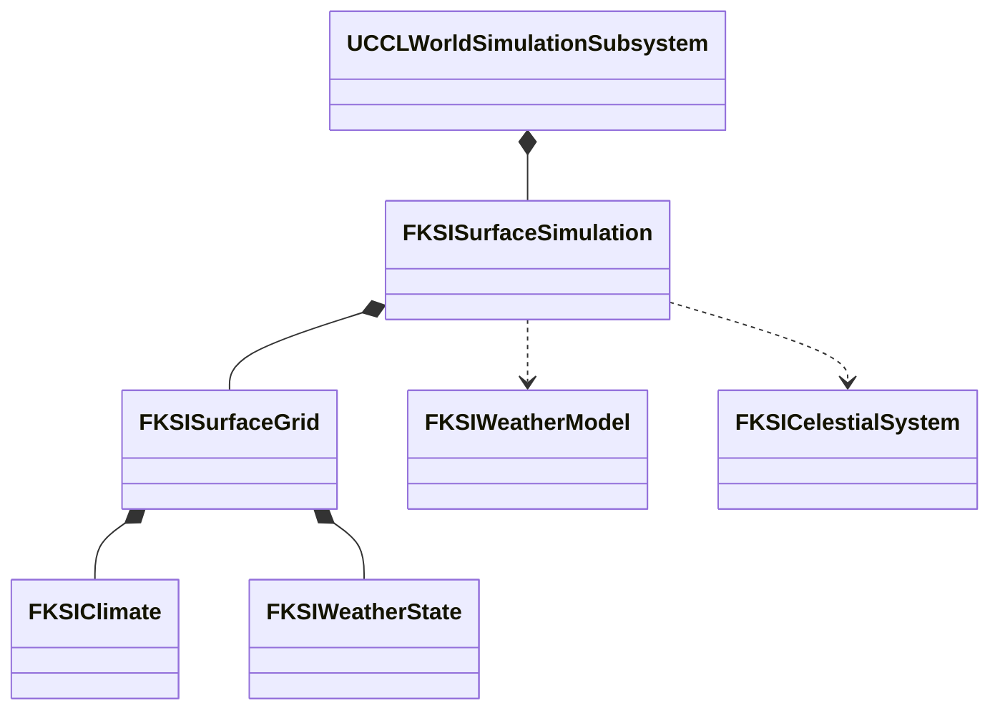

# 자연 날씨의 계산과 연결

지역 날씨를 천체 일조, 기후 정의와 이전 수분·기온 상태에서 진행한다. 구역 02에서 자연 진행과 강제 비·눈을 선택하고 기온, 대기 수분, 바람과 표면 수지를 확인한다. 범위 근거는 결정 19와 [환경 계획](EnvironmentPlan.md#단계별-구현과-통과-기준)이다. 이 문서는 지역 날씨의 값 모델, 공통 시간과의 확정 순서, 구역 02 조작, 저장·복제와 검증 기록을 소유한다.

## 목표와 책임

서버의 `UCCLWorldSimulationSubsystem`이 공통 시간을 소유한다. `FKSIWeatherModel`은 일조와 기후 입력으로 지역 날씨 후보를 계산한다. `FKSISurfaceGrid`가 기후 정의와 지속 날씨 상태를 보관한다. `CCLWorldAdvance`는 날씨·표면·생활·시계의 후보를 같은 완료 경계에서 확정한다. 클라이언트는 기존 표면 스냅샷 복제를 통해 확정 날씨를 받는다.

## 계산 계약

기온은 지역 기준 기온과 차광된 일조가 정하는 목표값으로 지수 완화한다. 바람과 외부 수분 공급은 기후 정의·Seed·세계 시각으로 정한 완만한 주기 입력이다. 지역 대기는 열린 계이며 외부 공급을 허용한다. 수증기가 온도별 용량을 넘으면 구름으로 응결하고 구름의 일부가 강수로 빠진다. 이는 게임용 근사 모델이며 대기 역학이나 실제 예보 정확도를 제공하지 않는다.

강수·증발과 기온 변화는 세계 초, 물의 수평 이동은 게임 초를 쓴다. 강수는 물 환산 깊이로 계산한 뒤 기온에 따라 비·눈으로 분배한다. 기존 셀별 강수 노출률을 적용하며 물·눈·얼음·토양과 증발의 수지 검사를 유지한다. 천체 관측은 처리 구간의 중간 시각에서 수행한다. 날씨 모델의 하위 단계는 최대 60세계 초다. 큰 요청은 최대 4096개로 나누어 일조·대기·표면을 순서대로 계산하고 후보 전체를 한 번에 확정한다. 예산을 넘는 요청은 시간을 미처리 상태로 남긴다. 평소 런타임은 기존 15세계 초 예산을 유지한다.

자연 모드를 활성화한 지역만 날씨가 표면 입력을 갱신한다. 기존 수동 표면 실험은 그대로 시작한다. 수동 강수·온도 변경은 자연 모드를 끄고 화면에 강제 입력으로 표시한다. 자연 모드로 돌아오면 저장된 대기 상태에서 진행한다. 실패 시 이전 날씨·표면·시계와 미처리 시간이 남는다. 생활 계산이 실패하면 표면과 시계를 교체하지 않으므로 재시도에서 강수를 두 번 소비하지 않는다.

표면 저장 형식은 [불·열·공간 환경](EnvironmentFire.md#저장-형식과-실패-경계)이 소유한다. 버전 1·2는 자연 모드 꺼짐으로, 버전 1-3은 동적 차폐 꺼짐으로 복원한다. 동적 차폐 여부와 셀별 일사·바람 노출률도 저장한다. 날씨 정의·상태와 표면은 동일 스냅샷에 들어간다. 손상·범위 초과 입력은 원본을 교체하지 않고 거부한다.

## 인터페이스와 검증 기준

`FKSIWeatherModel::Advance`는 기후·시각·간격·일조와 상태를 받는다. `FKSISurfaceSimulation::ChangeClimate`는 지역 기후를 검증하고 교체한다. 월드 소유자는 서버 권한과 실행 상태를 검사한 뒤 값 코어에 전달한다. 진행 API는 선택적 천체 문맥을 받으며 자연 모드에서 시간이 진행할 때 문맥이 없으면 실패한다.

검증은 낮·밤과 계절별 일조에 따른 온도 차이, 차가운 조건의 눈과 따뜻한 조건의 비, 저장·복원 후 같은 결과, 실패 후 재시도의 중복 강수 없음, 0배속, 잘못된 수치 거부를 포함한다. 구역 02에서 자연·강제 입력 표시와 표면 변화를 확인한다.

## 대안과 비용

기존 표면 소유자에 날씨 상태를 붙이면 저장·복제·원자적 확정을 재사용할 수 있다. 대신 여러 표면이 같은 기후를 공유하는 광역 기상장의 계산을 중복할 수 있다. 현재는 제한된 지역 모델을 먼저 검증하고 광역 공유·이류는 별도 확장으로 남긴다. 천체와 표면은 프로젝트 계산 코어다. 기존 UE5 복제를 재사용하며 이번 변경에 UE4 대비 엔진 API 전환은 없다.

## 직접 확인

1. `EnvironmentScenario` 또는 `EnvironmentPlayground`에서 F7로 메뉴를 연다.
2. **02 자연 날씨**를 선택하고 **선택 구역으로 이동**을 누른다. 자연 진행은 세계 시간 배율이 0보다 클 때 변한다.
3. 기온, 수증기, 구름, 바람과 비·눈 강수율을 읽는다. 강수율은 물 환산 mm/h이며 표면의 수지 오차는 m³다.
4. **강제 비** 또는 **강제 눈**을 누르면 해당 지역의 대기 계산이 멈추고 지정한 표면 입력을 사용한다. **자연 진행**으로 돌아오면 보관한 대기 상태에서 이어진다.
5. 격리 맵의 천체 구역에서 위도·자전·공전 입력을 바꾼 뒤 자연 날씨의 기온 변화를 비교한다. 온도는 즉시 점프하지 않고 열 반응 시간에 따라 변한다.
6. **실험 저장**, 입력 변경, **저장 불러오기** 순서로 비교한다. **자동 검사**는 실제 상태의 복사본을 900세계 초 진행하고 표면 수지·저장 왕복을 검사한다.

전용 레벨 `Weather`는 [기능별 환경 실험장](EnvironmentLaboratories.md)의 절차를 따른다.
## 구현 위치와 단위

| 파일 | 소유 내용 |
|---|---|
| `Source/KSIEnvironment/Public/KSIWeatherModel.h`, `KSIWeatherModel.cpp` | 기후 값, 지속 날씨 상태, 입력 검증·진행·직렬화 |
| `Source/KSIEnvironment/Private/KSISurfaceSimulation.cpp` | 구간 중간의 천체 관측, 비·눈·증발 입력과 표면 수지 |
| `Source/CCL/Environment/CCLWorldAdvance.cpp` | 생활 실패 시 날씨·표면 후보 폐기와 시간 재시도 |
| `Source/CCL/Environment/CCLWeatherPresentation.cpp` | 확정 강수량을 읽는 Niagara 비·눈과 볼류메트릭 구름 |
| `Source/CCL/Environment/CCLExperimentWeather.cpp` | 구역 02 초기값·자연/강제 조작·격리 자동 검사 |
| `Source/CCL/Tests/CCLWeatherSmokeSubsystem.cpp` | 실제 월드 진행·복원, 참가자 수신과 권한 거부 |
| `Tools/Validation/run_weather_smoke.ps1` | Standalone·Listen·Dedicated 프로세스와 결과 비교 |

초기 기후 수치는 `FKSIClimate`에 있는 실험용 값이다. 자연 날씨는 구역 02에서 켜져 있고 기존 물·눈 구역은 별도의 수동 입력을 유지한다. 활성 지역은 같은 천체 관찰 지점을 쓰되 기후 값과 대기 상태는 지역마다 보관한다.

## 검증 범위와 남은 표현

날씨 변화가 표면의 물·얼음·진흙·눈 메시로 이어지고 메뉴는 서버 확정 상태를 읽는다. 비·눈은 Niagara 경량 emitter로 표시한다. 볼류메트릭 구름의 피복과 태양 밝기는 관찰 위치에서 가장 가까운 날씨 지역의 구름량을 읽는다. 비·눈 입자는 2m 타일의 대표 셀 노출률을 사용하므로 정밀 입자 충돌과 같지는 않다. 바람에 흔들리는 식생은 아직 구현하지 않았다. 구름의 밝기·형태와 주야간 노출은 단계 9 시각 검토에서 조정한다. 공간별 실내 기온과 환기는 [불·열·공간 환경](EnvironmentFire.md)이 소유한다.

차폐는 `FKSISurfaceSimulation::Advance`의 선택적 읽기 전용 provider로 전달한다. 동적 차폐를 켠 지역은 매 진행 요청에서 확정 표면 provider의 세대·리비전으로 셀의 강수·일사·바람 노출을 다시 구한다. 강제 날씨도 차폐를 우회하지 않는다. 문맥이 없거나 질의가 실패하면 후보를 폐기해 노출·물·날씨·공통 시간을 함께 보존한다. 계산 비용은 활성 지역의 셀 수와 표면 수에 비례하므로 규모 검증에서 측정한다. 기존 수동 표면 실험의 고정 노출률은 유지한다. 자동 검사에서 천창 개방에 따른 물 유입 변경과 실패 전후 바이트 보존을 확인했다. 실제 구역 02는 반쪽 지붕을 두고 첫 셀의 강수 노출 0, 마지막 셀의 노출 1을 서버와 참가자에서 검사한다. 지역 대기의 기온과 셀의 차폐율은 별개다.

기후의 대기 공급은 외부 유입이다. 표면 증발량을 같은 지역의 수증기에 되돌리는 닫힌 대기 순환, 광역 기상장 이류와 실제 예보 정확도는 이번 구현에 포함하지 않는다. 저장 복원 후 같은 입력·구간에서는 같은 상태를 재현한다. 서로 다른 시간 분할에서 완전히 같은 수치가 나온다고 보장하지 않는다.

## 실행 검증

2026-10-10 UE 5.8.3 소스 빌드의 로컬 작업 트리에서 계산 코어를 검증했다. Dedicated 검사는 Editor 실행 파일의 `-server` 모드다. 실제 Server 타깃·패키지·네트워크 지연·손실·대규모 성능은 이 검증에 포함하지 않았다. 실행 절차는 `ccl8-verify`가 소유한다.

프로젝트 파일 생성과 CCLEditor Win64 Development 빌드가 성공했고 환경 자동 검사는 57/57, 경고·실패·미실행 0이었다. Standalone은 자연 강수·모드 전환·동일 세대 복원·구역 이동·1280×720 화면이 통과했다. Dedicated의 서버와 두 참가자는 기온·수증기·구름이 일치했고 클라이언트 직접 변경을 거부했다. Listen의 같은 세 수치와 권한 검사는 큰 시간 요청의 내부 분할 보완 전 결과이며, 보완 후 네트워크 재검사는 Dedicated에서 수행했다. 기존 실험장은 안내·천체의 큰 시간 요청과 실패 재시도·저장·초기화·차폐가 통과했다. `DA_Environment_02`는 UE에서 저장하고 새 게임 프로세스로 정의를 검증했다. 자동 검사는 7200세계 초 요청과 60세계 초씩 120회 진행의 기온·수분·표면량을 비교하며, 예산을 넘긴 요청의 원본 보존도 확인한다.

## 차폐와 표현의 추가 검증

2026-10-10 단계 6의 차폐·표현 연결 후 프로젝트 생성과 Editor 빌드가 성공했고 환경 자동 검사는 58/58, 경고·실패 0이었다. 앞 절의 기록은 계산 코어 구현 당시의 결과이며, 후속 검증은 이 절이 소유한다.

두 맵의 새 프로세스 검증에서 표면 9개·구역 12개와 날씨 Actor·비·눈·구름 에셋 참조를 확인했다. Standalone에서 자연 상태·비·눈·높은 수분 공급으로 생성한 구름 화면 4장을 확인했다. Dedicated의 첫·늦은 참가자는 기온·수증기·구름이 일치했고 지붕 노출률·권한 거부를 확인했으며, Listen도 같은 수치·차폐·권한 검사가 통과했다. 기존 실험장은 천체·저장·복원·문 개폐가 통과했다.

Niagara 에셋은 엔진의 `FountainLightweight`를 복제한 뒤 초기 수명·크기·위치·속도·강수율 바인딩을 구성한다. 매 게임에서 생성·컴파일하지 않는다. 에디터 생성 경로만 Niagara 내부 헤더를 사용하므로 엔진 이전 시 이 경로를 다시 빌드·저장해야 한다. `FNiagaraDistributionRangeVector2`의 일부 가상 함수는 외부 export가 없어 임시 객체 생성 대신 공개 `InitConstant`를 호출했다. 일반 게임·Server 패키지는 단계 9에서 별도 검증한다.

## 눈 Niagara 생성 이력 보완

2026-10-10 구역 07의 실제 렌더링에서 눈 Niagara의 활성 생성 이력이 GPU 처리 상한을 넘었다는 경고를 확인했다. 눈 입자의 최대 수명은 2.7초인데 0.25초마다 반복하며 변하는 강수율을 평가하고 있었다. 서로 다른 강수율의 생성 기록이 입자 수명 동안 함께 남아 한도를 넘는 조건이었다.

UE 5.8.3의 `<Engine>/Plugins/FX/Niagara/Source/Niagara/Private/Stateless/NiagaraStatelessEmitterInstance.cpp:705`는 반복마다 생성율을 다시 평가한다. 같은 파일 743줄부터는 생성율과 시간 경계·확률·수명 조건이 맞는 기록만 합치며, 846줄부터는 생성 종료 시각에 최대 수명을 더한 경계가 지나야 기록을 제거한다. `NiagaraStatelessEmitterData.cpp:114`는 GPU 생성 기록 상한을 검사하고 148줄에서 화면 경고를 만든다. 이 근거는 UE 5.8.3 Stateless Niagara 경로에 해당한다.

`CCLWeatherPresentation.cpp`의 에디터 에셋 구성에서 눈의 반복 길이를 1초로 늘렸다. 비는 0.25초를 유지한다. 눈은 강수율 표현의 반응 간격이 길어지는 대신 동시에 보존하는 생성 기록 수가 줄어든다. 서버의 강수량·물·눈 계산은 바꾸지 않았다. `Tools/Validation/update_precipitation_lifecycle.py`로 기존 비·눈 에셋을 갱신하고 새 게임 프로세스의 화면에서 경고가 사라진 것을 확인했다.

생성·빌드와 관련 실행 범위는 [구역 07 검증](EnvironmentEcology/Vegetation.md#구역-07-식생-조작과-복제-검증)에 기록한다. 장시간·최대 강수량의 효과 비용 검증까지 완료한 결과는 아니다.
