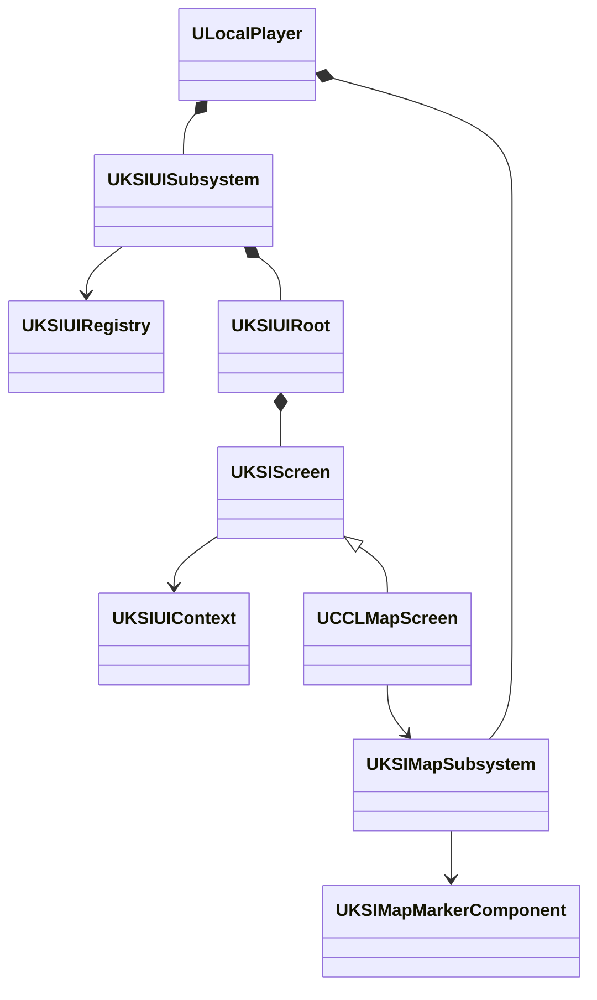
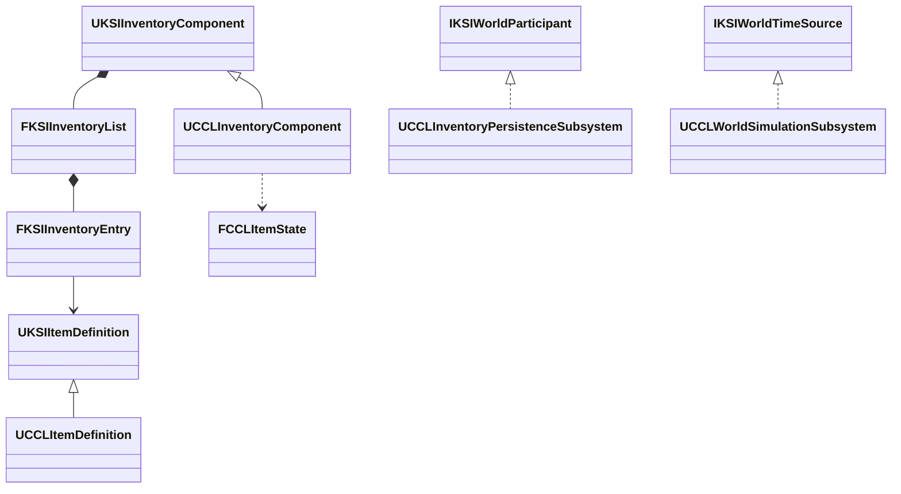
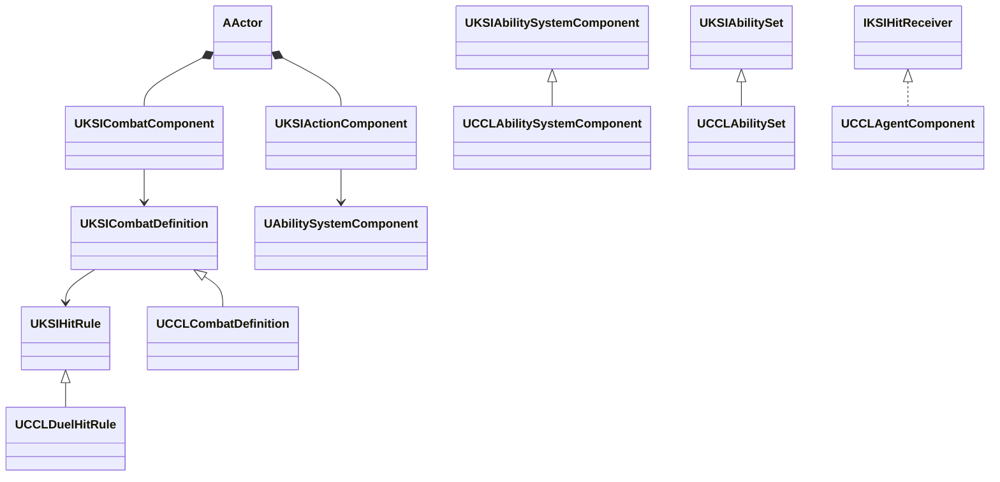
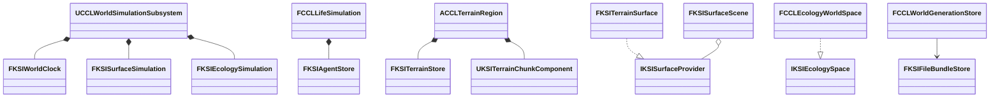

# 공용 Framework 분리 계획

여러 개인 UE5 프로젝트가 선택해 쓰는 공용 게임 시스템 `KSI Framework`를 CCL 안의 C++ 모듈 11개로 분리했다. 2026-10-11-12에 단계 1-4의 추출, 독립 최소 프로젝트 실행, CCL 회귀, Game·Server 패키지 검증을 마쳤고, 다른 프로젝트와의 장기 배포 방식만 정하지 않았다. 플러그인은 현재 범위에서 제외한다. 이 문서는 이름 규칙, 독립 선택 기준, 모듈 계층, 분리 절차와 완료 기준, 단계별 구현·검증 기록을 소유한다. 현재 세계 계산·저장 경계는 [결정 26](decisions/0026-shared-world-computation-split.md)을 따른다. 전투·능력·행동 경계는 [결정 25](decisions/0025-shared-combat-split.md), 계약·인벤토리 경계는 [결정 24](decisions/0024-shared-save-and-inventory.md)를 따른다. 계획과 이름의 근거는 [결정 20](decisions/0020-framework-plan-on-hold.md)·[결정 22](decisions/0022-ksi-module-split.md), 단계 1 착수와 검증 범위는 [결정 23](decisions/0023-framework-stage-1.md)에 기록했다.

## 목표와 현재 상태

CCL은 공용 시스템을 사용하는 첫 프로젝트로 둔다. 공용 시스템은 상태 소유권, 수명, 실행, 저장·복제 계약을 제공한다. 각 게임은 필요한 시스템을 선택하고 게임 규칙과 콘텐츠를 연결한다.

| 항목 | 상태 |
|---|---|
| 공용화 범위 | 시스템 단위의 재사용 기반 |
| 분리 단위 | 프로젝트 안의 C++ 모듈. 플러그인은 현재 범위에서 제외 |
| 이름 규칙 | 공용 모듈 `KSI{System}`, 공용 타입 접두사 `KSI` |
| 묶음 이름 | `KSI Framework`. 문서에서 공용 시스템 전체를 부를 때만 사용 |
| 독립 후보 | 11개 KSI 모듈 추출 완료. 단계별 독립 실행과 조합 검증은 아래 기록을 따름 |
| 실제 분리 | 단계 1-4 구현·검증 완료. 코드·설정·검증 도구 제출 범위는 아래 기록을 따름 |
| 착수 시점 | 2026-10-11 사용자 지시 |
| 환경 후속 작업 | [EnvironmentPlan](EnvironmentPlan.md)의 별도 범위. 이 계획으로 착수하지 않음 |

장르 독립적인 계약과 콘텐츠 분리는 [Coding](Coding.md#장르에-독립적인-베이스-시스템-설계)을 따른다. UE의 기능 선택 기준도 유지한다. 이 계획은 엔진 소스를 수정하거나 UE의 UObject·GAS·Subsystem 등을 자체 구현으로 교체하는 계획이 아니다.

보스, 맵, 퀘스트 내용, 아이템 정의, 화면 구성과 연출 자료는 각 게임이 소유한다. 이 콘텐츠들을 공용 모듈이나 플러그인으로 분리하는 작업은 공용화 범위에 포함하지 않는다.

## 독립 선택의 기준

독립 시스템은 UE5와 작은 공통 계약에는 의존할 수 있지만, 사용하지 않는 다른 게임 시스템을 필수로 요구하지 않아야 한다. 예를 들어 UI만 선택한 프로젝트에는 인벤토리·Agent·지형 구현이 필요하지 않아야 한다.

1. 게임이 공용 시스템을 참조하고, 공용 시스템은 특정 게임의 클래스·맵·에셋을 참조하지 않는다.
2. 게임마다 달라질 규칙과 데이터는 공개 계약으로 전달한다. 변경되지 않는 공통 실행은 시스템이 구현한다.
3. 상태의 소유자, 생성·해제 시점, 서버 권위와 복제 범위를 시스템별로 명시한다.
4. 시스템 사이의 연결은 선택 가능한 어댑터로 둔다. 참조 방향을 바꾸기 위해 모든 데이터를 공통 모듈에 몰아넣지 않는다.
5. 시간과 저장은 여러 시스템이 기대는 바닥 계약이다. 저장 참여, 구간 등록, 시간 읽기 같은 공통 계약은 `KSICore`에 두고 구체 시계와 저장 실행은 별도 모듈로 둔다. 외부 시각·저장 참여 계약만으로 충분한 시스템은 그 입력만 받는다.

현재 CCL의 구현이 이 조건을 모두 만족한다는 판정은 아니다. 시스템을 추출할 때 실제 코드·에셋·설정 의존을 다시 확인한다.

## 이름 규칙

공용 모듈과 타입은 공통 접두사 `KSI`를 쓴다. `KSI`는 사용자 이름의 약자이며 결정 22에서 정했다. 게임 고유 모듈과 타입은 지금처럼 `CCL`을 유지한다.

| 대상 | 형식 | 예 |
|---|---|---|
| 공용 모듈 | `KSI{System}` | `KSICore`, `KSIUI`, `KSIMap` |
| 공용 타입 | UE 타입 접두사 + `KSI` + 이름 | `UKSIScreen`, `FKSIUIViewHandle`, `IKSIWorldParticipant` |
| export 매크로 | 모듈 이름 대문자 + `_API` | `KSICORE_API`, `KSIUI_API` |
| 게임 모듈 | 기존 이름 유지 | `CCL`, `CCLEditor` |

`Framework`는 모듈 이름에 붙이지 않는다. 결정 20의 `{Prefix}{System}Framework` 형식은 이름이 길다. 또한 UE 5.8.3에는 서버에서 UMG를 제어하는 실험 플러그인 `UIFramework`가 있어 `KSIUIFramework` 같은 이름이 그 플러그인과 혼동된다 (`<Engine>/Plugins/Experimental/UIFramework/UIFramework.uplugin`). `KSI Framework`는 문서에서 공용 시스템 전체를 부르는 이름으로만 쓴다.

접두사 자리에는 일반 단어를 쓰지 않는다. 접두사는 엔진·외부 플러그인과 이름이 겹치지 않게 하고 공용 코드의 출처를 드러내야 한다. `GameFramework`는 엔진 헤더 폴더(`#include "GameFramework/Character.h"`)와 ModularGameplay의 `UGameFrameworkComponent`와 섞인다. `GameModule`은 프로젝트의 주 게임 모듈을 뜻하는 엔진 용어이고, `Public`은 모듈 폴더와 `Build.cs`의 용어다. `Game`과 `Common`으로 시작하는 엔진 모듈도 많다. 예를 들어 `Common`을 접두사로 쓰면 `UCCLUIActionRouter`가 CommonUI의 `UCommonUIActionRouterBase`와 거의 같은 `UCommonUIActionRouter`가 된다. 접두사 뒤의 시스템 부분에는 일반 단어를 써도 된다.

2026-10-11 UE 5.8.3 소스에서 `KSI`의 이름 충돌을 확인했다. 엔진의 모듈 규칙 파일 이름 2,549개와 플러그인 이름 895개 중 `KSI`로 시작하는 이름은 없었다. 엔진의 C++·C# 소스에도 `KSI`로 시작하는 식별자가 없었고, 착수 전 CCL 저장소에도 쓰는 곳이 없었다.

모듈 이름은 첫 분리 뒤 바꾸지 않는다. 네이티브 타입의 경로 `/Script/<Module>`을 모듈 이름이 정하기 때문이다 (`<Engine>/Source/Runtime/CoreUObject/Private/Misc/PackageName.cpp:2324`). 모듈 이름을 바꾸면 그 모듈의 모든 타입에 리다이렉트가 다시 필요하다.

공용 모듈로 옮기지 않은 `CCL` 모듈, 클래스와 파일은 지금 이름을 유지한다. 타입을 공용 모듈로 옮길 때는 같은 작업에서 `KSI` 이름으로 바꾼다. 경로와 이름이 함께 바뀌어도 타입마다 CoreRedirects 한 줄로 처리할 수 있다. `WorldParticipant` 같은 개별 타입 이름을 다듬을지는 추출할 때 정한다.

## 독립 시스템 후보

| 모듈 이름 | 공용 책임 | 독립 사용 확인 사례 | 관련 사양 |
|---|---|---|---|
| `KSICore` | 저장 참여·구간 등록·시간 읽기·표면 질의처럼 여러 시스템이 공유하는 계약 | 다른 `KSI` 모듈 없이 엔진에만 의존해 컴파일 | [세계 저장 참여자 학습](Learning/EnvironmentRestoreParticipants.md) |
| `KSIUI` | 화면 등록·수명·레이어·입력 문맥·표시 제어 | 전투나 인벤토리 없이 메뉴·도구 화면 사용 | [UIFoundation](UIFoundation.md) |
| `KSIInventory` | 아이템 정의·인스턴스·보관·이동·소유권 | 캐릭터나 장비 없이 상자·창고 사용 | [ProgressionFoundation](ProgressionFoundation.md) |
| `KSISave` | 불변 파일 묶음·완료 게시·복구 | 게임 codec 없이 호스트가 검증한 바이트를 저장 | [SessionFoundation](SessionFoundation.md) |
| `KSICombat` | 판정 문맥·대상 검증·중복 적중 방지·결과 전달 | 무기·인벤토리 없이 함정·파괴 가능한 물체에 적용 | [CombatFoundation](CombatFoundation.md), [Coding](Coding.md) |
| `KSIMap` | 마커 등록·공개 조건·좌표 투영·지도 자료 | Agent·퀘스트 없이 위치 자료 제공. UI 연결은 선택 | [지도 학습](Learning/Map.md) |
| `KSIWorldTime` | 공통 시계·배율·실행 구간·후보 확정 | Agent·날씨 없이 시간과 실행 순서 사용 | [EnvironmentPlan](EnvironmentPlan.md) |
| `KSICelestial` | 천체 위치·현지 시각·일조 계산 | 외부 시각을 받아 자체 시계·날씨·지형 없이 계산 | [EnvironmentPlan](EnvironmentPlan.md) |
| `KSITerrain` | 지형 데이터·편집·메시·충돌·표면 질의 | 물·눈·생태 없이 지형 편집 사용 | [EnvironmentTerrain](EnvironmentTerrain.md) |
| `KSIAgent` | ID·Feature·Store·Handle·Lease와 상태 교체 | 경제·인벤토리·전투 없이 개체 상태와 단일 작성자 검증 | [AgentFoundation](AgentFoundation.md) |

표의 모듈은 단계 1-4에서 추출했다. KSIEnvironment의 범위와 모듈별 실제 검증은 [단계 4](#단계-4-구현과-검증)를 따른다. 게임 동작의 정본은 관련 사양서가 소유한다.

단계 4에서 KSICelestial은 외부 시각을 받는 별도 계산 모듈로 유지했다. KSIAgent는 상태·작성권 수명을 소유하고, 성격·가치관·경제·삶 모델과 Actor/Mass 연결은 CCL에 남겼다.

## 선택 확장과 후속 후보

| 기능 | 첫 분리에서의 위치 |
|---|---|
| 장비·소비·탄약 | 아이템 상태와 실행 시스템을 연결하는 선택 확장 |
| 무기·투사체·방어 행동 | 전투 판정과 게임 규칙을 연결하는 선택 확장 |
| Agent 경제·생활·생태 | Agent와 자원·시간·환경을 연결하는 선택 확장 |
| 눈 위 이동·접촉 | 환경 상태와 CharacterMovement를 연결하는 선택 확장 |
| HUD·지도·인벤토리 화면 | 해당 시스템과 공용 UI를 연결하는 게임별 구성 |

물·눈·날씨·열·공기·식생·생태 계산은 단계 4에서 KSIEnvironment로 추출했다. 상호작용과 보존 계약을 공유하므로 개별 모듈로 더 나누지 않았다. 표현·내비게이션·게임 규칙 연결은 CCL이 소유한다.

## 목표 계층

공용 모듈은 아래 계층을 따른다. 아래 계층은 위 계층을 참조하지 않는다. 같은 계층의 독립 시스템끼리도 서로 참조하지 않으며, 필요한 연결은 조합 계층이나 게임 모듈이 맡는다. 이 표는 의존 방향의 기준이다. 단계 1-4에서 추출한 모듈의 실제 의존 목록은 각 모듈의 `Build.cs`가 정본이다.

| 계층 | 모듈 | 참조할 수 있는 대상 |
|---|---|---|
| 0. 공통 계약 | `KSICore` | 엔진 |
| 1. 공통 실행 | `KSIWorldTime`, `KSISave` | 엔진, 계층 0 |
| 2. 독립 시스템 | `KSIUI`, `KSIMap`, `KSIInventory`, `KSICombat`, `KSICelestial`, `KSITerrain`, `KSIAgent` | 엔진, 계층 0-1 |
| 3. 조합 시스템 | `KSIEnvironment`, 선택 확장 | 엔진, 계층 0-2 |
| 게임 | `CCL`, `CCLEditor` | 엔진, 모든 공용 모듈 |

## 모듈 분리와 플러그인 제외

공용 시스템은 CCL 프로젝트의 `Source/` 아래에 별도 C++ 모듈로 분리한다. 모듈 사이의 의존 방향은 각 `Build.cs`가 선언하고 빌드 도구가 강제한다. UBT는 모듈 순환을 오류로 처리하며 `CircularlyReferencedDependentModules`에 명시한 예외만 허용한다 (`<Engine>/Source/Programs/UnrealBuildTool/Configuration/UEBuildModule.cs:1380`). 그래서 남은 폴더 순환은 해당 시스템을 모듈로 옮기기 전에 풀어야 한다. [Epic 모듈 문서](https://dev.epicgames.com/documentation/en-us/unreal-engine/unreal-engine-modules)

플러그인은 현재 범위에서 제외한다. 플러그인을 쓰지 않으면 `.uplugin` 관리와 추가 플러그인 경로의 패키지 재배치를 다루지 않아도 된다. 대신 다음 제약이 생긴다.

- 모듈에는 Content 폴더가 없다. 공용 모듈은 에셋을 직접 참조하지 않고 설정이나 데이터로 받는다. 지형·눈·환경처럼 머티리얼과 FX가 시스템과 묶인 경우, 그 에셋은 사용하는 프로젝트마다 둔다.
- 플러그인의 활성화 설정이 없다. 각 프로젝트는 `.uproject`의 `Modules`, 타깃의 `ExtraModuleNames`와 `Build.cs` 의존으로 사용할 모듈을 고른다.
- 다른 프로젝트와 장기적으로 공유·동기화하는 방식은 정하지 않았다. 단계 1의 독립 검사에는 모듈 소스 복사를 사용했다.

다른 프로젝트와의 공유가 실제로 필요해지면 플러그인을 다시 검토한다. 모듈을 플러그인으로 감싸도 모듈 이름이 같으면 타입 경로 `/Script/<Module>`은 바뀌지 않는다. 따라서 모듈 분리 때 처리한 리다이렉트를 다시 하지 않는다. Game Features는 플러그인 기반이므로 이 계획의 범위 밖이다.

특정 시스템만 사용할 때 나머지 시스템을 필수로 불러오지 않는 구성을 우선한다. 런타임 기능과 에디터 도구는 모듈 종류로 나눈다. `Source/CCLEditor/`는 Combat·Items·Agents를 참조하는 게임 전용 제작 도구와 Details 등록을 소유한다. `CCL`에는 눈 Animation Blueprint 제작 코드와 PIE 검사 때문에 조건부 `UnrealEd`·`AnimGraph` 등의 의존이 남는다. 이 의존은 Game·Server 빌드에서는 추가하지 않는다. 에디터 의존 목록의 정본은 각 모듈의 `Build.cs`다.

### 다른 프로젝트에서의 사용

단계 1은 모듈 소스를 최소 프로젝트에 복사해 사용했다. 실제 개인 프로젝트의 장기 배포·동기화 방식은 정하지 않았으며 후보는 두 가지다.

1. 공용 모듈을 별도 저장소에 두고, 각 프로젝트의 `Source/` 아래에 git submodule이나 복사로 넣는다.
2. 각 `.uproject`의 `AdditionalRootDirectories`로 공용 루트를 지정한다. UBT는 그 루트의 `Source/`에서도 모듈 규칙을 찾는다 (`<Engine>/Source/Programs/UnrealBuildTool/Configuration/Rules/RulesCompiler.cs:324-328`, `:365-368`). 이 방법의 바이너리 출력 위치, 에디터 로드와 패키징은 확인하지 않았다.

공용 저장소 생성과 다른 개인 프로젝트 수정은 아직 정하지 않았다. 최소 프로젝트의 복사 검증 결과는 아래에 기록했고, 공용 루트 방식과의 비교는 후속 작업으로 남긴다.

## 시스템별 엔진 의존과 네트워크 전제

선택 사용을 판정하려면 모듈마다 필수 엔진 기능과 네트워크 전제를 정해야 한다. `CCL`은 GAS, StateTree, Mass, Niagara와 게임 UI의 MVVM을 의존한다. 모듈별 실제 의존은 아래 단계별 구현 범위와 각 Build.cs를 따른다.

| 대상 | 정할 항목 |
|---|---|
| `KSIUI` | CommonUI·UMG 필수, MVVM은 CCL에 유지. 정확한 목록은 `Source/KSIUI/KSIUI.Build.cs` |
| `KSICombat` | GAS 필수. 입력·능력·효과 수명은 GAS가 소유하며 게임 정책과 분리. 정확한 목록은 `Source/KSICombat/KSICombat.Build.cs` |
| `KSIAgent` | GameplayTags를 사용하고 Mass·StateTree는 요구하지 않는다. Actor/Mass와 게임 실행은 CCL에 둔다 |
| 공통 | 서버 권위와 복제를 기본 전제로 둘지. 싱글 플레이 프로젝트도 그 비용을 지는지 |
| 공통 | 지원 엔진 버전 범위. 모든 사용 프로젝트가 같은 소스 엔진을 쓰는지 |

## 재검토 시점

작업량 증가 자체보다 실제 변경 비용과 재사용 수요를 확인한다. 다음 상황은 추가 분리나 배포 방식을 다시 검토할 계기이며 자동 착수 조건은 아니다.

- 한 시스템을 바꿀 때 관련 없는 시스템의 코드·설정까지 반복해서 수정해야 한다.
- 공용 책임과 게임 규칙이 섞여 같은 기능을 다른 맥락에 적용하기 어렵다.
- 두 번째 개인 프로젝트에서 같은 시스템이 필요해 복사·수정이 시작될 상황이다.
- 한 시스템의 공개 계약과 검증 사례가 안정되어 별도로 유지할 근거가 생긴다.
- 시스템별 빌드·테스트·배포를 분리해야 할 구체적인 비용이 확인된다.

파일 수, 코드 줄 수, 환경 단계 번호를 착수 기준으로 고정하지 않는다. 특히 환경 4단계 전에 물리적 모듈 분리를 반드시 완료해야 한다는 일정은 두지 않는다. 다만 여러 시스템의 후보 계산·확정·저장 일관성은 기존 모듈 안에서도 유지해야 한다.

단계 1-4는 2026-10-11 사용자 지시로 착수해 한 단계의 결과를 사용자가 검토한 뒤 다음 단계로 넘어갔다. 시스템을 더 분리할 때도 같은 방식으로 당시 변경 상태와 의존을 확인하고 아래 절차를 따른다.

## 착수 후 진행 순서

단계 1-4의 구현·검증을 완료했다. 별도 공용 저장소의 배포·동기화는 후속 결정으로 남긴다.

| 단계 | 대상 | 진행 조건 |
|---|---|---|
| 1 | `CCLEditor`, `KSIUI`, `KSIMap` | 분리·검증 완료. `Source/`의 각 모듈 폴더에 있다. CCLEditor만 CCL을 참조한다 |
| 2 | `KSICore`(저장 참여 계약·구간 등록·시간 읽기), `KSIInventory` | 구현·검증 완료. [인벤토리 추출 조건](#인벤토리-추출-조건)의 독립 상자·게임 확장·저장 호환을 아래 실행 기록에서 확인했다 |
| 3 | `KSICombat`, AbilitySystem·Actions 정리 | 구현·검증 완료. [공용 계약과 게임 연결](#단계-3-구현과-검증), GAS 필수 의존과 독립 함정·표적 실행을 확인했다 |
| 4 | `KSIWorldTime`, `KSISave`, `KSICelestial`, `KSITerrain`, `KSIAgent`, 환경 계열 | 구현·검증 완료. [세계 계산과 게임 확정 경계](#단계-4-구현과-검증), 독립 프로젝트 6개와 기존 저장·패키지 호환을 확인했다 |

단계 1-2는 공유 수요가 없어도 CCL 안의 의존 방향을 바로잡는 이득이 있어 먼저 진행했다. 단계 3-4는 사용자 지시로 착수해 완료했다. 단계 순서는 의존 정리 비용으로 정했으며, "독립 시스템 후보" 표의 순서는 구현 순서가 아니다.

각 시스템을 옮길 때는 다음 절차를 따른다.

1. AI는 선택한 시스템의 코드·에셋·설정 의존을 조사한다. 기존 결함과 검증 한계를 분리 작업의 기준으로 기록한다.
2. AI는 시스템의 공개 계약, 상태 소유자, 생성·해제, 권위와 저장·복제 경계를 정리한다. 게임별 규칙을 연결할 지점을 정한다.
3. AI는 기존 `CCL` 안에서 구체 게임 타입을 향한 의존을 정리한다. 기존 동작을 먼저 검증한다.
4. AI는 필요한 소스만 새 모듈로 옮기고 타입 이름을 `KSI` 접두사로 바꾼다. `Build.cs`, export 매크로, CoreRedirects, 설정 섹션 이름과 `.uproject`·타깃의 모듈 목록을 갱신한다.
5. AI는 CCL에서 기존 동작과 에셋 로드를 확인하고, 별도 최소 프로젝트에서 필요한 모듈만 사용해 독립성을 검증한다.
6. AI는 검증된 공용 코드의 버전과 지원 엔진 범위를 기록한다. 각 게임의 갱신·회귀 검증 방식을 정한 뒤 다른 프로젝트에서의 사용 방법을 선택한다.

구체 클래스·함수 시그니처와 파일 이동 목록은 각 단계를 시작할 때 확정한다.

### 인벤토리 추출 조건

`KSIInventory`의 추출 단위는 기본 아이템 정의 계약과 보관 실행이다. 현재 `Items` 폴더에는 장착·소비·탄약·음식의 정의와 실행이 함께 있으므로, 파일 위치만으로 공용 모듈에 포함할 대상을 정하지 않는다. 기본 정의·개별 상태·보관·이동·소유권 계약을 먼저 정하고 게임별 기능을 연결할 경계를 확인한다.

| 구분 | 분리 목표 | 추출 전에 확인할 현재 결합 |
|---|---|---|
| 기본 계약 | 정의 식별·확장 데이터, 인스턴스 ID·수량·보관 위치, 변경 알림과 저장·복제 | `UCCLItemDefinition`과 `FCCLInventoryEntry`가 기능별 타입을 필수로 요구하는지 |
| 장착·소비·무기 | 기능별 Fragment와 실행을 선택 확장 또는 CCL에 배치 | `CCLItemDefinition.h`·`CCLItemFragments.h`의 `UCCLCombatDefinition`, `UCCLAbilitySet`, `UKSIActionSet`, `UGameplayEffect` 참조와 `CCLLoadoutComponent`·`CCLInventoryWeapon`의 실행 의존 |
| 음식·환경·픽업 | 환경 관측과 월드 Actor 연결을 선택 확장 또는 CCL에 배치 | `CCLInventoryFood`, `CCLFoodEnvironment`, `CCLWorldPickup`과 저장 참여자의 환경 참조 |
| 기능별 개별 상태 | 기본 인벤토리가 기능을 몰라도 보관·저장할 계약 정의 | `FCCLInventoryEntry::Food`·`LoadedAmmo`, 해당 상태의 검증·직렬화와 기존 저장 호환 |

위 파일은 `Source/CCL/Items/` 아래에 있다. 실행 서비스를 분리해도 공개 Fragment와 개별 상태가 구체적인 전투·음식 타입을 요구하면 기본 인벤토리의 의존이 남는다. 기능별 타입을 옮길 위치와 저장 변환 방식은 착수 때 확정한다. 전투·능력 연결을 CCL에 남기면 단계 3의 `KSICombat` 추출을 기다리지 않고 기본 인벤토리를 검증할 수 있다. 기능별 데이터의 검증·직렬화 계약과 호환 처리 비용은 추가된다.

단계 2는 다음 조건을 모두 확인한 뒤 완료로 판정한다.

1. 기본 인벤토리의 공개 헤더·리플렉션 필드·구현·기본 에셋이 CCL의 전투·능력·행동·환경 타입을 요구하지 않는다. 엔진 의존 목록도 별도로 기록한다.
2. 별도 최소 프로젝트에서 `KSICore`, `KSIInventory`와 선언한 엔진 의존만으로 상자 두 개의 보관·이동·저장·복원을 실행한다. 장착·무기·음식 확장을 등록하지 않은 구성이 동작해야 한다.
3. CCL에 선택 확장을 연결한 구성에서는 장비·소비·탄약·음식과 기존 저장 복원의 회귀 검사를 통과한다. 타입 이동에 필요한 에셋 로드와 CoreRedirects도 확인한다.

## 분리 완료 기준

| 검증 | 기대 결과 |
|---|---|
| 최소 프로젝트 | 원본 CCL의 헤더·맵·설정 없이 선택한 `KSI` 모듈과 선언한 의존만으로 사용 |
| 게임 규칙 교체 | 공개 데이터·정책·어댑터로 다른 사용 사례를 연결 |
| 선택 사용 | 사용하지 않는 모듈을 모듈 목록에서 제외해도 선택한 모듈이 동작 |
| CCL 회귀 | 기존 게임 흐름과 해당 시스템의 자동·수동 검증 유지 |
| 수명·권위 | 맵 이동, 소유자 종료, 클라이언트·서버 분리 시 상태·자원 정리 |
| 저장 호환 | 대상 시스템의 기존 저장 복원 또는 명시적인 버전 변환 |
| 에셋 호환 | 기존 맵·Blueprint의 타입 참조를 실제 로드로 확인 |
| 빌드·패키지 | 필요한 Editor·게임·서버 대상 확인. 불필요한 에디터 의존 제외 |

성능 개선은 분리의 자동 효과로 주장하지 않는다. 빌드 시간, CPU 시간, 메모리와 전송량을 개선 대상으로 삼으면 동일한 조건에서 전후를 측정한다.

## 2026-10-11 의존 정리 현황

2026-10-11 전체 소스 검토에서 지적한 역방향 의존 다섯 개를 `CCL` 모듈 안에서 정리했다. 이는 "착수 후 진행 순서"에 있는 이동 절차 3번의 일부를 미리 수행한 것이며, 모듈·플러그인 분리 착수가 아니다.

| 이전 의존 | 정리 방식 |
|---|---|
| 전투 판정이 Agent 컴포넌트를 직접 호출 | Combat이 `ICCLHitReceiver`를 정의하고 Agent가 구현한다 |
| Agents가 Campaign Actor를 생성 | Agent 세계는 인구 변경만 알리고, Campaign의 `UCCLVillagePopulationSubsystem`이 Actor를 만든다. Agent 쪽은 `ICCLAgentEmbodiment`와 `ICCLAgentWorldHost`로 표현·세계 설정을 받는다 |
| 환경 세계 스냅샷 헤더가 Session을 include | 세계 스냅샷은 이름 있는 구간만 소유하고, 플레이어·보관함은 `ICCLWorldParticipant`로 자기 구간을 수집·검증·복원한다 |
| Items가 Combat의 Fighter를 호출 | Items가 `ICCLEquipmentPresenter`를 정의하고 Fighter가 구현한다 |
| AbilitySystem과 Combat의 상호 의존 | `UCCLCombatAbility`를 Combat으로 옮겨 AbilitySystem이 다른 게임 폴더를 include하지 않는다 |

폴더 단위의 순환은 아직 남아 있다. 적 캐릭터는 Combat 폴더에 있지만 Agent 컴포넌트를 조합하므로 Combat과 Agents가 서로 include한다. 환경 세계 시뮬레이션은 생활 시뮬레이션과 음식 인벤토리를 함께 확정하므로 Environment와 Agents, Environment와 Items도 서로 include한다. 분리를 착수하면 적 캐릭터를 콘텐츠 계층으로 옮기고 환경·생활·인벤토리의 공통 시간 계약을 먼저 나눠야 한다. 측정 기준은 하위 폴더 사이의 `#include` 방향이며 2026-10-11 작업 트리에서 확인했다.

### 단계 1-2의 전제와 분리 비용

결정 22의 단계 1-2 계획은 아래 의존 조사와 분리 비용 측정을 근거로 한다. 의존 설명은 2026-10-11 검토한 작업 트리 기준이며, 수치의 재현 기준은 표 아래에 구분한다.

- `UI/Core`와 `Map`은 같은 폴더의 헤더와 엔진 헤더만 include한다. 다른 게임 폴더는 include하지 않는다.
- `UI` 폴더 최상위에는 게임 화면이 함께 있다. `SCCLInventoryWidget.cpp`는 Items, `CCLMapScreen.cpp`는 Map, `CCLSessionMenuScreen.cpp`는 Session을 include한다. 이 화면들은 `KSIUI`로 옮기지 않고 `CCL`에 남긴다.
- Items는 저장 참여 계약이 Environment 폴더에 있어 Environment를 include한다 (`CCLInventorySnapshot.cpp`, `CCLInventoryPersistenceSubsystem.h`). 음식과 줍기 아이템도 환경 세계를 include한다 (`CCLInventoryFood.cpp`, `CCLFoodEnvironment.cpp`, `CCLWorldPickup.cpp`).
- Session은 Campaign을 include한다 (`CCLGameInstance.cpp`, `CCLPlayerPersistenceSubsystem.cpp`).

| 항목 | 측정값 | 분리할 때 필요한 작업 |
|---|---|---|
| 리플렉션 선언(`UCLASS`·`USTRUCT`·`UENUM`·`UINTERFACE`) | 307개 | 옮기는 타입의 경로가 `/Script/CCL.X`에서 바뀐다 |
| `CCL_API` 사용 | 323곳 | 옮기는 타입의 export 매크로를 새 모듈의 것으로 바꾼다 |
| `/Script/CCL`을 참조하는 에셋 | 454개 중 100개 | 옮긴 타입마다 CoreRedirects를 넣고 실제 로드로 확인한다 |
| `Config/`의 `/Script/CCL.` 참조 | 5곳 | 설정 섹션 이름과 클래스 경로를 바꾼다 |

소스와 설정 수치는 커밋 `ef44376d21811df02b5cf28b2c50105047921e2c`에 고정한다. 아래 명령은 저장소 루트의 PowerShell에서 실행하며 순서대로 307, 323, 5를 반환한다. 리플렉션 수치는 선언 매크로의 일치 건수이며 export 수치는 `CCL_API` 토큰의 사용 건수다. 옮길 타입 수나 리다이렉트 수를 그대로 뜻하지 않는다.

```powershell
$FrameworkRevision = 'ef44376d21811df02b5cf28b2c50105047921e2c'
(git grep -o -E '^[[:space:]]*U(CLASS|STRUCT|ENUM|INTERFACE)\(' $FrameworkRevision -- Source/CCL | Measure-Object -Line).Lines
(git grep -o -w 'CCL_API' $FrameworkRevision -- Source/CCL | Measure-Object -Line).Lines
(git grep -n -F '/Script/CCL.' $FrameworkRevision -- Config | Measure-Object -Line).Lines
```

에셋 수치는 2026-10-11 로컬 `Content/`의 `.uasset`·`.umap`을 대상으로 다시 확인했다. 다음 명령은 전체 파일 454개와 `/Script/CCL` 바이트열을 포함한 파일 100개를 반환한다. Git LFS의 실제 에셋을 받은 작업 트리에서 실행해야 하며, 포인터 파일을 검색한 수치와 구분한다. 이 바이트열 검사는 에디터에서 타입 참조와 로드를 검증하는 절차를 대신하지 않는다.

```powershell
(rg --files Content -g '*.uasset' -g '*.umap' | Measure-Object -Line).Lines
(rg -a -l -F '/Script/CCL' Content -g '*.uasset' -g '*.umap' | Measure-Object -Line).Lines
```

같은 날 후속 코드 수정을 포함한 작업 트리에서는 리플렉션 선언 308개와 `CCL_API` 330곳을 확인했다. 이 값은 위 커밋의 기준값에 합치지 않는다. 실제 분리 착수 시 대상 커밋과 측정 명령을 기록하고, 옮길 파일과 타입만 다시 집계한다.

## 미정 사항과 비용

착수일은 2026-10-11이고 단계 1-4는 끝났다. 장기적인 공용 저장소 배포 방식과 실제 개인 프로젝트의 배포·동기화 지원은 정하지 않았다. 독립 검증은 모듈 소스를 최소 프로젝트에 복사한 범위다. CCL 안에 남은 폴더 사이의 include 방향을 검증 도구로 검사할지도 정하지 않았다.

공용화는 다음 게임에서 구현·검증을 다시 하는 비용을 줄일 수 있다. 대신 공개 API, 저장·에셋 호환, 버전 관리와 별도 프로젝트 검증 비용이 추가된다. 현재는 기능을 실제로 사용하며 경계를 확인하고, 분리 비용을 감당할 근거가 생기면 필요한 시스템부터 진행한다.

분리를 미루는 비용은 시간이 지나며 늘어난다. `/Script/CCL`을 참조하는 에셋이 늘면 옮길 때 넣을 리다이렉트와 로드로 확인할 에셋도 함께 늘어난다.

## 단계 1 구현 범위와 검증 기준

2026-10-11 사용자의 착수 지시에 따라 `CCLEditor`, `KSIUI`, `KSIMap`을 분리하고 검증했다. 단계 2는 이 결과를 검토한 뒤 진행한다. 이번 변경의 기준은 `2930929aca25f32415b0e961f8f2d90172f4ce44`와 기존 미커밋 코드 보완을 포함한 작업 트리다.

UI는 LocalPlayer가 관리자와 화면 수명을 소유하며 CommonUI·UMG·Enhanced Input을 사용한다. MVVM은 CCL의 기능별 표시 모델에 남긴다. 지도도 LocalPlayer 범위의 관찰자 표시 데이터를 제공하며 KSIUI를 참조하지 않는다. 서버 권위·복제와 게임 화면 구성은 CCL이 소유한다. Editor 폴더의 제작 도구와 Details 등록은 CCL을 참조하는 Editor 모듈로 이동했다.

공개 함수의 동작을 유지하면서 타입과 헤더 접두사를 KSI로 바꾸고 모듈별 export와 CoreRedirects를 추가했다. 기존 에셋을 다시 저장하지 않은 상태에서 로드를 검증했다. UI·지도 각각의 최소 프로젝트에서는 CCL 코드·설정·콘텐츠 없이 공개 API를 실행했다. CommonUI 의존을 유지하면 기존 입력·풀 동작을 보존할 수 있지만 UI만 사용하는 프로젝트도 해당 플러그인을 활성화해야 한다.

검증은 프로젝트 파일 생성, Editor·Game·Server 대상 빌드, 자동 검사, UI 수명·입력·지도 통합 실행, 에셋 로드와 패키징을 포함한다. 실행 결과는 아래 표에 기록한다.

### 책임·의존과 공개 계약

| 모듈 | 책임·수명 | 직접 엔진 의존 |
|---|---|---|
| KSIUI | LocalPlayer 관리자, 화면·문맥·요청의 생성과 해제. 클라이언트 표현이며 자체 저장·복제 없음 | Public: Core, CoreUObject, Engine, GameplayTags, UMG, CommonUI, SlateCore. Private: Slate, InputCore, CommonInput, EnhancedInput |
| KSIMap | LocalPlayer별 공개 표식·지형 표시 데이터. ActorComponent가 거리·시야 공개 조건 제공. 자체 저장·복제 없음 | Core, CoreUObject, Engine |
| CCLEditor | 에디터 모듈 시작·종료에 Details 등록·해제. 제작 Library는 명시 호출로 실행 | CCL과 제작용 엔진 모듈. `Source/CCLEditor/CCLEditor.Build.cs` 참조 |

KSIUI와 KSIMap은 서로를 참조하지 않는다. 게임별 표시 모델, 지도 화면과 서버 권위는 CCL에 남는다. 지역 설정과 Registry는 호출자가 주입하고 공용 모듈은 `/Game/` 에셋 경로를 갖지 않는다. 지도 종류 enum의 Player·NPC·Enemy·Objective 항목은 기존 공개 계약으로 유지한다. 임의의 표식 종류를 추가하는 계약 변경은 이번 이동에 포함하지 않는다.



공개 계약의 타입 이름만 변경했다. UI 세부 동작은 [UIFoundation](UIFoundation.md)이 소유한다.

```cpp
FKSIUIViewHandle OpenView(FGameplayTag View, UKSIUIContext* Context, UObject* Owner);
void CloseView(FKSIUIViewHandle View);
void SetRegion(UKSIMapRegionDefinition* Definition);
void Refresh(APlayerController* Observer);
```

게임은 화면·지역 정의를 제공하고 요청한 화면 핸들을 해제한다. 독립 검사도 같은 계약을 사용한다 (`Tools/Validation/FrameworkProbe/KSIProbe.cpp`).

```cpp
const FKSIUIViewHandle Handle = UI->OpenView(ViewTag, Context, Owner);
if (Handle.IsValid())
{
    UI->CloseView(Handle);
}
```

### 타입 이동과 호환

기존 파일 26개를 이동했다. KSIUI에 14개, KSIMap에 2개, CCLEditor에 10개다. 모듈 초기화 파일과 `Build.cs`는 별도로 추가했다. 이전 이름은 `Config/DefaultEngine.ini`의 클래스·구조체·enum 리다이렉트 32개로 받는다. enum은 한정 이름의 값도 변환한다. `UEnum::GetIndexByNameString`의 ValueChanges 적용은 UE 5.8.3 `<Engine>/Source/Runtime/CoreUObject/Private/UObject/Enum.cpp:970`에서 확인했다.

게임 전용 제작 Library는 CCL 접두사를 유지하고 `/Script/CCLEditor`로 이동했다. Editor 모듈이 사용하는 CCL 태그와 StateTree 작업의 export를 추가하고 직접 호출하는 엔진 모듈 의존을 선언했다. CCL은 CCLEditor를 참조하지 않는다.

모듈 종류·export·CoreRedirects는 UE4에도 있던 개념이다. 이번 구현의 기반인 CommonUI와 Enhanced Input의 현재 API·로드 동작은 UE 5.8.3에서 검증한다. 다른 UE 버전의 컴파일·동작 호환은 지원 범위로 확정하지 않았다.

### 단계 1 검증 결과

UE 5.8.3의 초기 작업 트리에서 아래 항목을 확인했다. 이 작업 트리는 기존 미커밋 코드 보완도 포함한다. 이번 제출본만 분리한 검증은 아래에 구분한다. 로그의 원본 경로는 저장소 상대 경로로 적었다. 검사에 복사한 KSIUI·KSIMap 소스는 현재 소스와 SHA-256이 일치한다. 에셋 파일은 수정하지 않았다.

| 검사 | 결과 | 근거 |
|---|---|---|
| 이동 전 UI 수명 기준 | 통과 | |
| 최종 프로젝트 파일 생성 | 성공 | |
| Editor·Game·Server Win64 Development | 모두 성공 | 같은 폴더의 |
| 초기 KSIUI 단독 프로젝트 | 화면 생성·해제와 내부 상태 검사 통과. 실제 입력 검증은 아래 보완 결과로 대체 |.log`, `module-sha256.json` |
| KSIMap 단독 프로젝트 | 표식 공개 조건·지역 지형·좌표 투영 통과. KSIUI·CCL 미로드 | |
| 전체 자동 검사 | 163개 성공, 경고·실패·미실행 0개 | |
| 타입·에셋 호환 | 32개 타입 경로·enum 값, 기존 패키지 454개와 구형 UI Blueprint 부모 로드 통과 | 위 보고서의 `CCL.Framework.MigratedTypes`, `CCL.Framework.ExistingAssets` |
| UI 수명·맵 이동·플레이어 격리 | 통과 | |
| 지도·연출 통합 | 지도 지형·표식·투영, 카메라·UI 복구 통과 | |
| 장비 UI·입력·중첩 연출·사망 정리 | 1280×720 통과 | |
| Dedicated 콘텐츠 회귀 | 서버, driver·witness·late의 상품·개인 상태 검사 통과 | |
| Windows Development 패키지 | Cook·Stage·Archive 성공 | |
| 패키지 UI 실행 | 1280×720 장비·입력·연출 검사 통과 | |
| 패키지 Listen 콘텐츠 회귀 | 호스트 driver·원격 witness·late의 상품·개인 상태 검사 통과 | |

Server 타깃은 빌드와 Editor의 Dedicated 실행으로 확인했으며 별도 WindowsServer 패키지는 만들지 않았다.

를 열어 지도 표식·지역 경계와 장비 화면의 글자·슬롯·미리보기를 확인했다. 화면의 최종 아트 품질이나 성능 개선을 판정한 검사는 아니다.

첫 빌드에서는 남아 있던 상대 include, DLL export와 제작 모듈의 직접 엔진 의존 누락을 수정했다. UI 검사에 남아 있던 "구형 저장은 즉시 최신 버전이 된다"는 기대값도 현재 코덱 계약에 맞췄다. 코덱은 슬롯 변환 후 버전 7을 유지하며 버전 8의 보급품 배치 변환은 캠페인 맵 정보가 필요하다. 저장 로직은 바꾸지 않았다. 신규 에셋 검사에서 두 번째 파일 검색이 첫 목록을 덮어쓰는 문제도 고친 뒤 454개 로드를 다시 확인했다.

독립 프로젝트 빌드 뒤 공유 엔진의 BuildId가 바뀌어 CCL 실행이 처음에는 플러그인 로드 전에 종료됐다. CCL Editor 빌드를 다시 실행해 메타데이터를 맞췄고, 검사 도구에도 ID가 달라지면 원래 Editor 타깃으로 복구하는 처리를 추가했다. 빌드와 동시에 시작한 UI 검사는 엔진 초기화 중 제한 시간을 초과했다. 빌드 종료 후 단독 실행은 통과했으며 초기화 대기를 UI 기능 실패와 구분했다.

### 독립 입력 검증 보완과 제출본 확인

재검토에서 초기 KSIUI 검사가 실제 입력 모드 적용 전에 내부 상태만 확인하고 PASS를 출력한 결함을 찾았다. 검사 프로젝트의 Enhanced Input 기본 클래스 설정도 빠져 `Null player input` 오류가 발생했다. 이 오류를 실패로 처리하지 않아 초기 입력 복구 완료 판정을 취소하고 검사를 보완했다.

검사 도구는 `DefaultInput.ini`에 EnhancedPlayerInput·EnhancedInputComponent를 지정하고 `DefaultGame.ini`에서 CommonUI의 Enhanced Input 연동을 활성화한다. CommonUI 연동을 끄면 Registry의 입력 매핑이 등록되지 않는다. 근거는 UE 5.8.3 `<Engine>/Plugins/Runtime/CommonUI/Source/CommonUI/Private/CommonActivatableWidget.cpp:319`의 `ActivateMappingContext`다.

UI 검사는 여러 프레임에 걸쳐 Registry의 매핑 활성화, 실제 라우터의 차단·복구와 Enhanced Input 액션 값을 확인한다. CommonGameViewportClient로 전달한 K 키의 액션 값이 차단 전 1, 차단 중 0, 해제 뒤 1이어야 한다. 컨트롤러 콜백 호출 횟수나 운영체제 키보드 입력 주입까지 검증하는 검사는 아니다. Enhanced Input·UIActionRouter 오류도 실행 실패로 처리한다.

| 검사 | 결과 | 근거 |
|---|---|---|
| 보완한 KSIUI 단독 실행 | 매핑 등록, 라우터·액션 값 차단과 복구, 화면 해제 통과 | |
| KSIMap 단독 회귀 | 통과 | |
| 입력 클래스 누락 재현 | 명시적 FAIL 출력, PASS 없음. 임시 설정은 검사 뒤 복원 | KSIUI 검사 폴더의 |
| 과거 오류 로그 판정 | 초기 거짓 성공 로그는 실패, 설정 보완 로그는 오류 없음으로 판정 | `Tools/Validation/run_framework_isolation.ps1`의 실제 오류 패턴으로 비교 |
| 제출본 프로젝트 파일 생성·Editor 빌드 | 성공 | |
| 제출본 전체 자동 검사 | 160개 성공, 경고·실패·미실행 0개. 기존 에셋 454개 로드 포함 | 같은 폴더의 `Submitted-Automation.json` |
| 제출본 UI 수명·맵 이동 | 통과 | 같은 폴더의 |

제출본은 기존 작업 트리를 덮어쓰지 않고 Git index에서 별도 검증 프로젝트로 내보냈다. Framework 1단계 코드·설정·검사 도구만 포함하며, 기존 콘텐츠·인벤토리·환경 보완과 다른 문서 작업은 포함하지 않는다. 검증 사본은 같은 이름의 원본 바이너리를 읽지 않도록 uproject 파일명만 고유하게 지정했다. 소스·모듈 이름과 descriptor 내용은 제출본을 유지했고, 실제 DLL 로드 경로를 확인했다. 초기 작업 트리의 자동 검사 163개와 달리 제출본에는 기존 로컬 보완의 검사 3개가 들어 있지 않아 160개를 실행했다.

### 사용·갱신 범위

검증한 엔진 범위는 UE 5.8.3 Windows다. 초기 공용 코드의 검증 식별자는 위 소스 manifest다. 이번 제출본은 별도 Git blob 목록으로 식별하며 두 공용 모듈의 소스 해시는 초기 검증과 같다. KSIUI의 소스 집계 SHA-256은 `56da02d9bf6e4677e039607cdb4815c4477921c6628285a611ef1e798db8bb93`, KSIMap은 `9ac28fb51c9fc6dec81190d9e5eba9fd84649e451a716cf8146509e76c51f1b2`다. 집계 입력은 manifest의 정렬된 상대 경로·파일 해시 쌍을 공백 없는 JSON으로 직렬화한 UTF-8 바이트다.

다른 프로젝트에서의 검증에는 모듈 소스를 해당 프로젝트의 Source 아래로 복사했다. 재현 도구는 `Tools/Validation/run_framework_isolation.ps1 -Module KSIUI` 또는 `-Module KSIMap`이다. 도구는 선택한 모듈, 최소 시험 모듈과 엔진 설정만 만든다. 실제 개인 프로젝트의 장기 배포·동기화는 아직 시작하지 않았다.

공용 모듈을 갱신할 때에는 선택 모듈의 단독 실행, 사용하는 게임의 회귀와 원본 에셋 로드를 함께 확인한다. 네이티브 타입을 옮기거나 이름을 바꾸면 기존 CoreRedirects를 유지하고 새 변환을 추가한다. 코드·설정·도구의 제출과 문서 제출은 별도이며, 현재 코드의 원격 공개 여부는 완료 보고에서 구분한다. 단계 2는 이번 결과를 검토한 뒤 착수한다.

## 단계 2 구현 설계와 검증 기준

사용자 지시에 따라 `KSICore`의 저장 참여·구간 등록·시간 읽기 계약과 `KSIInventory`의 기본 정의·보관 추출을 완료했다. 기준 소스는 `996bf49a0ca3ff5e1fe309675addc2bb37434616` 이후의 로컬 보완을 포함한다. 설계 근거는 결정 24다. 실행 검증의 완료 여부는 아래 기록에서 구분한다.

공용 인벤토리는 ActorComponent 수명, 서버 변경 권한, 소유자 대상 Fast Array 복제, GUID·수량·슬롯과 확장 상태를 소유한다. CCL 파생 클래스가 음식·탄약 검증, 환경 관측, 장비 트랜잭션과 기존 저장 형식을 연결한다. 게임 클래스의 경로를 유지하고 이동하는 공용 구조체에는 CoreRedirects를 적용한다.



공용 정의의 `FindFragment<T>()`, 인벤토리의 `Add`, `Remove`, `MoveToSlot`, `TransferTo`, `Capture`·`RestoreSnapshot`을 기본 계약으로 둔다. `FInstancedStruct` 확장 상태의 의미와 검증은 파생형이 맡는다. 공용 저장 참여 문맥은 게임별 검증 자료를 선택적으로 받고 표면·생활 타입을 직접 포함하지 않는다. 시간 읽기는 값 스냅샷 인터페이스를 사용하며 구체 시계의 진행 구현은 CCL에 남긴다.

파생형 연결은 기존 게임 타입과 저장 호환을 유지하기 쉽지만 기본 규칙과 게임 규칙의 회귀 검사를 각각 요구한다. 전역 기능 등록 방식은 여러 확장을 교체하기 편하지만 등록 수명과 로드 순서 의존이 늘어 현재 단계에는 사용하지 않는다. UE 5.8.3의 `FInstancedStruct`와 Fast Array를 사용하며 UE4 호환은 검증 범위에 포함하지 않는다.

예상 결과는 KSICore 단독 빌드, KSICore·KSIInventory만 사용하는 두 상자의 보관·이동·저장·복원 성공, 기존 에셋 로드와 장비·소비·탄약·음식·저장 회귀 통과다. 최종 소스에서 프로젝트 파일 생성과 Editor·Game·Server 빌드를 구분해 기록한다.

### 책임과 공개 계약

| 모듈·어댑터 | 상태 소유자와 수명 | 권위·저장·의존 |
|---|---|---|
| KSICore | 계약 값은 호출자가 소유한다. 구간 등록 객체의 수명이 검증 콜백 수명이다 | Core·CoreUObject. 자체 Tick·세계 상태·복제 없음 |
| KSIInventory | Actor가 컴포넌트를 소유한다. 각 항목이 GUID·수량·슬롯·확장 상태를 값으로 소유한다 | Core·CoreUObject·Engine·NetCore·KSICore. 서버 변경, 소유자에게만 복제 |
| UCCLItemDefinition | 에셋이 음식·장비·전투 Fragment와 옛 에셋 변환을 소유한다 | 기본 정의를 상속하고 기존 `/Script/CCL.CCLItemDefinition` 경로 유지 |
| UCCLInventoryComponent | Actor 수명에 맞춰 환경 관측·영속 보관함 연결·게임 검증을 수행한다 | 공용 보관을 상속하며 저장 참여와 장비 복원은 기존 CCL 서비스가 조합 |
| UCCLWorldSimulationSubsystem | World가 실제 시계·세계 상태와 진행을 소유한다 | `IKSIWorldTimeSource`로 확정된 시각만 제공. 환경 의존의 진행 계약은 CCL 유지 |

공용 항목은 `FKSIInventoryEntry::State`를 통해 선택 기능의 상태를 보관한다. CCL은 `FCCLItemState`에 탄약과 음식 상태를 둔다. 기존 세션·세계 codec은 같은 필드와 버전으로 이 값을 읽고 쓴다. 기존 저장 레코드의 `Food`·`LoadedAmmo`를 공용 항목의 리플렉션 필드로 남기지 않는다. 구체 클래스가 같은 네이티브 타입으로 남으므로 일반 DataAsset의 PrimaryAssetId도 유지한다. UE 5.8.3 `UPrimaryDataAsset::GetPrimaryAssetId`의 일반 에셋 경로는 실제 클래스 이름과 객체 이름을 사용한다 (`<Engine>/Source/Runtime/Engine/Private/DataAsset.cpp`, 앵커 `FPrimaryAssetId(GetClass()->GetFName(), GetFName())`).

```cpp
bool UKSIInventoryComponent::TransferTo(FGuid Id, int32 Quantity, UKSIInventoryComponent& Destination);
bool UKSIInventoryComponent::Capture(TArray<uint8>& OutBytes) const;
bool UKSIInventoryComponent::RestoreSnapshot(
    const TArray<uint8>& Bytes,
    TFunctionRef<UKSIItemDefinition*(const FString&)> ResolveDefinition);
```

상자 사이 이동은 양쪽 후보를 먼저 검증하고 함께 확정한 뒤 알림을 보낸다. 알림 동안 양쪽 변경을 잠가 재진입을 거부한다. 부분 이동은 새 GUID를 만들고 전체 이동은 GUID를 유지한다. 목적지에는 빈 슬롯이 필요하며 기존 중첩과 자동 합치지는 않는다. 음식처럼 수량 변경에 별도 의미가 있는 상태는 CCL의 기능별 이동 함수를 사용한다.

```cpp
TMap<FString, UKSIItemDefinition*> Catalog;
Catalog.Add(Definition->GetPrimaryAssetId().ToString(), Definition);
TArray<uint8> Saved;
if (Box.Capture(Saved))
{
    const auto Resolve = [&Catalog](const FString& Id) -> UKSIItemDefinition*
    {
        return Catalog.FindRef(Id);
    };
    Box.RestoreSnapshot(Saved, Resolve);
}
```

기본 저장 파일은 버전·용량·항목 수와 정의 식별자를 기록하며 입력 길이를 제한한다. 서로 다른 정의가 같은 PrimaryAssetId를 사용하면 저장을 거부한다. 정의 조회 함수가 항목을 직접 불러오며 공용 codec은 임의 에셋 경로를 로드하지 않는다. 복원 중 조회 함수의 재진입도 거부한다. 기본 `EncodeState`·`DecodeState`는 비어 있는 상태만 허용하며 다른 게임은 필요한 타입 검증과 직렬화를 구현해야 한다. CCL의 세계·세션 저장은 기존 codec을 계속 사용한다.

이동한 구조체 `CCLInventoryEntry`, `CCLInventoryList`, `CCLItemFragmentData`는 `/Script/KSIInventory`의 KSI 이름으로 연결한다. 장비·음식 Fragment와 게임 클래스는 CCL에 유지하므로 해당 타입에는 새 리다이렉트를 만들지 않는다. 런타임 항목의 구조체 필드를 통째로 저장한 외부 파일은 지원 대상으로 추가하지 않았다.

### 실행 결과와 재현 범위

UE 5.8.3, Win64 Development에서 아래 최초 로컬 검증 결과를 확인했다. 이후 패키지 실행에서 발견한 서버 글꼴 로딩 수정과 최종 검증·제출 범위는 다음 절을 따른다. 변경 전 작업 트리의 기존 보완을 포함한 검사로, 깨끗한 원격 커밋만의 결과가 아니다. 이번 변경의 파일 목록은 , 검증 소스 해시는 같은 폴더의 `worktree-sha256.json`과 `module-source-manifest.json`에 있다. 로그의 기기별 절대 경로는 아래에서 저장소 상대 경로로 표기했다.

| 검사 | 결과 | 근거 |
|---|---|---|
| 변경 전 자동 검사 | 163개 성공, 경고·실패 0 | |
| 최종 프로젝트 파일 생성 | 성공 | |
| 최종 Editor·Game·Server 빌드 | 세 타깃 성공 | 같은 폴더의 |
| KSICore 독립 실행 | CCL·Inventory 없는 구간 검증, 등록 해제와 외부 시각 읽기 성공 | |
| KSIInventory 독립 실행 | 두 상자의 보관·부분/전체 이동, 파일 왕복, 콜백 재진입 거부, 잘린 입력·후행 바이트·알 수 없는 정의·중복 정의 식별자 거부 성공 | |
| 최종 CCL 자동 검사·에셋 | 163개 성공, 경고·실패 0. 원본 패키지 454개를 재저장 없이 로드. 추가 구조체 리다이렉트 확인 |, 같은 검사 폴더의 |
| 장비 복원 | 새 프로세스에서 장비·플레이어 저장 복원 성공 | |
| 탄약·투사체 | 재장전·발사와 세션 codec의 탄약 보존 성공 | |
| 음식·환경·픽업 | 새 프로세스 음식 복원·노화 연속성, 환경 연결과 픽업 회수 성공 | |
| 분리 전 저장 파일 | 2026-10-10 저장의 세계 시각 `116.096656`, 음식 CRC `2407150248` 일치와 후속 노화 성공 |. 원본은 |
| 확장 상태 네트워크 | 전용 서버·클라이언트 2개에서 음식·탄약의 타입·값·변경 알림, 소유자 전용 복제, 클라이언트 변경 거부와 늦은 접속 성공 | |
| UI 수명·세션 | 화면 수명·맵 이동과 네트워크 세션 저장·복원 성공 | |
| 장비·소비·성장 네트워크 | 전용 서버의 동작과 재스폰 뒤 인벤토리·장비·훈련 유지 성공 | |
| 화면 조작 | 1280×720의 장착·이동·소비·세션·대화 조작 검사 성공. 장비 화면 캡처 확인 |, 같은 폴더의 |

독립 검사에 복사한 KSICore와 KSIInventory 소스는 최종 원본과 바이트 단위로 일치한다. 두 모듈의 헤더·구현·Build.cs에는 CCL·전투·음식·환경 타입 참조가 없다. 재현 명령은 `Tools/Validation/run_framework_isolation.ps1 -Module KSICore`와 `-Module KSIInventory`다. 독립 프로젝트는 CCL 설정·맵·에셋을 복사하지 않는다. 확장 상태 복제는 `Tools/Validation/run_inventory_network.ps1`로 재현한다.

최종 실행 검사는 빌드 종료 뒤 순서대로 수행했다. 빌드와 동시에 시작한 UI·이전 저장 검사에서는 게임 검사에 도달하기 전 엔진 시작 단계의 대기·시간 초과가 있어 성공 근거에서 제외했다. 소스 엔진을 공유하는 독립 빌드 뒤에는 UBT로 CCL 메타데이터를 복구했다. 이 최초 검사에는 패키징·패키지 실행을 포함하지 않았다. 다른 UE 버전, Iris 전환과 실제 두 번째 프로젝트의 장기 배포도 검증하지 않았다. 단계 3-4는 별도 검토 대상으로 유지한다.

### 패키지 검증과 제출 범위

2026-10-12 Windows Development의 Game·Server 패키지 생성과 실행 검증을 완료했다. 상세 실행 결과, 남은 쿠킹 경고와 재현 명령은 [Framework 분리 후 Game·Server 패키지](Packaging/Records.md#framework-분리-후-gameserver-패키지)가 소유한다. 처음 패키지에서 발견한 화면용 글꼴의 서버 생성자 로딩을 수정한 뒤 프로젝트 생성·Editor 빌드·163개 자동 검사와 패키지 회귀를 다시 확인했다.

제출 범위는 `KSICore`, `KSIInventory`, CCL 어댑터와 호출부, 모듈·리다이렉트 설정, 독립·복제·음식 검사 도구다. 분리의 기반으로 사용한 [코드 설계 후속 보완](ProgressionFoundation/Verification.md#2026-10-11-설계-후속-수정)의 장비 알림·카탈로그·음식/무기 서비스·선택적 시간 진행·표면 공유 발행본과 해당 회귀 도구도 함께 포함한다. 기존 `Guide.md`의 설계 초안 링크와 미추적 `CodeStructurePlan.md`는 이 제출에서 제외한다. 에셋은 수정하거나 재저장하지 않았다.

독립 검사 뒤 공용 모듈 소스는 바뀌지 않았으며, 최종 패키지 검사에는 서버 생성자 보완까지 포함한다. 단계 3-4는 착수하지 않았다.

## 단계 3 구현과 검증

2026-10-12 `KSICombat` 분리와 AbilitySystem·Actions 정리를 완료했다. [결정 25](decisions/0025-shared-combat-split.md)의 경계를 적용했으며 기준 커밋은 `dbdd174dcdae6019918ae2dfb1c4c64c9d732eab`이다. 공용 판정은 특정 캐릭터·인벤토리·Agent를 요구하지 않는다. 피해·팀·스태미나·가드·패링과 무기·탄약은 CCL이 연결한다.

### 책임·수명과 의존

`Source/KSICombat/`의 직접 의존은 Core·CoreUObject·Engine·GameplayAbilities·GameplayTags·GameplayTasks다. 다른 KSI 모듈, CCL, Mass·StateTree와 `/Game/` 에셋 경로를 참조하지 않는다. CCL과 제작 모듈 CCLEditor는 KSICombat을 직접 의존한다. 정의 에셋과 게임 정책의 소유자는 CCL이다.

| 구성 | 책임·소유자 | 권위·종료 |
|---|---|---|
| `UKSICombatComponent` | 공격 Actor가 공격 ID·방향·대상별 적중 기록을 보유 | 서버만 판정. EndAttack·EndPlay에서 정리 |
| `UKSICombatDefinition`·`UKSIHitRule` | 공유 정의의 거리·반경·정책과 상태 없는 CDO의 Resolve·Commit | 정책은 동기 호출. Resolve는 상태를 바꾸지 않음 |
| `KSIHit::Apply`·`IKSIHitReceiver` | GAS 효과 적용 후 정책 확정·대상 컴포넌트 통지 | 서버에서 현재 Avatar·월드를 검증. 별도 저장·복제 없음 |
| `UKSIAbilitySystemComponent`·`UKSIAbilitySet` | 태그 입력·해제·효과 적용과 능력·AttributeSet 부여 | ASC 소유자는 게임이 선택. 기본 효과 복제는 Mixed, 게임이 변경 가능 |
| `UKSIActionComponent`·`UKSIActionSet` | Actor가 GUID별 정의·AbilitySpecHandle을 등록 | 등록·실행·제거는 서버. 제거·EndPlay에서 취소와 ClearAbility |

Action의 Source 목록은 자체 복제하지 않는다. 태그 입력은 UKSIAbilitySystemComponent의 기존 GAS 능력과 예측 경로를 사용한다. 직접 Source 실행은 서버 전용이며 별도 클라이언트 RPC를 추가하지 않았다. CCL의 플레이어 ASC는 계속 PlayerState에, 적 ASC는 적 Actor에 둔다. 재스폰·저장 정책도 CCL이 소유한다.



### 공개 계약과 게임 확장

공용 계약은 다음과 같다. 전체 선언은 `Source/KSICombat/Public/`에 있다.

```cpp
uint32 BeginAttack(const UKSICombatDefinition* Definition, const FVector& Direction);
FGameplayTag ResolveHit(AActor* Target, const FHitResult& Hit, uint32 AttackId);
void EndAttack();
FGameplayTag KSIHit::Apply(const FKSIHitContext& Context);
bool RegisterSource(FGuid Id, UObject* Definition, const TArray<FKSIActionGrant>& Grants);
void UKSIAbilitySet::GrantTo(UAbilitySystemComponent& ASC, UObject* Source) const;
```

공용 컴포넌트의 질의는 기존 수평 방향 구체 스윕과 ECC_Pawn·ECC_Visibility 채널을 유지한다. 같은 공격의 중복 대상, 끝난 공격, 이전 Avatar, 거리·차폐 오류를 거부한다. 잘못된 반경·방향과 판정 콜백에서 새 공격을 시작하는 재진입도 거부한다. 공격 취소는 허용하므로 패링의 EndAttack 경로를 보존한다. 효과가 거부된 대상도 해당 공격에서는 예약을 소비하며 반복 적용하지 않는다.

정책은 결과 태그와 적용할 효과·Magnitude를 반환한다. 결과 태그가 없거나 GAS가 효과를 거부하면 Commit·ReceiveHit을 실행하지 않는다. 직접 `KSIHit::Apply`를 사용하는 발사체는 중복·거리·충돌 검사를 호출자가 맡는다. 이 함수 자체가 공격별 중복 기록을 갖지는 않는다. 효과 적용 경로의 성공 검사는 다음과 같다.

```cpp
const auto Applied = Context.SourceASC
    ? Context.SourceASC->ApplyGameplayEffectSpecToTarget(*Spec.Data, Context.TargetASC)
    : Context.TargetASC->ApplyGameplayEffectSpecToSelf(*Spec.Data);
if (!Applied.WasSuccessfullyApplied())
{
    return {};
}
```

UE 5.8.3의 `FActiveGameplayEffectHandle`은 Instant 효과의 IsValid가 거짓이어도 WasSuccessfullyApplied가 참일 수 있다고 명시한다 (`<Engine>/Plugins/Runtime/GameplayAbilities/Source/GameplayAbilities/Public/ActiveGameplayEffectHandle.h:43-59`). 적용 함수도 Instant 실행 핸들을 기본 성공값으로 만든다 (`Private/AbilitySystemComponent.cpp:1070`, 같은 모듈). 핸들 유효성만으로 피해 성공을 판단하지 않는다.

발사 당시의 팀은 CCL의 `FCCLHitSourceFacts`에 둔다. `FKSIHitContext::SourceFacts`가 FInstancedStruct 값으로 전달하며 공용 모듈은 내용을 해석하지 않는다. 문맥은 동기 호출 범위에서만 사용한다. 분리된 발사체의 캡처 효과·방향과 팀은 CCLProjectile이 채우고, UCCLDuelHitRule이 방어·팀 규칙을 결정한다. CCL ASC 파생형은 사망 입력 차단과 Data.Magnitude 태그를 공급한다. 무기 실행과 인벤토리 연결은 `Source/CCL/Actions/CCLWeaponAbility.cpp`에 남는다.

### 타입·에셋·저장 호환

CCLCombatComponent·CCLActionComponent·CCLActionSet·CCLHitRule·CCLHitReceiver와 ActionGrant·ActionSource·AbilityGrant 구조체를 KSI 이름으로 옮겼다. Config의 CoreRedirects와 `CCL.Framework.MigratedTypes`가 이전 타입 경로를 확인한다. C++ 전용 HitContext·HitResolution에는 리플렉션 리다이렉트가 필요하지 않다.

UCCLCombatDefinition·UCCLAbilitySystemComponent·UCCLAbilitySet은 게임 파생형으로 유지해 기존 네이티브 경로를 보존한다. 원본 에셋을 다시 저장하지 않고 전체 패키지를 로드했으며, `CCL.Framework.CombatAssets`로 부모에 옮긴 공격 거리·반경·정책과 Action 에셋의 발사 능력을 확인했다. ActionSet의 네이티브 클래스 이름은 KSIActionSet으로 바뀐다. 이를 문자열 PrimaryAssetId로 별도 저장하는 외부 사용자는 추가 변환이 필요하며, CCL의 기존 저장은 이 식별자를 기록하지 않는다.

전투 실행 핸들·공격 ID는 디스크 저장 대상이 아니다. CCL의 장비·탄약·세계·세션 저장 형식은 변경하지 않았다. 장비는 새 프로세스 복원으로, 탄약은 기존 codec과 투사체 검사로 확인했다.

### 실행 근거와 한계

UE 5.8.3, Win64 Development에서 아래 항목을 확인했다. 로그 경로는 저장소 기준이다. 정적 의존 검사와 독립 소스 대조는 `static-validation.json`을 따른다.

| 검사 | 결과 | 근거 |
|---|---|---|
| 프로젝트 파일 생성·Editor 빌드 | 성공 | |
| KSICombat 독립 빌드·실행 | 함정·표적, GAS 거부·재진입·차폐·캡처 효과·Action 수명 27개 확인 | |
| CCL 자동 검사·원본 에셋 | 164개 성공, 검사 경고·실패 0. 원본 패키지 454개 로드 |, 같은 폴더 |
| 전투 네트워크·재스폰 | Standalone, Dedicated 지연·손실, Listen 원격·호스트 통과 | |
| 게임 연결 | 투사체·Agent 피격 기억·새 프로세스 장비 복원·Dedicated 성장 통과 | 같은 폴더의 |
| Game·Server 패키지 | 생성·실행과 UI 검증 통과 | [전투 모듈 패키지 검증](Packaging/Records.md#전투-모듈-분리-후-패키지) |

독립 프로젝트에 복사한 KSICombat 소스는 실행 검사 시점의 CCL 소스와 바이트 단위로 같다. 제출 직전 KSIHitRule.h 끝의 빈 줄 하나만 제거했고 선언·실행 코드는 그대로다. 이 차이는 `post-validation-formatting.json`에 기록했으며 프로젝트 생성·Editor 빌드를 다시 확인했다. 재현은 `Tools/Validation/run_framework_isolation.ps1 -Module KSICombat`이다. 이 프로젝트는 CCL·Inventory·UI 코드·콘텐츠를 복사하지 않고 GameplayAbilities만 활성화한다. 전체 자동 검사는 `Tools/Validation/run_automation.ps1 -Filter 'CCL.'`로 실행한다.

첫 Editor 링크에서 제작 도구의 KSICombat 직접 의존 누락을 고쳤다. Listen 원격 검사에서는 준비 중 적 AI가 호스트를 죽이는 간섭이 있어 검사 대기부터 AI를 정지시켰다. 수정 후 관찰자 생존 조건을 유지한 네 가지 구성을 다시 통과했다. 투사체 도구의 단일 인자 배열 변환도 보완했다. 이 실패들과 모듈 DLL 생성 전 시작해 결과가 없던 자동 검사 시도는 성공 근거에서 제외했다. 최초 분리 전 전체 검사 결과를 새로 확보했다는 뜻은 아니다.

자동 검사 시작 전에는 기존 실행에서도 보인 `Condition failed` 진단이 15줄 남았다. 일부 Editor 게임 프로세스에는 EditorToolset·ToolsetRegistry의 `AgentSkill`·`PythonTestRunner` Python 초기화 오류도 있다. 164개 테스트의 결과 JSON과 이 시작 진단을 구분하며, 전체 Editor 로그가 오류 없이 실행됐다는 뜻은 아니다.

GAS와 모듈·리다이렉트는 UE4에도 있던 개념이다. 이번 API·실행 검증 범위는 UE 5.8.3이다. GAS를 필수로 유지하면 기존 예측과 효과 수명을 재사용하지만, GAS가 없는 프로젝트에도 그대로 사용할 수는 없다. 범용 효과 전달 인터페이스를 추가하는 대안보다 공개 경계가 작고 현재 동작을 보존하기 쉬워 이 구성을 택했다. 성능 개선, Shipping·다른 UE 버전·Iris·다른 PC의 호환은 주장하지 않는다. 단계 4와 공용 저장소 배포는 착수하지 않았다.

## 단계 4 구현과 검증

2026-10-12 기준 커밋 `35ab176c3dd840a8d28f50c30e1f91d717730986`에서 시간·천체·지형·Agent·환경 계산과 저장 파일 묶음을 6개 공용 모듈로 분리했다. 공용 계산과 게임의 원자적 확정 경계를 분리하고 기존 에셋·저장 형식을 유지한다. 경계의 근거는 [결정 26](decisions/0026-shared-world-computation-split.md)다.

### 책임과 의존

| 모듈 | 소유 책임과 수명 | CCL에 남는 연결 |
|---|---|---|
| KSIWorldTime | 값으로 복사하는 시계, 준비·확정 티켓과 대기 시간 구간 | WorldAdvance의 전체 후보 확정 |
| KSICelestial | 정의 DataAsset, 천체 위치·현지 관측 계산 | 월드 설정·관측자 선택·하늘 표현 |
| KSITerrain | 밀도 저장·codec·메시·충돌 준비 컴포넌트 | Region 권위·복제·세계 세대·물·내비게이션 게시 조정 |
| KSIAgent | ID·Feature·Store·Handle·Lease, 원자적 배치 교체 | 생물·성격·경제·생활·Actor/Mass·StateTree, 기존 SaveGame 클래스 |
| KSIEnvironment | 공기·연소·날씨·눈·표면·식생·생태 계산과 경로 질의 계약 | UWorld 내비게이션 구현, 표현·복제·Agent 연결 |
| KSISave | 완료 마커를 마지막에 게시하는 불변 파일 묶음과 복구 | 세계·지형 형식 해석, 도메인·동일 세대 검증 |

KSICore에는 지형과 환경이 함께 쓰는 SurfaceQuery 계약·기본 scene을 둔다. KSIWorldTime과 KSITerrain은 KSICore를, KSIEnvironment는 KSICore·KSICelestial을 참조한다. KSIEnvironment는 시계 구현 모듈에 의존하지 않고 KSICore의 `FKSIWorldStep`을 입력받는다. KSIAgent·KSICelestial·KSISave는 다른 KSI 모듈을 요구하지 않는다. 6개 모듈과 KSICore에서 CCL 식별자·`/Game/` 참조가 없음을 확인했다.

엔진 직접 의존은 각 `Build.cs`가 정본이다. KSISave는 Core, KSIWorldTime은 Core와 KSICore를 사용한다. KSICelestial은 Core·CoreUObject·Engine, KSIAgent는 여기에 GameplayTags를 사용한다. KSITerrain은 GeometryFramework·GeometryCore를 공개 의존으로, PhysicsCore·Chaos·ChaosCore를 비공개 의존으로 추가한다. KSIEnvironment는 Core·CoreUObject·Engine을 사용한다. KSIAgent에 Mass·StateTree·GAS 의존을 추가하지 않았다.



공용 계산 객체는 자체 RPC나 전역 Subsystem을 만들지 않는다. 호스트가 객체를 소유하고 서버 권위·저장 시점·복제를 선택한다. `CCLWorldAdvance::Advance`는 시계·표면·생태·생활 후보 전체가 성공한 뒤 한 번만 확정한다. TerrainRegion은 충돌 준비 뒤 점유·권위·revision을 재검증한다. Agent Lease는 Store 세대와 작성자 epoch를 검사하며 실행 Actor 수명과 분리한다. Agent Store의 변경은 기존 게임 스레드 계약을 유지한다.

### 공개 API와 저장 호환

[시계](../Source/KSIWorldTime/Public/KSIWorldClock.h)는 QueueGameTime·Prepare·Commit·Abort·Capture·Restore를 제공한다. 아래는 [독립 실행 검사](../Tools/Validation/FrameworkProbe/World/KSIWorldProbe.cpp)의 UE 5.8.3 예제다. `Check`는 같은 파일에서 성공 여부를 누적하는 람다이며 `Error`는 FString이다.

```cpp
FKSIWorldClock Clock;
FKSIWorldStep First, Retry;
Check(Clock.QueueGameTime(1, false, Error) && Clock.Prepare(1, 15, First, Error), TEXT("bounded prepare"));
Check(Clock.GetWorldSeconds() == 0. && First.WorldToSeconds == 15., TEXT("prepare is unpublished"));
Check(Clock.Abort(First.Ticket, Error) && Clock.Prepare(1, 15, Retry, Error), TEXT("retry pending time"));
Check(!Clock.Commit(First.Ticket, Error) && Clock.Commit(Retry.Ticket, Error), TEXT("stale ticket rejected"));
```

[파일 묶음 저장소](../Source/KSISave/Public/KSIFileBundleStore.h)의 Write는 루트 바이트·GUID별 부분 바이트·형식·검증 콜백을 받는다. Recover는 같은 형식과 콜백으로 읽고 `FKSIFileBundle`을 반환한다. 콜백은 동기적으로 호출되고 부수 효과 없이 내용의 의미를 검증하며 Generation을 돌려준다. 복구 순위는 폴더 이름이 아니라 검증된 내용의 Generation으로 결정한다.

루트 64MiB, 부분 파일 32MiB, 전체 256MiB와 최대 64개 부분 파일을 허용한다. 경로 이름·용량·GUID·CRC·완료 마커는 KSISave가 검사한다. CCL 어댑터는 기존 `world.bin`, magic `0x43434c47`, marker Version 1과 지형 파일명을 유지하고 세계 ID·버전·세대·시각·도메인을 검사한다. 의미 검증 실패와 불완전한 최신 세대는 이전 유효 세대 복구로 이어지며 실패 시 호출자의 결과를 교체하지 않는다. 파일 Flush·마커 rename은 완료 게시 경계이며 전원 장애 시 디스크 내구성을 보장한다는 뜻은 아니다.

`UCCLAgentSnapshot`은 게임에 남겨 기존 SaveGame 클래스 경로를 유지한다. 이동한 반사 타입 20개는 CoreRedirects와 enum ValueChanges로 연결했다. 천체 정의·지형 컴포넌트·표면·환경 관측·Agent 구조체의 이전 경로와 값을 검사했다. 세계·지형·Agent 저장 버전을 바꾸지 않았으며 Content 파일은 분리 전 해시와 같다.

### 코드 위치의 전후 비교

아래 표는 이동 전 파일 이름과 현재 모듈이다. CCL의 게임 연결과 기존 자동 검사 파일은 원래 폴더에 남는다. 각 모듈의 Public은 공개 헤더, Private은 구현이다.

| 이동 전 이름 | 현재 소유와 진입점 |
|---|---|
| CCLWorldClock | [KSIWorldTime](../Source/KSIWorldTime/Public/KSIWorldClock.h) |
| CCLCelestialSystem | [KSICelestial](../Source/KSICelestial/Public/KSICelestialSystem.h) |
| CCLTerrainStore·Codec·Mesher·ChunkComponent·Surface | [KSITerrain](../Source/KSITerrain/Public/KSITerrainStore.h) |
| CCLSurfaceQuery | [KSICore](../Source/KSICore/Public/KSISurfaceQuery.h) |
| CCLAgentTypes | [KSIAgent](../Source/KSIAgent/Public/KSIAgentTypes.h) |
| CCLAirSimulation·CombustionModel·WeatherModel | [KSIEnvironment](../Source/KSIEnvironment/Public/KSIAirSimulation.h) |
| CCLSurfaceSimulation·SnowSimulation·SurfaceFire·SurfaceVegetation | [KSIEnvironment](../Source/KSIEnvironment/Public/KSISurfaceSimulation.h) |
| CCLEcologySimulation·Advance·Behavior·Nutrition | [KSIEnvironment](../Source/KSIEnvironment/Public/KSIEcologySimulation.h) |
| CCLEnvironmentInputs·EnvironmentView | [KSIEnvironment](../Source/KSIEnvironment/Public/KSIEnvironmentInputs.h) |
| CCLEcologySpace의 경로 계약 | [IKSIEcologySpace](../Source/KSIEnvironment/Public/KSIEcologySpace.h). UWorld 구현은 CCL에 유지 |
| CCLWorldGenerationStore의 파일 게시·복구 | [KSISave](../Source/KSISave/Public/KSIFileBundleStore.h). 게임 형식 검사는 CCL에 유지 |

이동할 때 명시한 이름·include·API 매크로를 되돌린 코드와 원본을 대조했다. 지형의 진단 로그는 게임 명령행 조건을 제거하고 일반 Verbose 로그로 바꿨다. DLL 경계에서 호출하는 `KSISurfaceFire`·`KSISurfaceVegetation`의 자유 함수에는 export를 추가했다. CCLEditor가 직접 사용하는 Agent 구조체 때문에 KSIAgent를 직접 링크한다. 환경이 시계 구현에 기대던 간접 include는 시간 계약 헤더로 바꾸고 실제 시계를 쓰는 게임 검사에 직접 include를 추가했다.

### 독립 실행과 CCL 회귀

UE 5.8.3, Win64 Development에서 CCL 모듈 소스·콘텐츠·설정이 없는 프로젝트 6개를 빌드하고 실행했다. 필요한 하위 모듈만 복사했다. 각 결과 폴더의 build.log·game.log·module-sha256.json을 대조했고 공용 소스를 실행 시점의 원본 해시와 대조했다. 제출 정리에서는 KSIEcologySpace.h 끝의 빈 줄 하나만 제거했다. 의미 있는 코드 변경은 없으며 별도 기록 `submission-whitespace.json`에 전후 해시를 보관한다.

| 모듈 | 성공 항목 | 핵심 확인 | Saved/Tests/FrameworkIsolation 아래 폴더 |
|---|---|---|---|
| KSIWorldTime | 5 | 미게시 준비·취소·오래된 티켓·대기 시간 복원 | KSIWorldTime-20261012-025818 |
| KSICelestial | 4 | 외부 시각의 궤도 계산·잘못된 정의 원본 보존 | KSICelestial-20261012-025950 |
| KSITerrain | 6 | 권한 있는 편집·후보 확정·재사용 거부·저장 복원 | KSITerrain-20261012-030212 |
| KSIAgent | 7 | 삶 Feature 없는 개체·단일 Writer·반납·복원 세대 | KSIAgent-20261012-030258 |
| KSIEnvironment | 6 | 게임 Subsystem 없는 물 보존·저장·중복 구간 거부 | KSIEnvironment-20261012-030325 |
| KSISave | 9 | 불완전·손상 세대 복구·의미 거부·출력 보존·파일명 충돌 거부 | KSISave-20261012-030400 |

총 37개 항목이다. 최초 WorldTime·Celestial 독립 빌드와 실행 뒤 CCL 메타데이터 복원에서 누락 include가 드러났다. 의존을 보완한 뒤 후속 독립 실행과 최종 CCL 빌드로 복원했다. 초기 도구 호출 전체가 종료 코드 0이었다고 판정하지 않는다.

분리 전 전체 자동 검사와 최종 자동 검사는 각각 164개 성공, 경고·실패·미실행 0이다.

기존 콘텐츠 454개 로드와 타입 이동 검사를 통과했다. 작업 전에 보존한 이전 저장에서 세대 31, 세계 시각 20.925562173초, 지형 1개를 복구했다. 세계의 시간·생활·표면·생태 복원과 지형 재직렬화 바이트 일치를 확인했다. 근거는 최종 보고서의 `CCL.Environment.Save.GenerationRecovery`와 `CCL_LEGACY_GENERATION` 기록이다.

월드 Dedicated, 지형 편집·복제·맵 왕복, Agent 저장, 생태 행동·Actor/Mass·공간 경로, 환경 새 프로세스 재개·맵 이동과 Listen 지연 80ms·손실 2%·재접속 검사를 통과했다. 테스트 Subsystem 보완 뒤 전체 자동화와 해당 생태 검사를 재실행했다. 변경하지 않은 앞선 월드·지형·Agent 실행은 해당 검증 시점의 결과다.

### 기존 실행 검사에서 보완한 조건

TerrainTravel의 경제 비교 실패는 이전 단계 3 패키지에서도 재현됐다. 복원한 프로필로 AccountId를 다시 연결하기 전 생성된 임시 계좌를 검사기가 식별하지 못했다. AccountComponent에는 서버가 처음 생성한 ID·잔액의 읽기 전용 이력만 추가했다. 복제·직렬화·거래 동작은 바꾸지 않았다. 검사기는 실제 플레이어가 생성한 계좌의 모든 필드가 초기값과 같을 때만 추가 계좌로 구분한다. 저장된 계좌·알 수 없는 계좌·값이 바뀐 계좌는 계속 실패한다. Players 구간도 현재 저장 참여 계약으로 포착해 세계·인벤토리·지형 바이트와 충돌을 비교한다.

생태 표현 검사는 실험장 전체 표현 수가 0이어야 한다고 가정했다. 세계 복원 뒤 실험장 고유 개체가 다시 표현되는 경로와 충돌하며 이 역시 이전 패키지에서 재현됐다. 보완한 검사는 테스트 ID 6개의 사망·표현 등록 제거·실제 Actor 제거와 저장한 Mass Entity의 무효화, 대상 개체군의 생존 수를 직접 검사한다. 다른 실험장 개체는 제거하지 않는다.

두 이전 패키지 실패는 ·, 보완 뒤 성공은 ·있다. 이는 검사 대상 식별을 고친 것이며 새 경제 정책이나 생태 알고리즘을 구현한 결과가 아니다.

### 재현과 한계

자동화 시작 전 기존 `LogAutomationTest: Error: Condition failed` 15줄이 남았고 테스트 보고서의 경고·실패는 0이다. 일부 Editor 게임 실행에는 Toolsets의 AgentSkill·PythonTestRunner 초기화 오류가 남았다. 의도한 서버 종료의 연결 끊김도 별도로 확인했다. 회귀 실행에서 치명적 오류·어설션·ensure·CDO 생성자 오류는 발견하지 않았다.

LegacyGenerationDirectory는 실제 이전 파일 사본을 준비한 뒤 지정한다. 일반 자동 검사는 이 선택 인자를 생략해 실행할 수 있다. 공용 모듈을 선택해 검사할 때는 `-Module`에 표의 다른 이름을 지정한다. 공유 소스 엔진의 빌드 메타데이터 때문에 독립 빌드와 CCL 실행은 순서대로 수행한다.

Game·실제 Server 타깃 패키지 결과와 재현 명령은 [세계 모듈 패키지 검증](Packaging/Records.md#세계-모듈-분리-후-패키지)을 따른다. Saved의 소스 해시·로그·패키지는 로컬 근거이며 Git 제출 대상이 아니다. 공유 문서의 경로는 저장소 상대 경로로 표기했다.

모듈 수와 공개 API는 늘었지만 세계 조정까지 공용화하는 대안보다 게임별 정책과 재사용 계산의 의존이 분명하다. UE 모듈·CoreRedirects·SaveGame은 UE4에도 있던 개념이다. 실제 검증 대상은 UE 5.8.3이며 DynamicMesh·Chaos 경로를 유지한다. Shipping·다른 엔진 버전·다른 PC·외부 인터넷·Iris·성능 향상은 검증하지 않았다. 기존 환경 성능 측정의 미완료는 별도로 남으며 이번 기능 PASS로 대체하지 않는다. 공용 저장소의 배포·동기화 방식도 후속 결정이다.
