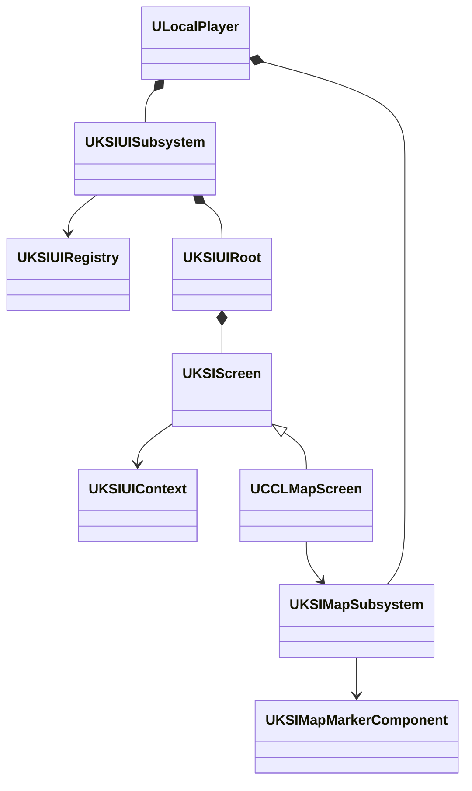

# Framework 단계 1

상위 문서는 [FrameworkPlan](../FrameworkPlan.md)이다.

## 단계 1 구현 범위와 검증 기준

2026-10-11 사용자의 착수 지시에 따라 `CCLEditor`, `KSIUI`, `KSIMap`을 분리하고 검증했다. 단계 2는 이 결과를 검토한 뒤 진행한다. 이번 변경의 기준은 `2930929aca25f32415b0e961f8f2d90172f4ce44`와 기존 미커밋 코드 보완을 포함한 작업 트리다.

UI는 LocalPlayer가 관리자와 화면 수명을 소유하며 CommonUI·UMG·Enhanced Input을 사용한다. MVVM은 CCL의 기능별 표시 모델에 남긴다. 지도도 LocalPlayer 범위의 관찰자 표시 데이터를 제공하며 KSIUI를 참조하지 않는다. 서버 권위·복제와 게임 화면 구성은 CCL이 소유한다. Editor 폴더의 제작 도구와 Details 등록은 CCL을 참조하는 Editor 모듈로 이동했다.

공개 함수의 동작을 유지하면서 타입과 헤더 접두사를 KSI로 바꾸고 모듈별 export와 CoreRedirects를 추가했다. 기존 에셋을 다시 저장하지 않은 상태에서 로드를 검증했다. UI·지도 각각의 최소 프로젝트에서는 CCL 코드·설정·콘텐츠 없이 공개 API를 실행했다. CommonUI 의존을 유지하면 기존 입력·풀 동작을 보존할 수 있지만 UI만 사용하는 프로젝트도 해당 플러그인을 활성화해야 한다.

검증은 프로젝트 파일 생성, Editor·Game·Server 대상 빌드, 자동 검사, UI 수명·입력·지도 통합 실행, 에셋 로드와 패키징을 포함한다. 실행 결과는 아래 표에 기록한다.

### 책임·의존과 공개 계약

| 모듈 | 책임·수명 | 직접 엔진 의존 |
|---|---|---|
| KSIUI | LocalPlayer 관리자, 화면·문맥·요청의 생성과 해제. 클라이언트 표현이며 자체 저장·복제 없음 | Public: Core, CoreUObject, Engine, GameplayTags, UMG, CommonUI, SlateCore. Private: Slate, InputCore, CommonInput, EnhancedInput |
| KSIMap | LocalPlayer별 공개 표식·지형 표시 데이터. ActorComponent가 거리·시야 공개 조건 제공. 자체 저장·복제 없음 | Core, CoreUObject, Engine |
| CCLEditor | 에디터 모듈 시작·종료에 Details 등록·해제. 제작 Library는 명시 호출로 실행 | CCL과 제작용 엔진 모듈. `Source/CCLEditor/CCLEditor.Build.cs` 참조 |

KSIUI와 KSIMap은 서로를 참조하지 않는다. 게임별 표시 모델, 지도 화면과 서버 권위는 CCL에 남는다. 지역 설정과 Registry는 호출자가 주입하고 공용 모듈은 `/Game/` 에셋 경로를 갖지 않는다. 지도 종류 enum의 Player·NPC·Enemy·Objective 항목은 기존 공개 계약으로 유지한다. 임의의 표식 종류를 추가하는 계약 변경은 이번 이동에 포함하지 않는다.



공개 계약의 타입 이름만 변경했다. UI 세부 동작은 [UIFoundation](../UIFoundation.md)이 소유한다.

```cpp
FKSIUIViewHandle OpenView(FGameplayTag View, UKSIUIContext* Context, UObject* Owner);
void CloseView(FKSIUIViewHandle View);
void SetRegion(UKSIMapRegionDefinition* Definition);
void Refresh(APlayerController* Observer);
```

게임은 화면·지역 정의를 제공하고 요청한 화면 핸들을 해제한다. 독립 검사도 같은 계약을 사용한다 (`Tools/Validation/FrameworkProbe/KSIProbe.cpp`).

```cpp
const FKSIUIViewHandle Handle = UI->OpenView(ViewTag, Context, Owner);
if (Handle.IsValid())
{
    UI->CloseView(Handle);
}
```

### 타입 이동과 호환

기존 파일 26개를 이동했다. KSIUI에 14개, KSIMap에 2개, CCLEditor에 10개다. 모듈 초기화 파일과 `Build.cs`는 별도로 추가했다. 이전 이름은 `Config/DefaultEngine.ini`의 클래스·구조체·enum 리다이렉트 32개로 받는다. enum은 한정 이름의 값도 변환한다. `UEnum::GetIndexByNameString`의 ValueChanges 적용은 UE 5.8.3 `<Engine>/Source/Runtime/CoreUObject/Private/UObject/Enum.cpp:970`에서 확인했다.

게임 전용 제작 Library는 CCL 접두사를 유지하고 `/Script/CCLEditor`로 이동했다. Editor 모듈이 사용하는 CCL 태그와 StateTree 작업의 export를 추가하고 직접 호출하는 엔진 모듈 의존을 선언했다. CCL은 CCLEditor를 참조하지 않는다.

모듈 종류·export·CoreRedirects는 UE4에도 있던 개념이다. 이번 구현의 기반인 CommonUI와 Enhanced Input의 현재 API·로드 동작은 UE 5.8.3에서 검증한다. 다른 UE 버전의 컴파일·동작 호환은 지원 범위로 확정하지 않았다.

### 단계 1 검증 결과

UE 5.8.3의 초기 작업 트리에서 아래 항목을 확인했다. 이 작업 트리는 기존 미커밋 코드 보완도 포함한다. 이번 제출본만 분리한 검증은 아래에 구분한다. 로그의 원본 경로는 저장소 상대 경로로 적었다. 검사에 복사한 KSIUI·KSIMap 소스는 현재 소스와 SHA-256이 일치한다. 에셋 파일은 수정하지 않았다.

| 검사 | 결과 | 근거 |
|---|---|---|
| 이동 전 UI 수명 기준 | 통과 | |
| 최종 프로젝트 파일 생성 | 성공 | |
| Editor·Game·Server Win64 Development | 모두 성공 | 같은 폴더의 |
| 초기 KSIUI 단독 프로젝트 | 화면 생성·해제와 내부 상태 검사 통과. 실제 입력 검증은 아래 보완 결과로 대체 |.log`, `module-sha256.json` |
| KSIMap 단독 프로젝트 | 표식 공개 조건·지역 지형·좌표 투영 통과. KSIUI·CCL 미로드 | |
| 전체 자동 검사 | 163개 성공, 경고·실패·미실행 0개 | |
| 타입·에셋 호환 | 32개 타입 경로·enum 값, 기존 패키지 454개와 구형 UI Blueprint 부모 로드 통과 | 위 보고서의 `CCL.Framework.MigratedTypes`, `CCL.Framework.ExistingAssets` |
| UI 수명·맵 이동·플레이어 격리 | 통과 | |
| 지도·연출 통합 | 지도 지형·표식·투영, 카메라·UI 복구 통과 | |
| 장비 UI·입력·중첩 연출·사망 정리 | 1280×720 통과 | |
| Dedicated 콘텐츠 회귀 | 서버, driver·witness·late의 상품·개인 상태 검사 통과 | |
| Windows Development 패키지 | Cook·Stage·Archive 성공 | |
| 패키지 UI 실행 | 1280×720 장비·입력·연출 검사 통과 | |
| 패키지 Listen 콘텐츠 회귀 | 호스트 driver·원격 witness·late의 상품·개인 상태 검사 통과 | |

Server 타깃은 빌드와 Editor의 Dedicated 실행으로 확인했으며 별도 WindowsServer 패키지는 만들지 않았다.

를 열어 지도 표식·지역 경계와 장비 화면의 글자·슬롯·미리보기를 확인했다. 화면의 최종 아트 품질이나 성능 개선을 판정한 검사는 아니다.

첫 빌드에서는 남아 있던 상대 include, DLL export와 제작 모듈의 직접 엔진 의존 누락을 수정했다. UI 검사에 남아 있던 "구형 저장은 즉시 최신 버전이 된다"는 기대값도 현재 코덱 계약에 맞췄다. 코덱은 슬롯 변환 후 버전 7을 유지하며 버전 8의 보급품 배치 변환은 캠페인 맵 정보가 필요하다. 저장 로직은 바꾸지 않았다. 신규 에셋 검사에서 두 번째 파일 검색이 첫 목록을 덮어쓰는 문제도 고친 뒤 454개 로드를 다시 확인했다.

독립 프로젝트 빌드 뒤 공유 엔진의 BuildId가 바뀌어 CCL 실행이 처음에는 플러그인 로드 전에 종료됐다. CCL Editor 빌드를 다시 실행해 메타데이터를 맞췄고, 검사 도구에도 ID가 달라지면 원래 Editor 타깃으로 복구하는 처리를 추가했다. 빌드와 동시에 시작한 UI 검사는 엔진 초기화 중 제한 시간을 초과했다. 빌드 종료 후 단독 실행은 통과했으며 초기화 대기를 UI 기능 실패와 구분했다.

### 독립 입력 검증 보완과 제출본 확인

재검토에서 초기 KSIUI 검사가 실제 입력 모드 적용 전에 내부 상태만 확인하고 PASS를 출력한 결함을 찾았다. 검사 프로젝트의 Enhanced Input 기본 클래스 설정도 빠져 `Null player input` 오류가 발생했다. 이 오류를 실패로 처리하지 않아 초기 입력 복구 완료 판정을 취소하고 검사를 보완했다.

검사 도구는 `DefaultInput.ini`에 EnhancedPlayerInput·EnhancedInputComponent를 지정하고 `DefaultGame.ini`에서 CommonUI의 Enhanced Input 연동을 활성화한다. CommonUI 연동을 끄면 Registry의 입력 매핑이 등록되지 않는다. 근거는 UE 5.8.3 `<Engine>/Plugins/Runtime/CommonUI/Source/CommonUI/Private/CommonActivatableWidget.cpp:319`의 `ActivateMappingContext`다.

UI 검사는 여러 프레임에 걸쳐 Registry의 매핑 활성화, 실제 라우터의 차단·복구와 Enhanced Input 액션 값을 확인한다. CommonGameViewportClient로 전달한 K 키의 액션 값이 차단 전 1, 차단 중 0, 해제 뒤 1이어야 한다. 컨트롤러 콜백 호출 횟수나 운영체제 키보드 입력 주입까지 검증하는 검사는 아니다. Enhanced Input·UIActionRouter 오류도 실행 실패로 처리한다.

| 검사 | 결과 | 근거 |
|---|---|---|
| 보완한 KSIUI 단독 실행 | 매핑 등록, 라우터·액션 값 차단과 복구, 화면 해제 통과 | |
| KSIMap 단독 회귀 | 통과 | |
| 입력 클래스 누락 재현 | 명시적 FAIL 출력, PASS 없음. 임시 설정은 검사 뒤 복원 | KSIUI 검사 폴더의 |
| 과거 오류 로그 판정 | 초기 거짓 성공 로그는 실패, 설정 보완 로그는 오류 없음으로 판정 | `Tools/Validation/run_framework_isolation.ps1`의 실제 오류 패턴으로 비교 |
| 제출본 프로젝트 파일 생성·Editor 빌드 | 성공 | |
| 제출본 전체 자동 검사 | 160개 성공, 경고·실패·미실행 0개. 기존 에셋 454개 로드 포함 | 같은 폴더의 `Submitted-Automation.json` |
| 제출본 UI 수명·맵 이동 | 통과 | 같은 폴더의 |

제출본은 기존 작업 트리를 덮어쓰지 않고 Git index에서 별도 검증 프로젝트로 내보냈다. Framework 1단계 코드·설정·검사 도구만 포함하며, 기존 콘텐츠·인벤토리·환경 보완과 다른 문서 작업은 포함하지 않는다. 검증 사본은 같은 이름의 원본 바이너리를 읽지 않도록 uproject 파일명만 고유하게 지정했다. 소스·모듈 이름과 descriptor 내용은 제출본을 유지했고, 실제 DLL 로드 경로를 확인했다. 초기 작업 트리의 자동 검사 163개와 달리 제출본에는 기존 로컬 보완의 검사 3개가 들어 있지 않아 160개를 실행했다.

### 사용·갱신 범위

검증한 엔진 범위는 UE 5.8.3 Windows다. 초기 공용 코드의 검증 식별자는 위 소스 manifest다. 이번 제출본은 별도 Git blob 목록으로 식별하며 두 공용 모듈의 소스 해시는 초기 검증과 같다. KSIUI의 소스 집계 SHA-256은 `56da02d9bf6e4677e039607cdb4815c4477921c6628285a611ef1e798db8bb93`, KSIMap은 `9ac28fb51c9fc6dec81190d9e5eba9fd84649e451a716cf8146509e76c51f1b2`다. 집계 입력은 manifest의 정렬된 상대 경로·파일 해시 쌍을 공백 없는 JSON으로 직렬화한 UTF-8 바이트다.

다른 프로젝트에서의 검증에는 모듈 소스를 해당 프로젝트의 Source 아래로 복사했다. 재현 도구는 `Tools/Validation/run_framework_isolation.ps1 -Module KSIUI` 또는 `-Module KSIMap`이다. 도구는 선택한 모듈, 최소 시험 모듈과 엔진 설정만 만든다. 실제 개인 프로젝트의 장기 배포·동기화는 아직 시작하지 않았다.

공용 모듈을 갱신할 때에는 선택 모듈의 단독 실행, 사용하는 게임의 회귀와 원본 에셋 로드를 함께 확인한다. 네이티브 타입을 옮기거나 이름을 바꾸면 기존 CoreRedirects를 유지하고 새 변환을 추가한다. 코드·설정·도구의 제출과 문서 제출은 별도이며, 현재 코드의 원격 공개 여부는 완료 보고에서 구분한다. 단계 2는 이번 결과를 검토한 뒤 착수한다.
