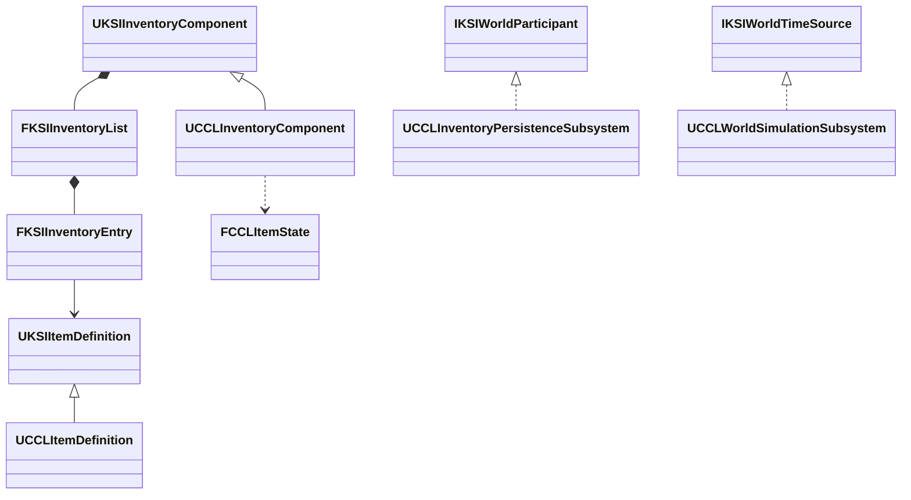

# Framework 단계 2

상위 문서는 [FrameworkPlan](../FrameworkPlan.md)이다.

## 단계 2 구현 설계와 검증 기준

사용자 지시에 따라 `KSICore`의 저장 참여·구간 등록·시간 읽기 계약과 `KSIInventory`의 기본 정의·보관 추출을 완료했다. 기준 소스는 `996bf49a0ca3ff5e1fe309675addc2bb37434616` 이후의 로컬 보완을 포함한다. 설계 근거는 결정 24다. 실행 검증의 완료 여부는 아래 기록에서 구분한다.

공용 인벤토리는 ActorComponent 수명, 서버 변경 권한, 소유자 대상 Fast Array 복제, GUID·수량·슬롯과 확장 상태를 소유한다. CCL 파생 클래스가 음식·탄약 검증, 환경 관측, 장비 트랜잭션과 기존 저장 형식을 연결한다. 게임 클래스의 경로를 유지하고 이동하는 공용 구조체에는 CoreRedirects를 적용한다.



공용 정의의 `FindFragment<T>()`, 인벤토리의 `Add`, `Remove`, `MoveToSlot`, `TransferTo`, `Capture`·`RestoreSnapshot`을 기본 계약으로 둔다. `FInstancedStruct` 확장 상태의 의미와 검증은 파생형이 맡는다. 공용 저장 참여 문맥은 게임별 검증 자료를 선택적으로 받고 표면·생활 타입을 직접 포함하지 않는다. 시간 읽기는 값 스냅샷 인터페이스를 사용하며 구체 시계의 진행 구현은 CCL에 남긴다.

파생형 연결은 기존 게임 타입과 저장 호환을 유지하기 쉽지만 기본 규칙과 게임 규칙의 회귀 검사를 각각 요구한다. 전역 기능 등록 방식은 여러 확장을 교체하기 편하지만 등록 수명과 로드 순서 의존이 늘어 현재 단계에는 사용하지 않는다. UE 5.8.3의 `FInstancedStruct`와 Fast Array를 사용하며 UE4 호환은 검증 범위에 포함하지 않는다.

예상 결과는 KSICore 단독 빌드, KSICore·KSIInventory만 사용하는 두 상자의 보관·이동·저장·복원 성공, 기존 에셋 로드와 장비·소비·탄약·음식·저장 회귀 통과다. 최종 소스에서 프로젝트 파일 생성과 Editor·Game·Server 빌드를 구분해 기록한다.

### 책임과 공개 계약

| 모듈·어댑터 | 상태 소유자와 수명 | 권위·저장·의존 |
|---|---|---|
| KSICore | 계약 값은 호출자가 소유한다. 구간 등록 객체의 수명이 검증 콜백 수명이다 | Core·CoreUObject. 자체 Tick·세계 상태·복제 없음 |
| KSIInventory | Actor가 컴포넌트를 소유한다. 각 항목이 GUID·수량·슬롯·확장 상태를 값으로 소유한다 | Core·CoreUObject·Engine·NetCore·KSICore. 서버 변경, 소유자에게만 복제 |
| UCCLItemDefinition | 에셋이 음식·장비·전투 Fragment와 옛 에셋 변환을 소유한다 | 기본 정의를 상속하고 기존 `/Script/CCL.CCLItemDefinition` 경로 유지 |
| UCCLInventoryComponent | Actor 수명에 맞춰 환경 관측·영속 보관함 연결·게임 검증을 수행한다 | 공용 보관을 상속하며 저장 참여와 장비 복원은 기존 CCL 서비스가 조합 |
| UCCLWorldSimulationSubsystem | World가 실제 시계·세계 상태와 진행을 소유한다 | `IKSIWorldTimeSource`로 확정된 시각만 제공. 환경 의존의 진행 계약은 CCL 유지 |

공용 항목은 `FKSIInventoryEntry::State`를 통해 선택 기능의 상태를 보관한다. CCL은 `FCCLItemState`에 탄약과 음식 상태를 둔다. 기존 세션·세계 codec은 같은 필드와 버전으로 이 값을 읽고 쓴다. 기존 저장 레코드의 `Food`·`LoadedAmmo`를 공용 항목의 리플렉션 필드로 남기지 않는다. 구체 클래스가 같은 네이티브 타입으로 남으므로 일반 DataAsset의 PrimaryAssetId도 유지한다. UE 5.8.3 `UPrimaryDataAsset::GetPrimaryAssetId`의 일반 에셋 경로는 실제 클래스 이름과 객체 이름을 사용한다 (`<Engine>/Source/Runtime/Engine/Private/DataAsset.cpp`, 앵커 `FPrimaryAssetId(GetClass()->GetFName(), GetFName())`).

```cpp
bool UKSIInventoryComponent::TransferTo(FGuid Id, int32 Quantity, UKSIInventoryComponent& Destination);
bool UKSIInventoryComponent::Capture(TArray<uint8>& OutBytes) const;
bool UKSIInventoryComponent::RestoreSnapshot(
    const TArray<uint8>& Bytes,
    TFunctionRef<UKSIItemDefinition*(const FString&)> ResolveDefinition);
```

상자 사이 이동은 양쪽 후보를 먼저 검증하고 함께 확정한 뒤 알림을 보낸다. 알림 동안 양쪽 변경을 잠가 재진입을 거부한다. 부분 이동은 새 GUID를 만들고 전체 이동은 GUID를 유지한다. 목적지에는 빈 슬롯이 필요하며 기존 중첩과 자동 합치지는 않는다. 음식처럼 수량 변경에 별도 의미가 있는 상태는 CCL의 기능별 이동 함수를 사용한다.

```cpp
TMap<FString, UKSIItemDefinition*> Catalog;
Catalog.Add(Definition->GetPrimaryAssetId().ToString(), Definition);
TArray<uint8> Saved;
if (Box.Capture(Saved))
{
    const auto Resolve = [&Catalog](const FString& Id) -> UKSIItemDefinition*
    {
        return Catalog.FindRef(Id);
    };
    Box.RestoreSnapshot(Saved, Resolve);
}
```

기본 저장 파일은 버전·용량·항목 수와 정의 식별자를 기록하며 입력 길이를 제한한다. 서로 다른 정의가 같은 PrimaryAssetId를 사용하면 저장을 거부한다. 정의 조회 함수가 항목을 직접 불러오며 공용 codec은 임의 에셋 경로를 로드하지 않는다. 복원 중 조회 함수의 재진입도 거부한다. 기본 `EncodeState`·`DecodeState`는 비어 있는 상태만 허용하며 다른 게임은 필요한 타입 검증과 직렬화를 구현해야 한다. CCL의 세계·세션 저장은 기존 codec을 계속 사용한다.

이동한 구조체 `CCLInventoryEntry`, `CCLInventoryList`, `CCLItemFragmentData`는 `/Script/KSIInventory`의 KSI 이름으로 연결한다. 장비·음식 Fragment와 게임 클래스는 CCL에 유지하므로 해당 타입에는 새 리다이렉트를 만들지 않는다. 런타임 항목의 구조체 필드를 통째로 저장한 외부 파일은 지원 대상으로 추가하지 않았다.

### 실행 결과와 재현 범위

UE 5.8.3, Win64 Development에서 아래 최초 로컬 검증 결과를 확인했다. 이후 패키지 실행에서 발견한 서버 글꼴 로딩 수정과 최종 검증·제출 범위는 다음 절을 따른다. 변경 전 작업 트리의 기존 보완을 포함한 검사로, 깨끗한 원격 커밋만의 결과가 아니다. 이번 변경의 파일 목록은 , 검증 소스 해시는 같은 폴더의 `worktree-sha256.json`과 `module-source-manifest.json`에 있다. 로그의 기기별 절대 경로는 아래에서 저장소 상대 경로로 표기했다.

| 검사 | 결과 | 근거 |
|---|---|---|
| 변경 전 자동 검사 | 163개 성공, 경고·실패 0 | |
| 최종 프로젝트 파일 생성 | 성공 | |
| 최종 Editor·Game·Server 빌드 | 세 타깃 성공 | 같은 폴더의 |
| KSICore 독립 실행 | CCL·Inventory 없는 구간 검증, 등록 해제와 외부 시각 읽기 성공 | |
| KSIInventory 독립 실행 | 두 상자의 보관·부분/전체 이동, 파일 왕복, 콜백 재진입 거부, 잘린 입력·후행 바이트·알 수 없는 정의·중복 정의 식별자 거부 성공 | |
| 최종 CCL 자동 검사·에셋 | 163개 성공, 경고·실패 0. 원본 패키지 454개를 재저장 없이 로드. 추가 구조체 리다이렉트 확인 |, 같은 검사 폴더의 |
| 장비 복원 | 새 프로세스에서 장비·플레이어 저장 복원 성공 | |
| 탄약·투사체 | 재장전·발사와 세션 codec의 탄약 보존 성공 | |
| 음식·환경·픽업 | 새 프로세스 음식 복원·노화 연속성, 환경 연결과 픽업 회수 성공 | |
| 분리 전 저장 파일 | 2026-10-10 저장의 세계 시각 `116.096656`, 음식 CRC `2407150248` 일치와 후속 노화 성공 |. 원본은 |
| 확장 상태 네트워크 | 전용 서버·클라이언트 2개에서 음식·탄약의 타입·값·변경 알림, 소유자 전용 복제, 클라이언트 변경 거부와 늦은 접속 성공 | |
| UI 수명·세션 | 화면 수명·맵 이동과 네트워크 세션 저장·복원 성공 | |
| 장비·소비·성장 네트워크 | 전용 서버의 동작과 재스폰 뒤 인벤토리·장비·훈련 유지 성공 | |
| 화면 조작 | 1280×720의 장착·이동·소비·세션·대화 조작 검사 성공. 장비 화면 캡처 확인 |, 같은 폴더의 |

독립 검사에 복사한 KSICore와 KSIInventory 소스는 최종 원본과 바이트 단위로 일치한다. 두 모듈의 헤더·구현·Build.cs에는 CCL·전투·음식·환경 타입 참조가 없다. 재현 명령은 `Tools/Validation/run_framework_isolation.ps1 -Module KSICore`와 `-Module KSIInventory`다. 독립 프로젝트는 CCL 설정·맵·에셋을 복사하지 않는다. 확장 상태 복제는 `Tools/Validation/run_inventory_network.ps1`로 재현한다.

최종 실행 검사는 빌드 종료 뒤 순서대로 수행했다. 빌드와 동시에 시작한 UI·이전 저장 검사에서는 게임 검사에 도달하기 전 엔진 시작 단계의 대기·시간 초과가 있어 성공 근거에서 제외했다. 소스 엔진을 공유하는 독립 빌드 뒤에는 UBT로 CCL 메타데이터를 복구했다. 이 최초 검사에는 패키징·패키지 실행을 포함하지 않았다. 다른 UE 버전, Iris 전환과 실제 두 번째 프로젝트의 장기 배포도 검증하지 않았다. 단계 3-4는 별도 검토 대상으로 유지한다.

### 패키지 검증과 제출 범위

2026-10-12 Windows Development의 Game·Server 패키지 생성과 실행 검증을 완료했다. 상세 실행 결과, 남은 쿠킹 경고와 재현 명령은 [Framework 분리 후 Game·Server 패키지](../Packaging/Records.md#framework-분리-후-gameserver-패키지)가 소유한다. 처음 패키지에서 발견한 화면용 글꼴의 서버 생성자 로딩을 수정한 뒤 프로젝트 생성·Editor 빌드·163개 자동 검사와 패키지 회귀를 다시 확인했다.

제출 범위는 `KSICore`, `KSIInventory`, CCL 어댑터와 호출부, 모듈·리다이렉트 설정, 독립·복제·음식 검사 도구다. 분리의 기반으로 사용한 [코드 설계 후속 보완](../ProgressionFoundation/Verification.md#2026-10-11-설계-후속-수정)의 장비 알림·카탈로그·음식/무기 서비스·선택적 시간 진행·표면 공유 발행본과 해당 회귀 도구도 함께 포함한다. 기존 `Guide.md`의 설계 초안 링크와 미추적 `CodeStructurePlan.md`는 이 제출에서 제외한다. 에셋은 수정하거나 재저장하지 않았다.

독립 검사 뒤 공용 모듈 소스는 바뀌지 않았으며, 최종 패키지 검사에는 서버 생성자 보완까지 포함한다. 단계 3-4는 착수하지 않았다.
