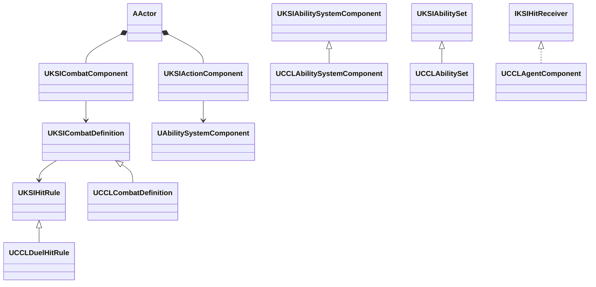

# Framework 단계 3

상위 문서는 [FrameworkPlan](../FrameworkPlan.md)이다.

## 단계 3 구현과 검증

2026-10-12 `KSICombat` 분리와 AbilitySystem·Actions 정리를 완료했다. [결정 25](../decisions/0025-shared-combat-split.md)의 경계를 적용했으며 기준 커밋은 `dbdd174dcdae6019918ae2dfb1c4c64c9d732eab`이다. 공용 판정은 특정 캐릭터·인벤토리·Agent를 요구하지 않는다. 피해·팀·스태미나·가드·패링과 무기·탄약은 CCL이 연결한다.

### 책임·수명과 의존

`Source/KSICombat/`의 직접 의존은 Core·CoreUObject·Engine·GameplayAbilities·GameplayTags·GameplayTasks다. 다른 KSI 모듈, CCL, Mass·StateTree와 `/Game/` 에셋 경로를 참조하지 않는다. CCL과 제작 모듈 CCLEditor는 KSICombat을 직접 의존한다. 정의 에셋과 게임 정책의 소유자는 CCL이다.

| 구성 | 책임·소유자 | 권위·종료 |
|---|---|---|
| `UKSICombatComponent` | 공격 Actor가 공격 ID·방향·대상별 적중 기록을 보유 | 서버만 판정. EndAttack·EndPlay에서 정리 |
| `UKSICombatDefinition`·`UKSIHitRule` | 공유 정의의 거리·반경·정책과 상태 없는 CDO의 Resolve·Commit | 정책은 동기 호출. Resolve는 상태를 바꾸지 않음 |
| `KSIHit::Apply`·`IKSIHitReceiver` | GAS 효과 적용 후 정책 확정·대상 컴포넌트 통지 | 서버에서 현재 Avatar·월드를 검증. 별도 저장·복제 없음 |
| `UKSIAbilitySystemComponent`·`UKSIAbilitySet` | 태그 입력·해제·효과 적용과 능력·AttributeSet 부여 | ASC 소유자는 게임이 선택. 기본 효과 복제는 Mixed, 게임이 변경 가능 |
| `UKSIActionComponent`·`UKSIActionSet` | Actor가 GUID별 정의·AbilitySpecHandle을 등록 | 등록·실행·제거는 서버. 제거·EndPlay에서 취소와 ClearAbility |

Action의 Source 목록은 자체 복제하지 않는다. 태그 입력은 UKSIAbilitySystemComponent의 기존 GAS 능력과 예측 경로를 사용한다. 직접 Source 실행은 서버 전용이며 별도 클라이언트 RPC를 추가하지 않았다. CCL의 플레이어 ASC는 계속 PlayerState에, 적 ASC는 적 Actor에 둔다. 재스폰·저장 정책도 CCL이 소유한다.



### 공개 계약과 게임 확장

공용 계약은 다음과 같다. 전체 선언은 `Source/KSICombat/Public/`에 있다.

```cpp
uint32 BeginAttack(const UKSICombatDefinition* Definition, const FVector& Direction);
FGameplayTag ResolveHit(AActor* Target, const FHitResult& Hit, uint32 AttackId);
void EndAttack();
FGameplayTag KSIHit::Apply(const FKSIHitContext& Context);
bool RegisterSource(FGuid Id, UObject* Definition, const TArray<FKSIActionGrant>& Grants);
void UKSIAbilitySet::GrantTo(UAbilitySystemComponent& ASC, UObject* Source) const;
```

공용 컴포넌트의 질의는 기존 수평 방향 구체 스윕과 ECC_Pawn·ECC_Visibility 채널을 유지한다. 같은 공격의 중복 대상, 끝난 공격, 이전 Avatar, 거리·차폐 오류를 거부한다. 잘못된 반경·방향과 판정 콜백에서 새 공격을 시작하는 재진입도 거부한다. 공격 취소는 허용하므로 패링의 EndAttack 경로를 보존한다. 효과가 거부된 대상도 해당 공격에서는 예약을 소비하며 반복 적용하지 않는다.

정책은 결과 태그와 적용할 효과·Magnitude를 반환한다. 결과 태그가 없거나 GAS가 효과를 거부하면 Commit·ReceiveHit을 실행하지 않는다. 직접 `KSIHit::Apply`를 사용하는 발사체는 중복·거리·충돌 검사를 호출자가 맡는다. 이 함수 자체가 공격별 중복 기록을 갖지는 않는다. 효과 적용 경로의 성공 검사는 다음과 같다.

```cpp
const auto Applied = Context.SourceASC
    ? Context.SourceASC->ApplyGameplayEffectSpecToTarget(*Spec.Data, Context.TargetASC)
    : Context.TargetASC->ApplyGameplayEffectSpecToSelf(*Spec.Data);
if (!Applied.WasSuccessfullyApplied())
{
    return {};
}
```

UE 5.8.3의 `FActiveGameplayEffectHandle`은 Instant 효과의 IsValid가 거짓이어도 WasSuccessfullyApplied가 참일 수 있다고 명시한다 (`<Engine>/Plugins/Runtime/GameplayAbilities/Source/GameplayAbilities/Public/ActiveGameplayEffectHandle.h:43-59`). 적용 함수도 Instant 실행 핸들을 기본 성공값으로 만든다 (`Private/AbilitySystemComponent.cpp:1070`, 같은 모듈). 핸들 유효성만으로 피해 성공을 판단하지 않는다.

발사 당시의 팀은 CCL의 `FCCLHitSourceFacts`에 둔다. `FKSIHitContext::SourceFacts`가 FInstancedStruct 값으로 전달하며 공용 모듈은 내용을 해석하지 않는다. 문맥은 동기 호출 범위에서만 사용한다. 분리된 발사체의 캡처 효과·방향과 팀은 CCLProjectile이 채우고, UCCLDuelHitRule이 방어·팀 규칙을 결정한다. CCL ASC 파생형은 사망 입력 차단과 Data.Magnitude 태그를 공급한다. 무기 실행과 인벤토리 연결은 `Source/CCL/Actions/CCLWeaponAbility.cpp`에 남는다.

### 타입·에셋·저장 호환

CCLCombatComponent·CCLActionComponent·CCLActionSet·CCLHitRule·CCLHitReceiver와 ActionGrant·ActionSource·AbilityGrant 구조체를 KSI 이름으로 옮겼다. Config의 CoreRedirects와 `CCL.Framework.MigratedTypes`가 이전 타입 경로를 확인한다. C++ 전용 HitContext·HitResolution에는 리플렉션 리다이렉트가 필요하지 않다.

UCCLCombatDefinition·UCCLAbilitySystemComponent·UCCLAbilitySet은 게임 파생형으로 유지해 기존 네이티브 경로를 보존한다. 원본 에셋을 다시 저장하지 않고 전체 패키지를 로드했으며, `CCL.Framework.CombatAssets`로 부모에 옮긴 공격 거리·반경·정책과 Action 에셋의 발사 능력을 확인했다. ActionSet의 네이티브 클래스 이름은 KSIActionSet으로 바뀐다. 이를 문자열 PrimaryAssetId로 별도 저장하는 외부 사용자는 추가 변환이 필요하며, CCL의 기존 저장은 이 식별자를 기록하지 않는다.

전투 실행 핸들·공격 ID는 디스크 저장 대상이 아니다. CCL의 장비·탄약·세계·세션 저장 형식은 변경하지 않았다. 장비는 새 프로세스 복원으로, 탄약은 기존 codec과 투사체 검사로 확인했다.

### 실행 근거와 한계

UE 5.8.3, Win64 Development에서 아래 항목을 확인했다. 로그 경로는 저장소 기준이다. 정적 의존 검사와 독립 소스 대조는 `static-validation.json`을 따른다.

| 검사 | 결과 | 근거 |
|---|---|---|
| 프로젝트 파일 생성·Editor 빌드 | 성공 | |
| KSICombat 독립 빌드·실행 | 함정·표적, GAS 거부·재진입·차폐·캡처 효과·Action 수명 27개 확인 | |
| CCL 자동 검사·원본 에셋 | 164개 성공, 검사 경고·실패 0. 원본 패키지 454개 로드 |, 같은 폴더 |
| 전투 네트워크·재스폰 | Standalone, Dedicated 지연·손실, Listen 원격·호스트 통과 | |
| 게임 연결 | 투사체·Agent 피격 기억·새 프로세스 장비 복원·Dedicated 성장 통과 | 같은 폴더의 |
| Game·Server 패키지 | 생성·실행과 UI 검증 통과 | [전투 모듈 패키지 검증](../Packaging/Records.md#전투-모듈-분리-후-패키지) |

독립 프로젝트에 복사한 KSICombat 소스는 실행 검사 시점의 CCL 소스와 바이트 단위로 같다. 제출 직전 KSIHitRule.h 끝의 빈 줄 하나만 제거했고 선언·실행 코드는 그대로다. 이 차이는 `post-validation-formatting.json`에 기록했으며 프로젝트 생성·Editor 빌드를 다시 확인했다. 재현은 `Tools/Validation/run_framework_isolation.ps1 -Module KSICombat`이다. 이 프로젝트는 CCL·Inventory·UI 코드·콘텐츠를 복사하지 않고 GameplayAbilities만 활성화한다. 전체 자동 검사는 `Tools/Validation/run_automation.ps1 -Filter 'CCL.'`로 실행한다.

첫 Editor 링크에서 제작 도구의 KSICombat 직접 의존 누락을 고쳤다. Listen 원격 검사에서는 준비 중 적 AI가 호스트를 죽이는 간섭이 있어 검사 대기부터 AI를 정지시켰다. 수정 후 관찰자 생존 조건을 유지한 네 가지 구성을 다시 통과했다. 투사체 도구의 단일 인자 배열 변환도 보완했다. 이 실패들과 모듈 DLL 생성 전 시작해 결과가 없던 자동 검사 시도는 성공 근거에서 제외했다. 최초 분리 전 전체 검사 결과를 새로 확보했다는 뜻은 아니다.

자동 검사 시작 전에는 기존 실행에서도 보인 `Condition failed` 진단이 15줄 남았다. 일부 Editor 게임 프로세스에는 EditorToolset·ToolsetRegistry의 `AgentSkill`·`PythonTestRunner` Python 초기화 오류도 있다. 164개 테스트의 결과 JSON과 이 시작 진단을 구분하며, 전체 Editor 로그가 오류 없이 실행됐다는 뜻은 아니다.

GAS와 모듈·리다이렉트는 UE4에도 있던 개념이다. 이번 API·실행 검증 범위는 UE 5.8.3이다. GAS를 필수로 유지하면 기존 예측과 효과 수명을 재사용하지만, GAS가 없는 프로젝트에도 그대로 사용할 수는 없다. 범용 효과 전달 인터페이스를 추가하는 대안보다 공개 경계가 작고 현재 동작을 보존하기 쉬워 이 구성을 택했다. 성능 개선, Shipping·다른 UE 버전·Iris·다른 PC의 호환은 주장하지 않는다. 단계 4와 공용 저장소 배포는 착수하지 않았다.
