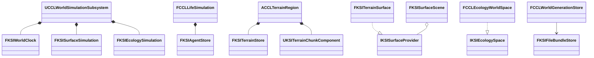

# Framework 단계 4

상위 문서는 [FrameworkPlan](../FrameworkPlan.md)이다.

## 단계 4 구현과 검증

2026-10-12 기준 커밋 `35ab176c3dd840a8d28f50c30e1f91d717730986`에서 시간·천체·지형·Agent·환경 계산과 저장 파일 묶음을 6개 공용 모듈로 분리했다. 공용 계산과 게임의 원자적 확정 경계를 분리하고 기존 에셋·저장 형식을 유지한다. 경계의 근거는 [결정 26](../decisions/0026-shared-world-computation-split.md)다.

### 책임과 의존

| 모듈 | 소유 책임과 수명 | CCL에 남는 연결 |
|---|---|---|
| KSIWorldTime | 값으로 복사하는 시계, 준비·확정 티켓과 대기 시간 구간 | WorldAdvance의 전체 후보 확정 |
| KSICelestial | 정의 DataAsset, 천체 위치·현지 관측 계산 | 월드 설정·관측자 선택·하늘 표현 |
| KSITerrain | 밀도 저장·codec·메시·충돌 준비 컴포넌트 | Region 권위·복제·세계 세대·물·내비게이션 게시 조정 |
| KSIAgent | ID·Feature·Store·Handle·Lease, 원자적 배치 교체 | 생물·성격·경제·생활·Actor/Mass·StateTree, 기존 SaveGame 클래스 |
| KSIEnvironment | 공기·연소·날씨·눈·표면·식생·생태 계산과 경로 질의 계약 | UWorld 내비게이션 구현, 표현·복제·Agent 연결 |
| KSISave | 완료 마커를 마지막에 게시하는 불변 파일 묶음과 복구 | 세계·지형 형식 해석, 도메인·동일 세대 검증 |

KSICore에는 지형과 환경이 함께 쓰는 SurfaceQuery 계약·기본 scene을 둔다. KSIWorldTime과 KSITerrain은 KSICore를, KSIEnvironment는 KSICore·KSICelestial을 참조한다. KSIEnvironment는 시계 구현 모듈에 의존하지 않고 KSICore의 `FKSIWorldStep`을 입력받는다. KSIAgent·KSICelestial·KSISave는 다른 KSI 모듈을 요구하지 않는다. 6개 모듈과 KSICore에서 CCL 식별자·`/Game/` 참조가 없음을 확인했다.

엔진 직접 의존은 각 `Build.cs`가 정본이다. KSISave는 Core, KSIWorldTime은 Core와 KSICore를 사용한다. KSICelestial은 Core·CoreUObject·Engine, KSIAgent는 여기에 GameplayTags를 사용한다. KSITerrain은 GeometryFramework·GeometryCore를 공개 의존으로, PhysicsCore·Chaos·ChaosCore를 비공개 의존으로 추가한다. KSIEnvironment는 Core·CoreUObject·Engine을 사용한다. KSIAgent에 Mass·StateTree·GAS 의존을 추가하지 않았다.



공용 계산 객체는 자체 RPC나 전역 Subsystem을 만들지 않는다. 호스트가 객체를 소유하고 서버 권위·저장 시점·복제를 선택한다. `CCLWorldAdvance::Advance`는 시계·표면·생태·생활 후보 전체가 성공한 뒤 한 번만 확정한다. TerrainRegion은 충돌 준비 뒤 점유·권위·revision을 재검증한다. Agent Lease는 Store 세대와 작성자 epoch를 검사하며 실행 Actor 수명과 분리한다. Agent Store의 변경은 기존 게임 스레드 계약을 유지한다.

### 공개 API와 저장 호환

[시계](../../Source/KSIWorldTime/Public/KSIWorldClock.h)는 QueueGameTime·Prepare·Commit·Abort·Capture·Restore를 제공한다. 아래는 [독립 실행 검사](../../Tools/Validation/FrameworkProbe/World/KSIWorldProbe.cpp)의 UE 5.8.3 예제다. `Check`는 같은 파일에서 성공 여부를 누적하는 람다이며 `Error`는 FString이다.

```cpp
FKSIWorldClock Clock;
FKSIWorldStep First, Retry;
Check(Clock.QueueGameTime(1, false, Error) && Clock.Prepare(1, 15, First, Error), TEXT("bounded prepare"));
Check(Clock.GetWorldSeconds() == 0. && First.WorldToSeconds == 15., TEXT("prepare is unpublished"));
Check(Clock.Abort(First.Ticket, Error) && Clock.Prepare(1, 15, Retry, Error), TEXT("retry pending time"));
Check(!Clock.Commit(First.Ticket, Error) && Clock.Commit(Retry.Ticket, Error), TEXT("stale ticket rejected"));
```

[파일 묶음 저장소](../../Source/KSISave/Public/KSIFileBundleStore.h)의 Write는 루트 바이트·GUID별 부분 바이트·형식·검증 콜백을 받는다. Recover는 같은 형식과 콜백으로 읽고 `FKSIFileBundle`을 반환한다. 콜백은 동기적으로 호출되고 부수 효과 없이 내용의 의미를 검증하며 Generation을 돌려준다. 복구 순위는 폴더 이름이 아니라 검증된 내용의 Generation으로 결정한다.

루트 64MiB, 부분 파일 32MiB, 전체 256MiB와 최대 64개 부분 파일을 허용한다. 경로 이름·용량·GUID·CRC·완료 마커는 KSISave가 검사한다. CCL 어댑터는 기존 `world.bin`, magic `0x43434c47`, marker Version 1과 지형 파일명을 유지하고 세계 ID·버전·세대·시각·도메인을 검사한다. 의미 검증 실패와 불완전한 최신 세대는 이전 유효 세대 복구로 이어지며 실패 시 호출자의 결과를 교체하지 않는다. 파일 Flush·마커 rename은 완료 게시 경계이며 전원 장애 시 디스크 내구성을 보장한다는 뜻은 아니다.

`UCCLAgentSnapshot`은 게임에 남겨 기존 SaveGame 클래스 경로를 유지한다. 이동한 반사 타입 20개는 CoreRedirects와 enum ValueChanges로 연결했다. 천체 정의·지형 컴포넌트·표면·환경 관측·Agent 구조체의 이전 경로와 값을 검사했다. 세계·지형·Agent 저장 버전을 바꾸지 않았으며 Content 파일은 분리 전 해시와 같다.

### 코드 위치의 전후 비교

아래 표는 이동 전 파일 이름과 현재 모듈이다. CCL의 게임 연결과 기존 자동 검사 파일은 원래 폴더에 남는다. 각 모듈의 Public은 공개 헤더, Private은 구현이다.

| 이동 전 이름 | 현재 소유와 진입점 |
|---|---|
| CCLWorldClock | [KSIWorldTime](../../Source/KSIWorldTime/Public/KSIWorldClock.h) |
| CCLCelestialSystem | [KSICelestial](../../Source/KSICelestial/Public/KSICelestialSystem.h) |
| CCLTerrainStore·Codec·Mesher·ChunkComponent·Surface | [KSITerrain](../../Source/KSITerrain/Public/KSITerrainStore.h) |
| CCLSurfaceQuery | [KSICore](../../Source/KSICore/Public/KSISurfaceQuery.h) |
| CCLAgentTypes | [KSIAgent](../../Source/KSIAgent/Public/KSIAgentTypes.h) |
| CCLAirSimulation·CombustionModel·WeatherModel | [KSIEnvironment](../../Source/KSIEnvironment/Public/KSIAirSimulation.h) |
| CCLSurfaceSimulation·SnowSimulation·SurfaceFire·SurfaceVegetation | [KSIEnvironment](../../Source/KSIEnvironment/Public/KSISurfaceSimulation.h) |
| CCLEcologySimulation·Advance·Behavior·Nutrition | [KSIEnvironment](../../Source/KSIEnvironment/Public/KSIEcologySimulation.h) |
| CCLEnvironmentInputs·EnvironmentView | [KSIEnvironment](../../Source/KSIEnvironment/Public/KSIEnvironmentInputs.h) |
| CCLEcologySpace의 경로 계약 | [IKSIEcologySpace](../../Source/KSIEnvironment/Public/KSIEcologySpace.h). UWorld 구현은 CCL에 유지 |
| CCLWorldGenerationStore의 파일 게시·복구 | [KSISave](../../Source/KSISave/Public/KSIFileBundleStore.h). 게임 형식 검사는 CCL에 유지 |

이동할 때 명시한 이름·include·API 매크로를 되돌린 코드와 원본을 대조했다. 지형의 진단 로그는 게임 명령행 조건을 제거하고 일반 Verbose 로그로 바꿨다. DLL 경계에서 호출하는 `KSISurfaceFire`·`KSISurfaceVegetation`의 자유 함수에는 export를 추가했다. CCLEditor가 직접 사용하는 Agent 구조체 때문에 KSIAgent를 직접 링크한다. 환경이 시계 구현에 기대던 간접 include는 시간 계약 헤더로 바꾸고 실제 시계를 쓰는 게임 검사에 직접 include를 추가했다.

### 독립 실행과 CCL 회귀

UE 5.8.3, Win64 Development에서 CCL 모듈 소스·콘텐츠·설정이 없는 프로젝트 6개를 빌드하고 실행했다. 필요한 하위 모듈만 복사했다. 각 결과의 빌드·게임 로그와 모듈 해시를 대조했고 공용 소스를 실행 시점의 원본 해시와 대조했다. 제출 정리에서는 KSIEcologySpace.h 끝의 빈 줄 하나만 제거했고 의미 있는 코드 변경은 없다.

| 모듈 | 성공 항목 | 핵심 확인 |
|---|---|---|
| KSIWorldTime | 5 | 미게시 준비·취소·오래된 티켓·대기 시간 복원 |
| KSICelestial | 4 | 외부 시각의 궤도 계산·잘못된 정의 원본 보존 |
| KSITerrain | 6 | 권한 있는 편집·후보 확정·재사용 거부·저장 복원 |
| KSIAgent | 7 | 삶 Feature 없는 개체·단일 Writer·반납·복원 세대 |
| KSIEnvironment | 6 | 게임 Subsystem 없는 물 보존·저장·중복 구간 거부 |
| KSISave | 9 | 불완전·손상 세대 복구·의미 거부·출력 보존·파일명 충돌 거부 |

총 37개 항목이다. 최초 WorldTime·Celestial 독립 빌드와 실행 뒤 CCL 메타데이터 복원에서 누락 include가 드러났다. 의존을 보완한 뒤 후속 독립 실행과 최종 CCL 빌드로 복원했다. 초기 도구 호출 전체가 종료 코드 0이었다고 판정하지 않는다.

분리 전 전체 자동 검사와 최종 자동 검사는 각각 164개 성공, 경고·실패·미실행 0이다.

기존 콘텐츠 454개 로드와 타입 이동 검사를 통과했다. 작업 전에 보존한 이전 저장에서 세대 31, 세계 시각 20.925562173초, 지형 1개를 복구했다. 세계의 시간·생활·표면·생태 복원과 지형 재직렬화 바이트 일치를 확인했다. 근거는 최종 보고서의 `CCL.Environment.Save.GenerationRecovery`와 `CCL_LEGACY_GENERATION` 기록이다.

월드 Dedicated, 지형 편집·복제·맵 왕복, Agent 저장, 생태 행동·Actor/Mass·공간 경로, 환경 새 프로세스 재개·맵 이동과 Listen 지연 80ms·손실 2%·재접속 검사를 통과했다. 테스트 Subsystem 보완 뒤 전체 자동화와 해당 생태 검사를 재실행했다. 변경하지 않은 앞선 월드·지형·Agent 실행은 해당 검증 시점의 결과다.

### 기존 실행 검사에서 보완한 조건

TerrainTravel의 경제 비교 실패는 이전 단계 3 패키지에서도 재현됐다. 복원한 프로필로 AccountId를 다시 연결하기 전 생성된 임시 계좌를 검사기가 식별하지 못했다. AccountComponent에는 서버가 처음 생성한 ID·잔액의 읽기 전용 이력만 추가했다. 복제·직렬화·거래 동작은 바꾸지 않았다. 검사기는 실제 플레이어가 생성한 계좌의 모든 필드가 초기값과 같을 때만 추가 계좌로 구분한다. 저장된 계좌·알 수 없는 계좌·값이 바뀐 계좌는 계속 실패한다. Players 구간도 현재 저장 참여 계약으로 포착해 세계·인벤토리·지형 바이트와 충돌을 비교한다.

생태 표현 검사는 실험장 전체 표현 수가 0이어야 한다고 가정했다. 세계 복원 뒤 실험장 고유 개체가 다시 표현되는 경로와 충돌하며 이 역시 이전 패키지에서 재현됐다. 보완한 검사는 테스트 ID 6개의 사망·표현 등록 제거·실제 Actor 제거와 저장한 Mass Entity의 무효화, 대상 개체군의 생존 수를 직접 검사한다. 다른 실험장 개체는 제거하지 않는다.

이는 검사 대상 식별을 고친 것이며 새 경제 정책이나 생태 알고리즘을 구현한 결과가 아니다.

### 재현과 한계

자동화 시작 전 기존 `LogAutomationTest: Error: Condition failed` 15줄이 남았고 테스트 보고서의 경고·실패는 0이다. 일부 Editor 게임 실행에는 Toolsets의 AgentSkill·PythonTestRunner 초기화 오류가 남았다. 의도한 서버 종료의 연결 끊김도 별도로 확인했다. 회귀 실행에서 치명적 오류·어설션·ensure·CDO 생성자 오류는 발견하지 않았다.

LegacyGenerationDirectory는 실제 이전 파일 사본을 준비한 뒤 지정한다. 일반 자동 검사는 이 선택 인자를 생략해 실행할 수 있다. 공용 모듈을 선택해 검사할 때는 `-Module`에 표의 다른 이름을 지정한다. 공유 소스 엔진의 빌드 메타데이터 때문에 독립 빌드와 CCL 실행은 순서대로 수행한다.

Game·실제 Server 타깃 패키지 결과와 재현 명령은 [세계 모듈 패키지 검증](../Packaging/Records.md#세계-모듈-분리-후-패키지)을 따른다. Saved의 소스 해시·로그·패키지는 로컬 근거이며 Git 제출 대상이 아니다. 공유 문서의 경로는 저장소 상대 경로로 표기했다.

모듈 수와 공개 API는 늘었지만 세계 조정까지 공용화하는 대안보다 게임별 정책과 재사용 계산의 의존이 분명하다. UE 모듈·CoreRedirects·SaveGame은 UE4에도 있던 개념이다. 실제 검증 대상은 UE 5.8.3이며 DynamicMesh·Chaos 경로를 유지한다. Shipping·다른 엔진 버전·다른 PC·외부 인터넷·Iris·성능 향상은 검증하지 않았다. 기존 환경 성능 측정의 미완료는 별도로 남으며 이번 기능 PASS로 대체하지 않는다. 공용 저장소의 배포·동기화 방식도 후속 결정이다.
