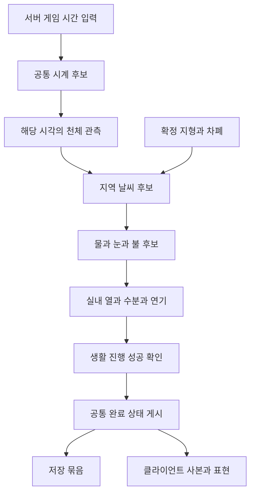

# 자연환경 시스템: 공통 시간에서 불과 환기까지

자연환경은 서버의 공통 시간에 천체·표면·물·눈·날씨·불·공기를 연결한다. 각 시스템은 자기 상태를 계산하지만 같은 세계의 완료 경계에서 결과를 게시한다. 이 문서는 전체 관계와 읽는 순서를 안내하고 실제 전후 코드·계산·실패 처리는 하위 장에서 가르친다.

## 학습 범위와 기준

대상은 C++ 경험이 있고 UE 전용 수명·복제·표현 연결을 배우는 개발자다. 자연환경 단계 0-7과 그 시스템이 기존 게임 코드에 연결된 부분을 다룬다. 진행 단계의 의미는 [환경 계획](../EnvironmentPlan.md#단계별-구현과-통과-기준)이 소유한다. 생태·생애 8단계와 통합·규모 9단계의 전체 해설은 이 묶음의 범위 밖이다.

2026-10-10 최초 작성 때 작업 트리에는 8단계 코드도 공존했다. 당시 모든 파일을 7단계 완료 코드로 취급하지 않았고, 커밋된 기반은 실제 Git 전후로 비교했다. 날씨·불·환기는 당시 미커밋 파일의 고정 사본을 읽었다. 브랜치·전체 해시·파일 해시는 [비교 근거](EnvironmentEvidence.md)에 있다. 원격 서버의 최신 상태를 조회하거나 브랜치를 전환하지 않았다.

이전의 환경 계획 학습은 [착수 전 학습 기록](EnvironmentPlanningHistory.md)에 보존했다. 그 문서에 남은 미구현 표기는 당시 사실이다. 현재 기능의 검증 상태는 각 환경 사양 문서와 실행 기록을 따른다.

## 메인 시스템과 하위 시스템

그림은 단계 7까지의 책임 연결이다. 실제 함수는 게임 시간과 세계 시간을 나눠 하위 구간을 계산한다. 오류·예산 초과·복원·후속 생태 콜백을 생략한 개념도이며 완전한 호출 순서를 대신하지 않는다. 지형 편집은 비동기 충돌 준비를 마친 뒤 별도 게시 경계에서 물·눈과 합류한다.

| 읽는 순서 | 하위 문서 | 먼저 해결할 질문 |
|---|---|---|
| 1 | [공통 시간](EnvironmentTime.md) | 생활은 성공하고 물은 실패했을 때 어디까지 완료인가 |
| 2 | [천체와 차폐](EnvironmentCelestial.md) | 같은 시각의 하늘과 위치별 비·빛·바람을 어떻게 구하는가 |
| 3 | [영구 지형](EnvironmentTerrain.md) | 땅값 변경과 충돌·경로 준비를 언제 완료로 보는가 |
| 4 | [물 순환](EnvironmentWater.md) | 물이 움직이고 얼어도 어떤 양을 보존하는가 |
| 5 | [깊은 눈과 이동](EnvironmentSnow.md) | 밟힌 깊이·질량·예측 입력을 왜 나누는가 |
| 6 | [자연 날씨](EnvironmentWeather.md) | 지정한 강수 입력이 지속 대기 상태로 어떻게 확장됐는가 |
| 7 | [불과 열](EnvironmentFire.md) | 연소한 연료·증발한 물·발생한 열은 어디에 기록되는가 |
| 8 | [실내 환기](EnvironmentAir.md) | 여러 문·여러 지역이 같은 공기를 중복 소비하지 않는가 |
| 9 | [저장과 실험장](EnvironmentPersistence.md) | 같은 세계 복원과 서버 조작을 어떻게 확인하는가 |

## 공통 기반의 후속 비교

기존 아홉 장을 읽은 뒤에는 다음 세 장으로 이어간다. 이후 소스가 커밋되고 공통 기반이 바뀐 부분을 별도 기준으로 설명한다. 8단계의 생태·생애 전체 해설로 범위를 넓힌 것은 아니다.

| 하위 문서 | 이어지는 문제 |
|---|---|
| [시간 분할 정밀도](EnvironmentTimeAccuracy.md) | 60배 입력을 나눌 때 두 시계가 함께 끝나는 조건 |
| [세계 저장 참여자](EnvironmentRestoreParticipants.md) | 이름 있는 구간과 중첩 확정·실패·알림 순서 |
| [환경 맵 설정](EnvironmentMapConfiguration.md) | 맵 이름 분기와 고정 눈 후처리를 설정 데이터로 옮긴 이유 |

이 세 장의 커밋·브랜치와 기존 검사 결과는 [후속 비교 근거](EnvironmentFollowupEvidence.md)에 분리했다. 기존 코드 블록의 당시 기준은 유지한다.

## 시간과 단위의 공통 약속

세계 초는 일조·기후·강수와 장기 변화에 사용한다. 게임 초는 물의 수평 이동과 불·환기의 반응에 사용한다. 배율 0과 일시 정지는 다르다. 배율 0은 게임 시간을 진행하면서 세계 시간 증가를 0으로 만들 수 있다. 각 장에서 어떤 시간 간격을 곱하는지 먼저 확인한다.

공간 단위는 천체 km, 표면 m, Actor cm다. 물 환산 체적은 m³, 연료·공기 중 물질량은 kg, 열은 J다. 눈의 외형 체적과 물 환산 체적은 서로 다른 값이다. 같은 이름의 Volume을 봤다고 단위와 보존량을 추정하지 않는다.

`Revision`은 내용 버전, `Epoch`는 실행 세대, `Ticket`은 준비한 요청, `PublicationSerial`은 게시 순번이다. 저장을 되돌리면 같은 내용 번호가 다시 나타날 수 있으므로 하나의 숫자로 모든 수명을 대신하지 않는다.

## 기존 게임 시스템과의 연결

기존 시스템 학습의 전후 예시는 당시 커밋을 보존한다. 아래 연결이 환경 도입 이후의 보완 경로다. 전체 목록은 [학습 문서 목록](README.md)에 있다.

| 기존 영역 | 유지하는 학습 | 환경 도입 이후 이어 읽을 내용 |
|---|---|---|
| 이동·카메라·재스폰 | [MovementRespawn](MovementRespawn.md) | 눈 CMC·SavedMove와 지형 준비 |
| GAS 전투·무기 | [GASCombat](GASCombat.md), [Weapons](Weapons.md) | 불 장의 후속 열 피해 확정 |
| 적 AI·생활 실행 | [EnemyAI](EnemyAI.md), [AgentExecution](AgentExecution.md) | 지형 경로 준비와 공통 시간 |
| 캠페인·마을 | [Campaign](Campaign.md), [VillageServices](VillageServices.md) | 기존 흐름과 실험 도메인 분리 |
| 아이템·장비·성장 | [ItemInventory](ItemInventory.md), [Equipment](Equipment.md), [Progression](Progression.md) | 단계 7까지의 기존 계약 유지, 후속 음식·전체 프로필 저장과 구분 |
| 화면·지도·연출 | [UIFramework](UIFramework.md), [InventoryUI](InventoryUI.md), [Map](Map.md), [Cinematics](Cinematics.md) | 공용 화면을 재사용한 실험 조작과 PIE 입력 |
| 개인 상태·판단·경제 | [AgentState](AgentState.md), [AgentDecision](AgentDecision.md), [LifeEconomy](LifeEconomy.md) | 삶의 정본은 유지하고 시간 진행 실패를 원자화 |
| 세션·콘텐츠 검증 | [SessionSave](SessionSave.md), [ContentValidation](ContentValidation.md) | 완료 세대·맵 전환·실행 방식별 증거 |

## 코드를 읽는 연습

한 요청을 골라 UI에서 시작해 서버 진입, 후보 계산, 확정, 복제·표현까지 따라간다. 각 함수에서 상태를 직접 바꾸는지, 바꿀 후보만 만드는지 표시한다. 다음으로 중간 함수 하나가 실패했다고 가정해 원본과 대기 시간이 무엇인지 설명한다. 가정은 실제 장애 기록과 구분한다.

이 묶음의 이해 확인에는 정답과 이유를 함께 넣었다. 문서를 읽었다는 사실만으로 사용자의 숙련도를 평가하지 않는다. 실제 실행은 각 장이 연결하는 기존 검증 기록과 재현 조건을 참고한다. 이번 작성에서 새 UE 빌드·게임 실행·성능 측정은 하지 않았다.
