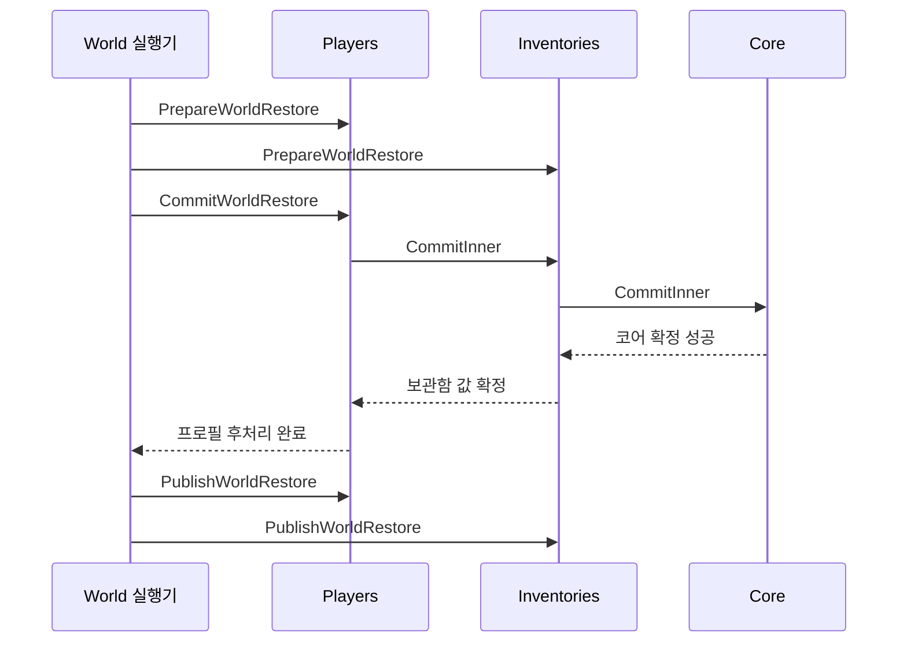

# 세계 저장 참여자: 준비·확정·알림을 함께 묶기

세계 저장은 시계·환경·생활의 코어와, 각 게임 시스템이 소유하는 이름 있는 구간으로 나뉜다. 이 장에서는 저장 구조의 의존성을 줄이면서도 플레이어·보관함·세계가 같은 복원 결과를 관측하도록 만드는 실행 순서를 배운다. [저장과 실험장](EnvironmentPersistence.md)의 완료 세대 파일 구조를 먼저 읽으면 연결하기 쉽다.

## 비교 기준과 플레이 상황

`c8816e7`의 세계 형식 6과 `b888b13`의 형식 7을 비교한다. 작성 시점의 기준은 `d7782f1`이며 전체 해시는 [후속 비교 근거](EnvironmentFollowupEvidence.md)에 있다. 현재 기준은 2026-10-31의 `main`인 `d4888b0`이다. 참여자 계약과 구간 등록부는 `dbdd174`에서 `Source/KSICore/`로 옮겨져 `ICCLWorldParticipant`, `FCCLWorldSectionRegistry`는 현재 `IKSIWorldParticipant`, `FKSIWorldSectionRegistry`다. 세계 스냅샷과 실행기는 CCL에 남아 있다. 생태·음식의 전체 규칙 대신, 그 기능이 늘면서 바뀐 공통 저장 경계를 설명한다.

플레이어가 장비와 음식을 가진 상태에서 과거 세계를 불러온다고 하자. 보관함만 먼저 복원되면 화면은 과거 보관함과 현재 플레이어를 동시에 읽을 수 있다. 뒤 플레이어의 장비 효과 적용이 실패하면 이미 바뀐 보관함을 다시 되돌려야 한다. 복원 대상을 추가할 때마다 세계 실행기에 새 시스템의 구체 타입과 정리 순서를 넣는 것도 부담이다.

`b888b13`의 커밋 본문은 `ICCLWorldParticipant`(현재 `IKSIWorldParticipant`)를 통한 의존성 반전과 이름 있는 저장 구간을 변경 사항으로 기록한다. [환경 계획](../EnvironmentPlan.md#다음-작업의-시작점)은 구간별 소유와 검증 순서를 설명한다. 아래의 확장 비용과 실패 경로 평가는 그 코드에 대한 분석이다.

## 저장 값과 런타임 참여자의 차이

`FCCLWorldSection`은 이름과 바이트 배열을 가진 값이다. `FName`은 UE의 이름 식별 타입이며, 여기서는 `Players`와 `Inventories` 같은 구간 키로 쓴다. 저장 파일 안의 이름은 문자열로 직렬화하므로 프로세스의 이름 테이블 번호를 파일 간 계약으로 사용하지 않는다.

`IKSIWorldParticipant`는 순수 C++ 가상 인터페이스다. UE의 `UINTERFACE` 선언이 아니며, 포인터를 보관했다고 UObject를 GC로부터 보호하지 않는다. 실제 참여자는 월드 Subsystem의 수명으로 존재하고 초기화에서 등록하며 종료 때 해제한다. `FKSIWorldSectionRegistry`의 검증기는 바이트의 유효성을 검사하고, 런타임 참여자는 실제 인벤토리·효과·알림을 준비한다. 같은 저장을 다루지만 두 책임은 다르다.

## 이전의 구체 배열에서 이름 있는 구간으로

출처: `c8816e7`, [CCLWorldSnapshot.h](../../Source/CCL/Environment/CCLWorldSnapshot.h). 연속 발췌이며 들여쓰기만 정리했다.

```cpp
TArray<uint8> Life;
TArray<uint8> Surface;
TArray<uint8> Ecology;
TArray<FCCLInventorySnapshot> Inventories;
TArray<FCCLPlayerSnapshot> Players;
FCCLEnvironmentInputs Environment = FCCLEnvironmentInputsCodec::MakeDefault(42);
```

기존 세계 스냅샷은 `FCCLInventorySnapshot`과 `FCCLPlayerSnapshot` 타입을 직접 알았다. 실제 형식도 두 본문을 정해진 위치에 기록했다. 기존 복원에도 실패를 보존하는 준비·콜백 경계는 있었다. 형식 7에서 처음 원자 복원이 생겼다고 설명하면 과거 코드를 잘못 읽은 것이다.

출처: `b888b13`, [CCLWorldSnapshot.h](../../Source/CCL/Environment/CCLWorldSnapshot.h). 연속 발췌이며 들여쓰기만 정리했다.

```cpp
struct FCCLWorldSection
{
    FName Name;
    TArray<uint8> Bytes;
};
```

현재 코어는 각 구간의 이름과 바이트를 보관한다. 구간 내부 형식과 의미 검증은 등록한 게임 시스템이 맡는다. 코어의 시계·생활·표면·생태 필드는 그대로 있으므로, 모든 시스템을 임의 플러그인으로 바꾼 범용 저장 프레임워크는 아니다.

`FCCLWorldSnapshotCodec::Validate`는 이름이 비어 있거나 중복·정렬 위반·미등록인 구간을 거부한다. 실제 검증기는 Registry의 순서대로 호출하고 같은 `ClaimedItems` 집합을 공유한다. 먼저 플레이어가 아이템 GUID를 청구하고 보관함이 같은 GUID를 다시 청구하면 실패한다. 저장 배열의 이름 정렬과 참여자의 처리 순서는 서로 다른 계약이다.

## 직접 연결하던 복원을 참여자 호출로 바꾸기

이전에는 세계 실행기가 플레이어 복원 함수와 보관함 알림을 직접 연결했다.

출처: `c8816e7`, [CCLWorldSimulationSubsystem.cpp](../../Source/CCL/Environment/CCLWorldSimulationSubsystem.cpp). 연속 발췌이며 들여쓰기만 정리했다.

```cpp
const bool bRestored = Players->Restore(Snapshot.Players, Snapshot.Identity.WorldId, Snapshot.Clock.WorldSeconds,
    SessionRequest, CommitWorld, [&]
    {
        // The caller prevalidates this synchronous, non-failing private-state commit.
        // All participants are still guarded; no inventory listener has run yet.
        if (FinalizeSession)
        {
            FinalizeSession();
        }
        Inventories->PublishRestore();
        Publish();
    }, Error);
if (!bRestored) { Inventories->CancelRestore(); }
return bRestored;
```

이 코드는 개인 세션의 마지막 값 확정, 보관함 알림, 세계 게시 순서를 한 함수에서 볼 수 있다는 장점이 있다. 반면 참여 시스템이 늘면 세계 실행기도 그 타입과 복원 인터페이스를 계속 알아야 한다.

현재는 `PrepareParticipants`가 순서대로 후보를 준비하고 성공 개수를 센다. 모두 준비되면 다음 함수가 확정 호출을 중첩한다. `TFunctionRef<bool()>`는 소유하지 않는 호출 가능 객체 참조다. 여기서는 동기 호출 중에만 사용하며 타이머에 저장해 나중에 실행하는 계약이 아니다.

출처: `b888b13`, [CCLWorldSimulationSubsystem.cpp](../../Source/CCL/Environment/CCLWorldSimulationSubsystem.cpp). 연속 발췌이며 들여쓰기만 정리했다.

```cpp
bool UCCLWorldSimulationSubsystem::CommitParticipants(int32 Index, int32 Prepared, TFunctionRef<bool()> CommitCore)
{
    // The lowest participant wraps every later commit and the core world in its own commit.
    if (Index >= Prepared)
    {
        return CommitCore();
    }

    return Participants[Index]->CommitWorldRestore([this, Index, Prepared, CommitCore]()
    {
        return CommitParticipants(Index + 1, Prepared, CommitCore);
    });
}
```

`Players`의 순서는 0, `Inventories`는 1이다. 호출은 플레이어 → 보관함 → 코어로 들어간다. 보관함은 내부 코어 성공 뒤 `CommitRestore(false)`로 자기 값을 확정하고, 플레이어는 안쪽 호출 성공 뒤 자기 프로필을 마무리한다. 플레이어의 실제 장비 처리에는 `FCCLLoadoutRestoreBatch::Execute`가 사용된다. 이 배치가 실패할 수 있는 효과 준비와 취소를 관리한다.



그림은 정상 경로의 참여자 순서다. 내부 장비 배치의 모든 GAS 콜백을 나열한 것은 아니다. 세계 실행기는 전체 중첩 확정이 성공한 뒤 참여자들의 게시 함수를 호출하고 마지막으로 월드 상태를 게시한다. 플레이어 배치 안에서 발행하는 인벤토리 알림도 내부 세계 확정과 프로필 후처리 뒤에 놓인다. 플레이어의 `PublishWorldRestore`는 준비 상태 정리를 맡고, 보관함의 같은 함수는 보류한 알림을 보낸다. 임의의 외부 콜백 부작용까지 자동 롤백된다는 뜻은 아니다.

## 실패·취소·수명

준비가 중간에 실패하면 앞서 성공한 참여자만 역순으로 취소한다. 실패를 반환한 참여자 자신의 부분 준비는 그 구현에서 정리해야 한다. 중앙 실행기가 실패한 참여자까지 자동 취소해 준다고 가정하면 자원이 남을 수 있다.

출처: `b888b13`, [CCLWorldSimulationSubsystem.cpp](../../Source/CCL/Environment/CCLWorldSimulationSubsystem.cpp). 연속 발췌이며 들여쓰기만 정리했다.

```cpp
void UCCLWorldSimulationSubsystem::CancelParticipants(int32 Prepared)
{
    for (int32 Index = Prepared - 1; Index >= 0; --Index)
    {
        Participants[Index]->CancelWorldRestore();
    }
}
```

코어 복원이 실패하면 보관함은 기존 상태를 유지하고 false를 반환한다. 바깥 플레이어 배치도 새로 준비한 효과를 취소한다. 전체 호출이 실패하면 실행기가 준비된 참여자들을 취소한다. 반대로 코어 성공 뒤에는 참여자의 준비된 값 교체가 실패하지 않는 계약이 필요하다. 재귀 함수 자체가 임의 시스템의 변경 이력을 기록하거나 되돌려 주지는 않는다.

등록은 `RegisterParticipant`에서 세계 실행 전인지 검사하고 순서대로 정렬한다. 해제는 `UnregisterParticipant`가 포인터를 제거한다. 세계를 복원하면 새 Epoch를 발급하여 이전 실행 결과와 구분한다. 서버 권위 검사는 세계의 시작·복원 진입점에 있으며 이 인터페이스를 구현했다는 사실만으로 클라이언트의 변경이 허용되지 않는다.

## 이전 파일과 누락 구간

형식 5는 보관함, 형식 6은 보관함과 플레이어 본문을 고정 위치에 넣었다. Decode는 이를 `Inventories`와 `Players`라는 구간으로 옮기고 형식 7 후보를 검증한다. 구간을 도입하기 전 파일에 없는 구간은 null로 전달된다. 구체 참여자가 그 경우를 빈 저장 구간으로 해석하되, 실행 중 유지할 접속자의 정책은 별도다.

[원격 플레이어 복원 정책](../SessionFoundation/PlayerRestore/Identity.md#원격-플레이어-신원-연결과-복원-시-접속자-유지)은 저장 이후에 들어온 등록 플레이어의 현재 상태를 유지한다. 그 플레이어의 아이템은 `KeptItems`로 다음 참여자에게 전달한다. 보관함이 과거 파일의 같은 아이템을 되살리는 요청은 거부한다. 값 검증기의 `ClaimedItems`와 런타임 유지 대상의 `KeptItems`를 같은 집합으로 혼동하지 않는다.

## 대안과 확인

구체 시스템을 직접 호출하면 처리 순서가 한눈에 드러나고 등록 누락을 걱정할 필요가 적다. 참여자 방식은 코어의 구체 의존성을 줄이는 대신 이름 등록, 처리 순서, 준비·취소 계약을 추가한다. 새 참여자를 붙일 때 정상 복원만 검사하면 부족하다. 뒤 참여자의 실패, 코어 거부, 중복 GUID, 알림 콜백이 읽는 최종 상태를 함께 확인해야 한다.

코드 진입점은 [세계 스냅샷](../../Source/CCL/Environment/CCLWorldSnapshot.cpp), [플레이어 참여자](../../Source/CCL/Session/CCLPlayerPersistenceSubsystem.cpp), [보관함 참여자](../../Source/CCL/Items/CCLInventoryPersistenceSubsystem.cpp)다. 기존 실행 근거는 [재검증 기록](../QA/FullReviewReverification-2026-10-11.md)과 [다중 복원 검사](../../Source/CCL/Tests/CCLLoadoutRestoreSmokeSubsystem.cpp)에 있다. 이번 문서 작업에서 빌드나 실행을 다시 하지는 않았다.

**Commit 함수를 순서대로 한 번씩 호출하면 같은 결과일까?** 플레이어의 효과 배치가 보관함·코어 실행을 감싸야 한다. 순차 호출로 앞 참여자의 처리 범위를 닫으면 뒤 실패와 함께 취소할 수 있는 경계가 달라진다.

**처음 보는 구간은 건너뛰어도 될까?** 현재 코덱은 미등록 이름을 거부한다. 내용을 모르는 채 복원하면 전체 소유권 검사와 저장 의미를 보장할 수 없기 때문이다. 미래 구간을 무시하는 호환 정책은 이 구현에 없다.
