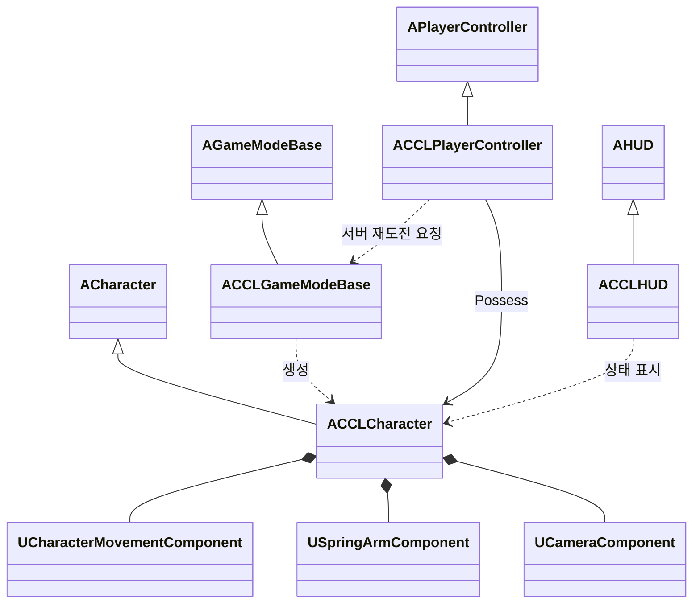

# 멀티플레이 기본 흐름

`Source/CCL/`에 스폰, 이동과 카메라, 사망 후 개별 재스폰을 구현했고 Standalone, Dedicated Server, Listen Server에서 자동 검사로 확인했다. 이 문서는 이 기본 흐름의 책임 배치, 인터페이스, 조작, 실행 방법과 검증 기록을 소유한다. 근거는 [결정 5](decisions/0005-run-modes-and-respawn.md)다. 테스트 맵은 `Content/Maps/MultiplayerPlayground.umap`이다.

## 목표와 제약

서버가 캐릭터의 생성과 사망을 결정하고 각 클라이언트는 자신이 소유한 캐릭터를 조작한다. Standalone도 같은 권위 경로를 쓴다. 사망한 플레이어만 재도전하며 생존자의 캐릭터와 진행은 유지한다. 평소 작업은 Standalone에서 하고 서버 검증은 Dedicated Server와 Listen Server에서 한다.

서버 검증에는 플레이어 2명을 썼으며 출시 인원 제한이 아니다. 테스트 맵에 배치한 PlayerStart 4개도 콘텐츠 사양이 아닌 검증용 배치다. 공격과 체력은 [CombatFoundation](CombatFoundation.md), 저장은 [SessionFoundation](SessionFoundation.md)이 소유한다. 동료 부활, 호스트 이탈 복구, 방 검색 UI는 이 흐름에 없다.

조작감 확인용으로 3인칭 카메라, 키보드·마우스 입력, 단순 도형 캐릭터를 쓴다. 기존 마네킹을 연결하는 대안은 사람 비례와 애니메이션 확인에 유리하지만, 기본 흐름에는 애니메이션 의존을 넣지 않았다.

## 책임과 수명

입력은 PlayerController에 두고 재도전 때 Character를 교체한다. 사망한 Pawn은 재도전 전까지 남아 있어 플레이어가 같은 시점에서 재도전을 고를 수 있다.

| 타입 | 책임 | 생성과 소멸 | 네트워크 권위 |
|---|---|---|---|
| `ACCLGameModeBase` | 시작 위치 검증, 재스폰 허용, 스폰 실패 대기 상태와 재시도 간격 관리 | 월드 생성·종료, 접속 종료 때 플레이어별 대기 기록 제거 | 서버 전용 |
| `ACCLPlayerController` | Enhanced Input 구성, 현재 Pawn 조작, 재도전 RPC | 접속부터 종료까지 유지 | 입력은 소유 클라이언트, RPC 판정은 서버 |
| `ACCLPlayerState` | 플레이어 ASC와 능력치, 인벤토리·장비·원정·계정 컴포넌트 소유. 재스폰 사이에 유지한다 | 접속부터 종료까지 유지 | 서버 권위. ASC 소유는 [결정 11](decisions/0011-minimal-combat-and-asc-lifetime.md) |
| `ACCLCharacter` | 이동, 카메라 구성, 현재 생명의 사망 상태 | 스폰부터 다음 재도전 또는 접속 종료까지 | `bDead`는 서버 결정 후 복제 |
| `UCharacterMovementComponent` | 이동 예측과 서버 이동 처리 | Character의 컴포넌트 | 엔진 이동 경로 |
| `USpringArmComponent`, `UCameraComponent` | 카메라 충돌 검사와 플레이어 시점 | Character의 컴포넌트 | 로컬 시점 |
| `ACCLHUD` | 조작 안내와 재도전 메시지 | 로컬 플레이어 HUD | 로컬 표시 |

사망은 `uint8 bDead`를 `ReplicatedUsing`으로 전달한다. 서버에서도 `OnRep_Dead`의 공통 표현 경로를 실행해 이동을 멈추고 캡슐 충돌을 해제한다.

## 클래스 관계



상속은 빈 삼각형, 컴포넌트 소유는 채운 마름모, 참조는 실선 화살표다. 점선은 생성과 호출의 의존 관계다.

## 인터페이스와 처리 흐름

공개 진입점은 다음과 같다. 전체 선언과 기본값은 `Source/CCL/CCLCharacter.h`, `CCLPlayerController.h`, `CCLGameModeBase.h`가 소유한다.

```cpp
// ACCLCharacter
bool IsDead() const;
void Die();

// ACCLPlayerController
UFUNCTION(Exec)
void CCLRetry();
UFUNCTION(Exec)
void CCLDie();

// ACCLGameModeBase
void RequestRetry(APlayerController* Player);
```

`CCLRetry`는 대상 Pawn이나 위치를 인자로 받지 않는 서버 RPC로 전달된다. 서버는 요청자의 현재 Pawn을 검사해 살아 있으면 거부한다. 사망한 Pawn은 소유를 해제하고 제거한 뒤 `RestartPlayer`로 교체한다. 새 Pawn 생성에 실패하면 요청자는 서버의 대기 집합에 남고 다음 입력으로 다시 시도할 수 있다. 재시도 간격은 반복 요청을 제한하는 구현 기본값이며 전투 사양이 아니다.

`FindPlayerStart_Implementation`은 캡슐이 들어갈 공간을 확인한다. 시작 위치가 모두 막혔으면 실패를 기록하고 대기 상태를 유지한다. 프로젝트의 `RestartPlayer`는 검사를 통과한 위치로 `RestartPlayerAtPlayerStart`를 호출하고, 엔진 기본 구현이 이전 `StartSpot`으로 되돌아가는 경로를 쓰지 않는다. 체크포인트는 이 시작 위치 정책을 확장해 붙인다.

## UE 5.8 코드 경로

다음은 실제 `ACCLCharacter::Die`의 핵심 경로다. 사망은 중복 적용하지 않고, 원격 클라이언트에는 복제 상태로 전달한다.

```cpp
void ACCLCharacter::Die()
{
    if (!HasAuthority() || IsDead())
    {
        return;
    }
    bDead = 1;
    OnRep_Dead();
    ForceNetUpdate();
    // 실제 소스에는 서버의 사망 로그도 남긴다.
}
```

사망 진입점은 양수 피해, 월드의 KillZ 아래 낙하, 개발용 `CCLDie`다. 체력과 피해 계산은 CombatFoundation이 소유한다. 개발용 사망 요청의 처리와 K 키 바인딩은 Shipping·Test 구성에서 비활성화된다.

입력 Action과 Mapping Context는 PlayerController가 런타임에 만들고 종료 때 해제한다. `CCL.Build.cs`에 `EnhancedInput` 의존성이 있다. 별도 입력 에셋 편집 없이 시험할 수 있지만, 디자이너가 키 배치를 바꾸려면 에셋이나 설정으로 옮겨야 한다.

## 조작과 실행

| 입력 | 동작 |
|---|---|
| WASD | 카메라 yaw를 기준으로 이동 |
| 마우스 | 3인칭 카메라 회전 |
| Space | 점프 |
| K | 개발용 사망 |
| R | 사망 또는 스폰 실패 후 재도전 |
| 콘솔 `CCLDie`, `CCLRetry` | 같은 사망·재도전 경로 호출 |

`Tools/Validation/create_playground.py`가 Unreal 에디터에서 맵을 만들고 저장한다. 바닥, 점프용 단차, 카메라 가림 확인용 벽과 시작 위치가 있다. 이 도구는 기존 맵을 덮어쓰지 않는다. 수동 확인은 에디터에서 `MultiplayerPlayground`를 열고 Standalone으로 플레이한다.

자동 검사는 저장소 루트에서 다음 명령으로 실행한다. 엔진 경로는 Git에서 제외한 `.local/agent-paths.json`을 읽는다. 도구가 시작한 프로세스만 종료하고 원본 로그는 `Saved/Tests/NetworkSmoke/`에 남긴다. 실행 순서와 증거 강도 기록은 `ccl8-verify` 스킬을 따른다.

## 검증 상태

네트워크 검사는 `UnrealEditor-Cmd -game`과 `-server`의 별도 프로세스를 `-nullrhi`로 실행하고, 입력은 Enhanced Input Action에 주입한다. 테스트용 `UCCLNetworkSmokeSubsystem`은 개발 구성에서 `-CCLSmoke=driver` 또는 `witness`를 명시했을 때만 생성되며, 실패하면 `CCL_SMOKE FAIL`, 통과하면 `CCL_SMOKE PASS`를 기록한다. 아래 두 기록은 2026-10-06 시점의 결과다.

### 2026-10-06 UE 5.8.2 설치본

사용한 설치본은 `<Engine>/Build/Build.version` 기준 UE 5.8.2, Changelist 56702186이다. 프로젝트 문서의 기본 기준 5.8.1과 구분한다. `Build.bat CCLEditor Win64 Development -Project=<repository>/CCL.uproject -WaitMutex -NoHotReloadFromIDE` 빌드가 성공했다. 명령과 로그의 실제 경로는 자리표시자나 저장소 상대 경로로 치환했다.

| 실행 | 검증 내용 | 결과와 증거 |
|---|---|---|
| Standalone | 이동 입력, 생존 중 재도전 거부, 사망 후 이동 차단, 반복 재도전, 카메라 대상과 입력 복구 | PASS |
| Dedicated Server + 클라이언트 2개 | 원격 이동, 사망과 새 Pawn 복제, 다른 플레이어의 Pawn 유지 | PASS |
| Listen Server + 원격 클라이언트 | 원격 클라이언트 사망·재스폰, 호스트 Pawn 유지 | PASS |
| Listen 호스트 재스폰 | 호스트 사망·재스폰, 원격 플레이어 Pawn 유지 | PASS |
| 낙하·스폰 실패 복구 | KillZ 사망, 모든 시작 위치가 막힌 상태에서 대기 후 재시도 | PASS, 위 Standalone 로그의 `CCL Spawn blocked`와 후속 PASS |

같은 날 사용자가 Standalone에서 이동·점프·마우스 회전, 사망, 카메라의 지형 충돌과 리스폰이 정상 동작함을 수동으로 확인했다. 게임 실행 로그에는 `EditorToolset`의 `AgentSkill`, `ToolsetRegistry`의 `PythonTestRunner` Python 초기화 오류가 남았지만 기본 흐름 검사는 통과했다. 해당 엔진 플러그인은 수정하지 않았다.

### 2026-10-06 UE 5.8.1 설치본

집의 설치본은 UE 5.8.1, Changelist 0이다. `c8c6e4a`를 대상으로 `CCLEditor Win64 Development` 빌드가 통과했다. 빌드에는 `-WaitMutex -NoHotReloadFromIDE -NoEngineChanges`를 썼다.

첫 Standalone 검사는 이동 검사 실패를 기록했다. 맵 로드와 캐릭터 스폰은 성공했지만 Python 초기화 이후 7프레임 시점에 검사 구간이 끝났다. 테스트가 실제 시간으로 이동 구간을 측정해 초기화 지연이 이동 시간에 들어간 것이다. `UCCLNetworkSmokeSubsystem::Tick`의 구간 판정을 월드 게임 시간으로 바꾸고 전체 중단 제한은 실제 시간으로 유지했다. 수정 후 프로젝트 빌드와 아래 네 검사가 통과했다. 이 시점에 테스트 코드 수정은 로컬 작업 트리에 있었고 회사의 검증 커밋에는 포함되지 않았다.

| 실행 | 결과 | 로그 |
|---|---|---|
| Standalone | PASS, 이동·사망·재스폰·KillZ·막힌 시작 위치 복구 | |
| Dedicated Server + 클라이언트 2개 | PASS, 원격 이동·사망·재스폰·생존자 Pawn 보존 | |
| Listen 원격 재스폰 | PASS, 원격 플레이어 재스폰·호스트 Pawn 보존 | |
| Listen 호스트 재스폰 | PASS, 호스트 재스폰·원격 Pawn 보존 | |

시간 기준은 UE 5.8.1의 `<Engine>/Source/Runtime/Engine/Classes/Engine/World.h:4681`과 `<Engine>/Source/Runtime/Engine/Private/LevelTick.cpp:1610`에서 확인했다. `GetTimeSeconds`는 월드의 `TimeSeconds`를 반환하고 월드 Tick은 게임 DeltaSeconds를 누적한다. Python 초기화의 `AgentSkill`·`PythonTestRunner` 오류는 이 설치본에서도 남았다.

### 미검증

- 집 설치본에서 화면을 보며 하는 조작감 확인.
- 패키징한 게임·전용 서버, 패킷 손실 환경, 재접속.
- 최종 외형과 조작감 수치, 접속 인원과 협동·대전 여부는 정하지 않았다.

## 엔진 근거와 대안

UE 5.8.2의 `<Engine>/Source/Runtime/Engine/Private/GameModeBase.cpp:1068`에서 `HandleStartingNewPlayer_Implementation`은 조건을 확인한 뒤 `RestartPlayer`를 호출한다. 같은 파일의 `:1241`은 시작 위치 선택, `:1264`는 Pawn 확인과 생성, `:1362`는 `Possess`를 맡는다. 이미 Pawn이 있으면 그 Pawn을 쓰므로 재스폰 전에 이전 Pawn을 정리한다.

`<Engine>/Source/Runtime/Engine/Private/Components/CharacterMovementComponent.cpp:8907`의 `ReplicateMoveToServer`와 `:9137`의 `CallServerMovePacked`를 포함한 엔진 이동 경로를 쓴다. 별도 위치 RPC와 보간기는 이동 규칙을 자유롭게 만들 수 있지만 예측·보정 구현과 검증 부담이 커진다.

입력은 `<Engine>/Plugins/EnhancedInput/Source/EnhancedInput/Public/EnhancedInputSubsystemInterface.h:265`의 `AddMappingContext`를 쓴다. UE4에서 흔히 쓰던 `DefaultInput.ini` Action/Axis 이름 바인딩과 다르다. GameMode, PlayerController, Character의 역할 분리는 UE5만의 신규 구조가 아니다.
