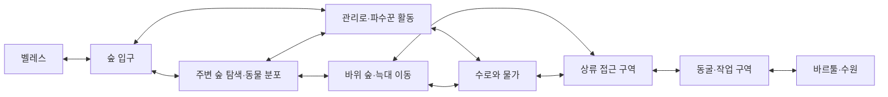

# 벨레스 필드 탐색과 전투 개정 후보

주인공은 수원이라는 목적지를 향해 숲을 탐색하며 그곳에 분포한 동물과 몬스터와 싸운다. 일반 전투는 걷고, 주변을 살피고, 길을 고르고, 다시 이동하는 경험 안에서 반복된다. 이야기의 중요한 장면은 그 여정에서 일어나며 모든 교전을 하나씩 호출하지 않는다.

필드 교전이라는 방향은 [결정 41](../../../../decisions/0041-field-exploration-combat.md)로 바로잡았다. 아래 구역·분포·갈림길·행동과 단서 전달 방식은 그 방향을 적용한 새 후보다. 개체 수·밀도·재등장·드롭·성장 수치·정밀 지형은 확정하지 않았다. 이전 [공간 연결안과 도면](2026-11-07-opening-spatial-connections.md)은 장소·물길과 수정 전 전투 구조를 비교하는 자료로 보존한다.

## 무엇을 바꾸는가

| 대상 | 앞선 안에서 생긴 문제 | 개정 기준 |
|---|---|---|
| 전투의 발생 | 장면을 따라 다섯 싸움을 차례로 배치했다. | 서식 구역 안에 있는 개체·무리를 탐색 중 만나 싸운다. 다섯 장면은 대표 사례다. |
| 공간 | 전투 지점을 잇는 한 줄이 플레이 동선처럼 보였다. | 관리로와 주변 숲·수로 변·바위 길을 탐색 가능한 구역으로 묶고 일부 길이 갈라졌다 다시 합쳐지게 한다. |
| 일반 몬스터 | 각 종이 자기 사건에서만 한 번 나오는 인상을 줬다. | 같은 종이 적합한 여러 장소에 분포할 수 있다. 위치·주변 개체·접근 방향이 싸움을 바꾼다. |
| 서사 단서 | 싸움마다 다음 단서를 받고 다음 전투로 넘어갔다. | 물길·흔적·설비·현장 도면에서도 정보를 얻는다. 일반 교전 전부에 대사나 단서 보상을 붙이지 않는다. |
| 귀환 | 보스 뒤 같은 길에는 추가 전투가 없다고 고정했다. | 처리한 대상의 결과는 남고 숲에 남아 있던 개체와는 다시 마주칠 수 있다. 귀환용 새 사건을 억지로 추가하지 않는다. |

이 변화는 모든 장소를 같은 간격으로 몬스터가 채운다는 뜻이 아니다. 주민이 관리하는 가까운 길, 먹이·물이 있는 장소, 버려진 설비와 굴에 따라 분포와 위험이 달라진다. 전투가 드문 연결 구간과 위험이 모이는 구역을 함께 둔다. 배회가 곧 무작위 스폰이나 완전한 생태 시뮬레이션을 뜻하지도 않는다.

## 필드를 먼저 구성한다

기존의 숲 입구·다람쥐·파수꾼·늑대 기준점은 구역의 특징을 읽는 참조로 사용한다. 점 사이의 모든 공간을 비어 있는 이동 통로로 두지 않는다. 범위의 경계와 폭은 H04로 남기며 기존 좌표를 임의로 옮기지는 않는다.

| 구역 후보 | 평소 분포와 행동 | 플레이어가 겪는 일반 교전 | 이야기와 만나는 부분 |
|---|---|---|---|
| 마을 바깥 관리림 | 작은 동물이 먹이를 찾고, 사람들이 다니는 길 밖에는 경계하는 개체가 있다. 주민의 관리가 닿는 범위와 위험한 숲을 구분한다. | 숲 가장자리·가지 아래·샛길에서 개체를 만나고 접근이나 공격에 따라 싸움이 생긴다. 모든 동물이 먼저 공격하지는 않는다. | 급수 이상과 차가운 파편은 수로 변에서 관찰할 수 있다. 특정 다람쥐를 반드시 잡아야만 원인을 알 수 있게 하지 않는다. |
| 수로와 버려진 작업 구역 | 수로를 따라 움직이는 파수꾼과 작업 구역을 벗어나지 않는 장치가 있다. 주변 동물의 생활 범위도 일부 겹친다. | 순찰 중 마주치거나 작업 단을 탐색하다 싸운다. 다른 개체의 접근을 피하려 위치를 옮기고, 경계가 겹치는 곳에서는 교전이 커질 수 있다. | 오작동한 장치와 결빙 흔적이 상류 문제를 보여 준다. 멈춘 장치를 전부 다시 켜는 임무는 만들지 않는다. |
| 바위 숲과 물가 | 늑대가 물과 사냥감을 따라 돌아다니며 쉬는 자리·접근로가 나뉜다. | 길을 가던 무리와 마주치거나 물가에 접근하다 싸운다. 바위와 수풀 때문에 보이는 적과 접근하는 적이 다르다. 일부 무리를 피하더라도 다른 탐색 중 교전은 이어질 수 있다. | 큰 곰의 발자국은 이동 흔적이며 늑대 처치 보상이 아니다. 흔적을 발견하면 동굴 방향을 추론한다. |
| 동굴 진입과 옛 작업 공간 | 남은 설비에 연결된 파수꾼이 작업 구역과 접근 통로를 점유한다. 종류를 무조건 늘리기보다 기존 적의 역할·위치를 달리한다. | 통로에서 만나고 작업대 주변을 돌며 싸운다. 멀리 유도할지, 다른 적과 거리를 벌릴지 판단한다. | 도면과 채취부 확인은 실제 조사다. 필요한 작업 구역을 확보하는 싸움은 있어도 모든 일반 적의 전멸이 도면 열람의 공통 조건은 아니다. |
| 수원 공동 | 결박된 바르툴이 조작부 접근을 위협한다. | 주요 보스전으로 유지한다. 앞다리·가슴 결박을 끊고 서로 물러난다. | 복구와 귀환으로 이어지는 핵심 사건이며 K06의 승리·생존 조건을 유지한다. |

통증 때문에 날뛰는 다람쥐는 해당 대표 개체의 상황이다. 숲의 모든 다람쥐가 결정에 붙들렸거나, 모든 늑대가 폭주했거나, 모든 적을 구출해야 한다는 규칙으로 확대하지 않는다. 전투가 필요한 개체·무리와 주변의 비적대 동물을 구분한다. 일반 전투의 승리를 전부 결박 제거 퍼즐로 만들지 않는다.

## 길과 교전이 섞이는 모습

숲 입구에서 관리로를 따라가면 수로 점검 단으로 이어진다. 옆 숲으로 들어가면 먹이를 찾는 동물과 마주치고, 바위 쪽 길로 돌아가면 늑대가 사용하는 이동 범위 가까이 간다. 갈라진 길은 상류 접근 구역에서 다시 이어지는 구성을 추천한다. 어느 길이 항상 안전하거나 모든 싸움을 자동으로 없애 주도록 고정하지 않는다.

화살표는 연결 후보이며 정확한 지형이나 확정된 우회로가 아니다. 서식 구역의 모든 연결을 전투 방 하나로 해석하지 않는다. 관리교 네 곳은 물길을 건너는 참조이며 네 번의 고정 전투를 새로 추가한 것이 아니다.

예를 들어 플레이어는 수로를 살피다가 파수꾼과 싸우고, 잠깐 옆 숲을 탐색하다 다른 개체를 만나며, 바위 지대에서 늑대 무리를 피해 돌아가다가 또 다른 위협과 교전할 수 있다. 대사나 임무 단계가 이 싸움들을 하나씩 시작시키지는 않는다. 이 예시는 가능한 여정 하나이고 고정 플레이 순서가 아니다.

## 주인공 성장과 주요 사건

전투 경험은 같은 지역을 돌아다니며 쌓인다. 주인공은 눈앞의 한 적만 보고 달려들던 태도에서 주변 개체와 발판을 함께 살피는 쪽으로 발전할 수 있다. 같은 공격도 다른 위치와 적 구성에서 대응이 달라진다는 경험이 바르툴의 이동 변화에 대응하는 바탕이 된다. 이 성장을 정해진 다섯 수업을 모두 수료하는 흐름으로 쓰지 않는다.

일반 교전은 탐색 범위 확보·장비 사용 경험·자원 획득 같은 역할을 가질 수 있다. 구체 보상 체계와 성장 수치는 후보로 남긴다. 스토리상 반드시 이어질 큰 인과는 급수 사고 → 수원 조사 → 바르툴 해방 → 복구·인계 → 출항이다. 일반 몬스터와 싸운 횟수나 모든 개체의 처치가 이 인과를 대신하지 않는다.

귀환에서는 이미 정지한 특정 파수꾼과 회수한 파편의 결과가 유지된다. 그렇다고 숲 전체가 비거나 모든 몬스터가 사라지지는 않는다. 남아 있던 개체·무리와 만날 가능성을 두고, 어떤 경로로 돌아오는지에 따라 교전이 달라지는 후보로 정리한다. 처치 개체의 재등장 주기·휴식 초기화·시간 경과 규칙은 별도 미정이다.

## 영향과 다음 작업

이 방향을 구체화한 [벨레스 숲 배치 후보](2026-11-07-veles-forest-population.md)에 탐색 구역·무리·평소 이동·추격 한계와 지도 두 장을 작성했다. 아래의 다음 작업 설명은 배치 전에 정한 작업 기준이며, 현재 배치와 남은 판단은 해당 문서가 소유한다.

기존 `opening-scenario.md`의 개별 전투 장면은 활용 가능한 대표 상황으로 보존한다. `2026-11-07-opening-spatial-connections.md`와 v1 도면의 ①-⑤는 옛 전투 배치이며, 현재 전체 전투량이나 유일한 동선을 나타내지 않는다. 동굴의 설비·곰 퇴로·복구 인계와 출항 끝 지점은 계속 참조한다.

다음에는 첫 장 필드를 구역별로 나눠 서식 개체와 무리, 이동 범위, 위험이 겹치는 장소, 탐색할 이유와 주요 사건의 위치를 지도 위에 배치한다. 전투 횟수부터 정하거나 장면마다 몬스터를 한 묶음씩 끼워 넣는 방식으로 돌아가지 않는다. 지도 상세화는 기존 승인 범위의 Map Maker를 함께 사용하며 인물 장면에 영향을 줄 때 Character Creator를 관련 선택 스킬로 둔다.

이번 산출물은 전투 구조를 바로잡은 문서와 구역 연결 후보다. [독립 검토](../../../Reviews/2026-11-07-field-combat-revision-review.md)는 PASS다. 개체별 정확한 좌표·실제 지형·전투 밀도·AI·재등장·드롭·플레이 시간은 검증하지 않았다.
