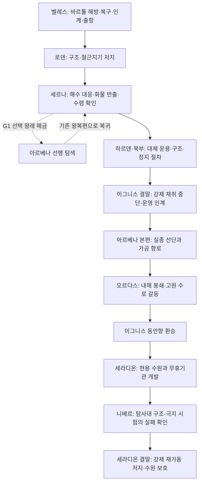

# 이그니스에서 이어지는 5대륙 메인 여정

[5대륙 전체 여정 통합표](2026-11-13-world-journey-continuity.md)는 각 지역 상세안의 현재 종료 상태·해금·동료와 구조자·운영 인계를 한 흐름으로 볼 때 읽는다. 이후에 작성된 귀항·결말까지 포함하며 아래 개요 작성 당시의 미정과 후보를 보존한다.

[세라디온 결말 상세](2026-11-13-seradion-finale.md)는 기존 강경파 경비와 CT03-B 전투, 위험 시험 연결 분리·주민 공급 인수로 여정을 닫는 후보를 담는다. 기적적인 자원 회복이나 모든 대륙 갈등의 해소는 제안하지 않는다.

[세라디온 귀항·G6 상세](2026-11-12-seradion-return-g6.md)는 니베르 근거를 현지 계통과 대조하고 주민 보호·필수 공급 준비를 인수한 뒤 기록을 공개한다. 강경파 점거와 외곽 정찰까지 연결하며 중추 격파·심부 분리·결말 인계는 후속 범위다.

[니베르 구조·조사 상세](2026-11-12-niber-expedition-rescue.md)는 생존자 8명 회수 뒤 잔존 장치에 접근해 G6의 니베르 근거를 확보하는 후보를 담는다. G6 전체는 세라디온 현지 적용·대피·필수 수원 준비가 남아 미완료이며 귀항도 다음 범위다.

[니베르 첫 상륙 후보](2026-11-11-niber-first-landing.md)에 T6 연안 도착·주/대체 상륙 판단·외곽 보급소 첫 조사·본선 귀환을 연결했다. G5는 유지하고 G6는 미완료다. 생존자 구조·실패 원인·잔존 장치 대조와 세라디온 귀항은 후속 범위다.

[남부 원정항·니베르행 출항](2026-11-10-seradion-polar-departure.md)은 G5의 극지 개조·귀환 비축·피난 인수와 당일 운항 판단을 확인할 때 읽는다. 추천 플롯의 끝은 G5 충족·T6 항해 시작이며 니베르 도착·G6는 후속 범위다. 아래 준비 예정 문구는 앞선 구간의 상태로 보존한다.

[세라디온 현용 수원·원정 준비](2026-11-10-seradion-waterworks.md)는 주민 급수 분리·시험 확대 중지와 구조 요청 대조를 구체화한다. G5의 극지 개조·귀환 비축·피난 현장 확인은 남부 출항 거점의 후속 범위이며 G6 결말은 앞당기지 않는다.

후속 [세라디온 성숙림·수원 접근](2026-11-10-seradion-forest.md)은 줄무늬 사건 개체 대응과 서쪽 정비길 통행 시험, 보스 전 동쪽 접근·외곽 인계를 연결한다. G4 귀환은 유지하고 시설 내부·주민 수원 분리·시험 확대 중지·G5는 후속에 남긴다.

후속 [T3-T5 환승과 세라디온 입항](2026-11-10-seradion-arrival.md)은 T3 남부 환승항을 기존 루세아로 연결하는 후보와 T4의 R9 동부 구간을 작성한다. G4 이전의 준비 이동·원양 계약 뒤 T5·입항 후 귀환을 구분한다. 기존 해금표와 항로 역할은 유지한다.

후속 [오르다스 고원과 G4 준비](2026-11-10-ordas-highlands.md)는 점거 수로·고원 통행·흰침 사건과 세라디온 초청을 연결한다. 원양 선박·선원·왕복 보급 계약은 이그니스 동안항의 후속 조건으로 남기며 기존 G4·T3-T5를 유지한다. 아래 후속 예정 문구는 각 작성 단계의 기록이다.

후속 [오르다스 외항과 봉쇄 조사](2026-11-09-ordas-arrival-investigation.md)는 G3·T2를 유지하며 외항 접근·제한 관측·고원 통행 협상을 구분한다. 내해 전체 개방·흰침 만티코어·G4는 후속으로 남긴다.

후속 [아르베나 수색과 G3](2026-11-09-arvena-fleet-search.md)에 구조·통행·행선지·선주회 배편 조건을 상세화했다. 오르다스 외항 접근과 이후 내해 봉쇄 해결은 구분하며 기존 G3·T2는 유지한다.

후속 [세르나 출항·아르베나 첫 탐색](2026-11-09-serna-arvena-passage.md)은 G1 선택 왕래·G2 최초 방문과 재방문, 계약선 환승·동료와 설비 인계·공개 탐색·조사 구획을 연결한다. 기존 사건·분포·해금은 유지하며 원문은 비교 자료로 보존한다.

이 여정을 기준으로 한 후속 [세계 분포·전체 레벨링](2026-11-08-world-distribution-and-leveling.md)에 64항목·199형태와 1-60 성장 후보를 작성했다. 아래의 분포·성장 ‘다음 단계’는 작성 당시의 기록이다. 사건·해금·항로는 이 문서군, 현행 분포·성장은 후속 문서군이 소유한다.

추천 흐름은 **이그니스 → 아르베나 → 오르다스 → 세라디온 → 니베르 → 세라디온 결말**이다. 이그니스의 세르나 사건 뒤 아르베나 왕래를 먼저 열고, 세계수의 강제 채취를 중단해 첫 대륙의 이야기를 마친 뒤 해외 본편으로 이어 간다. 해외 이야기는 이그니스에서 얻은 성취를 뒤집지 않고, 다른 땅의 생물·사회·잊힌 기술을 탐험하는 새 문제를 연다.

2026-11-08 사용자는 대륙별 이동 해금 조건·이야기·대표 지형·나라·세력·몬스터를 큰 흐름으로 구성하도록 요청했다. 이어 Map Maker·Mythology Creator 사용과 Creative Fiction Writer의 기존 이그니스 이야기 재검토를 지정했다. 아래는 그 범위의 **새 창작 후보**다. 상세 장면·대사·완전한 국가사·전 세계 레벨표는 작성하지 않는다. 기존 첫 장 정본과 이전 플롯·199형태 도감·수치는 보존한다.

## 전체 흐름

이 그림은 **서사 순서와 접근 조건**이다. 대륙의 실제 방향·거리·지형을 그린 지도가 아니다. 기존 해안과 상대 배치를 사용한 항로 검토 및 별도의 수송 관계도는 [이동과 해금](2026-11-08-five-continent-mainline/routes-and-unlocks.md)이 소유한다. 이그니스 환승은 세계수 보스 재전이나 새 필수 지역 공략이 아니다.

## 대륙별 핵심 이야기

| 구간 | 주인공의 목적과 큰 사건 | 그 구간에서 마무리할 것 | 이어지는 이동 |
|---|---|---|---|
| 이그니스 | 고향의 수원 수리에서 시작해 반복 사고·공급·거목의 휴식을 조사한다. 지역의 몬스터와 싸우며 사람과 설비를 지킬 방법을 익힌다. | 중앙 강제 채취를 멈추고 필수 공급·정비를 지역 사람에게 인계한다. 세계수 회복은 시작되며 심근룡 채택은 계속 보류다. | 세르나 사건 뒤 아르베나 왕래 G1. 이그니스 결말 뒤 정식 해외 조사 G2. |
| 아르베나 | 가공 기술 교류를 위해 왔다가 교역 선단 실종과 해안 포식자의 이동에 휘말린다. 선원을 구하고 빼돌린 탐사 물자·옛 설비 계약의 행선지를 확인한다. | 연안 운송을 재개하고 피해자와 정상 상인의 거래를 보호한다. 모든 상회가 적이라는 결론은 내리지 않는다. | 선단 생존자의 안내·운항 계약을 확보하면 오르다스 G3. |
| 오르다스 | 내해 해협 봉쇄와 물길 분쟁 속에서 탐사 물자의 목적지를 추적한다. 고원의 토착 포식자와 무장 점거 때문에 끊긴 수로·통로를 되찾는다. | 주민과 목축 집단의 물 사용을 보장하고 통행 협약을 맺는다. 장치 한 개를 가져가는 대신 현지 기술자·선원과 협력한다. | 세라디온 현지 수원 관리자의 초청·검증된 항해 자료와 원양 선박을 확보하면 G4. |
| 세라디온 전반 | 고대 유적 위에서 지금도 돌아가는 수원을 방문한다. 개발 사업단이 ‘멈추지 않는 동력’으로 선전하는 무휴기관을 조사하며 숲·범람원·유적의 몬스터 생활권을 지난다. | 주민의 식수와 시험 구역을 분리한다. 최근 니베르 시험대의 실패 보고가 빠져 있음을 확인하고, 현지 관리자는 시험 확대를 잠정 중지한다. | 구조 요청·시험대 위치·극지 선박 준비가 갖춰지면 니베르 G5. |
| 니베르 | 남은 탐사대를 구조하고 시험 설비가 왜 실패했는지 직접 확인한다. 연안 포식자·빙편 정령·국소 현현이 피난과 회수를 막는다. | 살아 있는 시험 담당자와 소모 기록을 확보해 시험대의 분리 조건을 확인한다. 세라디온 현지 적용은 별도 검토하며 무한 동력이나 세계의 모든 비밀을 발견하는 결말은 아니다. | 이미 확보한 귀환편으로 세라디온 복귀. 귀환은 전투 완료와 무관하게 가능하다. |
| 세라디온 결말 | 사업단 강경파가 투자·공급권을 지키려고 격리 시설을 점거한다. 주인공은 현지 동료와 수문 방어체를 돌파하고 강제 재가동을 막는다. | 필수 수원은 별도 운용으로 살리고 위험한 비상 운용만 끝낸다. 기록·권한·보수 책임은 현지에 남긴다. | 기존 항로 재방문과 후일담. 벨레스 귀향도 가능하며 다음 대륙을 새로 필수화하지 않는다. |

**무휴기관**은 사업단의 홍보명이다. 실제 후보는 유한한 비축을 저장·분배하는 오래된 대형 설비다. 에테르를 새로 만들거나 대륙 사이의 세계수 뿌리를 연결하지 않는다. 비상 운용을 계속하면 비축 고갈과 열·압력 사고가 생긴다. 거목이 없는 곳에서 모든 고장을 검은 결정으로 설명하지 않는다.

## 서사와 자료의 소유

| 문서 | 읽는 때 |
|---|---|
| [이그니스 이야기 재검토와 수정 개요](2026-11-08-five-continent-mainline/ignis-story-review.md) | 기존안의 강점·문제·정본 차이·지역별 인과를 확인할 때 |
| [대륙별 지형·나라·세력·몬스터](2026-11-08-five-continent-mainline/continent-arcs.md) | 각 대륙의 생김새와 사회·전투 차이를 비교할 때 |
| [해금 조건과 항로 관계도](2026-11-08-five-continent-mainline/routes-and-unlocks.md) | 무엇을 끝내면 어디로 갈 수 있는지, 돌아오는 조건·환승을 확인할 때 |
| [전승과 확인되는 진실](2026-11-08-five-continent-mainline/myths-and-truths.md) | 대륙별 신화 해석과 이번 이야기에서 실제로 알게 되는 범위를 볼 때 |
| [독립 검토](../../Reviews/2026-11-08-five-continent-mainline-review.md) | 인과·해금 순환·이전안 보존·정본 경계의 검토 결과를 볼 때 |

기본 지리는 [5대륙 배치](2026-11-01-world-map.md), 이그니스 국가·세력은 [기존 정치 관계](2026-11-01-ignis-political-relations.md), 첫 장의 확정 인과는 [Scenario](../../Scenario.md)가 소유한다. 이 문서군은 **대륙 간 메인 여정과 선행 조건의 최신 후보**이며 원래 지역 상세안 전체를 정본으로 승격하지 않는다. 기존 지역 후보와 다른 부분은 이그니스 재검토에 명시한다.

## 전투·성장·후속 분포

대륙의 대표 사건을 표로 묶었지만 야외 전투는 생물의 먹이·둥지·생활·경계와 이동로에서 지속된다. 스토리 표의 보스만 잡는 구간 구성이나 일반 개체 전멸 조건으로 돌아가지 않는다. 주요 사건은 접근권·운항·시설 상태를 바꾸며, 모든 무기로 접근·착지·응결·공격 후 빈틈을 이용할 수 있게 설계한다.

주인공은 이그니스에서 일을 나눠 맡는 법을 배운 뒤, 해외에서는 낯선 지형과 생물에 대응하고 자신이 모르는 사회의 판단을 존중한다. 로덴에서 배운 교훈을 매 대륙마다 잊고 같은 사고를 반복하지 않는다. 동료들의 역할은 유지하되 새로운 합류 인물의 상세 성격·신상은 이번에 정하지 않는다.

기존 1-40 성장 곡선과 199형태의 수치는 **이그니스 중심 비교안**으로 보존한다. 이번 여정을 그 뒤에 단순히 41-80으로 붙이거나 해외의 모든 몬스터를 강하게 만들지 않는다. 다음 단계에서 64항목을 세계 공통·대륙 고유·미분포 후보로 나누고 대표 필드와 위험 지역에 다시 배치한 뒤 전체 성장 곡선을 검토한다. 지금의 대표 선정은 기존 135 대 64 형태 수 편중을 해소한 최종 도감·레벨 재배치가 아니다.

추천은 첫 대륙의 결말을 지키면서 한 번의 선행 해외 탐색을 허용하는 방식이다. 이그니스 완주 뒤 해외를 전부 여는 대안은 명료하지만 세계 확장이 늦다. 세르나 이후 해외 본편을 즉시 필수화하는 대안은 빠르게 넓어지지만 이그니스 위기를 방치하고 돌아오는 부담이 크다. 이번에는 세르나의 임시 공급 인계 후 선택 왕래를 허용하고, 이그니스 결말 뒤 해외 본편을 시작한다.
