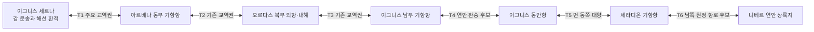

# 대륙 이동 해금과 항로 연결

이동은 **기존 세계에 있는 항로를 주인공이 이용할 조건을 얻는 것**이다. 사건을 끝내면 바다가 생기거나 세계의 상인 모두에게 처음 길이 열리는 구조가 아니다. 아래 G 표는 진행 조건, T 표는 수송 연결을 소유한다. 레벨과 보스 처치 횟수를 같은 것으로 다루지 않는다.

Map Maker로 [5대륙의 위치·해상 교류권](../2026-11-01-world-map.md)과 [계산 보정 지도 안내](../../../../ArtDirection/EtherWorldMap.md#계산-보정본)를 기준으로 검토한 **항로·접근 관계도**다. 해안선·좌표·축척·방향을 새로 그리는 지리도가 아니다. 기존 PNG·SVG·JSON은 수정하지 않았다. 항구의 실제 좌표·항행 가능성·거리·소요 일수는 미검증이다.

## 이동·이야기 시작 조건

| ID | 완료·준비 조건 | 열리는 것 | 미완료 시와 귀환 |
|---|---|---|---|
| G0 벨레스 출항 | 바르툴 해방·현장 복구·마을 인계, 다음 아침 점검 이상 없음, 예정 운송 배편 | 타르넬·로덴으로 내려가는 첫 여정. 세계수 상부 수관을 보는 장면에서 첫 장 종료 | 점검 이상이 남으면 출항을 미룬다. 세르나나 해외 출항과 같은 사건이 아니다. |
| G1 아르베나 왕래 | 세르나 구조·해수 대응·허가 범위 화물 반출, 로덴 수령 확인, 수리·비용 인계, 구조 선주가 연결한 왕복 선실 확보 | 세르나에서 아르베나의 기항 항구와 연결된 공개 지역으로 선택 방문 | 이그니스 세계수 결말은 아직 요구하지 않는다. 기존 왕복편으로 돌아올 수 있다. 세계수 위기 대응은 각 지역의 임시 운영이 인계된 상태에서 진행한다. |
| G2 아르베나 본편 | G1과 이그니스 중앙 강제 채취 중단·필수 운용 인계, 가공장 조합의 기술 교류·사고 조사 계약 수락 | 아르베나 실종 선단의 정식 조사와 원양 후속 여정 | 선행 방문 때 주민·흔적·계약은 존재한다. 이그니스 결과를 설명할 수 있고 조합이 선박·조사비를 대는 계약이 성립하는 시점이 G2다. 레벨 장벽으로 대륙을 통째로 잠그지 않는다. |
| G3 오르다스 항로 | G2 조사에서 선원 구조·항로 확보, 계약 물자 행선지 확인, 자유선주회의 배편·안내 확보 | 오르다스 외항 입항·내해 진입로 조사와 고원 통행 협상 | 내해 봉쇄는 오르다스 내부 사건이다. 외항에는 들어갈 수 있어야 해결에 착수할 수 있다. 봉쇄 해결을 대륙 첫 입항 조건으로 요구하지 않는다. |
| G4 세라디온 원양 항해 | G3 뒤 내해·고원 통행 회복, 현지 수원관리자의 초청과 항해 자료 검증, 원양 선박·선원·왕복 보급 계약 | 이그니스 동안항 환승을 거친 세라디온 항구 입항 | 원양 선박 확보 전에는 공개된 기존 지역을 왕래한다. 세라디온에만 있는 물건을 첫 입항 필수품으로 요구하지 않는다. |
| G5 니베르 원정 | G4 뒤 세라디온 주민 수원 분리·시험 확대 중지, 최근 시험대의 구조 요청·위치 확인, 극지 개조와 귀환 비축·피난 계획 확보 | 니베르 연안 상륙과 시험대 구조·조사 | 극지 개조 기술은 오르다스에서 협력을 얻고 부품·시공은 출항 전 항구에서 확보한다. 니베르에서 얻을 재료를 첫 상륙 조건으로 쓰지 않는다. |
| G6 세라디온 결말 | 니베르에서 생존자·자료·잔존 장치를 대조해 시험대의 실패 원인·분리 조건과 기록 확보, 세라디온 현지 관리자와 적용 조건 대조·대피·필수 수원 운용 준비 | 강제 재가동 저지·중추 방어체 돌파의 결말 사건 | 니베르에서 돌아오는 배는 G6 완료와 무관하게 이용한다. 조사를 중단해 귀환하면 결말 사건은 보류하고 구조·자료 확인을 다시 준비한다. |

G1은 항해 이용권, G2는 본편 조사 계약이다. 선행 탐색을 하지 않아도 이그니스 결말 뒤 G1·G2를 이어 진행할 수 있다. G1에서 아르베나의 모든 도시·고위험 유적까지 완전히 개방됐다고 보장하지 않으며, 공개 지역 밖은 현지 통행·생활권 조건으로 다룬다. 아직 작성하지 않은 해외 사이드 퀘스트를 완료했다고 전제하지 않는다.

## 수송 관계도

양방향 화살표는 **배편을 준비해 왕래 가능한 관계**다. 즉시 이동·항상 출항·같은 날 왕복을 뜻하지 않는다. 위 관계도는 실제 동서남북 배치를 표현하지 않는다. 세계지도에서 이그니스는 북방 중앙, 아르베나는 서남, 오르다스는 남서, 세라디온은 동쪽 먼 대양 건너, 니베르는 남극 육지라는 관계를 유지한다.

| 연결 | 근거와 이동 수단 | 유지할 조건·미검증 |
|---|---|---|
| T1 세르나·아르베나 | 기존 이그니스 남부·아르베나 동부 교역 관계에 세르나의 해선 환적을 연결하는 후보 | 강배에서 원양·연안용 계약 선박으로 갈아탄다. 세르나 외항의 정확한 흘수·항만 구조는 미정이다. |
| T2 아르베나·오르다스 | 기존 아르베나 남동부·오르다스 북부 항구 교역권 | 아르베나 기항항 사이의 연안 이동을 포함한다. 국호만으로 모든 항만의 입항 권리를 얻지 않는다. |
| T3 오르다스·이그니스 남부 | 기존 이그니스 남부·오르다스 북동부 해상 관계 | 오르다스 내해에서 해협을 통과해 외항으로 나온 뒤 기항·보급한다. 같은 포식자가 전 항로를 추격하지 않는다. |
| T4 이그니스 남부·동안항 | 기존 동안항의 조선·항해 역할을 활용하는 새 연안 환승 후보 | 대륙을 가로지르는 강 하나를 새로 만들지 않는다. 해안을 따라 기항하며 이동하는 방식으로 두고 거리·곶의 항행은 미검증이다. |
| T5 동안항·세라디온 | 기존 이그니스와 세라디온 사이의 먼 동쪽 대양 관계 | 기항지가 적은 원양 항해다. 선박·선원·예비 식량과 귀환 비용을 준비한다. 방문 순서만으로 실제 항해가 검증되지는 않는다. |
| T6 세라디온·니베르 | 기존 남쪽 별도 탐사권에 최근 시험대 항로를 연결하는 새 원정 후보 | 세라디온 기항항에서 남부 출항 거점까지 이동·보급한 뒤 연속된 남극해를 건넌다. 해빙 창·기상·피난·보급 항로는 후속 검증이 필요하다. |

니베르에서 세라디온으로는 같은 원정의 되돌아오는 항로를 사용한다. 월드 지도 좌우 끝이 이어진다는 사실을 이유로 세라디온·아르베나를 검증 없이 즉시 연결하지 않는다. 상업 항로와 최근 시험대의 조건부 원정은 구분한다.

## 재방문·실패·성장

출항 시 왕복 선실 또는 귀환 협약을 확보한다. 대륙 도착 후 필요한 승무원·장비를 몰수해 복귀를 임의로 막는 전개는 기본안에 넣지 않는다. 해빙·폭풍으로 지연될 수는 있지만 그때의 대기·보급·대체편은 상세 설계가 필요하다. 아직 정하지 않은 대기 시간을 실제 게임에서 강제하지 않는다.

주요 전투 실패는 해당 현장의 재도전·철수로 이어지며 전체 항로를 영구 폐쇄하지 않는다. 반복 보스 처치로 왕복권을 갱신하지 않는다. 구조·운항·계약·시험 중단은 각각의 완료 조건이며 생물의 최종 살해가 모든 해금의 공통 조건은 아니다.

이그니스의 잠정 공급은 감산·비축·지역 담당자의 인계로 유지하며, 해외 선택 방문에 숨겨진 실시간 세계 멸망 타이머를 두지 않는다. 후반 원정 전에 세라디온 관리자가 확대 시험을 잠정 중지한다. 귀환 뒤 강경파의 점거는 조사 결과 공개와 계약 취소에 대한 대응으로 발생하므로 주인공이 해외를 둘러본 시간만큼 자동으로 재난이 진행되지 않는다.

레벨은 이 해금표의 선행 조건이 아니다. 전체 성장 곡선은 후속 재설계하며 후기 대륙에도 낮은 위험 생물·안전한 길·고위험 선택지를 함께 둔다. 아르베나를 선행 방문했다고 이그니스 모든 전투가 무의미해질 정도의 필수 고급 보상을 주는 안은 전제하지 않는다. 실제 보상량·수준별 난도는 미정이다.

## 정합 확인 범위

해금 조건은 G0부터 G6까지 앞선 사건이나 출항지에서 확보 가능한 준비물만 참조한다. 니베르 귀환은 G6와 분리했고, 오르다스의 내부 봉쇄 해결을 첫 입항 조건에서 제외했다. 이그니스 동안항 환승은 완료한 세계수 결말을 재연하지 않는다. 기존 다섯 대륙과 바다 분리를 유지했다.

실제 해안선에 항로를 투영하거나 거리·날씨·급수·선속을 계산하지 않았다. 따라서 이 산출물은 검토 가능한 진행·수송 관계도이며 해도·항해 보증·UE 이동 검증이 아니다.
