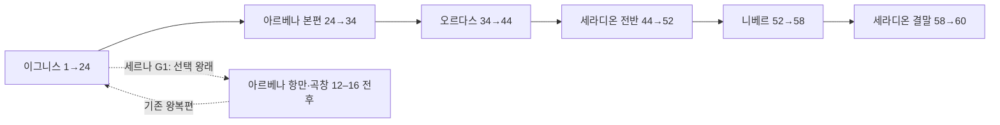

# 5대륙의 공통종·고유종과 전체 성장

[니베르 내륙 분포](2026-11-12-niber-expedition-rescue/spaces-and-ecology.md)에 새 10형태·10생활 단위·21개체와 54→58의 남은 2·1·1을 배정했다. 첫 상륙과 합쳐 니베르 성장 3·1·2, 선택 +2를 유지하며 기존 세계 도감·지역 수치는 보존한다.

[니베르 첫 탐색 배치](2026-11-11-niber-first-landing/spaces-and-ecology.md)에 현행 5형태·6생활 단위·11개체와 일반 해안 동물을 배치했다. 52→54에 필드 1·조사 1을 사용하며, 니베르 잔여 필드 2·주요 목표 1·조사 1과 선택 성장 +2를 유지한다. 기존 세계 분포·수치·도감은 보존한다.

[남부 원정항의 분포·성장](2026-11-10-seradion-polar-departure.md)은 추가 습지 2형태·4개체와 52 유지, 선택 +2 유지·니베르 성장 예산 보존을 확인할 때 읽는다. G5 준비에 새 필수 보스·레벨 상승분을 추가하지 않는다.

[세라디온 현용 수원 분포](2026-11-10-seradion-waterworks.md)는 새 8형태·8생활 단위·20개체와 별도 구조체 2기를 배치한다. 남은 필드 1·주요 목표 1·조사 1을 사용해 49→52와 전반 총 4·2·2를 유지하며 선택 성장 +2도 보존한다.

후속 [세라디온 상류 생활권](2026-11-10-seradion-forest.md)에 새 14형태·16생활 단위·30개체를 배치했다. 45→49에 필드 3·주요 목표 1을 쓰고 후속 1·1·1을 남겨 세라디온 전반 4·2·2와 52를 유지한다. 기존 도착항 개체·형태 범위와 세계 199형태는 보존한다.

후속 [세라디온 첫 탐색](2026-11-10-seradion-arrival.md)에 SE1의 8형태·19개체를 배치했다. 환승은 44 유지, 첫 비교 조사에 조사 예산 1로 45, 남은 필드 4·주요 목표 2·조사 1로 전반 목표 52를 유지한다. 세계 64항목·199형태와 개체의 고정된 위험 범위를 늘리지 않는다.

후속 [오르다스 고원·흰침 분포와 성장](2026-11-10-ordas-highlands.md)에 새 15형태·32개체와 별도 구조체 4기·경비 5명을 배치했다. 남은 38→44에 필드 3·주요 목표 2·조사 1을 배정해 오르다스 전체 6·2·2를 유지한다. 세계 64항목·199형태는 늘리지 않으며 아래 예정 문구는 이전 단계의 기록이다.

후속 [오르다스 외항 탐색](2026-11-09-ordas-arrival-investigation.md)에 13형태·32개체와 별도 구조체 3기·경비 6명을 배치했다. 이번 34→38은 필드 3·조사 1이고, 후속 38→44에 필드 3·주요 목표 2·조사 1을 남겨 기존 전체 예산을 유지한다.

후속 [아르베나 수색·성장](2026-11-09-arvena-fleet-search.md)은 도착 조사 이후 25→34와 필드 6·주요 전투 2·조사 1을 유지하며 15형태·16생활 단위·36개체를 새 국소 탐색권에 배치했다. 별도 구조체 1기·인간조 4명이며 세계 64항목·199형태·아르베나 32형태를 늘리지 않는다.

후속 [이그니스 S1-S6 연결 점검](2026-11-09-ignis-journey-continuity.md)은 아래 분포·성장 기준을 각 지역 상세 후보와 대조하고 S1 고블린 배정, 선택 성장 보존, 운송·설비 인계를 보완한다. 세계 64항목·199형태와 전체 해금·레벨 기준은 변경하지 않는다.

**64항목을 세계 공통 44항목·대륙 고유 20항목으로 나누고, 기존 199형태를 5대륙에 재배치한다. 주 여정은 이그니스 1-24에서 시작해 세라디온 결말 60 전후까지 이어지는 안이다.** 세르나 뒤 아르베나 선행 탐색은 선택이고, 대륙 이동은 레벨이 아니라 기존 사건·운항 조건으로 열린다.

2026-11-08 사용자의 “이 흐름을 기준으로 64항목을 세계 공통종·대륙 고유종으로 나누고, 대륙별 파생형 분포랑 메인 스토리 진행에 따른 전체 레벨링을 다시 구성해서 문서에 반영” 요청에 따른 창작 후보다. [5대륙 여정](2026-11-08-five-continent-mainline.md)을 작업 기준으로 사용한다. 종의 정체·외형·첫 장 정본·기존 36곳 좌표를 보존하고, 분포·성장 수치는 새 후보로 제안한다. 정본 채택이나 UE 구현은 아니다.

## 읽는 순서와 소유

| 문서 | 소유하는 내용 |
|---|---|
| [중앙 탐색 상세](2026-11-09-central-exploration.md) | S6 21→24·6항목/8형태를 적용한 27장소·13생활 단위·34개체·별도 구조체 5기, 공급·세력·최종 접근 지도 |
| [북부 탐색 상세](2026-11-09-north-exploration.md) | S5 18→21·7항목/9형태를 적용한 26장소·13생활 단위·34개체·별도 구조체 6기, 구조·기록·왕복 지도 |
| [세르나–켈바–하르덴 탐색 상세](2026-11-08-serna-harden-exploration.md) | S4 14→18·8항목/10형태를 적용한 공공 환승·계곡/고원 30장소·17생활 단위·비룡 전투·시험·왕복 지도 |
| [로덴–세르나 탐색 상세](2026-11-08-roden-serna-exploration.md) | S3 10→14와 7형태를 적용한 25장소·하구/항만 생활권·수위별 퇴로·구조·반출·귀환 지도 |
| [타르넬–로덴 탐색 상세](2026-11-08-tarnel-roden-exploration.md) | S2의 6→10 범위를 적용한 22장소·13형태·생활권·구조 사건·왕복 지도. 세계 분류·199형태·해금은 유지한다. |
| [64항목 분류](2026-11-08-world-distribution-and-leveling/species-distribution.md) | 모든 기본 ID의 공통·고유 구분, 대륙과 유지 조건, 보류 7항목 |
| [199형태 배치](2026-11-08-world-distribution-and-leveling/variant-distribution.md) | 모든 형태 ID의 현행 대륙·권역·교전 권장 범위와 외형 원문 연결 |
| [지역별 생태](2026-11-08-world-distribution-and-leveling/regional-ecology.md) | 자연환경·일반 동물·먹이·생활·거점·이동·사람과의 충돌, 분포 관계도 |
| [전체 레벨링](2026-11-08-world-distribution-and-leveling/progression.md) | 주인공 성장, 주요 전투와 구조체, 선택 탐색·재방문·해금·성장 예산 |
| [독립 검토](../../Reviews/2026-11-08-world-distribution-and-leveling-review.md) | 분류·수량·수치·정본·플롯 정합 점검과 미검증 |

## 배분 결과

| 대륙 | 공통 항목 출현 수 | 고유 항목 수 | 합계 항목 수 | 형태 수 | 역할 |
|---|---:|---:|---:|---:|---|
| 이그니스 | 36 | 4 | 40 | 59 | 숲·강·해안·고원·설선·세계수로 기초 관찰과 싸움의 폭을 익힌다. |
| 아르베나 | 17 | 4 | 21 | 32 | 항만·곡창·절벽 생활권에서 해상 구조와 관계·매개 추적을 익힌다. |
| 오르다스 | 18 | 5 | 23 | 44 | 고원·내해·풍구의 큰 체형과 협동 집단, 통행·물 배분 갈등을 만난다. |
| 세라디온 | 25 | 5 | 30 | 47 | 범람원·성숙림·현용 설비에 얽힌 큰 포식자와 유한 매개를 다룬다. |
| 니베르 | 11 | 2 | 13 | 17 | 해양 먹이·국소 열·탐사 보급에 의존하는 생태를 통과해 사람과 기록을 되찾는다. |
| 합계 | 107 출현 | 20 | 127 출현 | **199** | 공통 항목의 대륙별 중복을 제거하면 **64항목**이다. |

44개의 공통 항목은 두 대륙 이상에 등장한다. 고유 20항목은 이그니스 4·아르베나 4·오르다스 5·세라디온 5·니베르 2다. 공통은 어디에나 흔하다는 뜻이 아니다. 개체 수와 종 수, 형태 수, 대륙별 출현 수를 혼동하지 않는다. 이번 199형태는 대륙 간 중복 배치가 없으므로 형태 열은 단순 합계가 가능하다.

니베르가 적은 이유는 작업 누락이 아니라 식생·열·보급의 제약을 설계에 반영했기 때문이다. 니베르도 모든 배치 형태의 생활권과 수치를 작성한다. 이 수는 실제 기후·먹이 수지를 계산한 결과나 제작 할당량이 아니다. 지역마다 같은 수를 맞추는 대안은 도감의 균형을 보여 주기 쉽지만 국소 열원에 많은 생물을 억지로 몰아넣게 된다. 기존 135 대 64를 유지하는 대안은 수정량이 적지만 모든 기본 항목이 이그니스에 먼저 등장해 다른 대륙의 고유성이 약해진다.

## 메인 성장 개요

이는 공간 지도나 강제 레벨 순서가 아닌 진행 비교도다. 60은 본편 예상 도착점이며 최고 레벨을 확정하지 않는다. 선택 탐색으로 앞서갈 수 있고, 후반 대륙에도 4-14 정도의 낮은 위험이 남는다. 반대로 초반 대륙의 선택 심부는 당시 주 여정보다 어렵다. 실제 경험치·플레이 시간·장비 성장·레벨 차이 효과는 아직 구현·검증하지 않았다.

## 이전안과 충돌할 때

이 문서군이 **현행 후보의 분포와 성장**을 소유한다. [64항목·199형태 이전안](2026-11-08-worldwide-monster-variants.md), [초기 파생형](2026-11-08-monster-variants.md), [이그니스 분포 v2](2026-11-08-continent-ecology-progression-v2.md)는 당시 수치·지역·외형을 보존한 비교 자료다. 종의 기본 정체와 외형은 계속 참고하되, 이그니스 135형태·1-40·해외 X 전용이라는 이전 분포 규칙은 새 표에 적용하지 않는다.

이그니스의 첫 장, 세계수 강제 채취 중단과 운영 인계, G0-G6의 사건 조건, T1-T6의 운항 관계, 세라디온 시험 확대 중단 뒤 니베르행, 조사·전투 성공을 요구하지 않는 니베르 귀환 선택지는 유지한다. 귀환의 실제 운항·보급 조건까지 없애지 않는다. 해외를 서로 연결된 육지나 세계수 뿌리로 만들지 않는다.

일반 동물과 몬스터를 구별하며, 고블린·오크·나가 등 지성 집단을 종 전체의 적으로 처리하지 않는다. 색은 외형 단서이고 강함에는 체형·성장·장비·공급·행동 차이가 함께 있어야 한다. 모든 무기의 착지·관절·응결·공격 후 접근 창을 마련하는 원칙을 유지한다.

미정은 상세 좌표·개체 수·무리 크기·실제 활동 반경, 항행·기후·먹이 수지, 수치별 능력치·경험치·체감 전투 난도다. 이번 표는 전체 세계를 구성할 플롯·생태 설계이며 199형태를 전부 제작한다는 약속이 아니다.
