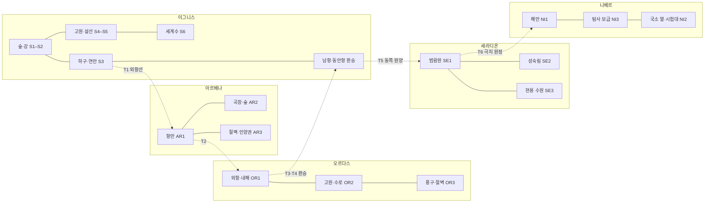

# 대륙별 자연환경·동물·몬스터 생활권

S4 계곡·고원은 [켈바·하르덴 탐색 상세](../2026-11-08-serna-harden-exploration.md)에 17생활 단위·10형태·45개체와 구조체 1기, 일반 동물·물 배정·먹이 운반·다른 귀환길을 연결했다. 세계 분류·형태·권장 범위와 기존 정착 좌표를 유지한 국소 배치 후보다.

S3 하구·항만은 [로덴–세르나 탐색 상세](../2026-11-08-roden-serna-exploration.md)에 12생활 단위·7형태·33개체와 일반 동물·작업자의 생활을 연결했다. 세계 분류·형태·권장 범위를 유지한 국소 배치 후보다.

S2의 장소·활동 반경·경보·왕복 경로는 [타르넬–로덴 탐색 상세](../2026-11-08-tarnel-roden-exploration.md)에서 구체화했다. 아래 세계 분포를 바꾸지 않고 두 확대 생활권에 13형태·45개체와 구조체 2기를 배치한 후보다.

몬스터를 사건 시작점마다 배치하지 않고 **먹이·물·휴식처·거점·운반 경로를 가진 세계의 주민**으로 둔다. [64항목 분류](species-distribution.md)와 [199형태 배치](variant-distribution.md)를 공간 관계로 읽는 창작 후보다. 아래 대표 항목은 설명용이며 전체 분포는 199형태 표가 소유한다.

각 권역 안에 일반 생태, 사람과 겹치는 낮거나 중간 위험의 활동권, 큰 포식자·무장 집단·설비가 지키는 높은 위험의 영역을 섞는다. 모든 권역이 세 층을 같은 비율로 갖거나 세 겹의 원으로 둘러싸인다는 뜻은 아니다. 주인공은 길을 따라가거나 옆으로 탐색하며 교전·관찰·우회·후퇴를 선택한다. 스토리 보스가 생기기 전에도 이 생활권은 존재한다.

## 이그니스: 숲에서 설선·세계수까지

| 권역 | 자연환경·일반 동물 | 대표 몬스터·활동 경로 | 사람과 겹치는 이유·메인 경로 |
|---|---|---|---|
| S1 벨레스 | 계곡 숲·얕은 물가·작업장. 다람쥐·숲새·토끼·사슴, 물을 찾아오는 일반 늑대 | 고블린 A·B의 기존 두 거점과 생활·약탈·운반조, 늑대의 물 접근, 파수꾼의 관리 구간을 유지한다. | 기존 숲 탐색과 다른 길 귀환을 그대로 쓴다. 바르툴은 결박 해방·생존, 복구·인계 뒤 출항이다. 새 대륙형이나 추가 전투 무리를 끼워 넣지 않는다. |
| S2 타르넬–로덴 | 강변 단·여울·수액 숲·광물 배수굴. 물새·어류·수달·작은 설치류 | 여울턱 A·B는 어살→그늘 바위, 유리턱충 A·B는 침전 배관→정비로, 고블린 C는 높은 강변 운반로, 코볼트 A·B는 마른 굴턱을 쓴다. | 낚시·목재·정비 운반이 먹이터와 교차한다. 강변과 숲길에서 자연스럽게 싸우고, 열린 작업로·둑길로 다른 귀환 경로를 잡는다. |
| S3 세르나 | 하구·갈대섬·갯바위·항구 잔해. 갈매기·도요새·어류·패류·물개류 후보 | 돌등게 A·B는 간조 잔해, 하피 A는 절벽→어획물, 청등 해수는 어군→그늘 수로. 능갑 해수 영역은 더 바깥에 있다. | 버려진 어획물과 침몰 잔해가 먹이를 집중시켰다. 부두 일상로·인양로·깊은 수로를 나눠 강한 개체가 공공 부두에 항상 붙지 않게 한다. |
| S4 하르덴 | 고원·채석장·바람 절벽·잔열 작업장. 산양·매·까마귀·고산 설치류 | 협곡 오크의 수렵·운반, 어린/성체 바위트롤의 저장 동굴, 비룡 A·B의 둥지→사냥 골짜기, 작은 불씨도롱뇽의 잔열 틈 | 작업로와 둥지 아래 통과선이 겹친다. 넓은 우회 능선과 짧은 작업장 통로의 위험이 다르며, 무리 경계 뒤에도 일반 동물 구간이 남는다. |
| S5 북부 | 설선·침엽수 계곡·겨울 관문. 사슴류·산토끼·여우·설조류 | 설원아귀 A·B는 먹이 이동을 추적, 백각거수 A·B는 식생 골짜기를 순회한다. 망령·겨울지기는 먹이와 별개인 기록·시설 경계에 묶인다. | 피난로가 거수의 이동길과 겹쳐 유도가 필요하다. 거수의 뿔과 쓰러진 나무로 우회 가능성을 먼저 보여 주고, 설원아귀 사냥권과 시설 경계를 한 무리로 연결하지 않는다. |
| S6 세계수 | 지상 뿌리권·그늘 수로·고사목·관리 길. 작은 새·딱따구리·설치류·사슴류 | 천공충 A·B는 목질 먹이터, 트리엔트 A·숲수호령 A·B는 개별 경계, 균류보행체 B는 고사 유기물 층을 쓴다. | 강제 채취와 휴식 부족이 사람의 진입·정비를 더 어렵게 만든다. 생물을 모두 정리하지 않고 작업 범위를 나눠 중앙 정지·필수 공급 인계를 끝낸다. |
| E1 서부 | 건조 절벽·계곡·바람 선반. 산양·매·도마뱀 | 갈고리날개 A·B, 동막 비룡, 청석 바실리스크, 적등 드레이크의 서로 다른 높이·그늘 영역 | 메인 고개와 이어지는 선택 탐색권이다. 위협 흔적을 보고 아래쪽 돌아가는 길을 택할 수 있다. 모든 포식자가 같은 둥지에 겹치지 않는다. |
| E2 동부 | 초지·곡창 가장자리·낮은 바위. 토끼·사슴·들새·일반 가축 | 모래털 놀, 얼룩다리 켄타우로스, 흙깃 코카트리스, 얼룩깃 히포그리프 | 곡물·가축·사냥 경계에서 갈등이 생긴다. 목축·교역하는 집단과 약탈조를 구별해 협정·호위·교전이 공존하게 한다. |
| E3 남부 | 넓은 여울·갈대·고사목 습지. 물새·개구리·어류·수달 | 넓은턱 여울턱, 적목 천공충, 갈대비늘 리자드맨이 담수·고사목·어로 거점을 나눠 쓴다. | 사람의 어살·목재 회수와 생활권이 겹친다. 이곳을 골랐다는 이유로 세라디온 고유 식인덩굴·히드라까지 복제하지 않는다. |

S1의 개체 수·거점·생활조와 추격 기준은 [고블린·일반 생태 v2](../2026-11-06-opening-and-continent/2026-11-07-goblin-territories-and-wildlife.md)가 계속 소유한다. 다른 지역의 위 표는 같은 수준의 좌표나 무리 수를 확정한 것이 아니다. 이그니스의 대도시 8·일반 도시 12·마을 16과 수계·길의 좌표는 [36곳 지도](../../../../ArtDirection/EtherWorldMap/2026-11-07-continent-coordinate-map.md)를 유지한다.

## 아르베나: 공개 항로와 깊은 인양권

| 권역 | 자연환경·일반 동물 | 생활권·파생형 | 갈등과 접근 변화 |
|---|---|---|---|
| AR1 항만·운하 | 조석 운하·건조 창고·낡은 부교. 갈매기·쥐·고양이·어류 | 약한 모래귀 고블린과 청막 슬라임은 폐자재·배수 틈, 통껍질/궤짝등 미믹은 방치 창고, 구울·염막 시체병은 폐쇄 잔해에 둔다. 흡혈귀·도플갱어·서큐버스는 알려진 관계망과 유한 매개를 가진 소수다. | 메리온 항만연합과 자유선주회가 공공 항로·거래를 유지한다. 모든 화물이 괴물·계약의 매개이거나 모든 상인이 가담한 것은 아니다. G1 공개 구역과 G2 구조 계약의 조사 구역을 구분한다. |
| AR2 곡창·낮은 숲 | 농경지·수로 둑·낮은 수액 숲. 들새·토끼·사슴·여우·가축 | 청목/붉은볏 코카트리스, 황띠 말벌, 가는뿌리 맨드레이크가 작물 가장자리에서 활동한다. 요정은 비적대 관찰·교섭, 강한 후천·계약 존재는 은신처와 공급처가 있는 선택 배후에 둔다. | 에스텔 곡창왕국의 농민과 가공장조합이 물류를 이어 간다. 인양 사건과 무관하게 수확·급수·해충·사냥 경계의 일상이 있고, 조사자가 사람의 생업을 멈추게 하지 않도록 우회한다. |
| AR3 절벽·연안 | 해안 절벽·얕은 패류대·깊은 어군·침몰선. 바닷새·패류·물개류·해양 어류 | 백석 돌등게·백깃 하피는 얕은 가장자리, 먹깃 하피·풍정령·돛갈퀴 해수는 깊은 절벽/인양권에 있다. 부표껍질 미믹은 폐부표 주변의 별도 은폐형이다. | 배가 남긴 먹이와 가공 부산물의 흐름이 포식자를 옮겼다. 피해 선원 구조와 정상 운항 회복이 목표다. 같은 종 전멸이 항로 해금 조건은 아니다. |

생활 흐름은 어획·가공 부산물→소형 연안 생물→큰 포식자, 그리고 부두 수리→폐자재 회수→고블린 운반이다. 수거와 관리가 회복되면 부두 접근 압력은 줄고 자연 서식지의 개체군은 남는다. 선행 방문에서 봤던 고블린·코카트리스가 본편 때 갑자기 강해지지 않는다. 깊은 곳을 조사할 작업선·안내·계약이 생기면서 기존 강형 영역을 더 멀리 탐색한다.

## 오르다스: 물·목초·통과권

| 권역 | 자연환경·일반 동물 | 생활권·파생형 | 갈등과 접근 변화 |
|---|---|---|---|
| OR1 내해·저수지 | 석회 연안·어장·저수 둑·외항. 물새·어류·작은 설치류 | 염갈기 트롤은 어류 저장처, 염회 사이클롭스는 바위 쉼터, 메두사 A·X와 라미아 B·X는 그늘 돌길·거래 거점을 나눠 쓴다. 가고일은 별도의 구조체다. | 바라크 내해왕국과 수로 관리자의 통제, 봉쇄 집단의 요구를 구분한다. G3로 먼저 외항에 들어와 진입로를 조사하므로, 봉쇄를 해결해야 처음 입항하는 순환 조건이 없다. |
| OR2 고원 목초·수로 | 고원 초지·계단식 수로·광물 굴·돌길. 산양·야생 양류·토끼·맹금·가축 | 적점 코볼트는 작은 굴, 능선갑주 코볼트·철갑 오크는 장비와 작업 거점, 켄타우로스·미노타우로스는 목초·돌길 생활권을 쓴다. 큰 오우거·거인은 저장·채집권이 따로 있다. | 오르문 고원연합의 목축·운반과 물 배분이 생존에 직결된다. 점거 거점 외 주민을 적으로 만들지 않는다. 급수 길과 몬스터 먹이 길이 겹치면서 호위·우회·교섭·전투가 생긴다. |
| OR3 풍구·절벽 | 건조 능선·풍구·큰 동굴·그늘 암반. 산양·매·도마뱀·소형 설치류 | 흰침 만티코어, 판뿔 미노타우로스, 넓은등 에틴, 돌주름 사이클롭스의 큰 영역을 분산한다. 바실리스크·전갈은 낮은 그늘, 그리핀은 높은 둥지, 암정령은 국소 매개 지점에 둔다. | 수로 점검·고개 통행이 각 영역의 일부를 지난다. 대형 개체는 모든 길을 쫓지 않고 먹이·둥지 방어 범위로 돌아간다. 풍구의 통과권 회복은 모든 고유종 사냥과 다르다. |

초식·목축 집단이 물을 쓰고, 작은 사냥꾼과 대형 포식자가 그 이동권 바깥에서 먹이를 얻는다. 사람이 수로를 막으면 물 접근이 한곳에 몰리고 충돌이 늘어난다. 물 배분을 회복하면 통행이 분산되지만 포식자·약탈 집단이 사라지지는 않는다. 강한 철갑 집단의 수송·교대가 생활권 사이를 오가는 전투를 만들며, 무리 전체를 동시에 호출하는 경보는 피한다.

## 세라디온: 범람원과 현용 수원

| 권역 | 자연환경·일반 동물 | 생활권·파생형 | 갈등과 접근 변화 |
|---|---|---|---|
| SE1 범람원 | 갈대 수로·범람 농지·고사 유기물·어장. 물새·개구리·어류·작은 포유류 | 히드라는 넓은 어류 먹이권, 리자드맨·나가는 어로·통행 사회, 식인덩굴과 맨드레이크는 국소 군락, 늪트롤은 그늘 저장처를 쓴다. | 사하르 수로왕국의 급수·농사와 큰 포식자의 영역이 겹친다. 배수로를 열었다고 바로 모든 수변 생물을 적으로 만들지 않는다. 수원 접근과 구조를 위해 일부 영역을 비켜 가거나 싸운다. |
| SE2 성숙림·분지 | 수액림·깊은 분지·목재층·바깥 건조 사면. 숲새·사슴류·원숭이류 후보·일반 파충류 | 키메라 세 형태는 다른 크기의 먹이권, 흑갑 드레이크는 건조 휴식처, 수지거미·말벌·지네는 각 층의 작은 먹이권. 트리엔트·드라이어드·수호령은 개별 숲의 경계에 묶인다. | 탈레아 자유도시연맹의 목재·운반로가 깊은 영역에 접근한다. 줄무늬 키메라를 상대할 때도 다른 군락의 전멸이나 후속 세계수 연결을 요구하지 않는다. |
| SE3 수원·옛 설비 | 현용 물길·석실·정비 턱·국소 잔열. 물새·박쥐·어류·작은 설치류 | 나가 B·X의 수로 거점, 수정령·기록 망령·해골/시체 상태, 유한 계약 존재·구조체가 서로 다른 조건으로 활동한다. 리치의 용기 심부는 선택 위험으로 분리한다. | 수원관리회와 사업단의 정상 기술자·은폐 강경파를 구분한다. 주민은 계속 물을 써야 하므로 모든 공급 차단이 해법은 아니다. 결말은 심부 점거·재가동을 멈추며 급수를 보호한다. |

물과 식생은 살아 있는 생태를, 보존된 유물·기록·계약은 조건부 현현을 지탱한다. 둘을 모두 검은 결정에서 태어난 것으로 설명하지 않는다. 니베르행 전 시험 확대를 멈추고 필수 공급을 격리한다. 재방문 때는 같은 생물이 같은 곳에 남고, 강경파의 새로운 점거와 준비된 방어체 때문에 특정 설비 구역의 위험이 높아진다.

## 니베르: 좁은 생존권과 넓은 빈 공간

| 권역 | 자연환경·일반 동물 | 생활권·파생형 | 갈등과 접근 변화 |
|---|---|---|---|
| NI1 해안·해빙 | 어군·해빙 가장자리·바람 절벽. 물개류·바닷새·어류·극지 여우류 후보 | 흰배 설원아귀의 사냥권, 백모 능선거인의 드문 채집권, 희귀 용 A·X의 넓은 해양 먹이권을 구분한다. | 탐사대 상륙·보급 이동이 포식자 접근선과 교차한다. 해빙 전역에 동일 밀도로 적을 채우지 않는다. 용은 먼저 큰 흔적·먹이 잔재를 보여 주며 원정 필수 보스가 아니다. |
| NI2 국소 온열·해빙 틈 | 제한된 온열 암반·해빙 물길·짧은 식생대. 작은 곤충·계절 새·연안으로 연결되는 소형 먹이 | 유백 도롱뇽 6-10·냉막 슬라임 4-8은 작은 열원과 잔류물, 낮은뿔 백각거수는 같은 국소 권역의 초본·이끼·지의류 먹이장과 겨울 피난처, 강한 빙편 정령은 시험대 잔류 공급 지점을 쓴다. 적동비늘 용은 온열 절벽에서 쉬고 해양 먹이권으로 나간다. | 이 생물 전부가 한 온천에 모이는 설정은 아니다. 작은 생태 틈, 거수의 국소 계절 이동, 시험 잔해를 서로 나눈다. 낮은뿔형은 작은 고립 무리이며 먹이 수지가 부족하면 배치를 축소한다. 탐사 구조와 분리 조건 조사는 시험대에 접근하는 이유다. |
| NI3 탐사·유실 보급 | 한시적 탐사 거점·흩어진 목재·식량·기록. 해안 새·작은 청소동물, 보급선 따라 들어온 설치류 후보 | 균류보행체는 유기 보급품, 늑대인간은 실제 먹이·은신처, 망령·밴시는 기록·유품·국소 매개, 지옥사냥개는 남은 계약 공급에 묶인다. | 합동극지탐사단과 시험 인력을 구하고 기록을 회수한다. 버려진 보급품이 고갈되면 군락과 일부 현현이 지속할 수 없다. 정치 국가나 끝없는 극지 숲을 새로 만들지 않는다. |

니베르의 17형태는 낮은 위험 4-18, 중간 위험 28-48, 주 여정의 강한 사냥·경계 46-58, 선택적인 용 60-70으로 섞인다. 이 범위는 각 형태 표의 범위를 묶은 설명이고 모든 칸을 채우는 연속 스폰 표가 아니다. 포식자가 없는 이동도 원정의 규모를 보여 주되, 긴 이동 중 반복 조우 수로 시간을 채우지 않는다. 얼음 지형·바람·시야·보급은 준비 과제이고 레벨만으로 사라지는 장벽은 아니다.

## 생활권과 항로 관계도

실선은 같은 대륙의 생태·생활권 인접 관계, 점선은 기존 항로를 묶은 연결이다. 일방 통행이나 몬스터의 대양 횡단 경로가 아니다. 귀환은 운항·보급 조건을 갖춘 반대 항로로 가능하다. 지도상의 절대 방향·거리·해안·수계·국경·동굴 연결을 측정한 그림이 아니다. 분리된 다섯 대륙과 [기존 상대 배치](../2026-11-01-world-map.md)를 유지하고, 항로의 정확한 출발·환승 조건은 [이동 문서](../2026-11-08-five-continent-mainline/routes-and-unlocks.md)를 따른다.

## 활동·추격·빈 구간을 상세화할 기준

둥지·거점은 휴식과 저장, 먹이권은 사냥·채집, 운반로는 두 곳 사이 이동으로 나눈다. 낮밤·조석·작업 교대에 따라 어느 구간에서 만날지가 달라질 수 있지만, 아직 시간표·거리·개체 수는 정하지 않는다. 괴물의 활동을 퀘스트 수락 순간에만 켜는 전제로 쓰지 않는다.

영역 포식자는 둥지·먹이를 지키다 벗어나면 돌아가고, 약탈조는 짐 회수·도주 길을 가지며, 경비는 시설 범위·경보 전달선이 있고, 조건부 존재는 매개가 닿는 범위를 벗어나지 못한다. 추격 종료가 화면의 임의 경계처럼 보이지 않도록 돌아갈 이유와 경계 징후를 먼저 둔다. 협동 무리는 시야·소리·연락 경로가 닿는 무리만 합류한다.

상세 탐색로는 ‘출발→생활 흔적→첫 활동권→쉬거나 돌아볼 자리→다른 생활권과 겹치는 곳→주요 위험→다른 귀환로’로 모의 이동한다. 이는 고정 전투 순서가 아니다. 싸움을 피했을 때·오래 싸워 다른 조가 돌아왔을 때·보스 뒤 돌아왔을 때를 비교해 빈 구간과 과밀 구간을 확인한다. 지금은 21권역(S1-S6·E1-E3·해외 12권역)의 연결 후보이며, 어느 구간이 실제로 몇 분 비거나 몇 마리가 동시에 몰리는지는 미검증이다.
