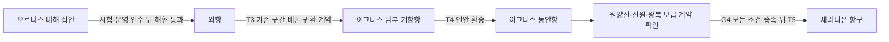

# 점거 해제에서 세라디온 초청까지

[후반 구간](../2026-11-10-ordas-highlands.md)의 주인공은 이미 확보한 현지 수령증·수위·배정 기록·증언·견인 순번을 P03에서 대조한다. 수로청은 계약 범위 위반을 근거로 합동 현장 조사와 작업 구획 회수를 맡고, 주인공에게 전투 중 접근·호위·철수를 부탁한다. 외지인이 왕국의 시설을 독단으로 점령하는 전개가 아니다.

## 사건의 흐름

| 구간 | 목표와 선택 | 전투·대가·변화 |
|---|---|---|
| 합동 진입 준비 | 기존 P03에서 책임자를 정하고 E05의 경계 연락을 갱신한다. 현지 관리자는 생활 급수의 임시 운용·대기 인력·작업 중지 기준을 마련한다. | 기존 OH1 경비 6명은 같은 명부를 유지한다. 이탈·항복하거나 안쪽 명령을 고수하는 사람을 구분한다. 저번 조사 때 만난 적을 새로 재생성하지 않는다. 공동체 대표는 E07에서 E09-H01 협의 장소까지의 예비 통행에 동의한다. |
| 점거 수로 38→40 | E05-C01-C02에서 조사조를 막는 안쪽 계약 경비와 철갑 무장조를 상대한다. | 주인공이 운반 골렘·견인체의 작업면을 분리해 각개로 대응하고 동료의 점검 시간을 번다. 움직이는 하중 밑에서 일제히 싸우지 않는다. 작업 정지 뒤에도 남은 하중·가동 범위를 확인한다. C06 퇴로는 승리 전부터 사용한다. |
| 필수 운용·통행시험 | C03에서 급수 계통과 점거 견인 구동을 구분하고 C04에 원래 관리자를 복귀시킨다. | 힘을 끊어 승리했다는 이유로 주민 급수를 같이 멈추지 않는다. 수위·배정·운용 기록을 점검하고, 선장·붐 담당자가 승인한 C08-P09 시험 도선을 확인한다. 무장조 제압과 정상 운항 허가는 별도 결과다. |
| 고원 탐색·협약 40→42 | E07 예비 합의로 E09-H01에 들어가 H02-H04의 물 배정과 목축길을 직접 확인한다. | 굵은굽 호위 집단·황석 물 운반자·장인들이 원하는 것은 공급과 귀환로다. 주인공은 돌굽 먹이권·모래갈기 사냥권을 통과하고 다른 능선으로 돌아 기록을 맞춘다. 바라크의 허가만으로 오르문 고원의 길을 빼앗지 않는다. |
| 풍구와 흰침 42→43 | H05에서 안내인과 바람·먹이 흔적을 조사하고 F01-F03의 접근·철수 공간을 확보한다. | 흑집게·황갑·회관의 생활권을 거쳐 사건 개체 MN29-X 43과 싸운다. 측풍 때문에 낮아지는 사격 자세와 착지·몸 회수 구간을 이용한다. 추천안은 해당 개체의 처치이며, 실패하면 F03 방향으로 철수한다. |
| 고개 확인·운영 인계 43→44 | F05-F07 다른 길로 돌아 잔류 위험·표지·작업 공간을 확인한다. H07·C04·P03에서 물·통행·운송 인계를 마친다. | 고개 안내인이 시험 운반을 확인하고 수로청·공동체가 운용 시간과 우회·감시 책임을 받아들인다. C05 원장과 수령증·운송 사본을 대조해 세라디온 수원 사업의 최종 발주 연결을 확인한다. 교역 창구를 통해 관리자의 초청과 항해 자료를 검증한다. |

흰침의 측풍·사선·엄폐 이동과 비룡의 착지 판단을 비교할 때는 [두 사냥 상세 후보](../2026-11-13-aerial-hunt-combat-arcs.md)를 읽는다. 아래 기존 전투·생활권·성장·운영 인수·G4 조건은 보존한다.

## 두 주요 전투의 차이

수로 점거 해제전은 **작업면과 사람을 분리하며 조사·회수 시간을 확보하는 전투**다. C01 안쪽의 새 계약 경비 HN1 5명, NH8 철갑 3명과 NS1·NS2 작업 장치가 같은 공간에 있지만 일제 증원 웨이브로 만들지 않는다. 입구 경비가 뒤로 물러나면 주인공은 그 틈에 측면으로 돌아가 견인체의 회수 동작을 읽는다. 장치는 각각의 명령·작업면에 묶여 있고 경비가 항복해도 남은 하중 때문에 접근이 바로 안전해지지는 않는다. 현지 기술자가 하중을 지지하고 운용을 인계받으면 주요 목표를 마친다. 모든 경비를 죽이는 조건은 아니다.

흰침은 **먹이터와 바람그늘을 오가며 길을 점유한 포식자를 추적·사냥하는 전투**다. F08의 가시·뼈·발톱 자국은 같은 사건 개체의 흔적이다. F04마다 다른 보스가 나타나지 않는다. 선행 수로 봉쇄 때문에 운반대가 고개에 몰렸고, 흘린 사료와 뒤처진 가축이 먹이 접근을 늘렸다. 경비가 만티코어를 원격 조종하는 설정은 없다.

전투 전 F03 바위턱과 동쪽 F05 철수턱을 확인한다. 주인공은 가시 방향을 보고 엄폐를 바꾸고, 측풍에 사격 방향을 다시 잡으려 내려오는 순간을 노린다. 근접은 낮은 착지·앞발 회수·꼬리 휘두르기 뒤에 접근하고, 원거리는 선회와 바위 가림을 고려한다. 가시는 유한한 비축이며 즉시 무한 보충되지 않는다. 보충에는 먹이와 시간이 필요하다는 기존 형태 설명을 유지한다. 특정 방패·원거리·속성 무기를 강제하지 않는다.

체력이 낮아져도 가시가 갑자기 무한 재생되거나 새 개체가 증원하지 않는다. 기존 비축과 이동 습성이 압박의 변화를 만든다. 추천 처치 뒤에도 안내인은 잔류 가시·낙석·주변 생물·운반 하중을 따로 확인한다. 시험 운반과 관리 인계 전에는 고개가 정상 개방됐다고 선언하지 않는다. 사망·재시작·세이브 처리와 실제 공격 동작은 구현하지 않는다.

## 인물과 운영의 변화

마렌은 C03의 필수 급수와 견인 구동을 구분하고 H07 장인과 부품·기록을 대조한다. 그는 자기가 수리할 수 있는 장치라도 현지 인력의 정비 주기·물 배정 없이 계속 가동하지 않기로 한다. 주인공은 조사조의 접근을 지키되 통행·물 사용의 최종 서명은 당사자에게 맡긴다. 이전의 구조·역할 분담을 잊었다가 다시 배우는 전개로 되돌리지 않는다.

현지 수로 안내인은 C04까지 운영 연락을, 고개 안내인은 H05 이후의 접근·철수·시험 운반을 맡는다. 같은 인물이 전투·선장·수원관리자 역할을 모두 대신하지 않는다. 인명·상시 동료 승격은 보류한다. 굵은굽 켄타우로스와 황석 거인은 호위·물 운반의 당사자로 다루며, 강한 형태라는 이유로 기본 적대가 되지 않는다.

린은 세르나·로덴 운송, 이르는 중앙·북부 연락에 남는다. 이그니스 남부 기항항으로 갈 계획만으로 둘이 현장에 순간이동하지 않는다. 마렌은 오르다스 운영자가 기록·부품·정지 기준을 인수한 뒤 주인공과 이동할 수 있다.

## 세라디온 초청과 G4의 남은 조건

C05 원장에는 발주 번호·중간 납품처·최종 수령 계약이 있다. 아르베나 사본과 오르다스 인수 원본의 물량·날짜·계약 번호를 맞춰 세라디온 수원 사업으로 이어지는 근거를 확보한다. 원장 하나를 읽고 발주처의 모든 사람이 불법 점거를 알고 있었다고 단정하지 않는다.

P03의 기존 교역 창구는 세라디온 수원관리자에게 사고 조사 결과와 해당 계약 번호를 보낸다. 정상 교역 연락편으로 회신을 받은 뒤 발신인 권한·현지 접수 장소·조사 범위·항해 자료의 갱신 상태를 대조한다. 회신 전에는 ‘초청 요청 중’이고 실제 도착·확인이 끝나야 ‘초청 확인’이다. 정확한 왕복 일수는 미정이며 즉시 원격 답신을 전제하지 않는다. 오르다스 수로청의 통행 허가가 세라디온의 초청장을 대신하지 않는다.

| G4 구성 | 이번 끝 상태 | 담당·후속 |
|---|---|---|
| 내해·고원 통행 회복 | 현지 시험·협약·운영 인수 뒤 완료 후보 | 수로청·목축 공동체·안내인이 정해진 운항·통행 범위를 관리한다. 대륙 모든 길이 무위험해진다는 뜻은 아니다. |
| 세라디온 수원관리자의 초청·항해 자료 | 정상 연락 회신과 권한·자료 대조 뒤 확인 후보 | 기존 교역 창구와 선장·항해 담당자가 확인한다. 원본과 증거 사본은 구분한다. |
| 원양 선박·선원·왕복 보급 계약 | **미완료** | 이그니스 동안항에서 선박·선원·비축·귀환 협약을 실제 인수·계약해야 한다. 오르다스 장인회의 기술 협력 약속만으로 충족하지 않는다. |

T3·T4의 기존 구간 배편·귀환 협약은 G4 원양 계약과 별도로 마련한다. G4가 아직 없어도 동안항에 가서 준비할 수 있다. 이번 구간에서는 배편 연결과 다음 준비 장소까지만 정하고, 실제 T3-T5 항해·세라디온 입항을 완료한 것으로 기록하지 않는다. 오르다스 체류·아르베나 귀환도 계속 선택할 수 있다.
