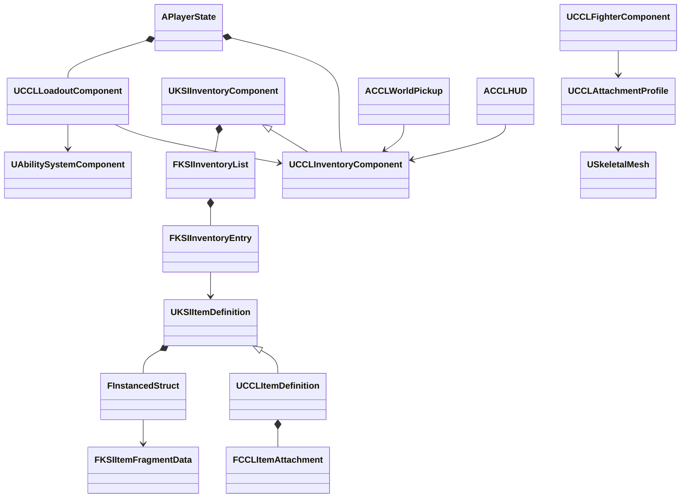

# 인벤토리·장비·성장 설계

마을의 보급품 획득, 장비 장착, 회복품 사용, 스킬 포인트 소비를 전투에 연결했고 Standalone, Dedicated, Listen, 저장 복원, 패키지 화면에서 검증했다. 이 문서는 아이템 정의, 소유, 콘텐츠 초안을 정하고 하위 문서로 안내한다. [StudyRoadmap](StudyRoadmap.md)의 단계 4 사양이며 근거는 [결정 15](decisions/0015-struct-fragments-and-two-handed-gear.md)와 [결정 16](decisions/0016-tagged-slots-and-attachments.md)이다. 값과 콘텐츠 명칭은 구현용 초안이며 최종 밸런스와 세계관이 아니다.

## 하위 문서

| 문서 | 읽는 때 |
|---|---|
| [장비](ProgressionFoundation/Equipment.md) | 장착 규칙, 슬롯과 부착 태그, 변경 순서, 장비 에셋 도구를 바꿀 때 |
| [인벤토리 화면과 일관성](ProgressionFoundation/Inventory.md) | 화면, 입력, 서버 검증, 복제와 저장 경계를 바꿀 때 |
| [성장 검증 기록](ProgressionFoundation/Verification.md) | 인벤토리·장비·성장의 실행 결과와 2026-10-11 후속 수정을 확인할 때 |

## 목표와 책임

| 구성 | 책임과 수명 | 변경 권위 |
|---|---|---|
| ItemDefinition과 Fragment | 공유하는 표시·중첩·장비·소비 정의 | 에셋 |
| InventoryComponent | GUID·정의 참조·수량의 일관된 보관, PlayerState 또는 상자 Actor 수명 | 서버, 소유자에게 복제 |
| LoadoutComponent | 장비·학습 상태와 포인트, GAS 효과 적용, Avatar 교체 연결 | 서버, PlayerState 수명 |
| WorldPickup | 월드 아이템의 한 번만 지급과 소멸 | 서버 |
| PlayerController | 실제 소유 플레이어의 획득·장착·사용 요청 | 요청만 전달 |
| 인벤토리 화면·문맥 | 복제된 아이템·장비·스킬 표시, 선택과 캐릭터 미리보기 | 로컬 플레이어의 공용 UI 관리자 |

공용 `UKSIInventoryComponent`는 Character, 무기, 스태미나, UI를 참조하지 않는다. `UCCLInventoryComponent`가 게임별 음식·탄약 규칙과 저장 참여를 연결한다. 공용 정의와 저장 계약의 경계·검증은 [FrameworkPlan](FrameworkPlan/Stage2.md#단계-2-구현-설계와-검증-기준)이 소유한다. 수량과 GUID는 런타임 상태이며 공유 정의를 수정하지 않는다. 장비와 소비는 Fragment를 조회하는 LoadoutComponent가 실행한다. 소유 Actor의 AbilitySystemInterface로 GAS를 조회하고 현재 Avatar에 장비를 연결하므로, 상자에 같은 인벤토리를 붙여도 GAS가 필요하지 않다([결정 9](decisions/0009-genre-independent-base-systems.md)).

## 아이템 정의

ItemDefinition이 이름·설명·아이콘·최대 중첩 수를 소유하고, 선택 기능은 `FInstancedStruct` 배열로 보관한다. Fragment 구조체의 루트는 공용 `FKSIItemFragmentData`다. 정의에는 Equip, ConsumableData, Visual, SkeletalVisual, HarvestTool, MeleeWeapon, ProjectileWeapon을 조합한다. SkeletalVisual은 Visual의 바닥 표시용 StaticMesh를 상속하고 장착용 SkeletalMesh를 더한다. 무기 속성은 Weapon 계층 안에 둔다. 기존 UObject Fragment 클래스는 저장된 에셋을 `PostLoad`에서 읽는 호환 경로로만 남아 있다.

훈련 목록과 저장 가능한 정의는 `UCCLItemCatalog`(`DA_ItemCatalog`)가 소유한다. Loadout의 훈련 요청과 세션 저장이 같은 카탈로그를 조회하므로, 새 아이템이나 훈련을 추가할 때 코드의 이름 목록을 고치지 않는다. 카탈로그는 중복 저장 이름과 빈 항목을 거절한다. 설정과 저장 거부 규칙은 [SessionFoundation](SessionFoundation.md)의 "정의 카탈로그와 보급품 개수"가 소유한다.

음식과 탄약 실행은 `FCCLInventoryFood`, `FCCLInventoryWeapon`이 맡는다. 발사·채집 실행은 ProjectileWeapon·HarvestTool의 정의 형식과 별개다.

## 콘텐츠 초안

- 월드 보급품은 세션 공유이며 먼저 받은 플레이어에게 한 번 지급한다. 이 임시 정책은 최종 협동·대전의 보상 규칙을 정하지 않는다.
- 철제 건틀릿은 맨손 공격 애니메이션을 쓰고 공격 보너스 10을 준다.
- 회복약은 체력 50을 회복하며 최대 중첩은 20개다.
- 기본 공격 수치는 20이다.
- 훈련 스킬은 공격 숙련과 생명력 훈련이며 각각 포인트 1을 써서 공격 보너스 5 또는 최대 체력 25를 얻는다. 같은 스킬을 중복 습득할 수 없다.
- 시작 포인트는 1이다. 원정 보상의 훈련 포인트는 [ContentFoundation](ContentFoundation.md)이 소유한다.

## 검증 방법

프로젝트 파일 생성과 CCLEditor 빌드 뒤 Standalone·Dedicated·Listen에서 획득·장착·회복·습득 요청을 확인한다. 음수 수량, 없는 GUID, 슬롯 부족, 비용 부족, 중복 습득을 거부하는지 본다. 장착 전후 실제 공격 피해와 재스폰 뒤 인벤토리·장비·학습 상태를 비교한다. 전투 회귀와 UI 캡처도 확인한다.

실행 검사는 `run_campaign_smoke.ps1 -Progression`으로 진행 검사와 함께 한다. 장비 태그 계약은 `Tools/Validation/run_automation.ps1`로 `CCL.Equipment.TagContracts`를 실행한다. 이 도구는 프로세스 종료 코드와 결과 JSON을 함께 검사하고, 결과가 없거나 실행되지 않은 검사가 있으면 실패한다. 실행 순서와 증거 기록은 `ccl8-verify` 스킬을 따른다.
