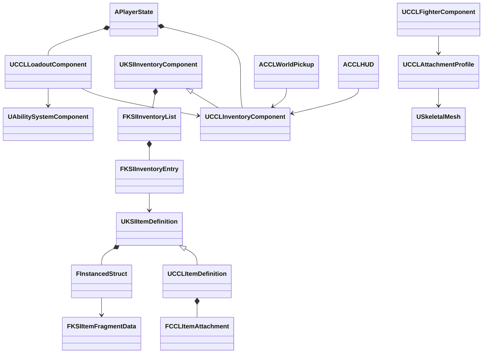

# 인벤토리·장비·성장 설계

마을의 보급품 획득, 장비 장착, 회복품 사용, 스킬 포인트 소비를 전투에 연결했고 Standalone, Dedicated, Listen, 저장 복원, 패키지 화면에서 검증했다. 이 문서는 아이템 정의, 인벤토리 보관, 태그 기반 장비 슬롯과 부착, 회복과 훈련의 계약과 검증 기록을 소유한다. [StudyRoadmap](StudyRoadmap.md)의 단계 4 사양이며 근거는 [결정 15](decisions/0015-struct-fragments-and-two-handed-gear.md)와 [결정 16](decisions/0016-tagged-slots-and-attachments.md)이다. 값과 콘텐츠 명칭은 구현용 초안이며 최종 밸런스와 세계관이 아니다.

## 하위 문서

| 문서 | 읽는 때 |
|---|---|
| [성장 검증 기록](ProgressionFoundation/Verification.md) | 인벤토리·장비·성장의 실행 결과와 2026-10-11 후속 수정을 확인할 때 |

## 목표와 책임

| 구성 | 책임과 수명 | 변경 권위 |
|---|---|---|
| ItemDefinition과 Fragment | 공유하는 표시·중첩·장비·소비 정의 | 에셋 |
| InventoryComponent | GUID·정의 참조·수량의 일관된 보관, PlayerState 또는 상자 Actor 수명 | 서버, 소유자에게 복제 |
| LoadoutComponent | 장비·학습 상태와 포인트, GAS 효과 적용, Avatar 교체 연결 | 서버, PlayerState 수명 |
| WorldPickup | 월드 아이템의 한 번만 지급과 소멸 | 서버 |
| PlayerController | 실제 소유 플레이어의 획득·장착·사용 요청 | 요청만 전달 |
| 인벤토리 화면·문맥 | 복제된 아이템·장비·스킬 표시, 선택과 캐릭터 미리보기 | 로컬 플레이어의 공용 UI 관리자 |

공용 `UKSIInventoryComponent`는 Character, 무기, 스태미나, UI를 참조하지 않는다. `UCCLInventoryComponent`가 게임별 음식·탄약 규칙과 저장 참여를 연결한다. 공용 정의와 저장 계약의 경계·검증은 [FrameworkPlan](FrameworkPlan/Stage2.md#단계-2-구현-설계와-검증-기준)이 소유한다. 수량과 GUID는 런타임 상태이며 공유 정의를 수정하지 않는다. 장비와 소비는 Fragment를 조회하는 LoadoutComponent가 실행한다. 소유 Actor의 AbilitySystemInterface로 GAS를 조회하고 현재 Avatar에 장비를 연결하므로, 상자에 같은 인벤토리를 붙여도 GAS가 필요하지 않다([결정 9](decisions/0009-genre-independent-base-systems.md)).



## 아이템 정의

ItemDefinition이 이름·설명·아이콘·최대 중첩 수를 소유하고, 선택 기능은 `FInstancedStruct` 배열로 보관한다. Fragment 구조체의 루트는 공용 `FKSIItemFragmentData`다. 정의에는 Equip, ConsumableData, Visual, SkeletalVisual, HarvestTool, MeleeWeapon, ProjectileWeapon을 조합한다. SkeletalVisual은 Visual의 바닥 표시용 StaticMesh를 상속하고 장착용 SkeletalMesh를 더한다. 무기 속성은 Weapon 계층 안에 둔다. 기존 UObject Fragment 클래스는 저장된 에셋을 `PostLoad`에서 읽는 호환 경로로만 남아 있다.

훈련 목록과 저장 가능한 정의는 `UCCLItemCatalog`(`DA_ItemCatalog`)가 소유한다. Loadout의 훈련 요청과 세션 저장이 같은 카탈로그를 조회하므로, 새 아이템이나 훈련을 추가할 때 코드의 이름 목록을 고치지 않는다. 카탈로그는 중복 저장 이름과 빈 항목을 거절한다. 설정과 저장 거부 규칙은 [SessionFoundation](SessionFoundation.md)의 "정의 카탈로그와 보급품 개수"가 소유한다.

음식과 탄약 실행은 `FCCLInventoryFood`, `FCCLInventoryWeapon`이 맡는다. 발사·채집 실행은 ProjectileWeapon·HarvestTool의 정의 형식과 별개다.

## 장비

장착 부위는 왼손·오른손·갑옷·신발·망토·목걸이·반지 두 칸이다. 한손 장비와 방패는 어느 손에나 장착하며 기본 손은 오른손이다. 양손 장비는 같은 GUID로 두 손을 점유하고 효과는 한 번 적용한다. 장착 항목은 소유 목록에 남고 가방 슬롯만 `INDEX_NONE`으로 바뀐다. 교체할 때는 새 장비가 비우는 칸을 포함해 이전 장비의 반환 공간을 확인하고, 부족하면 장착 상태와 효과를 바꾸지 않는다. 장비를 가방으로 드래그해 해제할 때는 빈 칸이 필요하다.

좌클릭·우클릭은 왼손·오른손 장비에 정의된 액션을 실행한다. Loadout과 ASC는 같은 PlayerState에 속한다. 손 선택 RPC를 먼저 보내고 GAS 예측 입력을 실행해 서버가 현재 보유 장비로 전투 정의를 고른다. 장비가 전투 Fragment를 갖지 않으면 맨손 공격 정의를 쓴다.

### 태그 설정

2026-10-07 사용자가 장비·무기 설정을 Gameplay Tag로 지정하고 부착 지점 태그를 캐릭터별 실제 소켓에 연결하는 개편을 승인했다. 슬롯 점유는 장착 처리와 저장 검증이 같은 규칙으로 계산한다.

| 설정 | 편집 위치와 계약 |
|---|---|
| 장착 부위 | Equip의 `AllowedSlots`, `DefaultSlotTag`: `Equipment.Slot.*`의 구체적인 슬롯 |
| 한손·양손 | Weapon의 `HandUsage`: `Weapon.HandUsage.OneHanded` 또는 `TwoHanded` 중 하나 |
| 부착 위치 | Visual의 `Attachments`: 슬롯 태그, `Attachment.*` 지점 태그, 아이템별 오프셋 |
| 메시 소켓 | `UCCLAttachmentProfile`의 `ReferenceMesh`, `Bindings`: 지점 태그를 실제 소켓 이름에 연결 |
| 에디터 미리보기 | 프로필의 `PreviewItem`, `PreviewSlot`: 기준 포즈의 캐릭터와 선택 장비 표시 |

`CCLEquipment::GetOccupiedSlots`를 장착과 저장 검증이 함께 쓴다. 복제된 장비 목록은 태그와 GUID로 구성한다. 실제 메시 부착은 Fighter가 프로필을 해석하며, 매핑이나 소켓이 없으면 경고를 남기고 표시를 생략한다. 본 이름을 소켓으로 간주하거나 루트에 대신 붙이지 않고, 프로필에 등록한 실제 소켓만 쓴다. 프로필 데이터 검증과 미리보기는 중복 매핑·부적합한 스켈레톤·잘못된 아이템 설정도 확인한다. 이전 Equip의 양손 플래그와 Visual의 소켓 이름은 로드 변환에만 남기고 편집 화면에서는 숨겼다.

기본 마네킹에는 별도의 명명된 장착 소켓을 추가하고 기존 본과 소켓을 보존한다. 양손 슬롯 점유와 보조 손 IK는 다른 것이며, 양손 무기는 두 손 슬롯을 점유하되 오른손에 메시 하나를 표시한다. 기존 구조체 에셋은 로드할 때 변환하고 저장 형식 1-3은 태그 형식 4로 읽는다.

`Loadout`은 장비 표현과 손 행동을 `ICCLEquipmentPresenter`로 요청하고 `UCCLFighterComponent`가 이 계약을 구현한다. 그래서 Items 폴더는 Combat의 구체 컴포넌트를 include하지 않는다. 장비 변경 알림은 슬롯과 효과를 확정한 뒤 전달하며, 콜백이 돌아올 때까지 Loadout 명령과 인벤토리 쓰기를 막는다. 확정 순서는 아래 [장비 변경의 확정 순서](#장비-변경의-확정-순서), 검증 근거는 [2026-10-11 설계 후속 수정](ProgressionFoundation/Verification.md#2026-10-11-설계-후속-수정)이 소유한다.

### 장비 변경의 확정 순서

2026-10-11 전체 코드 검토의 후속 수정으로 정한 계약이다. 서버 PlayerState의 Loadout이 장착·훈련 상태를 소유한다.

`Equip`, `Unequip`, `Use`, `Learn`은 변경 중 재진입을 거절한다. 장비 배치를 미리 검증한 다음 `BeginTransaction`으로 알림을 묶고 인벤토리 쓰기를 잠근다. 슬롯과 효과 핸들을 확정하고 GAS 속성 배치를 끝낸 뒤 외형을 동기화한다. 마지막으로 `Inventory.OnChanged`를 한 번 보낸다. 이 알림이 끝날 때까지 잠금을 유지한다. 저장 복원도 같은 쓰기 보호를 적용한다. 효과 적용이 거절되면 이전 장착과 인벤토리를 유지한다.

GAS의 효과 추가 콜백 자체를 숨기지는 않는다. 해당 콜백에서 들어온 Loadout 명령과 인벤토리의 공개 변경 API를 거절한다. 콜백이 ASC를 직접 변경하거나 Actor를 파괴하는 임의 동작까지 되돌리는 범용 트랜잭션은 아니다. 알림 지연과 명령 가드는 동기 콜백의 중간 상태 접근을 제한하는 대가가 있다.

엔진 근거는 UE 5.8.3의 `<Engine>/Plugins/Runtime/GameplayAbilities/Source/GameplayAbilities/Private/AbilitySystemComponent.cpp:1037`의 동기 적용 질의와 `GameplayEffect.cpp:4740`의 효과 추가 알림이다. `FScopedAggregatorOnDirtyBatch`는 속성 계산 알림의 배치이며 모든 GAS 콜백을 지연하는 도구가 아니다. GAS는 UE4에도 존재하던 시스템이며, 이 계약은 UE 5.8.3의 동기 효과 콜백과 속성 배치 동작에 맞춘 것이다. Build.cs 의존은 늘리지 않았다.

인벤토리 쓰기 가능 여부는 `CanMutate`가 소유자의 권위와 Loadout 쓰기 잠금으로 판단한다. 2026-10-12 인벤토리 본체가 `KSIInventory`로 옮겨진 뒤 이 함수는 `UKSIInventoryComponent`에 있다.

```cpp
bool UKSIInventoryComponent::CanMutate() const
{
    return GetOwner() && GetOwner()->HasAuthority() && !bMutationLocked;
}
```

음식 명령은 `FCCLInventoryFood`, 탄약 명령은 `FCCLInventoryWeapon` 기능 서비스가 맡는다. 호출자는 인벤토리를 명시적으로 전달한다. 저장 항목과 검증은 호환성 때문에 기존 `Food`, `LoadedAmmo` 필드를 유지한다. 기본 추가·소비의 음식 처리와 기능 상태 검증 연결도 남아 있으므로 완전한 장르 독립 상태 스키마로 분리한 것은 아니다.

```cpp
class FCCLInventoryWeapon
{
public:
    static bool Reload(UCCLInventoryComponent& Inventory, FGuid Id);
};

class FCCLInventoryFood
{
public:
    static bool TransferFood(UCCLInventoryComponent& Inventory,
        FGuid SourceId, int32 Count, UCCLInventoryComponent* Destination);
};
```

위 선언은 각 기능 헤더의 발췌다.

### 에셋 도구

- `Tools/Validation/migrate_equipment_tags.py`는 기존 정의 12개와 기본 마네킹을 백업한 뒤 변환을 요청한다. 기본 마네킹에 `CCL_Grip_L/R`, `CCL_Shield_L/R`, `CCL_Stow_Back` 소켓을 추가하고 `Content/Progression/DA_HumanoidAttachments.uasset`을 만든다. 기존 소켓과 이미 있는 프로필 설정은 덮어쓰지 않는다. 재시작한 새 에디터 모듈에서 실행해야 하며, 구버전 모듈에서는 에셋 저장 전에 실패한다.
- `Tools/Validation/create_equipment.py`는 기존 정의를 덮어쓰지 않고 시험용 장비 8종을 만든다.
- `migrate_item_fragments.py`는 기존 정의 네 개의 별도 변환 도구다. `migrate_equipment_tags.py` 실행이 그 네 개를 포함해 백업·로드 변환·저장을 마쳤으므로 따로 실행할 필요가 없다.

구현 위치는 `Source/CCL/Items/CCLItemFragments.h`, `CCLLoadoutComponent.cpp`, `Source/CCL/UI/SCCLInventoryWidget.cpp`다.

## 인벤토리 화면과 입력

인벤토리·장비 화면은 공용 UI의 `UCCLInventoryScreen`이다. `UCCLInventoryContext`가 선택 상태와 캐릭터 캡처를 소유하고, 컨트롤러는 화면 핸들과 서버 RPC를 쓴다. 공용 관리자가 화면을 닫으면 드래그와 캡처도 해제한다. 본문은 Slate 슬롯을 `UNativeWidgetHost`에 넣었다. 구현과 실행 근거는 [UIFoundation](UIFoundation.md)의 인벤토리·메뉴 이전 검사 표가 소유한다.

장비 패널은 캐릭터 캡처를 중앙에, 장착 슬롯을 양옆에 둔다. 가방은 오른쪽 4×4 격자이며 아이템 이름·수량을 표시한다. 빈 슬롯으로 드래그하면 이동하고 점유 슬롯이면 교환하며 창 밖 드롭은 취소한다. 슬롯 간 드래그로 장착·해제한다. GUID와 슬롯 번호는 서버가 검증하고 Fast Array로 소유자에게 복제한다. 마우스 조작 중 게임 입력을 막고 닫을 때 돌려준다. NPC 대화와 인벤토리는 동시에 열지 않아 하단 영역이 겹치지 않는다.

HUD의 기본 글자 배율은 2026-10-07 사용자 요청으로 기존의 2배다. ACCLHUD가 로컬 화면 크기에 맞춘 배치·줄바꿈을 맡고, 긴 문구는 영역 안에서 줄바꿈한다. 훈련 영역은 스크롤로 나머지 항목을 볼 수 있다.

| 입력 | 동작 |
|---|---|
| E | 가까운 보급품 획득 |
| I | 인벤토리 열기·닫기 |
| 위·아래 | 선택 이동 |
| F | 선택 항목 장착 |
| G | 장비 해제 |
| H | 선택한 회복품 사용 |
| 1, 2 | 각 훈련 습득 요청 |

성공·거부 결과와 남은 포인트를 표시한다. 화면은 기능 검증용이며 최종 시각 디자인이 아니다. 검·방패·양손 지팡이의 장착 메시는 임시 도형이다.

## 콘텐츠 초안

- 월드 보급품은 세션 공유이며 먼저 받은 플레이어에게 한 번 지급한다. 이 임시 정책은 최종 협동·대전의 보상 규칙을 정하지 않는다.
- 철제 건틀릿은 맨손 공격 애니메이션을 쓰고 공격 보너스 10을 준다.
- 회복약은 체력 50을 회복하며 최대 중첩은 20개다.
- 기본 공격 수치는 20이다.
- 훈련 스킬은 공격 숙련과 생명력 훈련이며 각각 포인트 1을 써서 공격 보너스 5 또는 최대 체력 25를 얻는다. 같은 스킬을 중복 습득할 수 없다.
- 시작 포인트는 1이다. 원정 보상의 훈련 포인트는 [ContentFoundation](ContentFoundation.md)이 소유한다.

## 계약과 일관성

```cpp
FGuid Add(UCCLItemDefinition* Definition, int32 Quantity);
bool Remove(FGuid EntryId, int32 Quantity);
bool Equip(FGuid EntryId, FGameplayTag Slot = FGameplayTag());
bool Unequip(FGuid EntryId, int32 BagSlot = INDEX_NONE);
bool Use(FGuid EntryId);
bool Learn(UCCLSkillDefinition* Definition);
```

서버는 실제 보유 GUID, 수량, 중첩 한도, 슬롯 수를 확인한다. 획득 요청은 원하는 수량이나 가격을 받지 않고, 월드 픽업의 서버 데이터를 쓰며 거리·시야·생존 상태를 검증한다. 클라이언트가 보낸 효과 수치나 스킬 비용은 믿지 않는다. 공격 중·사망 상태에서는 장착과 사용을 거부한다. 가득 찬 체력에서는 회복품을 소비하지 않는다. 장착 효과는 중복 적용하지 않고 이전 핸들을 제거한다.

`UCCLLoadoutComponent::Use`는 아이템을 먼저 소모하고 회복 효과를 적용한다. 효과가 거부되면 사용 전 항목 배열로 되돌린다. 인벤토리 트랜잭션 안에서 실행하므로 중간 상태의 알림은 나가지 않는다. 2026-10-11 이전 구현은 효과를 먼저 적용하고 `Remove`의 결과를 무시해, 음식 묶음 분할처럼 제거가 실패하면 회복만 되고 아이템이 남았다. 자동 검사 `CCL.Items.Loadout.EquipAndUse`가 이 순서를 확인한다.

능력치는 GAS AttributeSet에 두고, 전투 정책은 공격 보너스 세트가 없는 공격자도 처리한다. 장비·학습 효과에는 생명 단위 제거 태그를 붙이지 않아 개별 재스폰 뒤에도 유지된다. Avatar가 바뀌면 장비 정의를 다시 연결하고 회복된 최대 체력까지 초기화한다. 아이템 삭제와 장비 참조가 어긋나지 않도록 보관 변경을 구독한다. 컴포넌트가 종료되면 소유 효과를 정리한다.

Fast Array의 항목별 복제를 쓴다. 전체 배열 복제도 가능하지만 수량·항목의 변경을 명시적으로 표시하는 엔진 계약을 재사용한다. 이 계약은 `<Engine>/Source/Runtime/Net/Core/Classes/Net/Serialization/FastArraySerializer.h`의 `MarkItemDirty`·`MarkArrayDirty` 설명에서 확인했다. 가방은 16칸이고 장착 항목은 별도로 유지한다. 무게·내구도·정렬·거래 기능은 없다. 저장은 정의 ID·GUID·수량·장비·학습 상태를 대상으로 하며 UI와 Actor 참조를 담지 않는다. 슬롯 배치와 장착 상태의 저장 형식은 [SessionFoundation](SessionFoundation.md)의 저장 정책이 소유한다.

## 검증 방법

프로젝트 파일 생성과 CCLEditor 빌드 뒤 Standalone·Dedicated·Listen에서 획득·장착·회복·습득 요청을 확인한다. 음수 수량, 없는 GUID, 슬롯 부족, 비용 부족, 중복 습득을 거부하는지 본다. 장착 전후 실제 공격 피해와 재스폰 뒤 인벤토리·장비·학습 상태를 비교한다. 전투 회귀와 UI 캡처도 확인한다.

실행 검사는 `run_campaign_smoke.ps1 -Progression`으로 진행 검사와 함께 한다. 장비 태그 계약은 `Tools/Validation/run_automation.ps1`로 `CCL.Equipment.TagContracts`를 실행한다. 이 도구는 프로세스 종료 코드와 결과 JSON을 함께 검사하고, 결과가 없거나 실행되지 않은 검사가 있으면 실패한다. 실행 순서와 증거 기록은 `ccl8-verify` 스킬을 따른다. 원본 로그는 `Saved/StageValidation/`, 화면은 `Saved/Tests/`에 남긴다.
