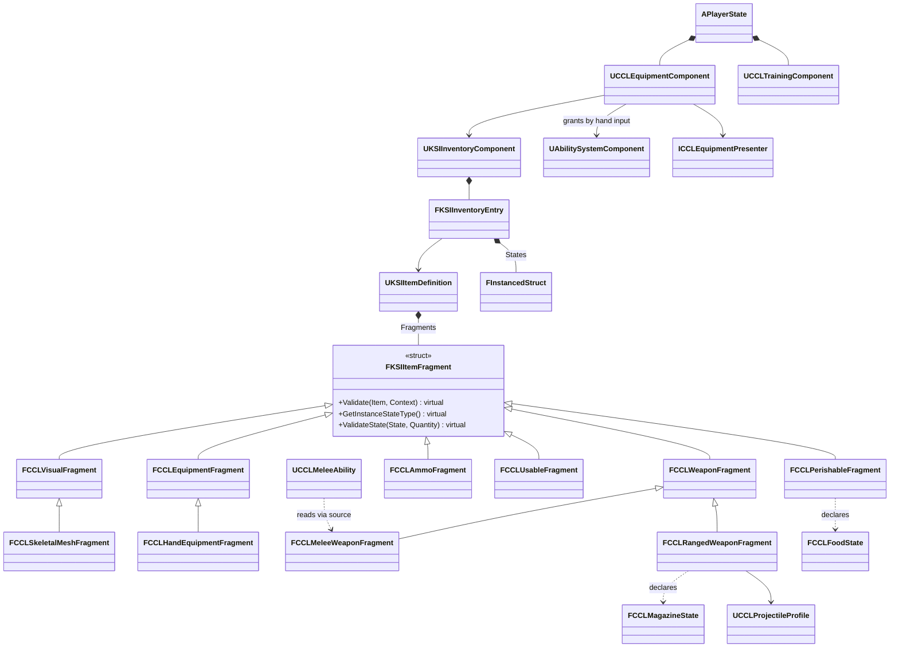

# 아이템 축 재설계 검토 (2026-11-19)

아이템 정의·Fragment·인스턴스 상태·인벤토리·장비·손 입력을 새로 만든다고 가정하고 현재 구조를 다시 판단한 검토안이다. 사용자가 2026-11-19에 제시한 Fragment 계층을 출발점으로 삼았다. 이 문서는 검토 당시의 후보다. 사용자와 정한 결과는 [결정 68](../decisions/0068-item-fragment-hierarchy.md)-[72](../decisions/0072-auto-usage.md)이고, 목표 구조는 [장비의 재설계 계약](Equipment.md#재설계-계약)이 소유한다. 아래 초안의 `PrimaryAbility`·`SecondaryAbility` 같은 손 장비 필드는 결정 69의 무브셋으로 바뀌었다. 사용한 스킬은 `ccl8-design`(주 담당), `ccl8-review`(규칙 축), `game-designer-assistant`(아이템 종류의 게임 규칙)다. 엔진 근거는 UE 5.8.3 소스다.

## 요약

- **사용자 안의 방향은 맞다.** Display·Stack·Combat UObject Fragment는 지금도 이전 에셋을 읽는 호환 경로일 뿐이고, 새로 만들면 지울 대상이다. Shield를 표현할 HandEquipment와 탄약 종류를 표현할 Ammo는 현재 구조의 실제 결함을 고친다.
- **고칠 점은 네 가지다.** `U` 접두사(UObject Fragment)는 [결정 15](../decisions/0015-struct-fragments-and-two-handed-gear.md)의 번복이라 이유가 필요하다. 원거리 무기와 Perishable이 빠졌다. Consumable을 빼면 회복약·음식의 사용 경로를 대신할 것이 필요하다. HarvestTool은 읽는 시스템이 없다.
- **Fragment보다 큰 문제는 주변에 있다.** 손 행동 경로 셋과 능력 부여 경로 둘이 겹친다. 인스턴스 상태가 모든 기능의 필드를 담은 구조체 하나다. Loadout이 장비·훈련·손 입력·재장전·결과 문구를 함께 소유한다. 인벤토리는 friend 6개와 외부에서 조작하는 잠금 플래그에 의존한다.
- **추천안**은 구조체 Fragment를 유지하되 검증·상태 선언을 Fragment 자신에게 옮기는 것이다. 장착하면 손 장비가 GAS 능력을 손 입력 태그로 부여하게 해 손 행동 경로를 하나로 줄이고, 인벤토리 변경은 RAII 편집 객체 하나로 처리한다.

## 사용자 안의 판단

| 사용자 안 | 판단 | 이유와 고칠 점 |
|---|---|---|
| Combat·Display·Stack·Consumable 제거 | Display·Stack·Combat은 동의, Consumable은 조건부 | Display·Stack은 이미 정의 필드(`ItemName`, `MaxStackCount`)이고 Combat은 Weapon에 흡수됐다. 세 UObject는 `PostLoad` 변환에서만 읽는다(`Source/CCL/Items/CCLItemDefinition.cpp:13`). 새로 만들면 변환 코드·숨긴 이전 필드·`FragmentSchemaVersion`·`ECCLEquipmentSlot`까지 함께 사라진다. Consumable은 회복약(`CCLLoadoutComponent.cpp:291`)과 음식 사용이 쓰므로 대체 경로를 정해야 한다. 아래 [게임 규칙](#게임-규칙-축) 참고 |
| `U` 접두사, UObject Fragment | 구조체 유지 추천 | 아래 [대안 1](#7-대안) 참고. UObject로 가려면 결정 15를 새 결정으로 번복한다 |
| Visual ← SkeletalMesh | 동의, 필드 이름 정리 | 결정 15에서 사용자가 지정한 형태와 같다. 다만 `DroppedMesh`는 장착용 정적 메시로도 쓰이므로(`CCLFighterComponent.cpp:291`) `WorldMesh` 같은 이름이 맞다. 슬롯별 부착 정보는 Visual보다 Equipment가 소유하는 편이 검증이 한 Fragment 안에서 끝난다 |
| Weapon ← MeleeWeapon | 동의, 원거리 추가 | 지금 `FCCLItemFragment_MeleeWeapon`은 빈 구조체다(`CCLItemFragments.h:160`). 삭제 시험에서 남을 이유가 없다. 새 안에서는 근접 공격 정의를 MeleeWeapon이 소유해 내용이 생긴다. 권총·소총 콘텐츠가 있으므로 RangedWeapon이 필요하다 |
| Equipment ← HandEquipment | 강하게 동의 | 지금 방패는 Guard 손 행동을 얻으려고 공격 정의를 가진 MeleeWeapon으로 만든다(`Source/CCLEditor/Private/CCLProgressionAssetLibrary.cpp:206-208`). 손 점유·한손/양손·손 입력은 무기가 아니라 손 장비의 성질이다. 다만 [결정 16](../decisions/0016-tagged-slots-and-attachments.md)이 양손 여부를 Weapon에 두었으므로 새 결정이 필요하다 |
| HarvestTool | 보류 추천 | 읽는 코드가 없다. `FCCLItemFragment_HarvestTool`의 `ResourceType`·`Tier`는 정의 외에 참조가 0건이다. 채집 루프를 설계할 때 자원 노드의 요구 태그와 함께 만든다([Coding/Design](../Coding/Design.md)의 "가상의 기능을 위해 클래스 계층을 늘리지 않는다") |
| Ammo | 동의 | 지금 탄약은 Fragment가 없고 `UCCLProjectileProfile::Ammunition`이 특정 정의 하나를 가리킨다(`Source/CCL/Actions/CCLWeaponAbility.h:51`). 화살 종류·특수 탄처럼 한 무기가 여러 탄을 받으려면 탄약 종류 태그가 필요하다 |
| (누락) Perishable | 추가 필요 | 음식 부패는 정의 정책과 묶음별 상태를 가진 실제 기능이다(`CCLFoodState.h`, 395줄 구현). 목록에서 빠지면 안 된다 |

## 현재 구조에서 확인한 문제

사실(코드에서 확인)만 적는다.

1. **손 행동 경로가 셋이다.** 고정 enum 행동(`ECCLHandAction` Attack·Guard·Parry, `CCLItemFragments.h:153-156`)은 `PrepareHandAction`이 활성 아이템을 고르고 `ServerPrepareHandAction`을 먼저 보낸 뒤 GAS 입력을 보낸다(`CCLLoadoutComponent.cpp:500`). 같은 Actor 채널의 RPC 순서에 기대는 숨은 전제다. 사용자 정의 행동은 `HandActions` 태그 맵과 `ServerCustomHandAction`으로 따로 간다(`CCLLoadoutComponent.cpp:615-689`). 재장전은 `ServerReload`가 두 손을 차례로 시도한다.
2. **능력 부여 경로가 둘이다.** `UKSIAbilitySet`은 Avatar 초기화 때 활성 아이템 하나에만 부여된다(`CCLFighterComponent.cpp:180`). `UKSIActionSet`은 첫 입력 때 GUID별로 늦게 등록된다(`CCLLoadoutComponent.cpp:680`). 같은 일을 하는 두 계약이다.
3. **같은 데이터가 두 곳에 있다.** ProjectileWeapon의 `ProjectileClass`·`LaunchSpeed`·`ReloadSeconds`(`CCLItemFragments.h:174-180`)는 읽는 곳이 없고 실제 값은 `UCCLProjectileProfile`에서 읽는다. 전투 정의도 Weapon의 `Combat`과 Profile의 `Combat`에 이중으로 있다.
4. **인스턴스 상태가 구조체 하나다.** `FCCLItemState`는 모든 항목에 `LoadedAmmo`와 `Food`를 함께 둔다(`CCLItemState.h:12-14`). 새 상태 기능을 넣으면 이 구조체·저장 코덱·검증이 모두 바뀐다. 탄창 검증은 `CCLInventoryWeapon.cpp:65`와 `CCLSessionRecord.cpp:125`에 중복된다.
5. **검증이 정의 클래스 한곳에 몰려 있다.** `UCCLItemDefinition::ValidateDefinition`이 모든 Fragment 종류를 알고 개수를 센다(`CCLItemDefinition.cpp:130`). Fragment를 추가할 때마다 이 함수를 고쳐야 한다. 장착할 때마다 런타임에서 다시 검증한다(`CCLLoadoutComponent.cpp:99`).
6. **Loadout이 너무 많은 것을 소유한다.** 장비, 효과 핸들, 훈련·포인트, 손 입력, 재장전, 결과 문구 복제가 한 컴포넌트에 있다. `Use`는 회복을 전제로 체력 속성을 직접 확인한다(`CCLLoadoutComponent.cpp:319`).
7. **인벤토리 경계가 새고 있다.** `UCCLInventoryComponent`는 friend 6개를 둔다(`CCLInventoryComponent.h:38-43`). 기능 서비스가 `List.Entries`를 직접 고치고, Loadout은 다른 컴포넌트의 `bMutationLocked`를 `TGuardValue`로 바꾼다(`CCLLoadoutComponent.cpp:169`, `:269`, `:338`, `:364`). 잠금·트랜잭션·재진입 순서를 호출자가 알아야 하는 얕은 모듈이다.
8. **슬롯 규칙이 코드에 박혀 있다.** `CCLEquipment::IsHand`가 두 태그를 비교하고, 이전 데이터 변환은 손·반지 슬롯을 하나씩 추가한다(`CCLItemDefinition.cpp:64-78`). 태그 계층(`Equipment.Slot.Hand.*`)을 쓰면 부모 태그 하나로 허용 범위를 표현할 수 있다.

## 1. 목표와 제약

- 확정: 정의는 ItemDefinition과 Fragment 조합([결정 9](../decisions/0009-genre-independent-base-systems.md)), 선택 기능은 `FInstancedStruct`(결정 15), 슬롯·부착 지점은 태그(결정 16), 공용 인벤토리는 `KSIInventory`, 게임 확장은 CCL([결정 24](../decisions/0024-shared-save-and-inventory.md)), 무기·탄약은 CCL([결정 25](../decisions/0025-shared-combat-split.md)), 모든 무기 사용 목표([결정 37](../decisions/0037-unrestricted-protagonist-weapons.md)), 플레이어 ASC는 PlayerState 소유([결정 11](../decisions/0011-minimal-combat-and-asc-lifetime.md)), 서버 권위와 Fast Array 복제([인벤토리 계약](Inventory.md#계약과-일관성)).
- 이번 목표: 같은 일을 하는 경로를 하나로 줄인다. Fragment를 추가할 때 정의 클래스·저장 코덱·검증 함수를 고치지 않게 한다. 호출자가 잠금·순서를 몰라도 되게 한다.
- 미정: 회복 방식(소모품·충전식·음식), 채집 루프, 양손 잡기 전환, 내구도. 이 문서는 이것들을 확정하지 않는다.
- 새로 만든다는 가정이므로 이전 에셋·저장 형식 변환은 범위 밖이다. 실제 이행을 고를 때 변환 비용을 따로 계산한다.

## 2. 책임과 수명

| 구성 | 책임 | 소유자·수명 | 권위 |
|---|---|---|---|
| `UKSIItemDefinition` | 이름·설명·아이콘·최대 중첩·Fragment 보관, Fragment별 검증 호출 | 에셋 | 읽기 전용 |
| `FKSIItemFragment` 파생 | 기능 하나의 정의, 자기 검증, 필요한 인스턴스 상태 타입 선언 | 정의 에셋 안의 값 | 읽기 전용 |
| 인스턴스 상태 구조체 | 탄창·음식 묶음처럼 개별 아이템마다 바뀌는 값 | 인벤토리 항목 | 서버, 소유자에게 복제 |
| `UKSIInventoryComponent` | GUID·정의·수량·가방 위치·상태 보관, 편집 객체로만 변경 | PlayerState 또는 상자 Actor | 서버 |
| `FKSIInventoryEdit` | 변경 후보 작성, 검증 뒤 한 번에 확정, 실패 시 원상태, 알림 한 번 | 호출 스택 | 서버 |
| `UCCLEquipmentComponent` | 슬롯 점유, 장비 효과와 능력의 부여·회수, 외형 요청 | PlayerState | 서버, 장착 목록 복제 |
| `UCCLTrainingComponent` | 포인트와 습득 스킬 | PlayerState | 서버 |
| `ICCLEquipmentPresenter` | 현재 Avatar에 장비 메시 표시 | Avatar의 컴포넌트 | 각 머신에서 복제 목록으로 표시 |
| 무기·사용 능력(`UGameplayAbility`) | 공격·가드·발사·재장전·사용의 실행. 소스 아이템에서 데이터를 읽음 | ASC | GAS 예측 |

## 3. 클래스 다이어그램



Fragment별 내용:

| Fragment | 필드 | 읽는 시스템 |
|---|---|---|
| `FCCLVisualFragment` | `WorldMesh`(정적 메시: 월드 표시, 정적 장착 메시) | WorldPickup, Presenter |
| `FCCLSkeletalMeshFragment` | `EquippedMesh`, `AnimClass` | Presenter |
| `FCCLEquipmentFragment` | `AllowedSlots`(부모 태그 허용), `DefaultSlot`, `Attachments`(슬롯→부착 지점·오프셋), `Effects`(`FKSIEffectGrant` 배열) | EquipmentComponent, Presenter |
| `FCCLHandEquipmentFragment` | `HandUsage`, `PrimaryAbility`(쥔 손 입력), `SecondaryAbility`(양손일 때 반대 손 입력), `ExtraAbilities`(재장전처럼 고정 입력) | EquipmentComponent |
| `FCCLWeaponFragment` | `WeaponType` 태그(숙련·애니메이션 세트 선택) | 무기 능력, 이후 숙련 |
| `FCCLMeleeWeaponFragment` | `Attacks`(`UCCLCombatDefinition` 배열, 콤보 순) | 근접 능력 |
| `FCCLRangedWeaponFragment` | `Profile`, `AcceptedAmmo` 태그, `MagazineSize` → 상태 `FCCLMagazineState` | 발사·재장전 능력 |
| `FCCLAmmoFragment` | `AmmoType` 태그 | 재장전 능력 |
| `FCCLUsableFragment` | `UseAbility`, `bConsumeOnUse` | 사용 요청 |
| `FCCLPerishableFragment` | `Policy` → 상태 `FCCLFoodState` | 음식 기능, 저장 |

이름은 사용자 안의 접미사 형식(`FCCLVisualFragment`)이 현재의 `FCCLItemFragment_Visual`보다 읽기 쉽다. 손·무기 계열은 Fragment 하나만 허용한다. `FindFragment<T>`가 파생형도 찾으므로(`KSIItemDefinition.h`의 `GetPtr<T>`) 같은 계열이 둘이면 결과가 순서에 달린다.

## 4. 호출 예

```cpp
// PlayerController: the hand input no longer selects an item or sends a preparing RPC.
ASC->AbilityInputTagPressed(CCLTags::Input_Hand_Left);

// Inventory screen: equip to a slot and show a localized reason on failure.
const ECCLEquipResult Result = Equipment->Equip(ItemId, CCLItemTags::Slot_Hand_Left);

// Melee ability: weapon data comes from the item that granted this ability.
const UKSIItemDefinition* Item = Cast<UKSIItemDefinition>(GetCurrentSourceObject());
const FCCLMeleeWeaponFragment* Melee = Item ? Item->FindFragment<FCCLMeleeWeaponFragment>() : nullptr;

// Food service: one edit object instead of friend access and lock flags.
FKSIInventoryEdit Edit(*Inventory);
FCCLFoodState* Food = Edit.FindState<FCCLFoodState>(ItemId);
Food->Lots[0].Quantity -= 1;
Edit.Commit();
```

호출자가 알아야 하는 것은 입력 태그, 장착 결과, 소스 아이템, 편집 객체뿐이다. 활성 아이템 선택, RPC 선행 순서, 잠금 플래그는 호출자에게서 사라진다.

## 5. 인터페이스 초안

```cpp
// KSIInventory/Public/KSIItemFragment.h
struct FKSIItemValidation
{
	const UKSIItemDefinition& Item;
	TArray<FText>& Errors;

	void Error(const FText& Message) const { Errors.Add(Message); }
	template <class T> bool Require(const TCHAR* Reason) const;
};

USTRUCT()
struct KSIINVENTORY_API FKSIItemFragment
{
	GENERATED_BODY()

	virtual ~FKSIItemFragment() = default;

	virtual void Validate(const FKSIItemValidation& Context) const {}

	// Per-instance state this fragment needs, or null for a stateless fragment.
	virtual const UScriptStruct* GetInstanceStateType() const { return nullptr; }

	virtual bool ValidateState(const FInstancedStruct& State, int32 Quantity) const { return true; }
};

// KSIInventory/Public/KSIInventoryComponent.h
USTRUCT()
struct KSIINVENTORY_API FKSIInventoryEntry : public FFastArraySerializerItem
{
	GENERATED_BODY()

	template <class T> const T* FindState() const;

	UPROPERTY()
	FGuid Id;

	UPROPERTY()
	TObjectPtr<const UKSIItemDefinition> Definition;

	UPROPERTY()
	int32 Quantity = 0;

	// INDEX_NONE means the item is owned but not placed in the bag, for example while equipped.
	UPROPERTY()
	int32 BagSlot = INDEX_NONE;

	// One state per stateful fragment, created from GetInstanceStateType when the entry is added.
	UPROPERTY()
	TArray<FInstancedStruct> States;
};

class KSIINVENTORY_API FKSIInventoryEdit
{
public:
	explicit FKSIInventoryEdit(UKSIInventoryComponent& Inventory);
	~FKSIInventoryEdit();

	FGuid Add(const UKSIItemDefinition& Definition, int32 Quantity);
	bool Remove(FGuid Id, int32 Quantity);
	bool Place(FGuid Id, int32 BagSlot);
	template <class T> T* FindState(FGuid Id);

	// Validates the staged list, replaces the replicated list and publishes one change.
	bool Commit();

	bool IsOpen() const { return bOpen != 0; }

private:
	UKSIInventoryComponent& Inventory;
	TArray<FKSIInventoryEntry> Staged;
	uint8 bOpen = 0;
};

// CCL/Items/CCLEquipmentComponent.h
UENUM()
enum class ECCLEquipResult : uint8
{
	Equipped,
	Unequipped,
	NotOwned,
	SlotNotAllowed,
	NoBagSpace,
	Busy,
	EffectRejected
};

UCLASS()
class CCL_API UCCLEquipmentComponent : public UActorComponent
{
	GENERATED_BODY()

	// 내 클래스 함수
public:
	ECCLEquipResult Equip(FGuid ItemId, FGameplayTag Slot = FGameplayTag());
	ECCLEquipResult Unequip(FGuid ItemId, int32 BagSlot = INDEX_NONE);

	// Reapplies granted abilities and presentation after the avatar changes.
	void BindAvatar();

	FGuid GetItemIn(FGameplayTag Slot) const;
	FGuid FindItemForAbility(FGameplayAbilitySpecHandle Handle) const;

	FCCLEquipmentChanged OnChanged;

private:
	TOptional<FCCLEquipPlan> MakePlan(FGuid ItemId, FGameplayTag Slot, ECCLEquipResult& OutResult) const;
	bool Grant(const FCCLEquippedItem& Item, FCCLGrantedHandles& OutHandles);
	void Revoke(FGuid ItemId);

	// 프로퍼티
private:
	UPROPERTY(Replicated)
	TArray<FCCLEquippedItem> Equipped;

	TMap<FGuid, FCCLGrantedHandles> Granted;
};
```

`FKSIEffectGrant`는 Equipment·Usable·Skill이 반복하는 `Effect`+`Magnitude` 쌍(`CCLItemFragments.h:63-66`, `:75-78`, `CCLSkillDefinition.h`)을 `TSubclassOf<UGameplayEffect>`와 SetByCaller 태그·값 배열로 합친 구조체다. 효과 하나에 능력치 여러 개를 줄 수 있다.

결과는 복제 `FString`(`CCLLoadoutComponent.cpp:418`) 대신 `ECCLEquipResult`를 돌려주고, 원격 요청은 Client RPC로 결과 코드만 보낸다. 문구는 UI가 지역화 텍스트로 고른다.

## 6. 코드 예시

장착 확정 경로다. 검증은 `MakePlan`이 순수하게 끝내고, 적용은 편집 객체와 GAS 부여를 한 범위에서 한다.

```cpp
ECCLEquipResult UCCLEquipmentComponent::Equip(FGuid ItemId, FGameplayTag Slot)
{
	ECCLEquipResult Result = ECCLEquipResult::Busy;
	TOptional<FCCLEquipPlan> Plan = MakePlan(ItemId, Slot, Result);
	if (!Plan)
	{
		return Result;
	}

	FKSIInventoryEdit Edit(*GetInventory());
	for (const FCCLReturnedItem& Returned : Plan->Returned)
	{
		Edit.Place(Returned.Id, Returned.BagSlot);
	}

	Edit.Place(ItemId, INDEX_NONE);

	FCCLGrantedHandles Handles;
	if (!Grant(Plan->Item, Handles))
	{
		// The edit is not committed, so the destructor restores the inventory.
		return ECCLEquipResult::EffectRejected;
	}

	if (!Edit.Commit())
	{
		RevokeHandles(Handles);
		return ECCLEquipResult::Busy;
	}

	for (const FCCLReturnedItem& Returned : Plan->Returned)
	{
		Revoke(Returned.Id);
	}

	Granted.Add(ItemId, MoveTemp(Handles));
	Equipped = MoveTemp(Plan->Equipped);
	Present();
	return ECCLEquipResult::Equipped;
}

bool UCCLEquipmentComponent::Grant(const FCCLEquippedItem& Item, FCCLGrantedHandles& OutHandles)
{
	UAbilitySystemComponent* ASC = GetASC();
	const UKSIItemDefinition* Definition = Item.Definition;
	const auto* Equip = Definition->FindFragment<FCCLEquipmentFragment>();
	if (!ASC || !Equip)
	{
		return false;
	}

	for (const FKSIEffectGrant& Effect : Equip->Effects)
	{
		const FActiveGameplayEffectHandle Handle = Effect.ApplyTo(*ASC, Definition);
		if (!Handle.IsValid())
		{
			RevokeHandles(OutHandles);
			return false;
		}

		OutHandles.Effects.Add(Handle);
	}

	if (const auto* Hand = Definition->FindFragment<FCCLHandEquipmentFragment>())
	{
		const FGameplayTag HeldInput = CCLEquipment::InputForHand(Item.PrimarySlot);
		GiveHandAbility(*ASC, Hand->PrimaryAbility, HeldInput, Definition, OutHandles);

		if (Hand->IsTwoHanded())
		{
			GiveHandAbility(*ASC, Hand->SecondaryAbility, CCLEquipment::OtherHandInput(HeldInput), Definition, OutHandles);
		}

		for (const FKSIAbilityGrant& Extra : Hand->ExtraAbilities)
		{
			GiveHandAbility(*ASC, Extra.Ability, Extra.InputTag, Definition, OutHandles);
		}
	}

	return true;
}
```

`GiveHandAbility`는 `FGameplayAbilitySpec`의 `SourceObject`에 정의를 넣고 `GetDynamicSpecSourceTags()`에 입력 태그를 넣은 뒤 `GiveAbility`를 호출한다. 엔진 근거는 `Engine/Plugins/Runtime/GameplayAbilities/Source/GameplayAbilities/Public/GameplayAbilitySpec.h:211`(`SourceObject`)과 `:248`(`GetDynamicSpecSourceTags`), 능력 쪽 조회는 `Abilities/GameplayAbility.h:410`(`GetCurrentSourceObject`)이다. 입력 태그로 능력을 누르는 경로는 이미 `UKSIAbilitySystemComponent::AbilityInputTagPressed`에 있다. 빈 손은 캐릭터 설정의 맨손 HandEquipment 데이터를 같은 방식으로 부여한다. `Build.cs` 의존은 늘지 않는다.

## 7. 대안

1. **UObject Fragment(사용자 안의 `U` 접두사, Lyra의 `ULyraInventoryItemFragment` 방식).** 얻는 것: 블루프린트로 Fragment를 상속해 만들 수 있고, `UFUNCTION`·인스턴스 생성 훅 같은 UObject 기능을 쓴다. 잃는 것: Fragment마다 서브오브젝트가 생겨 GC·로드 비용이 늘고, Instanced 서브오브젝트의 복제·복사 규칙을 따로 관리해야 한다. 구조체도 가상 함수를 가질 수 있어(`Engine/Plugins/Runtime/StateTree/Source/StateTreeModule/Public/StateTreeNodeBase.h:91`, `:129`가 `FInstancedStruct`로 보관하는 노드의 가상 소멸자·`Compile`) 자기 검증·상태 선언에는 UObject가 필요 없다. ccl8은 Fragment를 C++로 작성하므로 블루프린트 상속의 이득이 작다. 구조체 유지를 추천한다.
2. **상속 없는 평면 Fragment.** SkeletalMesh를 Visual과 별개로, Melee·Ranged를 Weapon 없이 둔다. 계열 중복 판정이 단순하지만 "무기인가"를 묻는 곳마다 종류를 모두 나열해야 한다. 사용자 안의 계층이 질의를 더 줄인다.
3. **현재의 고정 손 행동 enum 유지.** Attack·Guard·Parry 세 가지면 데이터가 단순하고 기존 예측 순서가 검증돼 있다. 하지만 사용자 정의 행동 경로가 이미 따로 생겼고(총기), 결정 37의 무기 자유와 방패·횃불 같은 손 장비가 늘면 enum과 맵이 계속 같이 자란다. 능력 부여로 하나로 합친다.
4. **장비를 별도 컨테이너로 옮기기.** 장착하면 가방 인벤토리에서 장비 인벤토리로 이동한다. `BagSlot == INDEX_NONE`이라는 묵시적 의미가 사라지지만, 이동·저장·양손 점유가 두 컨테이너에 걸쳐 복잡해진다. 소유 목록 하나를 유지하고 의미를 필드 이름·주석으로 드러내는 편이 싸다.
5. **아이템 종류별 정의 클래스(`UCCLWeaponDefinition` 등).** Coding/Design이 기본값이 아니라고 정했다. 고르지 않는다.
6. **인스턴스 상태를 하나만 허용.** 항목당 상태 하나로 두고 상태 Fragment 하나만 허용하면 지금 구조와 비슷하게 단순하다. 탄창과 내구도를 함께 가진 무기가 생기면 다시 바뀐다. 배열이 비용 대비 안전하다.

정의 식별은 `UCCLItemCatalog`의 이름 목록 대신 `UPrimaryDataAsset::GetPrimaryAssetId`(`Engine/Source/Runtime/Engine/Classes/Engine/DataAsset.h:53`)와 Asset Manager 설정을 쓰는 안도 있다. 수동 목록과 중복 이름 검사가 사라지지만, 저장이 임의 경로를 로드하지 않는다는 현재 보안 경계(`CCLItemCatalog.h`)를 Asset Manager 유형 제한으로 다시 증명해야 한다. 카탈로그가 훈련 스킬까지 소유하는 것은 이름과 책임이 어긋나므로 분리한다.

## 8. 검증 방법

실행 전 예상: 정의 검증은 Fragment 추가 없이 기존 규칙(계열당 하나, 장비 중첩 1, 부착 지점 유효성)을 모두 거절한다. 장착 실패는 인벤토리·효과·능력을 남기지 않는다.

- 자동화 테스트: Fragment별 `Validate`(손 장비의 비손 슬롯, 한손의 `SecondaryAbility`, 원거리의 탄약 태그 누락), `MakePlan`의 순수 계산(양손 교체 시 두 손 반환, 가방 공간 부족), 능력 부여 매핑(왼손 한손→`Input.Hand.Left`, 양손→두 입력), 편집 객체의 미확정 소멸 시 복원과 알림 1회. 기존 `CCL.Equipment.TagContracts`, `CCL.Items.Loadout.EquipAndUse`를 새 계약으로 옮긴다.
- 실행 검증: `run_campaign_smoke.ps1 -Progression`을 Standalone·Dedicated·Listen에서. 원격 클라이언트에서 공격·가드·발사·재장전의 예측 실행과 서버 판정 일치, 장비 교체 직후 입력, 재스폰 뒤 능력 재부여를 본다.
- 성능 주장은 없다. 능력 부여·회수가 장비 교체마다 생기므로 측정하려면 Dedicated 서버에서 교체 반복 시 `stat net`과 ASC 활성 스펙 수를 본다.

## 9. 검토에 필요한 설명

- `FInstancedStruct`는 UE 5.0의 StructUtils 플러그인에서 시작했고 현재는 CoreUObject에 있다(`Engine/Source/Runtime/CoreUObject/Public/StructUtils/InstancedStruct.h`). UE4에는 없다. UE4 방식은 `Instanced` UObject 배열이었다.
- 입력 태그로 능력을 누르는 방식은 UE4 시절의 `InputID` 정수 바인딩을 대신하는 Lyra 관례다. `DynamicAbilityTags`는 5.5에서 `GetDynamicSpecSourceTags`로 이름이 바뀌었다(`GameplayAbilitySpec.h:242`의 폐기 표시).
- `AActor::FindComponentByInterface`는 5.5에서 템플릿 판의 형변환 문제로 폐기 표시가 붙었다(`Engine/Source/Runtime/Engine/Classes/GameFramework/Actor.h:3844`). `FindPresenter`의 컴포넌트 순회는 `FindComponentByInterface<ICCLEquipmentPresenter>()`로 줄일 수 있다.
- `GiveAbilityAndActivateOnce`(`AbilitySystemComponent.h:958`)는 Usable의 한 번 사용 능력을 부여와 동시에 실행한다.

## 게임 규칙 축

`game-designer-assistant` 관점의 판단이다. 분석이며 플레이로 확인한 재미가 아니다.

| 항목 | 판단 | 정할 것 |
|---|---|---|
| 회복 | 소울라이크에서 회복을 소모품 더미로 두면 반복 획득으로 위험이 사라지기 쉽다. 쉼터에서 다시 채우는 충전식 회복은 한 번의 탐험 안에서 자원 판단을 만든다. 음식은 환경·부패 시스템과 이어지는 별도 회복·생활 자원이 될 수 있다 | 충전식·소모품·음식 중 무엇을 회복의 중심으로 둘지. 어느 쪽이든 Usable(능력 실행)로 표현되므로 Consumable(효과+수치)은 필요 없다 |
| 중첩 | 탄약·재료·음식에 필요하다. Fragment가 아니라 정의 필드로 충분하다 | 없음 |
| 손 장비 | 한손 무기+방패, 양손 무기, 쌍수가 같은 구조로 표현된다. 한손 무기를 양손으로 잡는 전환은 `HandUsage` 값 하나(`Either`)로 넓힐 수 있다 | 양손 잡기 전환의 포함 여부 |
| 원거리 | 권총·소총 콘텐츠와 결정 37 때문에 유지한다. 탄약 종류 태그로 화살 종류·특수 탄을 데이터로 늘릴 수 있다 | 첫 장에서 원거리를 실제로 쓰는지 |
| 채집 도구 | 도구 등급이 자원 접근을 막는 구조는 탐험 보상을 만들지만, 첫 장 범위에서 루프가 정해지지 않았다 | 채집 루프 설계 뒤에 Fragment를 만든다 |

## 규칙 축 지적

`ccl8-review` 형식이다. 기계 검사 `node Tools/Agent/cpp-rules.cjs check --summary Source/CCL/Items Source/KSIInventory Source/KSICombat`는 0건이다. 아래는 검사기가 보지 않는 항목이다.

- `[설계 위험]` **지침 충돌.** AGENTS.md는 코드 주석을 영어로 쓰라고 하고, [C++ 배치 규칙](../Coding/CppLayout.md#헤더-배치)의 예시는 `// 내 클래스 함수` 같은 한국어 영역 주석을 쓴다. 영역 주석을 쓴 헤더는 32개뿐이다(헤더 약 197개). 다음 작업자가 어느 쪽을 따를지 정할 수 없다. 판정: `검토`. 영역 주석을 영어로 바꾸거나 영역 주석만 예외로 명시한다.
- `[개선]` **들여쓰기 혼용.** `Source/KSIInventory/Public/KSIInventoryComponent.h`(72줄), `KSIItemDefinition.h`(27줄), `Source/KSICombat/Public/KSICombatDefinition.h`, `Source/CCL/AbilitySystem/CCLAbilitySet.h`, `CCLInventoryComponent.h:27-28`이 공백 들여쓰기다. `.clang-format`은 탭이지만 `format` 검사는 바뀐 줄만 본다. 판정: `조치`. 형식만 바꾸는 커밋으로 정리하고 `cpp-rules.cjs`에 들여쓰기 규칙을 더한다.
- `[개선]` **영역 구분 누락.** `KSIInventoryComponent.h`는 `public:` 묶음이 빈 줄 없이 이어지고 오버라이드·일반 함수·RPC 영역 구분이 없다. `CCLLoadoutComponent.h:54-70`은 RPC, 내부 함수, `static` 조회 함수가 한 `private` 묶음에 섞였다. 판정: `조치`.
- `[설계 위험]` **C++ 안의 사용자 문구.** 결과 문구(`CCLLoadoutComponent.cpp`의 `Report` 호출들)와 에셋 이름(`CCLProgressionAssetLibrary.cpp`의 `Labels`)이 한국어 리터럴이고 결과는 `FString`으로 복제된다. 지역화가 불가능하고 매번 문자열을 보낸다. 판정: `조치`(재설계 시 결과 코드로).
- `[설계 위험]` **부작용 있는 조회.** `FKSIInventoryEntry::GetState<T>()`의 비상수 판은 상태가 없으면 만든다(`KSIInventoryComponent.h:25`). 상수 판은 함수 정적 빈 값을 돌려줘 "없음"과 "기본값"을 구분할 수 없다(`:18`). 이름만 보고 잘못 쓰기 쉽다. 판정: `조치`. `FindState`(포인터)와 `FindOrAddState`로 나눈다.
- `[개선]` **friend와 정적 전용 클래스.** `CCLInventoryComponent.h:38-43`의 friend 6개, 정적 함수만 가진 `FCCLInventoryFood`·`FCCLInventoryWeapon`. 판정: `검토`. 편집 객체 API로 friend를 없애고, 상태 없는 함수 묶음은 namespace로 둔다.
- `[개선]` **한 줄 다중 선언과 불리언 산술.** `CCLItemDefinition.cpp:137`의 `int32 EquipCount = 0, WeaponCount = 0, ...`, `:145`의 포인터 비교 결과 더하기. CppLayout의 "한 줄에 실행문 하나"와 어긋난다. 판정: `조치`.
- `[개선]` **같은 술어의 반복.** `[Id](const FKSIInventoryEntry& E) { return E.Id == Id; }`가 여러 파일에 있다(`CCLInventoryWeapon.cpp:14`, `:29` 등). 한 줄 람다 본문은 `.clang-format`의 `BeforeLambdaBody`와도 다르다. 판정: `참고`. 편집 객체의 `Find`로 흡수된다.
- `[개선]` **쓰지 않는 전방 선언.** `CCLItemDefinition.h`의 `UCCLCombatDefinition`, `UCCLAbilitySet`, `UGameplayEffect`, `UTexture2D`, 여러 헤더의 `UCCLItemDefinition`. 판정: `참고`.
- `[개선]` **파일 이름과 내용 불일치.** `CCLItemTags.h`가 태그와 함께 장비 규칙(`CCLEquipment` namespace)을 소유한다. 판정: `참고`. 슬롯 규칙은 `CCLEquipmentSlots.h`로 나눈다.
- `[개선]` **`auto` 사용량.** `CCLLoadoutComponent.cpp`에 52곳이다. Epic 표준은 람다·반복자·긴 템플릿 타입 외의 `auto`를 줄이라고 한다. 프로젝트 규칙이 정하지 않았다. 판정: `검토`. 규칙으로 정할지 사용자가 고른다.

## 정할 것

1. Fragment를 구조체로 유지할지(결정 15 유지), UObject로 바꿀지(결정 15 번복).
2. 손 점유·양손 여부를 HandEquipment로 옮길지(결정 16 번복 또는 구체화).
3. 손 행동을 장착 시 능력 부여 하나로 합칠지.
4. 회복의 중심(충전식·소모품·음식)과 그에 따른 Usable 범위.
5. 이 안을 실제 이행할 때 기존 에셋·저장 형식 변환을 할지, 시험 데이터를 새로 만들지.
6. 규칙 축의 지침 충돌(영역 주석 언어)과 `auto` 규칙.

## 정한 결과

2026-11-19에 사용자와 위 여섯 항목을 정했다.

| 항목 | 결과 |
|---|---|
| 1. 구조체·UObject | 구조체 유지. [결정 68](../decisions/0068-item-fragment-hierarchy.md) |
| 2. 손 점유 | HandEquipment가 소유, 방어구를 포함한 모든 장비는 Equipment. 결정 68 |
| 3. 손 행동 | 손 입력 태그를 GAS로 바로 보내고 출처 등록부와 무브셋으로 부여. [결정 69](../decisions/0069-hand-input-and-ability-sources.md) |
| 4. 회복과 Usable | Consumable 대신 Usable. 사용 횟수는 `Quantity`로 표현한다. 회복의 중심은 미정. 결정 68 |
| 5. 이행 | 변환 없이 생성 라이브러리로 다시 만들고 이전 저장을 거절. [결정 70](../decisions/0070-rebuild-item-data-without-conversion.md) |
| 6. 주석 언어·`auto` | 설명은 한국어([결정 71](../decisions/0071-code-comment-language.md)), `auto`는 Epic 기준([결정 72](../decisions/0072-auto-usage.md)) |
